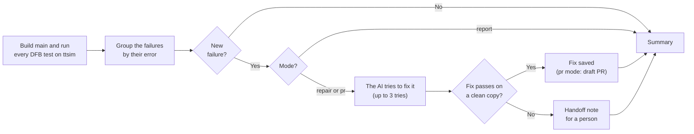
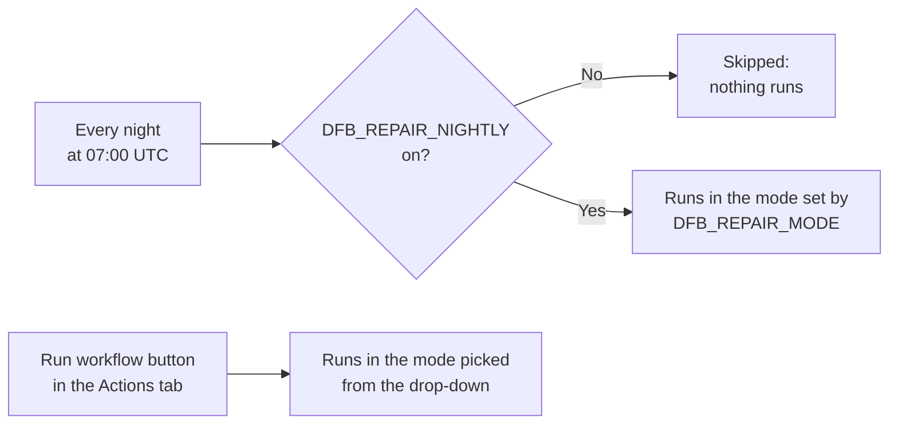

# DFB repair loop

Runs every Quasar DataflowBuffer (DFB) test on the ttsim simulator and, when tests fail, lets an AI agent (the GitHub
Copilot CLI with Claude Opus 5.5) try to fix them. A fix is kept only if it makes the failing tests pass on a clean copy
of main without making any other test worse. Verified fixes can be opened as draft PRs; what the AI cannot fix gets flaged with notes.

It runs every night once someone switches that feature on, and whenever someone starts it from the Actions tab. The AI cannot
weaken tests or push anything, and the code that judges its fixes is out of its reach.

## What one run does

A failure is not new when it is a known issue (`known_failures` in [repair_budget.yaml](repair_budget.yaml)), something
the simulator cannot do yet, or one that is already being dealt with: a person is on it, a fix or PR for it exists, or
the AI could not fix it in the last 7 days.

## Modes

| Mode | Builds and tests | AI fixes | Draft PRs | Use it to |
|---|---|---|---|---|
| `smoke` | no | one-word check | no | check that Copilot works, in a few minutes |
| `report` | yes | no | no | see what fails, with no AI cost |
| `repair` | yes | yes | no | get fixes to review (they are in the run's artifact) |
| `pr` | yes | yes | yes, at most 3 a night | have verified fixes opened as draft PRs |

Only `smoke`, `repair` and `pr` use Copilot AI credits. Each AI try is capped at 1000 AI credits
(`repair.copilot.max_ai_credits`).

## Starting a run

| How it starts | When | Mode |
|---|---|---|
| Nightly | 07:00 UTC, only while `DFB_REPAIR_NIGHTLY` is `on` (or `true`) | `DFB_REPAIR_MODE`, or `report` if it is unset |
| By hand | Actions tab > *[internal] DFB repair loop* > **Run workflow** | picked from the drop-down (default `report`) |
| On its own PR (testing only, until it merges) | each push, or adding a label | `smoke`; `repair` while the PR has the `dfb-repair-test` label; one `pr` run, which opens real draft PRs, each time the `dfb-repair-pr-mode` label is added |

Nightly and manual runs only exist once the workflow is on main. Until `DFB_REPAIR_NIGHTLY` is set, nothing runs
at night.

## Switches

Three repository variables, under Settings > Secrets and variables > Actions > Variables. Each run reads them when it
starts.

| Variable | Values | What it does |
|---|---|---|
| `DFB_REPAIR_NIGHTLY` | `on` (or `true`); anything else, or unset, is off | Turns the nightly run on or off. Off by default. Manual runs work either way. |
| `DFB_REPAIR_MODE` | `report` (default), `repair` or `pr` | The nightly run's mode. Manual runs use the drop-down instead. |
| `DFB_REPAIR_HANDLED` | failure group ids | Failures people are fixing themselves; the AI leaves them alone. |

A group id is the 10-character id in the first column of the summary's failure table, for example `cd1e94030d`.

To mark a failure as a known issue Add it to `known_failures` in [repair_budget.yaml](repair_budget.yaml) on main. It is still reported, but not given to the AI.

## Results

- **The run's Summary page** on GitHub: a one-line summary, test counts, each failure group and what happened to it,
  the fixes (small ones shown in full) and what needs a person.
- **The artifact `dfb-repair-run-<run id>`**: logs, the AI's attempts, saved fixes and handoff notes, kept for 14 days.
- **Draft PRs** (pr mode): titled `[DFB repair bot] ...`, from branches named `dfb-repair-bot/<date>-<group id>`.

The loop's job turns red only when the run could not judge the tests (the build, the simulator or the AI service
failed). Failing tests alone keep it green; they are listed in the summary.

## Details

<b>One run, step by step</b>

1. **Refresh.** Reset the bot's own checkout to `origin/main`, then apply any carried branches (fixes not merged yet).
2. **Build** `unit_tests_api` and install the ttsim release pinned in `tt_metal/ttsim-version`, the same way CI does.
3. **Test.** Run every DFB test, 16 at a time: about 590 device tests, one process per test, and about 290 host-only
   `CPU_` tests together in one process. That takes about 2 minutes on a 32-core machine with the loop's files on
   local disk, and about 10 minutes on a network filesystem. Each failure runs once more on its own, so one-off flakes
   are reported as flaky instead of failing.
4. **Group** the failures by signature: the failing check plus its message, without line numbers, so a group keeps its
   identity when code moves. Groups listed in `known_failures` (an open issue or a fix in flight) and simulator gaps
   are reported but never given to the agent.
5. **Repair** (repair and pr modes). Each new group gets up to 3 attempts by the agent, run headless with a fixed
   prompt (`prompt_template.md`) and a time limit. The agent is set by `repair.agent`: `copilot`, the GitHub Copilot
   CLI with Claude Opus 5.5 billed to the organization's Copilot, or `claude`, Claude Code with an Anthropic token or
   key. The agent writes `NOTES.md` (the PR description) or `HANDOFF.md` (what it found when it could not fix the
   problem). When the agent cannot work at all (no login, no access, no credits, an outage), the night stops its
   repairs and reports "the agent was not reachable", and the failures are tried again the next night.
6. **Verify.** The loop applies the saved patch to a clean tree, rebuilds, reruns the failing tests, then reruns the
   whole suite. The fix counts only if the failing tests pass and no other test got worse.
7. **Publish** (pr mode). Push each verified fix to `<prefix>/<date>-<group>` and open a draft PR. Without GitHub CLI
   login, the branch is pushed and the summary links to GitHub's PR form, where you choose "Create draft pull
   request". Before publishing, a fix that was verified with carried commits is rebuilt and retested on plain main. A
   verified fix that could not be published, for example because the push was refused, is re-verified (guards
   included) on a later night's tree and published then, without calling the model again. With `--outbox`, the fix is
   written as a plain patch with its message, for a separate job to commit and push (CI).
8. **Report.** Write `summary.md` (what passed, what failed, fixes, what needs a human) and `summary.json`, and update
   the state file that stops the same failure from being retried every night. Handoff reports and PR descriptions give
   reproduce commands for a tt-metal checkout of the tested commit.

<b>Safety rails</b>

- **Never weaken tests.** The guards reject a patch that adds `GTEST_SKIP`, disables a test, changes or removes a
  test assertion, adds an early `return;` or simulator-specific code to a test, or edits CI, CMake, yaml, skip lists,
  submodules or the simulator pin. A patch that adds simulator-specific code to product code is held for review, not
  published. `orchestrator.py --check-patch` runs the same guards on its own.
- **Verify the patch, not the agent's tree.** Edits to the CMake cache or to files the build generates are detected,
  rejected, and undone.
- **A narrow agent session.** With Claude Code, the agent has six tools (Bash, Read, Edit, Write, Grep, Glob), no web
  tools, no MCP servers and no claude.ai connectors, and it loads only the repository's Claude Code settings, never
  those of the user it runs as. With the Copilot CLI, sub-agents, web, skills, its session stores, hooks, MCP servers
  and custom instructions are switched off, sessions are not exported to GitHub, and each attempt starts from a fresh
  configuration directory with only a copy of the bot's login (in CI, only the job's token is used). Each agent gets
  only its own credential. Its deny rules (translated for each agent) block git commit and push, `gh` and killing
  processes, and its git can neither push to nor fetch from GitHub (in the partial clone, a search through old file
  contents then fails at once instead of downloading history for hours). Each attempt runs with a fresh home
  directory inside the run, so the agent and the tools it runs keep their files there, not in the home of the user it
  runs as, and nothing carries over between attempts. These are strong defaults, not a sandbox: its shell can still
  reach the network and whatever the user or job it runs as can reach. In CI it therefore runs in a throwaway
  container, with a token that can only read the repository and make Copilot requests (see below).
- **An agent session always ends.** An agent may wait for the commands it moved to the background before it exits;
  once its final result is written, it gets a minute to exit (15 minutes while background commands still run), and
  then whatever it left running is stopped.
- **The loop's own git and builds ignore what the agent could plant:** no global or system git config, no
  `core.fsmonitor`, no `ccache.conf` (ccache's settings come from the environment, so a planted `ccache.conf` cannot
  name another compiler), and build files regenerated from the sources when an attempt changed them.
- **Credentials go only where they are needed:** the model's to the agent, GitHub's to `gh`. The loop's own builds,
  tests and git never see them; the commands the agent runs inherit the agent's environment.
- **The agent cannot change the loop that judges it:** the run works from its own copy of this directory and rejects
  an attempt that changes that copy or the simulator files. In CI the tool directory is also mounted read-only. In the
  trial setup the agent runs as the user, so it could edit the live copy used by later nights; such a change is
  reported in the summary's notes.
- **Limits:** attempts per group and per night, a per-attempt time limit, a nightly deadline (in CI fitted to the
  job's time limit), and at most 3 PRs a night. Stray processes are found by an environment marker and killed.
- **No repeats and no duplicate PRs.** A group that was handed off, or that has a fix on disk, waits `rehandoff_days`.
  A group with a bot branch on origin (from any night, found with `git ls-remote`) is not proposed again: the summary
  points to the branch's open PR, or else to the branch with links to open a PR from it or to delete it. When its
  branch is deleted while the tests still fail, the agent tries again. A group that comes back after its fix was
  merged starts fresh. People can take a group over or ask for a fresh try (`handled/` and `retry/` markers, or in CI
  the `DFB_REPAIR_HANDLED` variable and the `retry` input).

## Files

| File | What it is |
|---|---|
| `orchestrator.py` | one run, as above (`--help` for options, such as `--agent-check`) |
| `repair_budget.yaml` | test selection, known failures, budgets, agent tools, guards, PR settings |
| `prompt_template.md` | what the agent is told |
| `run_test.sh` | how the agent runs a test |
