# Kimi K3 prefill MoE: FP8 on the wire for dispatch and combine

Status: v3 (2026-10-11). §0 holds the current goals and status; §1–§9 keep the v2 plan for reference and are
marked where v3 supersedes them. v2 folded in reviews from Codex (gpt-6-astra) and from a separate Claude Code
instance; §10 lists what changed. Scope: Kimi K3 only, Blackhole, prefill `TtMoe` with
`use_latent_moe=True`. The first validation target is the 2×4 LoudBox; the 8×4 Galaxy follows.

Decisions already taken:

- Scales are fp32, one per 1×32 block, for v1.
- `fp32_dest_acc_en=true` is acceptable on `unified_routed_expert_moe` and `post_combine_reduce`.
- (v3) Scales are powers of two and quantize uses packer truncation: no SFPU rounding pass (§4).
- (v3) Every quantize / dequantize runs in compute on the FPU where it can (column-broadcast multiplies, as
  sparse SDPA's scaled-fp8 path does); data-movement RISC-Vs only move data and place scale words.

## 0. Current goals and status (v3, 2026-10-11)

**Reference measurement.** LB proxy `tests/perf/test_scratch_k3_moe_perf_lb.py` with `K3_NUM_EXPERTS=224`
(28 experts and ~2560 dispatched rows per chip, as on the 8×4 Galaxy), FABRIC_2D, fp8 both wires,
`MOE_FP8_SCALE_BLOCK=32`. T_moe = traced, p50 of 20 (`K3_TRACE=1 K3_TRACE_ITERS=20`); per-op = Tracy device
kernel time (`scripts/run_safe_pytest.sh --profile`, `K3_PERF_ITERS=1`), median per chip. PCC from
`test_ttnn_moe.py::test_kimi_k3_moe[...-2x4-kimi_k3-5k-pcc]`.

**Status (branch `pjosipovic/k3-moe-fp8-wire`, 2026-10-11 afternoon):**

| | bf16 wire | fp8 1×32 now | Δ |
|---|---|---|---|
| **T_moe (traced)** | **4.93 ms** | **4.98–5.00 ms** | **+0.05 ms** |
| dispatch | 582 µs | 325 µs (one packet per token-expert) | −257 |
| combine | 417 µs | 375 µs | −42 |
| post_combine_reduce (DQ2 fused) | 196 µs | 141 µs | −55 |
| routed expert | 2551 µs | 2545 µs | −6 (bf8_b tiles in) |
| latent all-gather | 87 µs (bf16) | 67 µs (fp8, high_bw_all_gather) | −20 |
| Q1 / Q2 / DQ1 (standalone) | — | 14 / ~106 / 91 µs | +211 |
| final_output PCC | 0.99424 | 0.99404 | −0.0002 |

The wire now saves ~160 µs and the three standalone passes cost ~211 µs.

**Goals, in order:**

| Goal | Target | Status |
|---|---|---|
| **G1 (headline)** fp8 traced T_moe beats bf16 at Galaxy load | ≤ 4.80 ms, final_output PCC ≥ 0.994 | 4.98–5.00 ms vs bf16 4.93 ms (same-day rerun) |
| **G2** Q2 | was: fused in the expert epilogue. Measured: expert +~300 µs vs ~106 µs standalone (see below), so Q2 stays standalone; target ≤ 60 µs | standalone ~106 µs; epilogue parked |
| **G3** Q1 before the latent all-gather | Q1 on each chip's slice; fp8 gather | done: Q1 27 → 14 µs, gather 87 → 67 µs |
| **G4** DQ1 | ≤ 90 µs; full fusion only with a shared-tilize expert | 91 µs, reads the segmented rows |
| **G5** quick wins | NoC reassignment where the top grid rows congest | DQ1 110 → 90, Q2 125 → 104 µs |
| **G6** docs and Galaxy | this doc current; then the 8×4 Galaxy run (§5 P5) | LB only so far |

Out of scope until G1 is decided: e8m0 (1-byte) scales, 1×128 comparisons, the 1D-fabric sparse-mcast
dispatch (measured in §1.3a, not the shipped topology).

**F6 step 1, dispatch (2026-10-11): one packet per (token, expert).** The per-expert 2D path sent the payload and the
metadata page as two fabric packets. With `DISPATCH_FUSED_META` the sender ring slot is `[payload | metadata]` and
one 2-chunk NoC scatter-write packet lands both: dispatch 543 → 325 µs (`ffd7aef03d1`), PCC unchanged. Traced
T_moe does not move on the LB because dispatch runs on its own sub-device alongside the shared expert (~450 µs
of matmuls), which is now the longer branch; on the Galaxy dispatch spans more hops and should show it. bf16 rows
(7168 B) don't fit with the metadata, so the bf16 wire keeps two packets.

**Why fp8 still trails bf16 on the LB (2026-10-11).** Summed device time is lower on fp8 (5088 vs 5235 µs per
forward), but dispatch runs on its own sub-device beside the shared expert, and the shared expert (its matmuls plus
collectives) is the longer branch on both wires, so the dispatch savings (bf16 582 µs, fp8 325 µs) are hidden. What
stays visible is Q1 + DQ1 + Q2 (~212 µs) against the combine, reduce and gather savings (~160 µs): about +50 µs,
the measured gap. Running DQ1 on the dispatch sub-device inside that window would need ~3 core rows (it is
compute-bound, ~22 µs per 28-tile unit), which slows the shared expert by about what it saves. DQ1 at LoFi is exact
but unchanged (bound by unpack/pack, not math).

**Status of the goals that remain open.**
- G1 (≤ 4.80 ms on the LB): blocked by the structure above. On the LB the remaining fp8 costs can only be cut by
  making the casts cheaper; each is now bound by data movement or unpack/pack per tile. The Galaxy (more dispatch
  hops, where dispatch is not hidden) is where the fp8 wire is expected to pay.
- G2 (standalone Q2 ≤ 60 µs): not met, ~106 µs; compute (~1000 cycles per tile) and the writer's scale
  extraction are balanced at ~70–80 µs per core.
- G6 (Galaxy run): needs the 8×4 hardware.

**Combine (2026-10-11): no packet lever found.** Combine already sends one packet per row. A deeper reader→writer
CB (2 → 8 rows) changed nothing (369 vs 365 µs); batching the per-packet flush over 4 rows with rotating headers
made it 2× slower (749 µs) and was reverted. Remote rows are roughly 5 MB per chip over 2 links, so combine is
near link bandwidth; pairing rows (8704 payload) would not help a bandwidth-bound op.

**Fabric payload sweep (2026-10-11).** fp8 at 4160 / 4352 / 7168 / 8704 B and bf16 at 7168 / 7232 B: dispatch,
combine and traced T_moe all within run-to-run noise. Packets stay one per token per destination at every size
(dispatch / combine split only at the configured limit, no in-payload header), and both ops are bound by per-packet
work, so packet count (F6: two rows per packet at 8704) is the lever, not packet size. Keep 7168.

**G2 finding (2026-10-11): the epilogue loses.** It was built (`out_packed_fp8` expert mode, parked as
`k3_scratch/g2_q2_epilogue.patch`) and runs, but the expert grows by ~300 µs. 32-bit DEST alone costs ~20 µs. The
rest is grid shape: an expert gets 60–120 tokens (3–4 tile-rows), so only expert core-rows 0–2 hold real rows;
they quantize one 11-tile row for each of the 28 experts (~7 µs each, ~200 µs per core), and the column weight
multicast waits for them. Standalone Q2 spreads the same tiles over all 130 cores. The epilogue would need to
cost < ~250 cycles per tile (it is ~880) or overlap the next expert's matmul.

**G3 as built.** `to_latent(x, fp8_block=32)` quantizes its 896-column slice with `per_token_cast_to_fp8(...,
pack_scales_in_row=True, packed_row_align=64)` (rows `[896 e4m3 | 112 B scales | 16 B pad]` = 1024 B) and gathers
them with `high_bw_all_gather` into a persistent buffer. Dispatch rows are 4096 B (+1.6%). DQ1 reads them with
`per_token_cast_back(..., tile_output=True, row_segments=tp)`. The pad keeps each segment 64-B aligned for
Blackhole DRAM reads. `MOE_Q1_PRE_GATHER=0` restores the bf16 gather + full-latent Q1.

**G2 design (Q2 in the expert epilogue, as originally planned).** With 1×32 scales a block is one row of one output tile, so each
expert core quantizes its own down-proj output tiles with no cross-core exchange: |x| → FPU row-max reduce →
one SFPU pass on column 0 for the exact pow2 1/scale → column-broadcast multiply → pack_untilize to e4m3 rows.
The writer writes the core's 11-tile slice of each row (352 B) and its 11 scales (44 B). Blackhole DRAM writes
only need source and destination congruent mod 16 B, at any length, so the 44 B scale writes are legal from an
L1 copy at the same offset mod 16. The expert's writer has slack (the expert is matmul-bound for ~2.5 ms), so
the small row writes, which bound the standalone Q2, hide there. Combine stays a byte copy.

**G3 design (Q1 in `to_latent`).** `to_latent` is a column-parallel matmul (each chip computes 896 of the
3584 latent columns at tp=4) followed by an all-gather. Quantizing each chip's slice in the matmul epilogue
gives gathered rows `[e4m3₀ | s₀ | e4m3₁ | s₁ | e4m3₂ | s₂ | e4m3₃ | s₃]` instead of `[H e4m3 | H/32 scales]`.
Dispatch moves rows byte for byte and does not care; only DQ1's reader finds the scales, and with 28-tile
units one unit's data and scales become one contiguous 1008 B read. This needs a K3-specific latent matmul
(the stock `ttnn.matmul` has no quantize epilogue) and DQ1's interleaved-layout address math.

**Fusion map (current → planned):**

```
x ─ to_latent ─ AG ─ [Q1 standalone 32 µs → G3: in to_latent, before AG] ─ dispatch (fp8 rows)
  ─ [DQ1 standalone 90 µs, bf8_b tiles out] ─ routed expert ─ [Q2 standalone ~125 µs → G2: down epilogue]
  ─ combine (fp8 rows, byte copy) ─ [DQ2 fused in post_combine_reduce: done] ─ RS ─ from_latent
```

**Done so far (1×32):**
- 1×32 scales packed in the row tail on both wires; no RNE pass (`713b56d28c3`).
- DQ2 fused into `post_combine_reduce`: 32 tokens' compacted local slots stacked as rows, tilized (tile row =
  token, one 1×32 block per tile row), weight × scale by column broadcast, L1 accumulation over slots; output
  already tiled. Standalone DQ2 (546 µs) removed, PCR 196 → 141 µs (`1b1a05cbed6`).
- Quantize compute FAST_1X32: one-acquire phases, exact pow2 1/scale on column 0. Q1 42 → 32 µs, Q2 161 →
  ~125 µs; standalone Q2 is now bound by its 32 small row writes per block (`e5da63704a2`).
- DQ1 emits bf8_b tiles for the expert's tiled-x path (written in place); 28-tile units, scale side on the
  writer RISC, reader/writer NoCs swapped. 161 → 90 µs (`0bccf554797`).

**Findings that changed the plan:**
- The expert's own x tilize is hidden (tiled x saves only ~10 µs there), so fusing DQ1 into the expert would
  add its scale multiply on all 11 cores of an expert row for no saving. DQ1 stays a standalone op that does
  the tilize once.
- In-combine quantize ran on ≤ 16 untilizer cores (23.5 ms); dispatch's untilize compute has the same limit,
  so Q1 moves to `to_latent` (full grid) instead of dispatch (v2 F2).
- The standalone cast ops were bound by small NoC transfers and congestion in the top grid rows, not by
  their math.

## 1. Goals and targets

**Goal.** Send FP8 E4M3 plus fp32 1×32 scales in place of bf16 for the K3 MoE dispatch and combine
payloads. 1×32 is the MXFP8 block size K3 was trained with. The router, shared experts and latent
projections are not touched; the K3 recipe keeps them in higher precision.

**Non-goals:**

- new a2a transport;
- UE8M0 or bf16 scale storage;
- quantizing anything other than the two MoE payloads;
- other models.

### 1.1 Baseline (B0), measured first

**Perf proxies** (both use the real-time program profiler):

| Proxy | Where | Mesh | Metric | Status |
|---|---|---|---|---|
| **CI gate** `test_kimi_moe_perf.py::test_kimi_moe_perf_galaxy[k3]` | worktree `tt-metal-k3perf`, branch `pjosipovic/kimi-k3-moe-perf-situ-routed` (not merged); CI job `kimi_moe_perf` on `bh_sc1_high_power` (`tests/pipeline_reorg/blaze_models_prefill_tests.yaml:227-244`) | 8×4 torus-xy, 2 links, 640 tok/chip, cf 5, routed SiTU-GLU | Σ over programs of the max-across-chips duration; one warm-up pass | `expected_ns = 6,207,960` (6.21 ms) ± 3%, doubled at sub-nominal DDR. Setting it to `None` gives a report-only recalibration. |
| **Local LB proxy** `tests/perf/test_scratch_k3_moe_perf_lb.py` | this repo, untracked | 2×4 FABRIC_2D, 2 links, same shapes, cf 5 | same metric, plus the `K3_TRACE` / `K3_OVERLAP` / `K3_PERF_ITERS` modes | Mirrors the CI test's K3 case and adds diagnostics. No baseline recorded. |

**LB is the best local proxy, but it understates the win.** With sp = 2 on LB, dispatch and
combine are much cheaper than on the Galaxy (sp = 8).

- Per chip, the expert rows are the same: about 2560, since 1280 tokens × 16 × 112/896 equals
  5120 × 16 × 28/896.
- On LB only half of them are remote, at 1 hop.
- On the 8×4 torus, 7/8 are remote, at up to 4 hops on axis 0, so each byte loads more links.

So on LB:

- judge format effects by the **stage ratios** (T_disp, T_comb, bytes, memory), which carry over;
- judge T_moe against LB's own (T_disp + T_comb) share;
- read absolute LB T_moe gains as a lower bound for the Galaxy.

The Galaxy CI proxy run in P5 is the final perf gate.

What the proxy metric does **not** see, per the CI test's own docstring, measured on 8×4:

- **Op-to-op dispatch gaps.** The span was 19.39 ms against a 12.53 ms program sum, so 7.29 ms of
  gaps fall between records.
- **Overlap.** Dispatch and the shared expert run concurrently but are summed.

So the v1 standalone cast programs add gaps the proxy cannot see, and the fusions remove gaps it
cannot credit. **The proxy sum is a gate against regression, and traced T_moe is the acceptance
metric** (§1.3).

Proxy changes in P0:

1. Promote the LB proxy into `test_kimi_moe_perf.py` as a `mesh-2x4` param with `expected_ns=None`
   (report-only), keeping the diagnostic modes behind env flags. Then B0 on LB and the Galaxy gate
   share one code path.
2. Add `dispatch_wire` / `combine_wire` and capacity-factor params, so the cf 2 production case is
   also measured.
3. Take the fabric payload for the K3 case from `KimiK3Config`. Today the proxy uses
   `KimiK27Config.FABRIC_PAYLOAD_SIZE` for both generations, and F0 may change K3's value.
4. Fix the `K3_OVERLAP` span bug.
5. Add the `GetMemoryView` sampling for §1.4.

When a change lands, re-cut the CI `expected_ns` for k3 with the report-only mode on the Galaxy.
Expected direction: down by at least 0.30 × (dispatch + combine program time).

All targets below are relative to B0. B0 is recorded at the start of P0 on this LoudBox:

- build: `./build_metal.sh --release`, at the plan's base commit;
- test: `test_scratch_k3_moe_perf_lb.py` (2×4, FABRIC_2D, 2 links, 640 tokens/chip, capacity factor 5);
- plus one run at the model's own capacity factor of 2, per §5a.

| B0 quantity | How to measure | Value |
|---|---|---|
| T_moe: traced full-MoE wall clock, p50 of 20 | `K3_TRACE=1` | 13.83 ms |
| T_disp: dispatch device time, max over chips | `K3_PERF_ITERS=5` breakdown | 596 µs |
| T_comb: combine device time | same | 1097 µs |
| T_exp: `unified_routed_expert_moe` time | same | 10.29 ms |
| T_pcr: `post_combine_reduce` time | same | 365 µs |
| PCC per stage: latent_input, latent_routed_output, routed_output, final_output | `kimi_k3-5k-pcc`, 2×4 | 0.9998, 0.9726, 0.9723, 0.9942 |

### 1.2 Accuracy targets

Checked on the 2×4 LB with seeded weights, for every wire setting:

| Metric | Target |
|---|---|
| Existing K3 thresholds (`test_ttnn_moe.py`): latent_input 0.998, latent_routed_output 0.965, routed_output 0.96, final_output 0.965 | all pass |
| `final_output` PCC drop vs the bf16-wire run | ≤ 0.003 (fp8 dispatch only); ≤ 0.005 (fp8 dispatch + combine) |
| `routed_output` PCC drop vs the bf16-wire run | ≤ 0.005 / ≤ 0.008 |
| Relative L2 of `final_output` vs the bf16-wire run | ≤ 2% / ≤ 3% |
| Per-token cosine minimum vs the bf16-wire run | ≥ 0.99 |
| Mean norm drift at the latent RMSNorm input (catches systematic bias, which PCC cannot see) | ≤ 0.5% |
| Non-finite values, including the NaN-poisoned unwritten-slot test | 0 |
| Dispatch overflow (region_offset + count > capacity) | 0 at the production capacity factor |
| Scale clamp rate, active non-zero blocks only | < 0.1% |
| Device output vs the N1 torch emulation of the same rounding | PCC ≥ 0.9999 |

Production accuracy needs real checkpoint weights, which these tests do not use today
(`test_ttnn_moe.py:1245`). That is a separate sign-off before fp8 becomes the default: a K3 eval on
the real 4-Galaxy pipeline.

### 1.3 Performance targets (2×4 LB; v2, superseded by §0 goals)

| Stage | After v1 (P2 + P3) | After v2 (F1–F3) |
|---|---|---|
| Bytes per remote row (aligned pages) | dispatch 7232 → 4096 (−43%); combine 7168 → 4032 (−44%) | same |
| T_disp (dispatch op only) | ≤ 0.70 × B0 | ≤ 0.70 × B0, including F2's fused quantize |
| T_comb (including Q2) | ≤ 0.75 × B0 | ≤ 0.75 × B0 |
| Q1 standalone quantize | ≤ 0.15 × T_disp(B0) | 0 (fused) |
| DQ1 cast_back | measured, no target (v1 vehicle) | 0 (fused) |
| T_exp | = B0 ± 2% | ≤ 1.05 × B0 (fp32 dest + fused DQ1) |
| T_pcr (+ DQ2) | v1 cast_back + PCR in fp32 dest: measured | ≤ 1.10 × B0 |
| **T_moe (traced full MoE)** | **≤ 1.02 × B0** (no regression) | **≤ T_moe(B0) − 0.30 × (T_disp + T_comb)(B0)** |

On the 8×4 Galaxy (P5), the same T_moe formula applies with ≥ 0.35 × (T_disp + T_comb). Dispatch
spans more hops there, so more of its time is bytes.

Dispatch-plus-combine totals alone are not accepted as evidence, because the fusions move work into
the expert op and `post_combine_reduce`. T_moe is the gate.

### 1.3a Status on the 2×4 LB, per-row wire (2026-10-10; superseded by §0)

**Reference load: Galaxy-equivalent.** The proxy must run with `K3_NUM_EXPERTS=224`. That gives 28 experts
and 2560 dispatched rows per chip, as on the 8×4 Galaxy. The default of 896 experts puts 112 experts per chip
on the LB, and the 10 ms routed expert then hides everything else. Earlier numbers in this doc and in the
commit messages (13.3 ms vs 13.83 ms) used that default load and do not show the fp8 trade-off.

Shipped wire: per-token fp8 (one pow2 fp32 scale per token row), fused DQ1 in the routed expert, fused DQ2 in
`post_combine_reduce`. Measured with `K3_NUM_EXPERTS=224`. Per-op times are Tracy device kernel time, median
per chip.

| | bf16 wire | fp8 wire | Δ |
|---|---|---|---|
| **T_moe (traced, p50 of 20)** | **4.97 ms** | **5.13 ms** | **+0.16 ms (fp8 slower)** |
| routed expert | 2551 µs | 2620 µs | +69 (fp8 x takes the slow tilize path) |
| dispatch | 582 µs | 539 µs | −43 |
| combine | 417 µs | 368 µs | −49 |
| Q1 / Q2 quantize | — | 50 / 144 µs | +194 |
| post_combine_reduce | 196 µs | 196 µs | 0 |

Against the §1.3 targets: T_moe not met (fp8 is +3% vs bf16). T_disp not met (539 vs ≤ 407 µs): dispatch
runs on 6 cores (2 links × (sender + 2 workers)), is bound by per-packet work rather than bytes, and 4 or 5
workers per sender did not change it. T_comb incl. Q2 not met (512 vs ≤ 313 µs). Q1 standalone not met (F2
not done). DQ1 = 0 met. T_exp met within 1.05× (+2.7%). T_pcr incl. DQ2 met. PCC met (final 0.99405 vs
0.99424). Memory met (0.63–0.71× of bf16, measured at the default load).

With the 1D fabric (`K3_FABRIC=1d`), dispatch uses its grouped sparse multicast: one payload per destination
chip, scattered to all of that chip's expert pages, instead of one fabric send per (token, remote expert).
FABRIC_2D sends one per page.

| 1D fabric, `K3_NUM_EXPERTS=224` | bf16 | fp8 | Δ |
|---|---|---|---|
| T_moe (traced) | 4.76 ms | 4.97 ms | +0.21 |
| dispatch | 380 µs | 340 µs | −40 (T_disp target ≤ 417 met) |
| combine | 321 µs | 266 µs | −55 |
| Q1 / Q2 | — | ~50 / 145 µs | +195 |
| routed expert | 2553 µs | 2621 µs | +68 |

On the LB the wire saves about 90 µs. The fp8 costs, Q1 + Q2 + the fp8 tilize, are about 260 µs. The wire
only pays off once those costs drop below the dispatch and combine savings, or once dispatch spans more hops,
as on Galaxy.

Findings:
- fp32 DEST (required by any Fp8 CB on Blackhole) does not slow the expert's matmuls. The first +0.3 ms
  came from SiTU-GLU switching to its accurate fp32 exp/reciprocal under fp32 DEST. The expert now always
  uses its bf16-precision variant, since the result is packed to Bfp8_b.
- Fast tilize does not accept Fp8_e4m3 input (it returns wrong data), so fp8 x tilizes on the slow path.
- Per-row Q1/Q2 split each tile-row across partner cores that exchange partial row maxima. They are
  compute-bound (abs-max, RNE, pow2 multiply, pack-untilize) at about 1 µs per tile over two passes.
- `post_combine_reduce` was latency-bound (one small read + barrier per slot, 20 cores). Column parts and
  per-token batched reads take it from 337 to about 200 µs, for both wires.

### 1.4 Memory-footprint targets for MoE temporary buffers (DRAM per chip, 2×4 LB, 640 tokens/chip)

Buffer rows are `N = 1280·cf + 32·111`:

- cf 5 (the tests): N = 9952;
- cf 2 (the model's default, §5a): N = 6112.

Lifetimes today:

- The dispatch buffer is freed right after the expert (`tt_moe.py:956`).
- The expert output (bf8_b TILE, freshly allocated on the RM input path) and the metadata live until
  combine.
- The combine output lives until PCR.

| Buffer | B0 (bf16), cf 5 / cf 2 | v2 fp8, cf 5 / cf 2 | Target |
|---|---|---|---|
| Dispatch payload, N × 3584 × {2, 1} | 71.3 / 43.8 MB | 35.7 / 21.9 MB | −50% |
| Dispatch metadata, N × {64, 512} | 0.6 / 0.4 MB | 5.1 / 3.1 MB | (grows; counted in the total) |
| **Dispatch payload + metadata** | **71.9 / 44.2 MB** | **40.8 / 25.0 MB** | **≤ 0.57 × B0** |
| Expert output (bf8_b TILE, N × 3584 × 1.0625) | 37.9 / 23.3 MB | 37.9 / 23.3 MB | unchanged (F5 stretch: 0) |
| **Combine output** (640×16×3584 × {2, 1} + 640×16×448 B of scales) | **73.4 MB** | **41.3 MB** | **≤ 0.57 × B0** |
| **MoE transient peak** (combine stage: expert out + metadata + combine out) | **≈112 / ≈97 MB** | **≈84 / ≈68 MB** | **v2 ≤ 0.75 × B0** |

Rules:

1. **v1 must not raise the peak by more than 10%.**
   - The v1 dequantize ops create full bf16 copies: DQ1 gives N × 7168 and DQ2 gives 73.4 MB.
   - Free each fp8 source buffer immediately after its `per_token_cast_back`, except for the
     metadata, which combine still needs.
   - Free the expert output before DQ2.
   - The `return_intermediates` path is exempt.
2. **v2 (F1 + F3) removes both bf16 copies.** The peak target is ≤ 0.75 × B0.
3. **Capacity headroom.** With fp8 dispatch, cf 5 costs 40.8 MB, against 44.2 MB for today's
   production cf 2 in bf16. Whichever cf P2's overflow measurements choose, the dispatch footprint
   must stay ≤ that cf-2 bf16 figure (44.2 MB).
4. **F5 (stretch, after F1).** The expert writes its output as fp8 RM rows **in place over its own
   dispatch row** (both are 3584 B), with the scales in the existing 112-word metadata tail. Q2 then
   moves into the expert's down epilogue, which needs a `pack_untilize`, and combine becomes a pure
   byte copy.
   - This removes the expert-output buffer: −37.9 / −23.3 MB.
   - Stretch peak target ≤ 0.60 × B0.
   - Gated on K2 and on the cost of an epilogue untilize.

**Measurement.** Sample `ttnn.device.GetMemoryView(device, ttnn.BufferType.DRAM)` (bytes allocated and
largest free block) at each stage boundary of `TtMoe.forward` in the perf script. Report the
per-chip peak and the per-buffer sizes. The table above holds analytic estimates; the measured B0
replaces them.

## 2. Today's K3 MoE path (2×4 LB, per chip, 640 tokens)

On the LB, axis 0 (2 rows) is the dispatch/combine axis, and axis 1 (4 columns) is TP. Each column
owns 224 experts, 112 per chip. Tokens are TP-replicated, so each column dispatches every token to
its own experts. The cross-column sum is the axis-1 reduce-scatter after `post_combine_reduce` (PCR).
On FABRIC_2D, dispatch and combine send one row per (token, expert); sparse multicast is FABRIC_1D
only (`dispatch_program_factory.cpp:401-437`).

| # | Step | Code | Output |
|---|---|---|---|
| 1 | gate matmul, all-reduce (axis 1), `moe_grouped_topk` (fp32) | `tt_moe.py:795` | scores bf16, indices u16 |
| 2 | routing setup: `masked_bincount`, `offset_cumsum` | `tt_moe.py:806` | offsets, counts, region offsets |
| 3 | all-gather x (axis 1) | `tt_moe.py:850` | (1,640,7168) TILE bf16 |
| 4 | `to_latent`: `down_proj` (column-parallel) + all-gather (axis 1) | `tt_latent_proj.py:359,374` | (1,640,3584) **TILE bf16** |
| 5 | sub-device split: dispatch on core row 0, shared expert on rows 1.. | `tt_moe.py:443-458`, loaded at `:873` | |
| 6 | **dispatch** (axis 0, TILE path, `untilize_dispatch.cpp`) | `tt_moe.py:886` | buffer (9952,3584) RM bf16, metadata (9952,3) i32 |
| 7 | shared expert, overlapped with dispatch | `tt_moe.py:906` | (1,640,1792) |
| 8 | sub-device manager cleared | `tt_moe.py:910` | |
| 9 | `unified_routed_expert_moe`: RM bf16 → in-op tilize + bf8 pack → SiTU-GLU → down. `fp32_dest_acc_en=false`, DST 8, LoFi | `tt_routed_expert.py:731`; factory `:314-315,1161-1162` | (9952,3584) **TILE bf8_b** |
| 10 | **combine** (axis 0, TILE path, `untilize_combine.cpp`), `init_zeros=False` | `tt_moe.py:973,501` | (640,16,3584) RM bf16 |
| 11 | PCR: × gate weight, Σk. Accumulation is **bf16**, through the packer into L1; `fp32_dest_acc_en=false`, HiFi4. Then reduce-scatter (axis 1) | `post_combine_reduce_program_factory.cpp:265-268`, compute `:122-127` | (640,896) |
| 12 | `from_latent`: distributed RMSNorm + `up_proj` + reduce-scatter (axis 1) | `tt_moe.py:1009` | (640,1792) |
| 13 | routed + shared | `tt_moe.py:1024` | (640,1792) |

**What exists today:**

- **Dispatch, RM scaled-fp8 path.** fp32 scales go into the metadata tail, with
  `metadata_len = 3 + H/128`. The 128 is hard-coded (`dispatch_device_operation.cpp:16,94-142`).
- **`per_token_cast_to_fp8`:**
  - pack mode rounds toward zero (RTZ), not to nearest (RNE) (`per_token_cast_to_fp8_nanobind.cpp:25-28`);
  - power-of-two scale rounding rounds **up** (compute `:173-177`). That differs from the OCP MX floor rule.
- **`per_token_cast_back`** can read scales from the metadata tail (offset `metadata_len − H/block`,
  factory `:110-117`). In token-count-aware mode it processes the prefix up to the largest
  tile-rounded region end, which includes padding rows between experts (reader `:124-139`).
- **Combine's `use_fp8_combine`** is an unscaled packer cast, TILE input only (`combine_device_operation.cpp:65-79`).
- **On Blackhole, any compute kernel on a core that holds any Fp8_e4m3 CB must run with
  `fp32_dest_acc_en=true`.** Otherwise `TT_FATAL` (`tt_metal/impl/program/program.cpp:3179-3192`).

**Hazards that exist today:**

- **NaN from unwritten combine slots.**
  - If none of a token's experts are local to a group, PCR still reads the last slot and multiplies
    it by a zero weight (compute `:95-108`, writer `:142-151`).
  - With `init_zeros=False` that slot is uninitialized, and NaN × 0 = NaN.
  - About (3/4)^16 ≈ 1% of tokens per column take this path.
  - It survives today only because stale DRAM usually holds finite bf16. Garbage fp8 bytes and
    garbage fp32 scales are much more likely to be non-finite.
- **Dispatch overflow drops rows silently.**
  - Rows past `max_dispatch_buffer_token_size` (9952) are dropped (`reader_worker_dispatch.cpp:380`).
  - Combine clips its reads (`writer_untilize.cpp:229`), and PCR cannot tell that a row was dropped.
  - Overflow is only logged (`tt_moe.py:1046`).

## 3. Where quantize and dequantize happen

v3: §0 has the current fusion map. The diagram below is the v2 plan: Q1 moves to `to_latent` (G3), DQ1 stays
standalone with tile output, Q2 moves to the expert epilogue (G2) instead of combine's untilizer, and DQ2 is
fused in PCR with a different design (tilize 32 tokens' slots, not SFPU face-row scaling).

Legend:

- **Q** quantizes to E4M3 with an fp32 scale per 1×32 block.
  - Scale: `pow2_up(max(amax, 1e-4) / 448)`.
  - Rounding: **RNE**, implemented as an SFPU mantissa round before the pack (§4).
- **DQ** decodes and multiplies by the scale. The multiply is exact because the scales are powers of two.

```mermaid
flowchart LR
    subgraph SRC["Source chip (token owner)"]
        X["x 7168 bf16<br/>post-attn norm"] --> G["router<br/>bf16 · fp32 compute<br/>(never quantized)"]
        X --> SH["shared experts<br/>bf16 act<br/>(never quantized)"]
        X --> DP["latent down_proj 7168→3584<br/>bf8 w"]
        DP --> AG["all-gather axis 1<br/>bf16 latent (TILE)"]
        AG --> Q1["<b>Q1</b><br/>v1: per_token_cast_to_fp8 block 32<br/>F2: fused in dispatch untilize"]
    end
    Q1 -- "fp8 row 3584 B<br/>+ 112 fp32 scales in metadata tail<br/>(115 words → 512 B page)" --> D["dispatch, axis 0<br/>core row 0 sub-device"]
    subgraph EXP["Expert chip"]
        D --> DQ1["<b>DQ1</b> (after sub-device clear)<br/>v1: per_token_cast_back count-aware → bf16 RM<br/>F1: in expert tilize, fp32 dest"]
        DQ1 --> RE["unified_routed_expert_moe<br/>bf8 act · bf4 w · LoFi · SiTU-GLU<br/>out bf8_b TILE"]
        RE --> Q2["<b>Q2</b><br/>in combine untilize compute<br/>1×32 block = one tile row"]
    end
    Q2 -- "fp8 row 3584 B<br/>+ 112 fp32 scales (448 B)" --> C["combine, axis 0<br/>inactive slots zeroed"]
    subgraph ORG["Origin chip"]
        C --> DQ2["<b>DQ2</b><br/>v1: per_token_cast_back → bf16 RM<br/>F3: fused in PCR"]
        DQ2 --> PCR["post_combine_reduce<br/>× w_k, Σk<br/><b>fp32 dest acc</b> (new)"]
        PCR --> RS["reduce-scatter axis 1<br/>bf16"]
        RS --> UP["latent RMSNorm + up_proj"]
    end
```



The same flow as text:

```
SOURCE  x(bf16) ─┬─ router (bf16/fp32)                       never quantized
                 ├─ shared experts (bf16)                     never quantized
                 └─ down_proj ─ AG(bf16, TILE) ─ [Q1] ─► fp8 RM + scales (1×32, fp32)
WIRE    dispatch, axis 0:  3584 B fp8 page + 512 B metadata page (3 routing + 112 scale words)
EXPERT  ── sub-device clear ── [DQ1] ─► bf8 tiles ─► gate/up · SiTU · down ─► bf8_b TILE
        [Q2 inside combine's untilize compute] ─► fp8 RM + scales
WIRE    combine, axis 0:   3584 B fp8 + 448 B scales (one 4032 B packet; K3 payload limit 7168)
ORIGIN  [DQ2] ─► × w_k, Σ_k in fp32 dest ─► bf16 ─► RS axis 1 ─► latent RMSNorm ─► up_proj
```

**Why these points:**

- **Q1 is after `down_proj`, not at the attention output.** The router, shared experts and latent
  projections stay high precision per the K3 recipe. Only the routed experts consume the latent,
  and that is where K3 used MXFP8.
- **Q1 runs before the sub-device window.** The window opens at `tt_moe.py:873` and the latent is
  ready at `:868`.
- **DQ1 must run after the manager is cleared** at `:910`, because count-aware `per_token_cast_back`
  uses the full grid (factory `:144`).
- **Q2 goes in combine's untilizer.** A 1×32 block is exactly one tile row, so the amax is a
  single-tile `REDUCE_ROW`. The kernel already runs fp32 dest and full sync for fp8
  (`combine_program_factory.cpp:1089-1093`).
- **DQ2 runs before the weighted sum.** Scales vary along H and weights vary along k, so neither can
  be folded into the other. Since fp32 accumulation is approved, PCR switches to fp32 dest, which
  also fixes today's bf16 accumulation.

### Bytes

Pages are 64 B aligned on BH DRAM (`noc_parameters.h:375`).

| | Today | fp8 + fp32 1×32 scales | Change |
|---|---|---|---|
| dispatch payload page | 7168 | 3584 | |
| dispatch metadata page | 12 → 64 | 460 → 512 | |
| **dispatch per remote row** | **7232** | **4096** | **−43.4%** |
| **combine per remote row** (the 12 B routing record stays local to the sender) | **7168** | **3584 + 448 = 4032** | **−43.8%** |

Notes:

- K3's fabric payload limit is already 7168 (`kimi_k3_config.py:43`), so bf16 rows already fit in
  one packet. The saving is bytes only, not packet count.
- Folding the dispatch scales into the payload page would save 64 B per row (1.6%), so it is not
  worth a layout change.
- Later scale-format options:
  - bf16 storage is exact for pow2 scales and gives 224 B per row;
  - UE8M0 gives 112 B, and the dispatch metadata becomes 124 → 128 B.
- LB volume: about 1280 remote rows per chip each way. Dispatch goes from 9.3 to 5.2 MB per chip,
  and combine from 9.2 to 5.2 MB.

## 4. Numerical contract

- **Block:** 1×32 along H (3584 = 112 blocks). Scale = `pow2_up(max(amax, 1e-4) / 448)`, stored as fp32.
- **Rounding (v3): packer truncation, no RNE pass.** Decided 2026-10-11: no SFPU rounding work. With exact pow2
  1/scale, representable values stay exact; measured final_output PCC is unchanged (0.99404). The v2 reasoning
  follows for reference.
- **Rounding (v2): RNE.** The existing packer truncates (RTZ). With 3 mantissa bits, truncation shrinks
  every value toward zero by about half a ULP on average, around 3% of magnitude. That is a
  **systematic** bias, and PCC cannot see it. Fix it in the quantize kernel: use an SFPU rounding
  step to 3 mantissa bits (RNE) in fp32 before the fp8 pack. N1 measures both modes so the cost of
  RTZ is known.
- **pow2_up versus OCP MX floor.** We round up, so the block maximum never saturates. OCP MX rounds
  down and can saturate. Check which rule K3's training quantizer used. Neither is wrong, but parity
  claims depend on it.
- **pow2 scales only on device in v1.** With pow2 off, `x · (1/scale)` can exceed 448 by an ulp, and
  the packer's overflow behaviour is unverified.
- **Accumulation:** PCR in fp32 dest (new), and the expert in fp32 dest once F1 lands.
- **Inactive data must never be dequantized into a sum:**
  - zero the unwritten combine slots, both payload and scales;
  - PCR must not read the forced inactive slot at all (§5 P3);
  - assert that dispatch did not overflow.

## 5. Phases

### P0: baseline, numerics emulation and kernel cost probes (go or no-go)

- **B0:** build with `./build_metal.sh --release` and fill the §1.1 table, at capacity factors 5 and 2.
- **F0:** the fabric packet-size sweep on LB (§5b). It decides `FABRIC_PAYLOAD_SIZE` (4352 / 7168 / 8704) and whether F6 pairs rows.
  Fix the `K3_OVERLAP` span bug (§7) before recording any overlap numbers.
- **N1, torch emulation.** Emulate the hardware faithfully at Q1, at Q2, and at both:
  - RTZ versus RNE;
  - pow2_up scales and the clamp;
  - the bf8_b expert output decoded exactly before Q2. bf8_b shares one exponent per 16 values, so
    its precision depends on each block's range; do not reason from mantissa width alone;
  - the LoFi expert;
  - PCR accumulation in bf16 (today) and fp32 (new).

  Metrics:
  - PCC, relative L2, max abs, per-token cosine minimum, norm drift before the latent RMSNorm;
  - saturation and underflow rates;
  - the clamp rate over active non-zero blocks (excluding padding).

  Outputs: a go/no-go for Q1 and, separately, for Q2.
- **K1, expert with fp32 dest.** Rebuild `unified_routed_expert_moe` with `kFp32DestAccEn=true`
  (DST 8 → 4), keeping the current bf16 RM input, and measure K3 shapes on LB. This prices F1 before
  anything is built. Also update the adaptive L1 estimator (factory `:414`).
- **K2, Q2 cost.**
  - Today combine's untilizer does no math: `pack_untilize_block`, `block_ct_dim=8`, ≤ 16 cores
    (`untilize_combine.cpp:78,119-126`; factory `:197-205,316-333`).
  - Prototype the amax, scale, RNE and pack sequence on one tile row, and measure cycles per tile ×
    112 tiles per 32-token row.
  - If it makes combine compute-bound, fall back: run a standalone count-aware quantize on the
    expert output, or quantize in the expert's down epilogue once it has fp32 dest after F1.

### P1: block size as a parameter (default 128, so nothing else changes)

| Op | Change |
|---|---|
| `per_token_cast_to_fp8` | Make `block_w` an op attribute and compile-time argument. Replace the literals in: top-level `.hpp:16`; compute `:83`; reader `:48,53`; writer `:70`; factory `:90,93,97,99-100,244`; device op `:41,82-91,118`. Add it to the program hash (`device_operation.cpp:164`) and the bindings. With block 32, skip the cross-tile `binary_max` (`block_wt = 1`). Add the RNE option (SFPU round before pack). |
| `per_token_cast_back` | `block_w` attribute and compile-time argument. Replace the literals in: reader `:75,94` (`>>7`); writer `:60`; compute `:69`; factory `:88,94,96,114,403`; device op `:145,172-190`. Add it to the hash and bindings. |
| `dispatch` | `numbers_per_scale_block` becomes an attribute (`:16,94-142`), and the hash includes it. |
| `init_helpers.compute_constants` | `metadata_len = 3 + emb // fp8_block` (`:488-492`). Also thread this into the test's own `compute_constants` call (`test_ttnn_moe.py:225-232`). |
| Python | Thread `fp8_block` through `TtDispatchModule`, `TtCombineModule` and `TtMoe`. |

**Tests:** in `test_deepseek_prefill_per_token_cast.py`, turn the module constant `BLOCK_W=128`
(`:27`) into a parameter with values {32, 128}. Add:

- K3 shapes: (640,3584), (9952,3584), and the 5D (1,1,640,16,3584);
- RM and TILE inputs, bf16 and bf8_b inputs;
- RTZ and RNE;
- a cast-back round trip.

Scales may differ by one power of two at fp32 reduction boundaries, as the existing test already
allows (`:190`). Bytes are compared against a torch model of the same rounding mode.

### P2: dispatch side, v1 (existing ops, expert unchanged)

Behind `dispatch_wire="fp8_1x32"`:

1. After `to_latent`: `per_token_cast_to_fp8(latent, block_w=32, pow2=True, rne=True)`. TILE bf16 in,
   RM e4m3 plus (1,640,112) fp32 out. This runs before the sub-device load.
2. Dispatch with `fp8_output=True` and the scales, using the existing RM scaled path.
3. After the sub-device clear: `per_token_cast_back(buffer, metadata=metadata, token_count_aware=True,
   expert_region_offsets, expert_token_counts, global_expert_idx_table, experts_per_chip, block_w=32,
   output_dtype=bf16)`.
4. `unified_routed_expert_moe` unchanged.

Notes:

- **This moves dispatch from its TILE path to its RM path.** Run the bf16 RM path once with a
  standalone untilize, so the perf A/B separates the path change from the format change.
- **Correctness check:** add an overflow assertion, `region_offset[e] + count[e] ≤ capacity` for
  every expert.

### P3: combine side (scaled fp8 combine)

Requires **inactive-slot safety** first, as its own PR, which also fixes today's latent bug:

- **PCR:** when a token has no local expert, initialize the accumulator to zero instead of reading
  the forced last slot (compute `:95-108`, writer `:142-151`).
- **Combine:** in fp8 mode, write zero payload **and** zero scales for unwritten slots. Turning
  `init_zeros=True` on at fp8 also works and costs half of what it does at bf16. Pick by measurement.
- **Test:** NaN-poison the combine output buffer before the run, then assert the final output is finite.

New combine mode `combine_wire="fp8_1x32"`, separate from the unscaled `use_fp8_combine`:

- **Compute** (`untilize_combine.cpp:105-130`). For each bf8_b tile:
  1. unpack and copy to DST (fp32);
  2. take |x| and `REDUCE_ROW` max to get 32 amaxes;
  3. clamp, ×1/448, `pow2_up`;
  4. reciprocal, then a `bcast_col` multiply;
  5. RNE round;
  6. `pack_untilize` into the Fp8_e4m3 CB at the **full-width row stride**;
  7. write the scales to a new scale CB in (token row, block) order.

  Port from `compute_per_token_cast_to_fp8.cpp:95-177`, keeping its fp32 promotion and operand
  geometry.
- **Writer and sender:**
  - Local slots: two NoC writes, payload and scales (`writer_untilize.cpp:267-277`).
  - Non-local slots: the ring copy into the sender (`:279-322`) carries payload plus scales, and the
    sender ring CBs c_18/c_3 are resized (factory `:447-497`).
  - The fabric send (`writer_combine.cpp:296-336`) sends 4032 B as one packet. Use a 2-chunk scatter
    (`fabric_edm_packet_header.hpp:194-198`) to land payload and scales at their two addresses.
  - Credits and completion barriers count bytes and pages consistently.
  - Keep a fragmentation fallback (`moe_utils.hpp:442`) for payloads larger than the fabric limit.
- **Outputs:**
  - fp8 (1,1,640,16,3584) RM;
  - fp32 scales (1,1,640,16,112) RM, 448 B pages.
- **DQ2, v1:** `per_token_cast_back(combined, input_scale=scales, block_w=32, output_dtype=bf16)`,
  then PCR with **fp32 dest** (new; HiFi4 stays).

### P4: fusions (each one removes an extra DRAM pass)

v3 status: F3 done (different design, §0); F1 dropped (DQ1 stays standalone with tile output, §0 findings);
F2 replaced by G3 (Q1 in `to_latent`, which also covers F4); F5's Q2-in-down-epilogue part is G2, without the
in-place buffer reuse for now. F6 is not started.

Order: F2, then F1, then F3, then F4.

| Item | Change | Removes | Depends on |
|---|---|---|---|
| **F2** Q1 into dispatch | `untilize_dispatch.cpp` (TILE path, core row 0) gains the Q2 sequence and writes the scales into the metadata tail. Its compute already runs fp32 dest when fp8 is involved (factory `:946-954`). Dispatch compute is limited to one core row, so measure it. | standalone `per_token_cast_to_fp8` | K2 |
| **F1** DQ1 into the expert | `unified_routed_expert_moe` gets an RM e4m3 + metadata-scale input mode with `kFp32DestAccEn=true`. The reader fetches each row's 112-word metadata tail with its K-blocks. In tilize (`fused_swiglu.cpp:481-512`): tilize fp8 → `bcast_col` multiply by that K-block's per-row scale (one scale column per tile) → pack bf8. Fp8 CBs on the core require fp32 dest, which is accepted. The cost is the K1 number. | `per_token_cast_back` on the dispatch buffer | K1 |
| **F3** DQ2 into PCR | PCR reads fp8 plus scales. It views RM rows as 1024-element pseudo-tiles (factory `:49-70`), so a 32-block is 2 face rows, not a broadcast row or column. Proposed approach: the reader stages each (token, k) row's 112 scales, and an SFPU pass multiplies each 16-element face row by its block's scale × w_k before the fp32 accumulate. Write a design note before coding. | `per_token_cast_back` on the combine output | P3 |
| **F5** (stretch) in-place expert output | The expert writes fp8 RM rows over its own dispatch rows, with scales into the metadata tail; Q2 moves into the down epilogue with `pack_untilize`; combine becomes a byte copy (§1.4 rule 4). | the expert-output buffer (−37.9 MB at cf 5) and combine's untilize compute | F1, K2 |
| **F6** one packet per fp8 row (or two rows at 8704) | Dispatch payload + metadata in one scatter packet; combine payload + scales in one packet. At 8704, pair two rows for the same destination chip with a 4-chunk scatter (§5b). | half (or ¾) of the dispatch packets | P2, F0 |
| **F4** Q1 before the latent all-gather | Quantize the per-chip 896-wide slice (28 scales), then all-gather fp8 RM and the scales. | half of the latent all-gather bytes | F2 |

### P5: performance validation on LB, then Galaxy

- Run §7 on LB, then `test_kimi_k3_moe` on the existing 8×4 torus-xy parameters.
- On Galaxy, dispatch spans 8 chips, so each saved byte crosses more hops.
- The new torus a2a design reuses Q1/DQ1/Q2/DQ2 unchanged.

## 5a. Global model setup to adjust

These are model-level settings, outside the ops, that this work touches or should retune.

| Setting | Where | Today | Change |
|---|---|---|---|
| **Dispatch capacity factor** | `TtKimiK3Block(dispatch_buffer_capacity_factor=2)` default (`tt/kimi_k3/block.py:62`); `transformer.py:268` does not override it. The LB tests use **5** (`test_ttnn_moe.py`, `test_scratch_k3_moe_perf_lb.py`). | Model: 2 → 1280·2 + 32·111 = **6112 rows**. Tests: 5 → 9952 rows. | (1) Make the tests run the model's value as well (add a cf=2 id), so B0 and the gates reflect production. (2) Overflow drops rows silently (§2). With fp8 the buffer halves, so cf 5 in fp8 is 9952 × 3584 = 35.7 MB, **less than cf 2 in bf16** (6112 × 7168 = 43.8 MB) plus 5.1 MB of metadata. Raise the model's capacity factor when fp8 dispatch is on. The value is set by the overflow measurements in P2 at real routing skew. |
| **MoE wire-format switches** | `KimiK3Config` (`reference/kimi_k3_config.py`), `TtKimiK3Block` / `transformer.py`, `TtPrefillBlock._build_moe`, `TtMoe` | absent | Add `MOE_DISPATCH_WIRE`, `MOE_COMBINE_WIRE` (`"bf16"` / `"fp8_1x32"`) and `MOE_FP8_BLOCK = 32` to `KimiK3Config`, and plumb them through the block and transformer into `TtMoe`. Defaults stay bf16 until the §1.2 gates and the real-weight sign-off pass. No per-run env var in the runner manifest (`tt/runners/manifests/kimi_k3.json`) unless the runner needs A/B. |
| **`metadata_len` / `compute_constants`** | `tt/moe/init_helpers.py:488-492`, and the copy in `test_ttnn_moe.py:225-232` | 3, or 3 + emb/128 | 3 + 3584/`MOE_FP8_BLOCK` = 115 when fp8 dispatch is on. The metadata buffer is allocated per layer from this. |
| **Fabric payload size (max packet)** | `KimiK3Config.FABRIC_PAYLOAD_SIZE = EMB_SIZE = 7168`, used at device open by the production runner (`models/demos/common/prefill/runners/runner_utils.py:42`) and by the tests (`fabric_profiles.py:16-21`); "must stay in sync with migration code". It was sized so that one token fits one packet: a DSv3 fp8 row is 7168 B, and so is a K3 bf16 latent row. Fabric default: 4352 B, 4 × Bfp8 tiles (`erisc_datamover_builder.hpp:358-363`). Blackhole maximum: 15232 B. | 7168 | **Re-choose it; see §5b.** With fp8, a K3 token is 4032–4096 B, so 7168 is the worst option: one fp8 token per packet in a slot nearly twice its size, and two tokens (≈ 8.1 KB) do not fit. Candidates: **4352 (default)**, one fp8 token per packet; **8704**, two fp8 tokens per packet, the ubench optimum. Decided by the F0 sweep in P0. |
| **Packets per dispatch row** | `writer_sender_dispatch.cpp:466-489`: two unicasts per (token, expert), payload then metadata | 2 packets (7168 + 64 B) | The 64 B metadata packet costs a full per-packet slot time (§5b), so today's row costs about 2 packets. **F6 is mandatory with fp8:** payload + metadata (+ scales) go in one scatter packet, one fp8 row (4096 B) per packet at 4352, or two rows (2 × 4096 B in a 4-chunk scatter) at 8704 (`fabric_edm_packet_header.hpp:194-198`, ≤ 4 chunks). |
| **Combine packet** | `writer_combine.cpp:296-336`, one unicast per row | 1 × 7168 | One 2-chunk scatter of 3584 + 448 = 4032 B per packet at 4352, or two rows (4 chunks, 8064 B) at 8704. Resize the sender ring CBs c_18/c_3 (factory `:447-497`) to the slot size (12 B record + 4032 B per row × rows per packet). |
| **Shared-expert/dispatch sub-device split** | `tt_moe.py:443-458`, `dispatch_sd_rows = 1` | dispatch on core row 0 only | Unchanged for v1: Q1 runs before the window, DQ1 after it. Re-tune after **F2**, when dispatch gains quantize compute on that one row. Sweep `dispatch_sd_rows` ∈ {1, 2} against T_moe, because the shared expert loses those cores. |
| **Routed-expert compute config** | `unified_routed_expert_ffn_program_factory.cpp:314-315` (hard-coded `kFp32DestAccEn=false`, DST 8) and the L1 estimator `:414` | fixed | Expose fp32 dest as an op attribute (K1/F1); recompute the L1 estimate at DST 4; keep LoFi. |
| **PCR compute config** | `post_combine_reduce_program_factory.cpp:265-268` | fp32 dest off, HiFi4 | fp32 dest on (P3b). |
| **Hybrid routed-expert split** | `KimiK3Config.ROUTED_EXPERT_HYBRID_TOKEN_THRESHOLD_MEASURED = 128` (disabled; `moe_fused_swiglu` unused for K3) | off | Keep it off with fp8 dispatch: `moe_fused_swiglu` has no fp8 input. If it is ever enabled, it needs the v1 cast_back path or its own DQ1. |
| **Combine `init_zeros`** | `tt_moe.py:501` | False | Handled by P3a, either zero inactive slots in the op or turn this on at fp8 (half the cost of bf16). Decide by measurement. |
| **Trace and sub-device trace** | `SubDeviceTraceController`, `trace_region_size` in the test params | — | The new ops sit inside the traced MoE. Check that the trace region still fits, since there are more programs, and that the DQ1 placement after the sub-device clear survives trace capture. Covered by the trace-replay test in §7. |

## 5b. Fabric packet size: re-choose it for fp8 tokens

**Why it matters.** The 2D fabric ubench (BH QB2 CI, `test_fabric_ubench_at_least_2x2_mesh.yaml`,
`CustomMaxPacketSizeMesh*`, packet = max size, all_to_all, average GB/s per link; parsed from CI run
37902722039) shows a fixed per-packet cost of about 160–170 ns below about 5 KB:

| Max = packet size (B) | 2048 | 3264 | 4096 | 5440 | 7616 | 8704 | 15232 |
|---|---|---|---|---|---|---|---|
| GB/s per link (avg) | 12.6 | 19.4 | 24.2 | 31.9 | 34.3 | **35.9** | 30.0 |
| ns per packet | 163 | 168 | 169 | 171 | 222 | 242 | 508 |

The LoudBox run (113732736306) has the same shape, with 8704 best, at lower absolute numbers. So
halving the bytes in a packet does not halve its time. Estimated cost per remote row, using these
rates:

| Setting | Dispatch per row | Combine per row |
|---|---|---|
| Today: bf16, max 7168, payload + 64 B metadata packet | ≈ 210 + 160 = **370 ns** | ≈ **210 ns** |
| fp8, max 7168, no F6 (3584 B + 512 B packets) | ≈ 160 + 160 = 320 ns (−14%) | 4032 B ≈ 167 ns (−20%) |
| **fp8, max 4352 (default), F6: 1 row per packet** | 4096 B ≈ **169 ns (−54%)** | 4032 B ≈ **167 ns (−20%)** |
| **fp8, max 8704, 2 rows per packet** | 2 × 4096 in 4-chunk scatter ≈ 242/2 ≈ **121 ns (−67%)** | 2 × 4032 ≈ **121 ns (−42%)** |

These are estimates. Scatter costs about 8% in the ubench, which is not included, and the slot-size
effect of a packet smaller than the maximum is unknown; the sweep measures both.

The other K3 fabric traffic (the x and latent all-gathers, the reduce-scatters, attention CCLs, KV
migration) is streaming, and it prefers large packets: 4352 versus 7168 is about −25% per-link
bandwidth on those paths. So:

- **4352 (default):** simplest. It needs only F6, gives the full dispatch win, and a smaller combine
  win. It probably slows every streaming CCL in the model.
- **8704:** the best per-link bandwidth for everything, and the largest MoE win. It costs pairing two
  rows bound for the same destination chip in the dispatch and combine senders, a 4-chunk scatter,
  and ring and credit changes.
- **7168 (today):** the worst fit for fp8 tokens. Keep it only if the sweep says otherwise.

**F0, a fabric sweep in P0 on this LB** (a `test_tt_fabric` YAML, 2×4, 2 links, unicast all_to_all):

- `max_packet_size` ∈ {4352, 7168, 8704, 9792, 10880, 13056}. The CI points jump from 8704 to 15232, so the true optimum may lie between them;
- log the router buffer-slot option the static allocator picks for each size (`fabric_static_sized_channels_allocator.cpp:355-410`), to see where the slot count steps down;
- packet size ∈ {4032, 4096, 7232, 8064, 8192};
- write types: unicast_write, 2-chunk and 4-chunk scatter, fused atomic inc.

It also answers whether a packet smaller than the maximum loses bandwidth to slot size. Then:

- Re-run B0's CCL stages and the full `test_kimi_k3_moe` perf at the chosen size.
- The KV-migration "sync" constraint means checking the migration code with its owners before
  changing `KimiK3Config.FABRIC_PAYLOAD_SIZE`, since it is K3-wide and also used by the production runner.

**Decision rule:** pick the size that minimizes traced T_moe **plus** the summed time of the other
K3 fabric ops in one layer at B0 shapes. Ship F6 at whatever size is chosen. Do 2-row pairing only
if 8704 wins by ≥ 5% of layer time.


## 6. Work by op

| Op / module | P1 | P2 | P3 | P4 |
|---|---|---|---|---|
| `per_token_cast_to_fp8` | block_w, RNE, bf8_b input | Q1 | reference for the Q2 port | retired by F2 |
| `per_token_cast_back` | block_w | DQ1 (metadata tail, count-aware, after sub-device clear) | DQ2 | retired by F1, F3 |
| `dispatch` | block attribute | K3 tests, overflow assertion | — | F2, F6 |
| `combine` | — | — | inactive-slot zeroing; scaled fp8 mode (compute, scale CB, ring, sender, 2-chunk scatter, scale output) | — |
| `unified_routed_expert_moe` | — | — | — | K1 fp32 dest; F1 fp8 + scale input; L1 estimator; F5 stretch |
| `post_combine_reduce` | — | — | inactive-slot init; fp32 dest | F3 |
| `TtMoe`, `TtDispatchModule`, `TtCombineModule`, `init_helpers` | `fp8_block` plumbing | `dispatch_wire` | `combine_wire` | fused paths |
| Torch reference | N1 | expected PCC per stage | | |

## 7. Validation on this LoudBox (2×4, FABRIC_2D, 2 links)

Reset the board between full-mesh sessions with `tt-smi -r`; repeated mesh reopen in one session is
flaky on this box.

**Test matrix to add.** The existing generators do not cover K3 on 2×4:

| Test | Additions |
|---|---|
| `test_deepseek_prefill_per_token_cast.py` (nightly) | `block_w` {32,128}, K3 shapes, RTZ/RNE, bf8_b input, round trip |
| `test_prefill_dispatch.py` | **2×4 mesh id** (2 links, `KimiK3Config.FABRIC_PAYLOAD_SIZE`); an explicit K3 case with H=3584, 640 tokens/chip, 896 experts, top-16, so no downscaling (`:426-486`); fp8 scaled block 32; byte check of payload and scale tail; aligned page sizes 3584 and 512 |
| `test_prefill_combine.py` | 2×4 mesh id; explicit K3 shapes; **bf8_b TILE expert-output input** (today it builds bf16, `:181`); `scaled_fp8` mode; poisoned unwritten slots; all-inactive groups; partial expert tiles |
| `test_ttnn_moe.py::test_kimi_k3_moe` | `dispatch_wire` and `combine_wire` parameters; a **K3 HOST_ALL** parameter, so the sparse dispatch/expert/combine checks run (`:697-797`); a quantized reference in the dispatch checker, which uses `allclose(atol=1e-6)` today (`validation_helpers.py:1046`); the §1 metrics; finiteness and overflow assertions |
| Robustness | count changes between calls, program-cache reuse, trace capture and replay |

**Build.** After every C++ or kernel change, from the repo root:

```bash
./build_metal.sh --release
```

Kernel-only edits are JIT-compiled at runtime. Op attributes, bindings and program factories need
the rebuild.

**Running tests.** Always use `scripts/run_safe_pytest.sh`. It:

- serializes device access with flock;
- detects hangs through a dispatch timeout and resets the device after one;
- exits 0 on pass, 1 on failure, 2 on hang, 3 on setup error.

Variants:

- `--dev` turns on the watcher, NoC sanitizer and auto-triage. Use it for the first run of any new
  kernel path: Q2 in combine, F1, F2, F3.
- `--run-all` keeps going after a failure, for the full matrix.
- `--profile` runs under Tracy and emits a per-op CSV. Tracy masks the pytest exit code, so it is
  never a correctness run.

**Correctness runs.** Three wire settings × {DEVICE_FP32, HOST_ALL}:

```bash
scripts/run_safe_pytest.sh --run-all tests/ttnn/nightly/unit_tests/operations/experimental/deepseek_prefill/test_deepseek_prefill_per_token_cast.py -k "block_w32"
scripts/run_safe_pytest.sh --dev     models/demos/deepseek_v3_d_p/tests/op_unit_tests/test_prefill_dispatch.py -k "kimi_k3 and mesh-2x4 and fp8"
scripts/run_safe_pytest.sh --dev     models/demos/deepseek_v3_d_p/tests/op_unit_tests/test_prefill_combine.py  -k "kimi_k3 and mesh-2x4 and scaled_fp8"
scripts/run_safe_pytest.sh --run-all models/demos/deepseek_v3_d_p/tests/pcc/test_ttnn_moe.py::test_kimi_k3_moe -k "kimi_k3-5k-pcc and 2x4"
```

The new `-k` ids are the ones these tests will have once the matrix above is added. Today only
`kimi_k3-5k-pcc` exists.

**Performance runs.** These use the same script, without `--dev`, since the watcher distorts timing:

```bash
K3_TRACE=1 K3_TRACE_ITERS=20 scripts/run_safe_pytest.sh models/demos/deepseek_v3_d_p/tests/perf/test_scratch_k3_moe_perf_lb.py   # T_moe (gate)
K3_PERF_ITERS=5              scripts/run_safe_pytest.sh models/demos/deepseek_v3_d_p/tests/perf/test_scratch_k3_moe_perf_lb.py   # T_disp, T_comb, T_exp, T_pcr
K3_OVERLAP=1                 scripts/run_safe_pytest.sh models/demos/deepseek_v3_d_p/tests/perf/test_scratch_k3_moe_perf_lb.py   # per-chip span / overlap (after the span fix)
scripts/run_safe_pytest.sh --profile models/demos/deepseek_v3_d_p/tests/perf/test_scratch_k3_moe_perf_lb.py                     # per-op CSV cross-check (Tracy build only)
```

The perf script is an uncommitted scratch file. Commit it, or a cleaned-up copy, as part of P0 so
that B0 and every later number are reproducible. Add wire-setting and capacity-factor parameters to it.

Measurement rules:

- **Traced wall clock** for the full MoE is the acceptance metric.
- **Fix the overlap span bug first.** `K3_OVERLAP` computes the span from the end of the
  last-*starting* interval, not the maximum end timestamp (`test_scratch_k3_moe_perf_lb.py:120-133`).
- **Check record completeness** in each run, and repeat each measurement 5 or more times.
- **Report per-chip skew**, since fabric ops absorb waits.
- **The per-program sum is a breakdown only.** It double-counts dispatch, which overlaps the shared
  expert.
- The realtime profiler must be active (`realtime_profiler_utils.py:96`).

## 8. Risks

1. **Combine fp8 numerics** have their own gate. DeepSeek keeps combine in bf16 in V3 and V4. If Q2
   fails N1 or the §1 gates, ship dispatch fp8 alone.
2. **The expert slows down with DST = 4** (K1). If the slowdown exceeds what F1 saves, keep v1 DQ1,
   or make `per_token_cast_back` emit bf8_b TILE. The expert's TILE bf8_b input path already exists
   (`unified_routed_expert_ffn_device_operation.cpp:77-79`); confirm it honours the region offsets.
3. **Q2 compute cost in combine** (K2). Fallbacks are in P0.
4. **The sender ring and credit changes in combine** touch flow control. Hang risk, so test it with
   trace replay and changing counts.
5. **Overflow** is a correctness failure, not a capacity trade-off. Assert in tests. fp8 halves the
   dispatch buffer (71.3 → 35.7 MB per chip, while metadata grows 0.6 → 5.1 MB), which leaves room
   to raise the capacity factor.
6. **The TILE → RM dispatch path change** in v1 can mask format effects in an A/B. Measure the bf16
   RM baseline separately (P2).

## 9. Order and effort

v3 order: G5 quick wins (NoC reassignment on Q2) → G2 (Q2 in the expert epilogue) → G3 (Q1 in a K3 latent
matmul + DQ1 interleaved reads) → G4 decision → G6 Galaxy run. The v2 table follows for reference.

| Step | Content | Effort |
|---|---|---|
| P0 | B0 baseline, perf-script commit + span fix, N1, K1, K2 | 4–5 d |
| P1 | block_w, RNE, tests | 3–4 d |
| P2 | dispatch v1 + K3 2×4 tests + PCC | 3 d |
| P3a | inactive-slot safety (PCR + combine) + NaN-poison test | 2 d |
| P3b | scaled fp8 combine + PCR fp32 dest + tests | 8–10 d |
| P4 | F2 | 3–4 d |
| P4 | F1 (provisional on K1) | 5–8 d |
| P4 | F3 (design note first; provisional) | 5–7 d |
| P4 | F4 | 2 d |
| P0 | F0 fabric packet-size sweep + decision | 1–2 d |
| P4 | F6: one packet per row (2 d); with 2-row pairing at 8704, add 4–5 d | 2–7 d |
| P4 | F5 stretch (in-place fp8 expert output) | 6–8 d, gated |
| P5 | LB perf report, Galaxy run | 2–3 d |

P3a is worth landing on its own, because it fixes today's latent NaN risk.

## 10. Review log

v3 (2026-10-11): goals reset around the 1×32 wire at Galaxy-equivalent load (§0). No RNE pass; DQ2 fused in
PCR; DQ1 kept standalone with tile output; Q1 retargeted from dispatch to `to_latent`; Q2 retargeted from
combine's untilizer to the expert's down epilogue. Per-row wire numbers moved under §1.3a as history.

v2.3: added §5b. The fabric payload (7168) was sized for one token per packet, which an fp8 K3 token (4–4.1 KB) no longer fits well. Candidates are 4352 (default, 1 token per packet) and 8704 (ubench optimum, 2 tokens per packet), decided by the F0 sweep. F6 is now mandatory.

v2.2: added §1.4 memory-footprint targets for MoE temporary buffers, with the v1 free-early rules and the F5 in-place stretch. Fabric packet review: the payload limit stays 7168; every fp8 packet fits; sends fragment only above the maximum; F6 single-packet dispatch rows; combine ring CB resize; a payload-size sweep in P5.

v2.1 (follow-up from the user):

- Added §1 goals, the baseline table, and accuracy and performance targets.
- Added build and run instructions (`./build_metal.sh --release`, `scripts/run_safe_pytest.sh`).
- Added §5a on global model setup. The model's dispatch capacity factor is 2 while the tests use 5;
  the wire switches go in `KimiK3Config`; payload, sub-device, compute-config, hybrid-split and trace
  notes.

v2:

Changes from v1 after the Codex (gpt-6-astra) and Claude Code reviews:

- **Rounding:** the existing quantizer rounds toward zero, and pow2 rounding goes up. RNE is now
  required, and pow2-off is forbidden on device.
- **PCR accumulates in bf16 today.** The plan now switches it to fp32 dest (approved).
- **Fp8 CBs force fp32 dest on BH** (`program.cpp:3179`). F1 now runs with fp32 dest (approved), and
  K1 prices the cost.
- **Inactive combine slots can produce NaN today,** and zeroing scales alone is not enough. New
  P3a, plus a NaN-poison test.
- **Dispatch overflow** is now treated as a correctness failure, with an assertion.
- **Count-aware cast_back covers padding rows too;** the "valid rows only" claim is removed.
- **DQ1 must run after the sub-device clear,** because dispatch owns only core row 0.
- **Bytes:** combine scale page 448 (not 512); no 12 B header on the wire; no packet saving at K3's
  7168 payload; folding the scales saves 1.6%; UE8M0 metadata is 124 → 128 B.
- **Q2 port details:** full-width row stride, scale CB, ring/credit resize, scatter. P3 re-estimated
  at 8–10 days.
- **Tests:** the existing generators lack K3, 2×4 and bf8 combine input. Added an explicit matrix and
  a K3 HOST_ALL parameter.
- **Performance:** traced full-MoE latency is the gate; the overlap span bug is noted; record
  completeness and skew are added.
- **Numerics:** metrics beyond PCC; bf8_b precision depends on block range; seeded weights are not
  a production gate.
- **Corrected citations:** `tt_routed_expert.py:731`, sub-device split `:443-458`,
  `combine_program_factory.cpp:1089`, HOST_ALL block `:697-797`, and the missed 128 literals.
