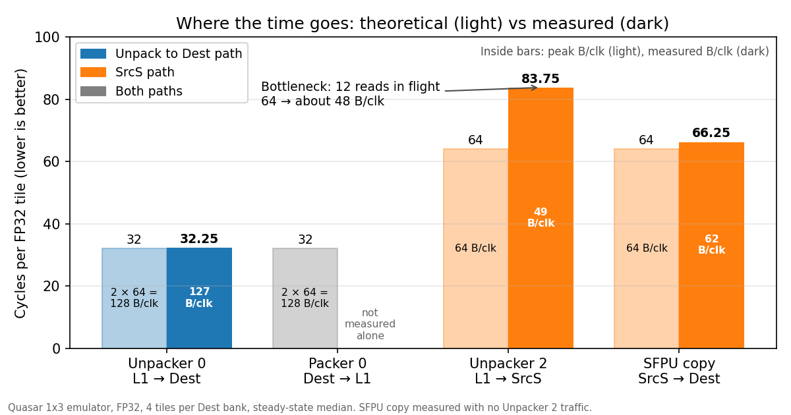

# FP32 into Dest on Quasar: unpack to Dest vs the SrcS path

Quasar 1x3 emulator, 4 November 2026.

## Test

The test copies FP32 tiles L1 → Dest → L1. The functional version of each case checks every bit of the output.

- L1 holds 64 different tiles: 16 blocks of 4 tiles.
- Dest runs as 2 halves (banks) of 4 FP32 tiles each. The writer fills one bank while Packer 0 drains the other.
- The test loops over the 16 blocks 4 times: **64 banks, 256 tiles for each run.**
- The writer is one of these:
  - Unpack to Dest: TRISC0 issues UNPACR_DEST (Unpacker 0, L1 → Dest).
  - SrcS path: TRISC3 runs Unpacker 2 (L1 → SrcS) and the SFPU copy (SrcS → Dest).
- The writer gives each bank to Packer 0 in hardware: a done bit on its last Dest write.
- Packer 0 (TRISC2) packs the bank to L1 and frees it:
  - Full pack: all 4 tiles of the bank.
  - Writer-only: only 1 face (of 16) for each bank. The packer still waits for and frees every bank. Thus, the
  result shows the speed of the Dest writer.

## Where the time goes

- Unpack to Dest runs at its theoretical rate: 32 cycles for each tile.
- On the SrcS path, the SFPU copy is close to its theoretical rate (66.25 against 64) when it runs alone.
- **Unpacker 2 is the bottleneck:** 83.75 against 64 cycles for each tile.

## Result

| Path | Cycles for each tile (writer-only) | Cycles for each tile (full pack) | Effective B/clk |
|---|---:|---:|---:|
| Unpack to Dest (Unpacker 0) | 32.25 | 42 | 127 |
| SrcS path (Unpacker 2 → SrcS → SFPU → Dest) | 82.1 | 83.25 | 49.9 |

**If unpack to Dest is removed, FP32 Dest fill becomes 2.6 times slower.**

## SFPU: 4 instructions to move 1 slice

Unpacker 2 writes SrcS one **slice** at a time. In 32-bit mode, one slice is 4 rows × 16 values = 64 FP32 values
(256 B). A tile is 16 slices.

The SFPU cannot move a full slice with one instruction:

- **One LReg holds only half a slice:** 32 lanes × 32 bits = 32 values (128 B).
- Thus, one slice needs **2 LRegs**: LREG0 for the even columns and LREG1 for the odd columns.
- Each LReg needs **1 load** (SrcS → LReg) and **1 store** (LReg → Dest).
- Thus, one slice needs **4 instructions**:
  1. SFPLOAD: even columns, SrcS → LREG0.
  2. SFPSTORE: LREG0 → Dest.
  3. SFPLOAD with done: odd columns, SrcS → LREG1. The done bit frees the SrcS bank.
  4. SFPSTORE: LREG1 → Dest. The Dest row pointer moves down 4 rows.
- The SFPU issues **1 instruction for each cycle**.

| Unit | SFPU instructions | Theoretical cycles | Measured cycles (no Unpacker 2 traffic) |
|---|---:|---:|---:|
| 1 slice (256 B) | 4 | 4 | 4.14 |
| 1 tile (16 slices) | 64 | 64 | 66.25 |
| 1 bank (4 tiles) | 256 | 256 | 265 |

This is 64 B for each cycle. More LRegs do not help, because each slice still needs 2 loads and 2 stores.

## Why Unpacker 2 is slow

The Unpacker 2 L1 port has 4 lanes of 16 B, so one read is 64 B. Its peak is **64 B for each cycle**: 4 cycles
for each slice, 64 cycles for each tile.

Unpacker 2 does not reach this peak:

- One L1 read needs about **14 cycles** to return to Unpacker 2 (estimate). Each L1 super bank serves Unpacker 2
in a time slot once in every 4 cycles. Thus, one read needs about **16 cycles** from issue to return.
- Unpacker 2 can have only **12 reads in flight**. When 12 reads are in flight, it must wait for the oldest read
to return before it issues a new read.

\[
\frac{12 \times 64\ \text{B}}{16\ \text{cycles}} = 48\ \text{B/clk}
\]

| | Peak | Measured |
|---|---:|---:|
| B/clk | 64 | 48.9 |
| Cycles for each tile | 64 | 83.75 |

To reach the peak, Unpacker 2 needs 16 reads in flight.

The counters agree:

| Counter (Unpacker 2 feeds the SFPU) | Value |
|---|---:|
| Cycles with an L1 grant to Unpacker 2 | 75% |
| Cycles with an Unpacker 2 request that L1 did not accept, for each super bank | 1.2% to 2.3% |
| Unpacker 2 waits for SrcS | 0% |
| SFPU waits for SrcS | 20% |

In each cycle, the Unpacker 2 L1 port is in one of 3 states:

| State | Cycles |
|---|---:|
| L1 grants a 64 B read | 75% |
| A read waits, but its super bank does not accept it (4 super banks added) | up to 7% |
| No read at L1: 12 reads are already in flight | 18% or more |

## Conclusion

- **Today, Unpacker 2 read issue is the bottleneck.** With 12 reads in flight, Unpacker 2 moves about 48 B/clk,
and the FP32 SrcS path needs about 84 cycles for each tile.
- **If read issue is improved** (16 or more reads in flight), **the SFPU becomes the bottleneck.** It needs
4 instructions for each slice, 64 for each tile. This puts the path at **64 cycles for each tile**.
- Unpack to Dest needs 32 cycles for each tile. Thus, the SrcS path is 2.6 times slower today, and 2 times slower
after the read issue improvement.
