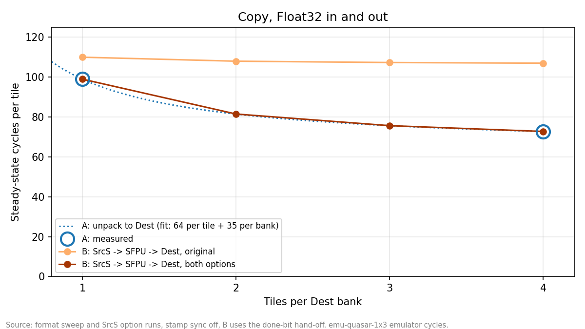
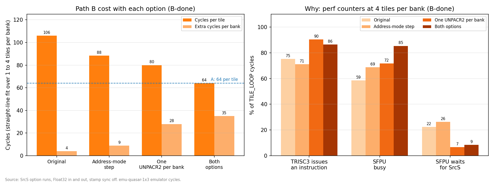
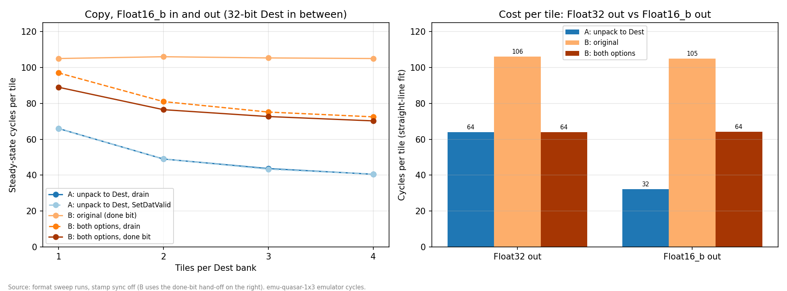
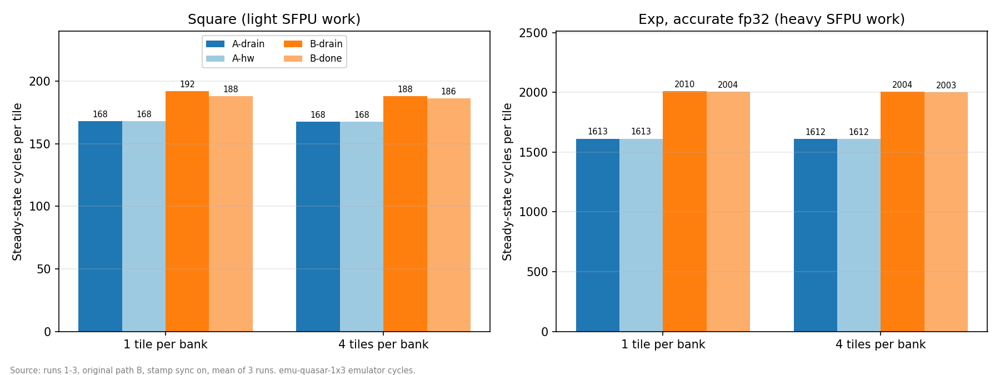
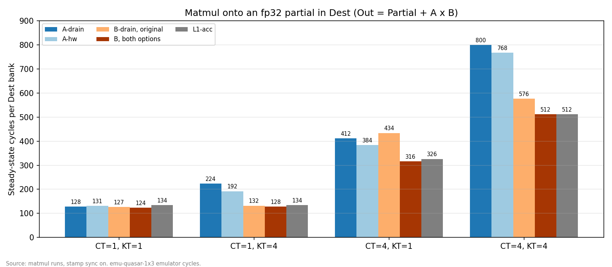

# Unpack to Dest vs SrcS → SFPU → Dest on Quasar 1x3: report

> Historical results: the 64-cycle packer attribution below is superseded by the
> user-provided RTL bandwidth/hash clarification dated 2026-11-04. These runs do
> not establish whether unpack-to-Dest can be removed. See PERF_COUNTERS_README.md
> for current measurement limits and the separate test-only experiment suite.

This page compares two ways to move 32-bit data from L1 into Dest on Quasar. All runs used the Quasar 1x3 emulator between November 2 and November 3, 2026, and every functional check passed. In every chart, blue is path A (unpack to Dest) and orange is path B (SrcS → SFPU → Dest). Darker orange means more of the new path B options are on.

This page replaces `dest_write_path_results.md`. That page measured the plain copy with "stamp sync" on, which made path A look slower than it is (see section 3), and it had none of the path B options or the Float16_b results.

## The short version

1. For a plain Float32 copy, path B now ties path A: both cost 64 cycles per tile plus 35 per bank. Path B used to cost 106 per tile.
2. Two small changes made path B faster. One removes an instruction from every SrcS slice. The other makes Unpacker 2 read a whole bank instead of one tile at a time, so it never runs out of work between tiles.
3. The tie only holds for 32-bit output. With Float16_b output, path A drops to 32 cycles per tile, but path B stays at 64. Path A is then about 1.75 times faster.
4. The reason: path A is limited by the packer, and path B is limited by how many SFPU instructions it must issue. A narrower output speeds up the packer but does not reduce the SFPU's instructions.
5. Path B wins when the Dest preload can run next to other work. In the matmul onto a partial in Dest with 4 matmul steps, path B with both options is 33% to 43% faster than path A, and it matches L1 accumulation.
6. For SFPU kernels (square, exp), path A is still faster. The new options are not used in those kernels yet.

## Background

### The parts

- **Tile:** a 32 × 32 block of numbers, so 1024 numbers. Almost everything works on tiles.
- **L1:** the core's local memory. Inputs start here and outputs end here.
- **Dest:** a register file where results sit before they go back to L1. In 32-bit mode it is split into two **banks**, and each bank holds up to 4 tiles. One bank is filled while the other is written out, so the two sides can work at the same time.
- **Unpacker:** hardware that reads tiles from L1 and writes them into registers.
- **Packer:** hardware that reads tiles from Dest and writes them back to L1.
- **SrcA and SrcB:** the input registers of the FPU, the matrix unit. They hold only 19 bits per number, so 32-bit data loses bits if it goes through them. That is why both paths here avoid them.
- **SFPU:** the vector unit. It can read from Dest and from **SrcS**, a small extra source register, and it can write to Dest.
- **SrcS:** a small register that Unpacker 2 fills one **slice** at a time. It is double-buffered, so the unpacker can fill one slice while the SFPU reads the other. In 32-bit mode one slice is 4 rows × 16 numbers, so one tile is 16 slices.
- **TRISC0 to TRISC3:** four small CPUs. Each one sends instructions to the hardware. Each sends them **in order, at most one per cycle**. TRISC0 drives Unpackers 0 and 1, TRISC2 drives the packer, and TRISC3 drives the SFPU and, in path B, Unpacker 2.

### The two paths

```text
  Path A: unpack to Dest                   Path B: SrcS -> SFPU -> Dest
  (TRISC0)                                 (TRISC3)

  L1                                       L1
   |                                        |
   |  Unpacker 0, UNPACR_DEST               |  Unpacker 2, UNPACR2
   |  (one instruction per tile)            |  (one instruction, repeated by the hardware for each slice)
   |                                        v
   |                                       SrcS (2 slices)
   |                                        |
   |                                        |  SFPU: SFPLOAD, SFPSTORE, SFPLOAD, SFPSTORE
   |                                        |  (4 instructions per slice, 16 slices per tile)
   v                                        v
  Dest bank                                Dest bank
   |                                        |
   |  Packer 0 (TRISC2)                     |  Packer 0 (TRISC2)
   v                                        v
  L1                                       L1
```

In path A, the unpacker writes straight into Dest, and the packer writes Dest out. In path B, Unpacker 2 fills SrcS, and the SFPU copies each slice into Dest. Path B costs many more instructions. Its benefit is that it uses TRISC3, Unpacker 2 and the SFPU, and leaves TRISC0, Unpackers 0 and 1, SrcA, SrcB and the FPU free for other work.

### Handing a bank to the packer

When a writer finishes a bank, it must tell the packer the bank is ready. Each path can do this in two ways:

- **Drain (A-drain, B-drain):** the writer waits until its own hardware is idle, then marks the bank ready in software.
- **Hardware bit (A-hw, B-done):** a bit on the bank's last write marks it ready. Path A sets SetDatValid on the last `UNPACR_DEST`. Path B sets done on the last `SFPSTORE`.

### A pipeline runs at the speed of its slowest stage

Each path is a chain: the writer fills Dest, and the packer drains it. Because the two Dest banks let both sides work at once, the chain runs at the speed of whichever side is slower. Most results below come down to one question: is the writer slower, or is the packer?

### How the time is measured

TRISC2 records the time after it packs each bank. One run moves 64 banks. The steady figure is the median time between banks, leaving out the first two banks, because both banks start empty. "Cycles per tile" is cycles per bank divided by tiles per bank. A straight-line fit of cycles per bank against tiles per bank splits the cost into a **per-tile cost** (the slope) and a **per-bank cost** (the hand-off overhead).

The numbers are emulator cycles on one core. Compare them with each other, not with silicon.

## 1. Copy, Float32 in and out

Each test copies 16 tiles through Dest and back to L1, and checks every bit. The x-axis is how many tiles go in one Dest bank.



| Tiles per bank | A | B, original | B, both options |
| -------------- | ---- | ----------- | --------------- |
| 1              | 99   | 110         | 99              |
| 2              | n/a  | 108         | 81.5            |
| 3              | n/a  | 107.3       | 75.7            |
| 4              | 72.8 | 107         | 72.8            |

Path A costs 64 cycles per tile plus 35 per bank. The original path B costs 106 per tile plus 4 per bank, so it was about 1.5 times slower at 4 tiles per bank. With both options on, path B costs 64 per tile plus 35 per bank, exactly like path A. Path A's two hand-offs give the same numbers, and B-drain costs 1 to 8 cycles more per bank than B-done.

Path A was measured only at 1 and 4 tiles per bank in this setup, so the 2 and 3 points are missing from its line.

## 2. What the two path B options do

### Option 1: address-mode step

Path B copies each slice with four SFPU instructions. The original code then needed a fifth instruction, `INCRWC`, to move Dest's row pointer down 4 rows for the next slice. With this option, the last `SFPSTORE` moves the pointer itself, through an address mode (`ADDR_MOD_6`, set to add 4 rows). That removes 16 instructions per tile.

### Option 2: one UNPACR2 per bank

`UNPACR2` is the instruction that starts Unpacker 2. The hardware repeats it once for each slice. The original code issued one `UNPACR2` per tile, so the unpacker stopped after 16 slices. Because TRISC3 sends instructions in order, the next tile's `UNPACR2` sat behind the current tile's 64 SFPU instructions. So at every tile boundary:

1. Unpacker 2 finished the tile early and went idle.
2. TRISC3 issued the next `UNPACR2` only after the SFPU was nearly done with the current tile.
3. The SFPU then waited for the unpacker to read the next tile from L1.

With this option, one `UNPACR2` covers all the tiles in the bank. The unpacker keeps going from one tile to the next without a pause, and stays about two slices ahead of the SFPU. The wait now happens once per bank instead of once per tile. This needs the bank's tiles to sit next to each other in L1.

### Results



| Path B option | Cycles per tile | Extra cycles per bank |
| ------------- | --------------- | --------------------- |
| Original | 106 | 4 |
| Address-mode step | 88 | 9 |
| One UNPACR2 per bank | 80 | 28 |
| Both options | 64 | 35 |
| One UNPACR2 across several banks | 64 | 35 |

Each option saves what you would expect:

- The address-mode step saves about 18 cycles per tile, about the 16 instructions it removes.
- One UNPACR2 per bank saves about 26 cycles per tile. That is the wait at each tile boundary. Part of it comes back once per bank, which is why the per-bank cost rises from 4 to 28.
- Together, path B costs 64 cycles per tile. That is exactly 16 slices × 4 instructions, at one instruction per cycle. Path B cannot go lower without fewer instructions.

The perf counters on the right show the same thing. With both options, TRISC3 issues an instruction 86% of the time, the SFPU is busy 85% of the time, and the SFPU waits for SrcS only 9% of the time, down from 22%.

Issuing one `UNPACR2` across several banks removes the last wait at each bank boundary, but it gains nothing here. The packer was already the limit for Float32 output.

Both options are safe to keep beyond this experiment. Address modes are private to each TRISC, so `ADDR_MOD_6` on TRISC3 cannot affect the FPU's address modes. Path B uses only Unpacker 2 and SrcS, which no other part of these kernels uses. Two things to watch in a real kernel: other SFPU code on TRISC3 also uses `ADDR_MOD_6`, so it must be set again before the copy, and one `UNPACR2` per bank needs all of the bank's tiles in L1 first, next to each other.

## 3. Correction: stamp sync made path A look slower

The earlier page found that both paths take 127 cycles at 1 tile per bank, and that path A costs 64 per tile plus 63 per bank. Those copy runs had "stamp sync" on: TRISC2 waited for the packer to finish completely before it recorded each bank's time. That wait stops the packer from overlapping one bank with the next, which adds cycles to every bank.

Path A is limited by the packer, so it suffered the most. With stamp sync off, path A costs 64 per tile plus 35 per bank, and 99 cycles at 1 tile per bank instead of 127. Path B was barely affected, because the packer was not its limit. All results on this page have stamp sync off, except the SFPU kernels and the matmul (sections 5 and 6).

## 4. Copy with a 16-bit output

L1 holds Float16_b. The unpacker widens it to 32 bits on the way in, so Dest is still 32-bit. The packer writes Float16_b back to L1, so it writes half as many bytes as before. All 24 cases passed the bit-exact check.



| Tiles per bank | A-drain | A-hw | B, original (done) | B, both options (drain) | B, both options (done) |
| -------------- | ------- | ---- | ------------------ | ----------------------- | ---------------------- |
| 1              | 66      | 66   | 105                | 97                      | 89                     |
| 2              | 49      | 49   | 106                | 81                      | 76.5                   |
| 3              | 43.7    | 43.3 | 105.3              | 75.2                    | 72.7                   |
| 4              | 40.5    | 40.5 | 105                | 72.5                    | 70.3                   |

| Path | Float32 out | Float16_b out |
| ---- | ----------- | ------------- |
| A | 64 per tile + 35 per bank | 32 per tile + 34 per bank |
| B, original | 106 per tile + 4 per bank | 105 per tile + 1 per bank |
| B, both options | 64 per tile + 35 per bank | 64 per tile + 25 to 33 per bank |

Path A's per-tile cost halves, from 64 to 32, because the packer writes half the bytes. Path B with both options stays at 64, because the SFPU still issues 64 instructions per tile, whatever the output format. With Float32 output, the packer was just as slow as path B's SFPU, so the difference did not show.

A Float16_b input with a Float32 output changes nothing: path A stays at 72.8 cycles per tile at 4 tiles per bank, and the original path B at 105.5 to 106.8. Reading fewer bytes from L1 does not help either path. Only the packer's writes matter.

The perf counters agree. With Float16_b output and 4 tiles per bank, path A's unpack thread (with the drain hand-off) is stalled 91% of the time, waiting for the packer to free a bank. Path B's SFPU is busy 88% of the time.

The hardware bit is now slightly better than the drain for path B, by about 8 cycles per bank. With Float32 output, the packer hid that difference.

The 8-bit output (`MxFp8R`) cases are in the tests but have not run yet. Path A should get faster again there, and path B should stay at 64.

## 5. SFPU kernels

The same copy, with square (one multiply per number) or accurate fp32 exp on the way into Dest. Path A unpacks to Dest and then runs the op in place on TRISC3. Path B runs the op on the data as it moves from SrcS to Dest. These runs use the original path B and have stamp sync on.



Square takes 168 cycles per tile on path A and 186 to 192 on path B. Exp takes 1612 on path A and 2003 to 2010 on path B. The SFPU is the bottleneck either way, and on path B it also has to move the data.

The new options are not in these kernels yet. The square and exp slice code still issues its own pointer step, and still uses one `UNPACR2` per tile. Part of the exp gap may also come from the code rather than the path, because the two paths call different exp implementations.

## 6. Matmul onto a partial in Dest

Each bank first gets CT fp32 partial tiles. Then the FPU adds KT matmul steps of bf16 tiles on top, and the packer writes Out = Partial + A × B.

- Path A: TRISC0 unpacks the partial to Dest, reprograms Unpacker 0 for SrcA, then feeds the matmul. The same thread does both, one after the other.
- Path B: TRISC3 copies the partial from SrcS into Dest. TRISC0 only feeds the matmul, so the two run at the same time.
- L1-acc: no partial in Dest at all. The packer adds each bank's result onto the partial in L1.



| CT×KT | A-drain | A-hw | B-drain, original | B, both options | L1-acc |
| ----- | ------- | ---- | ----------------- | --------------- | ------ |
| 1×1   | 128     | 131  | 127               | 124             | 134    |
| 1×4   | 224     | 192  | 132               | 128             | 134    |
| 4×1   | 412     | 384  | 434               | 316             | 326    |
| 4×4   | 800     | 768  | 576               | 512             | 512    |

With both options, path B is the fastest in every case, or tied with L1-acc. At CT=4, KT=1, the original path B was the slowest at 434 cycles. With both options it takes 316, faster than path A's 384. At CT=4, KT=4, path B and L1-acc both reach 512 cycles, which is 128 per tile. That looks like the matmul's own compute time, so no way of loading the partial can go lower.

These matmul runs had stamp sync on, so path A's numbers may be a little high (see section 3). They have not been rerun with stamp sync off. Path B with both options and L1-acc were measured with LoFi only. LoFi and HiFi4 gave the same cycles everywhere else.

## Which one to use

| Situation | Better choice |
| --------- | ------------- |
| Plain copy into Dest, 32-bit output | Either, if path B uses both options |
| Plain copy into Dest, 16-bit or narrower output | A, unpack to Dest |
| SFPU op on the way into Dest | A, unpack to Dest (until the options are added there) |
| FPU kernel that needs Dest preloaded | B, SrcS → SFPU → Dest, with both options |
| TRISC0 and the unpackers are busy with other work | B, SrcS → SFPU → Dest |
| Bank hand-off | The hardware bit. It saves up to 8 cycles per bank on path B, about 30 in path A's matmul, and nothing in path A's copy |

## Caveats

- These are emulator cycles on one core. Earlier, three repeated runs of the same tests gave identical numbers, or numbers within 4.5 cycles per bank. The new runs on this page ran once each.
- The raw stamp files for the Float32 no-sync copy and the path B option runs were overwritten. Their numbers are copied from the run summaries into `logs/earlier_runs_summary.json`. The perf counter CSVs for the option runs are kept in `logs/srcs_opts`.
- Path B relies on two hardware behaviours that work in every run but were not checked against the RTL spec: the done bit on `SFPSTORE` handing over the SFPU's Dest bank, and SetDatValid on `UNPACR_DEST` handing over path A's bank.
- The L1-acc matmul functional test hangs at CT=1, KT=1. Its perf runs complete, but its output has not been checked yet.

## How to rerun

From `tt_metal/tt-llk/tests/python_tests`, with the 1x3 emulator environment set (`setup_qs_llk` sets the same variables):

```bash
export CHIP_ARCH=quasar \
  TT_UMD_SIMULATOR_PATH=/proj_sw/user_dev/nmohammedTT/tt-umd-simulators/build/emu-quasar-1x3 \
  TT_METAL_SIMULATOR=/proj_sw/user_dev/nmohammedTT/tt-umd-simulators/build/emu-quasar-1x3 \
  NNG_SOCKET_ADDR=tcp://tensix-l-04:49879 NNG_SOCKET_LOCAL_PORT=5555
```

Copy at every output format, with path B in its original form and with both options (stamp sync off):

```bash
pytest --timeout=300 -rN --run-simulator --enable-perf-counters quasar/perf_dest_write_path_quasar.py -k "format"
```

Only the Float16_b → Float16_b cases:

```bash
pytest --timeout=300 -rN --run-simulator --enable-perf-counters quasar/perf_dest_write_path_quasar.py \
  -k "format and Float16_b and not Float32 and not MxFp8R"
```

Each path B option on its own, Float32:

```bash
pytest --timeout=300 -rN --run-simulator --enable-perf-counters quasar/perf_dest_write_path_quasar.py -k "srcs_opt and not format"
```

The functional checks are the same commands with `quasar/test_dest_write_path_quasar.py` and without `--enable-perf-counters`. Each run writes the per-bank stamps to `/tmp/tt-llk-build/dest_write_path_bank_stamps.jsonl`, which the next run overwrites, so copy it into `logs/` first. To print the per-tile and per-bank fit:

```bash
PYTHONPATH=../../tools/python python -m quasar.test_dest_write_path_quasar /tmp/tt-llk-build/dest_write_path_bank_stamps.jsonl
```

To make the charts again, from the repository root:

```bash
python3 docs_dest_write_path_results/plot_report.py
```
