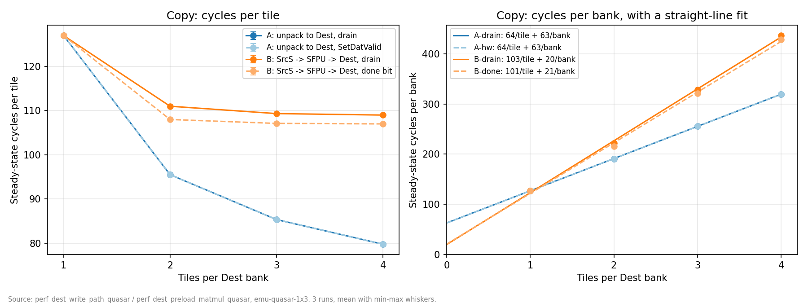
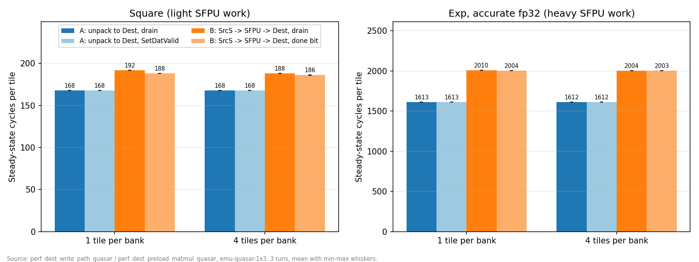
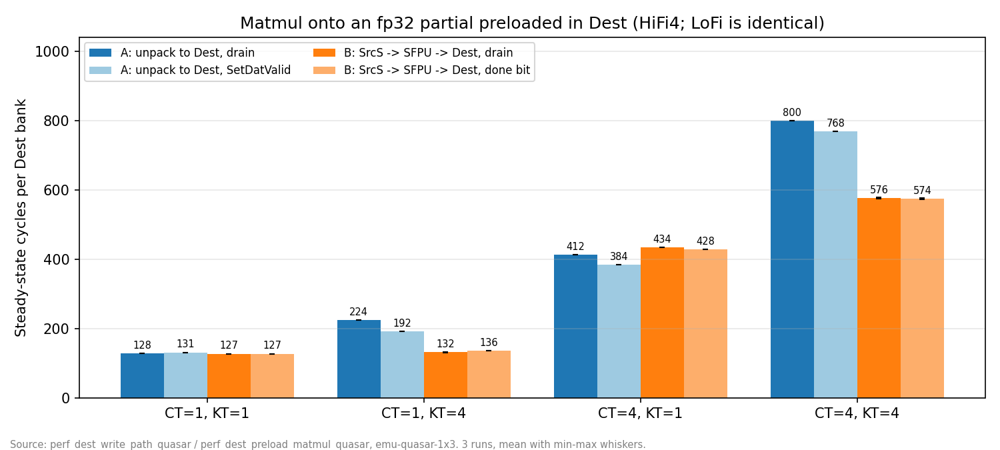
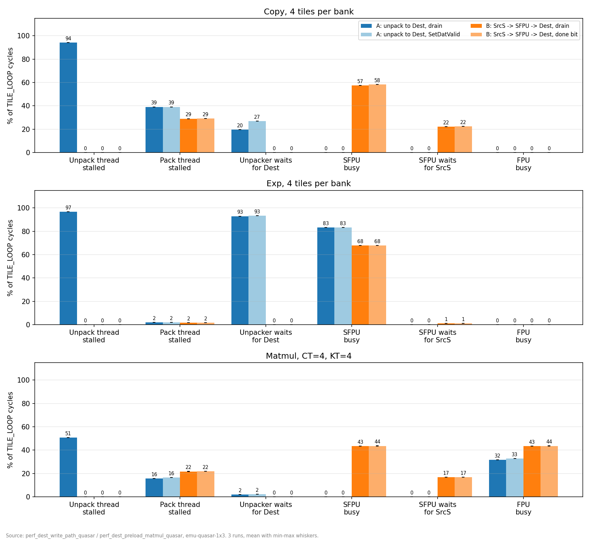

# Unpack to Dest vs SrcS → SFPU → Dest on Quasar 1x3: results

The 80 perf tests ran three times on the Quasar 1x3 emulator on November 2, 2026, and passed every time. They compare two ways to get 32-bit data from L1 into Dest, in a plain copy, in two SFPU kernels and in a matmul that needs Dest. In every chart, blue is path A and orange is path B. The dark shade drains the bank in software and the light shade hands the bank over in hardware. Bars and points are the mean of the runs, and the whiskers go from the lowest to the highest run.

The two paths take these steps from L1 to Dest:

```text
  Path A: unpack to Dest              Path B: SrcS -> SFPU -> Dest
  (TRISC0)                            (TRISC3)

  L1                                  L1
   │                                   │
  1. Unpacker 0, UNPACR_DEST          1. Unpacker 2, UNPACR (autoloop, one per tile)
   │                                   │
   │                                  SrcS (16 slices of 4x16 per tile)
   │                                   │
   │                                  2. SFPLOAD from SrcS, then SFPSTORE to Dest
   │                                     (and the math, for square and exp)
   │                                   │
  Dest bank                           Dest bank
   │                                   │
  3. Packer (TRISC2) -> L1            3. Packer (TRISC2) -> L1
```

Each path hands a full Dest bank to the packer in one of two ways:

- **drain (A-drain, B-drain):** the writer waits for its own engine to go idle, then clears the bank's dvalid in software.
- **hardware (A-hw, B-done):** a bit on the bank's last write flips the bank. Path A sets SetDatValid on the last `UNPACR_DEST`. Path B sets done on the last `SFPSTORE` (copy) or `SFPNOP` (square, exp).

TRISC2 stamps the wall clock after each bank is packed. The steady-state figure is the median of the bank-to-bank times, leaving out the first two banks, because both banks start empty. One launch moves 64 banks: 16 blocks, looped 4 times. The cycle counts below come from these stamps. The perf harness's `TILE_LOOP` zone gives the same numbers to within 2%.

## The short version

1. For a plain copy, path A is faster as soon as a bank holds more than one tile: 80 vs 107 cycles per tile at 4 tiles per bank. At 1 tile per bank, both take 127 cycles.
2. Path A pays about 63 cycles per bank switch and 64 cycles per tile. Path B pays only about 20 per bank switch but 101 to 103 per tile, because the SFPU copy loop is slower than the packer.
3. For SFPU kernels, path A is faster too: 12% for square and 24% for exp. The SFPU is the bottleneck either way, and on path B it also has to move the data.
4. For a matmul that adds on top of a partial in Dest, path B wins with KT=4, by 30% to 40% at CT=1 and 25% at CT=4. Path A makes TRISC0 load the partial and the matmul operands one after the other. Path B loads the partial on TRISC3 in parallel.
5. The hardware bank hand-off matters little. A-hw saves nothing in copy and SFPU kernels and about 30 cycles per bank in the matmul. B-done saves 2 to 6 cycles per bank.

## 1. Copy

Each test copies 16 distinct tiles through Dest and back to L1, bit-exact, with 1 to 4 tiles per bank. Float32 and Int32 give the same cycles to the cycle, so the charts show Float32.



| Tiles per bank | A-drain | A-hw | B-drain | B-done |
| -------------- | ------- | ---- | ------- | ------ |
| 1              | 127     | 127  | 127     | 127    |
| 2              | 95.5    | 95.5 | 111     | 108    |
| 3              | 85.3    | 85.3 | 109.3   | 107.3  |
| 4              | 79.8    | 79.8 | 109     | 107    |

The right-hand chart fits a straight line to the cycles per bank. Path A costs 64 cycles per tile plus 63 per bank, and path B 101 to 103 cycles per tile plus about 20 per bank. Path B switches banks more cheaply, but every tile costs it about 40 cycles more, so it falls behind from 2 tiles per bank on. At 1 tile per bank, both paths hit the same 127-cycle floor.

The first bank also takes longer on path B: 260 vs 157 cycles at 1 tile per bank, and 794 vs 556 at 4.

## 2. SFPU kernels

The same copy, with square (one multiply per datum) or accurate fp32 exp on the way into Dest. Path A unpacks to Dest and then runs the op in place on TRISC3. Path B runs the op on the data as it moves from SrcS to Dest.



Square takes 168 cycles per tile on path A and 186 to 192 on path B, 12% slower. Exp takes 1612 on path A and 2003 to 2010 on path B, 24% slower. The bank size changes almost nothing, because the SFPU work per tile is far above the bank-switch cost.

Part of the exp gap may come from the code rather than the path. Path A calls `calculate_exponential` on Dest, and path B calls `ExpAlgo` through the SrcS operand API, so the two do not run the same instruction sequence.

## 3. Matmul onto a partial in Dest

Each bank first gets CT fp32 partial tiles, then TRISC1 adds KT matmul steps of bf16 tiles on top, and the packer writes Out = Partial + A × B.

- Path A: TRISC0 unpacks the partial to Dest, reprograms Unpacker 0 for SrcA, then feeds the matmul. The same thread does both, one after the other.
- Path B: TRISC3 copies the partial from SrcS into Dest. TRISC0 only feeds the matmul.



| CT×KT | A-drain | A-hw | B-drain | B-done |
| ----- | ------- | ---- | ------- | ------ |
| 1×1   | 128     | 131  | 127     | 127    |
| 1×4   | 224     | 192  | 132     | 136    |
| 4×1   | 412     | 384  | 434     | 428    |
| 4×4   | 800     | 768  | 576     | 574    |

With KT=4, path B is 30% to 40% faster at CT=1 and about 25% faster at CT=4. With KT=1 there is too little matmul work to hide path B's slower copy, so A-hw wins at CT=4 by 11%. This is the one place where SetDatValid helps path A, by about 30 cycles per bank.

LoFi and HiFi4 give the same cycles: exactly on path A, and within the 4-cycle run-to-run noise on path B. The table and chart show HiFi4. The FPU is busy only 11% to 45% of the time, so it is not the bottleneck here, but it is also possible that the emulator does not model the extra fidelity phases.

## 4. Where the time goes

The Quasar perf counters over the `TILE_LOOP` zone, for the three most telling cases:



- **Copy, path A:** the packer sets the pace. With drain, the unpack thread is stalled 94% of the time, almost all of it waiting for a free bank. With SetDatValid there is no software wait, so that time shows up as the unpacker waiting for Dest (27%) instead.
- **Copy, path B:** the SFPU copy loop sets the pace. The SFPU is busy 57% to 58% of the time and waits for Unpacker 2 to fill SrcS another 22%. The packer waits less than on path A.
- **Exp:** the SFPU sets the pace on both paths. On path A, the SFPU is busy 83% of the time and the unpacker waits for Dest 93%. On path B, the SFPU is busy 68%, because it also does the SrcS loads and the Dest stores.
- **Matmul, CT=4, KT=4:** on path A, the unpack thread is stalled 51% of the time with drain, and the FPU is busy 32% to 33%. On path B, the unpack thread never stalls, the SFPU copies the partial 43% of the time next to it, and the FPU is busy 43%.

## Which one to use

| Situation                                                        | Better choice      |
| ---------------------------------------------------------------- | ------------------ |
| Plain copy or SFPU op into Dest, more than 1 tile per bank       | A, unpack to Dest  |
| 1 tile per bank, copy only                                        | Either             |
| FPU kernel that needs Dest preloaded, with real work on top (KT > 1) | B, SrcS → SFPU → Dest |
| FPU kernel that needs Dest preloaded, little work on top (KT = 1) | A, with SetDatValid |
| Bank hand-off                                                     | Hardware bit, but it saves little |

## Caveats

- These are emulator cycles on one core. 71 of the 80 points are the same in all three runs, and the rest move by at most 4.5 cycles per bank, all on path B. So the whiskers are nearly flat. That shows the emulator repeats itself, not that hardware will match.
- The exp comparison uses two different exp implementations (see section 2).
- LoFi and HiFi4 give the same matmul cycles (see section 3).
- Path B relies on behaviour the kernels assume but that was not checked against the RTL spec: the done bit on `SFPSTORE` and `SFPNOP` flipping the SFPU's Dest bank, and SetDatValid on `UNPACR_DEST` flipping path A's bank. Every run passes its bit-exact or golden check, so the data is right, but a wrong assumption would show up as a hang or a slower hand-off.

## How to rerun

From `tt_metal/tt-llk/tests/python_tests`, with the 1x3 emulator environment set (`setup_qs_llk` sets the same variables):

```bash
export CHIP_ARCH=quasar \
  TT_UMD_SIMULATOR_PATH=/proj_sw/user_dev/nmohammedTT/tt-umd-simulators/build/emu-quasar-1x3 \
  TT_METAL_SIMULATOR=/proj_sw/user_dev/nmohammedTT/tt-umd-simulators/build/emu-quasar-1x3 \
  NNG_SOCKET_ADDR=tcp://tensix-l-04:49879 NNG_SOCKET_LOCAL_PORT=5555
pytest --timeout=600 -rN --run-simulator --enable-perf-counters \
  quasar/perf_dest_write_path_quasar.py quasar/perf_dest_preload_matmul_quasar.py
```

One run takes about 4.5 minutes. The functional tests, with bit-exact and golden checks, are `quasar/test_dest_write_path_quasar.py` and `quasar/test_dest_preload_matmul_quasar.py`.

Each run writes the per-bank stamps to `/tmp/tt-llk-build/dest_write_path_bank_stamps.jsonl` and the counter CSVs to `tt_metal/tt-llk/perf_data/latest/`. Copy them into a `logs/runN` folder, then make the charts again from all the runs. Repeated points are averaged:

```bash
python3 tt_metal/tt-llk/tests/python_tests/quasar/plot_dest_write_path_quasar.py \
  docs_dest_write_path_results docs_dest_write_path_results/logs/run*
```

The stamps, CSVs and pytest log of every run are in `docs_dest_write_path_results/logs`, `run1` to `run3`.
