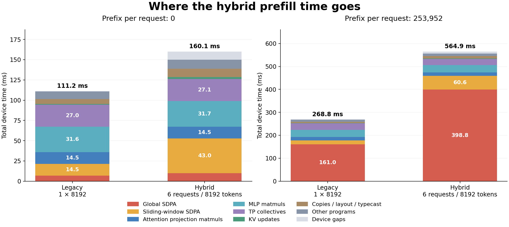

# Hybrid prefill slowdown

The long-prefix slowdown is overwhelmingly inside SDPA: **+237.8 ms global attention (80% of the regression), +43.9 ms sliding-window attention (15%)**. Projection and MLP matmuls stay at approximately 46.2 ms combined. At prefix zero, sliding-window attention is the largest regression, adding 28.5 ms (58%).

| Prefix per request | Legacy ms | Hybrid ms | Added ms | Hybrid / legacy |
|---:|---:|---:|---:|---:|
| 0 | 111.22 | 160.06 | 48.83 | 1.44× |
| 253,952 | 268.76 | 564.85 | 296.10 | 2.10× |

Legacy is one 8192-token request; hybrid is six independent requests of 512, 512, 1024, 1536, 2048 and 2560 tokens. Both process 8192 new tokens. Every request has the indicated prefix. This is the requested workload comparison; it does not isolate tracing overhead from the change in request shapes, ownership, or cache traffic.



## What the capture establishes

- Global SDPA runs 60 times in hybrid versus 10 in legacy. At the long prefix, it totals **398.85 versus 161.01 ms**. The six calls per global layer average 4.972, 4.957, 5.046, 5.601, 5.093 and **14.215 ms**, respectively. The 2560-token request alone contributes **142.15 ms** across the model.
- Sliding-window SDPA runs 300 times versus 50. It totals **60.62 versus 16.72 ms** at the long prefix, and **43.00 versus 14.54 ms** at prefix zero. The six halo/attention calls per layer carry appreciable overhead even when there is no cached prefix.
- Matmuls are flat: attention projections are approximately **14.5 ms**, and the MLP is approximately **31.6 ms**. Each path runs the same 300 matmul programs on the full packed shape. TP collectives are also approximately unchanged at 27–28 ms.
- Uncovered device gaps rise from **0.39 to 8.49 ms** at the long prefix: only **8.10 ms of the 296.10 ms regression**. At prefix zero they rise to 10.08 ms. Most hybrid gaps precede eager cache updates or SDPA. This is consistent with dispatch overhead, but is not a measurement of CPU stacks or total host time.
- Boundary copies/layout/typecast add **4.18 ms**, cache updates add **1.65 ms**, and other programs add **1.66 ms**, at the long prefix. Hybrid performs 660 cache-update programs versus 110. These are secondary costs.

## Why this happens, and what to try first

1. **Fix the global tuning cliff for the 2560-token request.** The current host policy in [`striped_prefill_program_config`](../../models/demos/gemma4_d_p/tt/attention/striped_prefill.py) chooses Q=64, K=256, one K split, and segmented accumulation off. With 320 local query rows and 8 heads, that produces 40 (head, Q-block) work units on 110 compute cores. The heuristic selects either three splits or one; it selects one because 40 × 3 exceeds 110, although two bands fit. The native factory uses whole rows: ceil(40 / 11) = 4 rows per split, so two splits fit in the 10-row grid. First compare two splits against segmented accumulation with one split, while checking numerical behavior. **The capture establishes the time outlier; the gain from changing tuning remains unmeasured.**

2. **Tune the other striped global shapes, then reduce repeated KV transport.** The 512–2048-token requests cost nearly the same ~5 ms per global layer despite a 4× range of query sizes. Each independently invokes the fused all-gather on its own long KV history. This repeats history movement/setup six times per global layer and gives each small request fewer query rows over which to amortize it. Total query-token count, and leading query × prefix arithmetic, remain approximately the same; the attention FLOPs are not sixfold. The flat per-call cost is consistent with a communication/memory/setup floor, but the capture cannot distinguish those components inside the fused program. After shape tuning, per-kernel tracing or targeted CCL counters would test that explanation. Concurrent requests or a grouped attention kernel could amortize setup and improve utilization; independent requests still require their distinct KV histories.

3. **Tune and amortize the striped SWA calls.** The current policy uses K=32, whereas legacy uses K=128; Q sizes and K splits also differ. Six sequential stripe-halo programs replace one larger contiguous-halo program. Both the smaller compute work units and repeated communication/setup can contribute. Compare Q/K/split configurations for the actual mixed sizes before changing halo transport. The no-prefix regression makes this the first target for short-context workloads.

4. **Then reduce hybrid boundary overhead.** Cache-update batching, fewer host calls, and direct writes into persistent projection/residual buffers could reduce the measured 8–10 ms of gaps and roughly 6 ms of extra copies/other programs. Those savings cannot account for the long-prefix attention regression. The native spans do not establish that every device gap is recoverable.

The global policy requests the following configurations. These are read from the host code at the measured revision, not decoded from profiler compile arguments. The device factory may cap splits or disable segmented accumulation; notably it disables segmented accumulation whenever K splitting is active.

| Query tokens | Local rows | Q chunk | K chunk | Max K splits | Requested segmented accumulation |
|---:|---:|---:|---:|---:|---|
| 512 | 64 | 64 | 256 | 3 | Off |
| 1024 | 128 | 32 | 256 | 3 | On |
| 1536 | 192 | 64 | 256 | 3 | Off |
| 2048 | 256 | 64 | 256 | 3 | On |
| 2560 | 320 | 64 | 256 | 1 | Off |

Legacy 8192 uses its tuned global configuration Q=96 / K=256 / one split / segmented accumulation on. These configurations come from different policies; the legacy tuned table is not automatically applied to striped requests.

## Inspect and reproduce

Serve this directory and open the interactive timeline at port 8520:

```bash
python_env/bin/python -m http.server 8520 --bind 0.0.0.0 \
    --directory investigations/gemma4_hybrid_8k_profile
```

The viewer has a prefix toggle, an additive breakdown, per-request attention times, and a zoomable device timeline with immediate tooltips. [trace.json.gz](trace.json.gz) is also a Perfetto/Chrome trace export; decompress if the chosen viewer requires it. [measurements.md](measurements.md) and [analysis.json](analysis.json) contain the exact attribution and sample ranges. [breakdown.svg](breakdown.svg) is an exportable vector chart.

To recapture the same four cells:

```bash
export HF_MODEL=google/gemma-4-31B-it \
    HF_HOME=/mnt/models/huggingface \
    TT_CACHE_PATH=/mnt/models/huggingface/tt_cache/gemma4_d_p/google--gemma-4-31B-it \
    HF_HUB_OFFLINE=1
GEMMA4_PERF_PROFILE=1 \
GEMMA4_PERF_OUTPUT=investigations/gemma4_hybrid_8k_profile \
python_env/bin/python -m pytest \
    'models/demos/gemma4_d_p/demo/hybrid_prefill_perf.py::test_prefill_hybrid_comparison[blackhole-8x4]' -sv
python_env/bin/python investigations/gemma4_hybrid_8k_profile/analyze.py
```

The full-model profiling test passed in 168.46 seconds, including setup. Each cell has five warmed measurements. The sampler validates matching program counts across all 32 chips and replay signatures. The analyzer checks non-overlapping spans, additive totals, and matmul/SDPA order for all 20 captured critical-chip timelines. All samples succeeded on the first collection attempt. The exported timeline uses the median sample's longest-span chip for each cell; raw chip clocks are never compared. See the table for the observed small sample ranges.

This is a native device-program profile, not a CPU flamegraph. A ring SDPA program includes its internal all-gather or halo, so those communication times cannot be separated from attention compute here. TP collectives are separate programs and are attributed separately. Loading, compilation, capture, input/metadata staging and warmup are excluded; cache history is synthetic and no PCC is measured. Raw `results.json` and `run.log` remain local and ignored; the compact timelines, tables, plots and compressed trace are committed. No kernel/tuning changes or extra workload sweep were made for this investigation.
