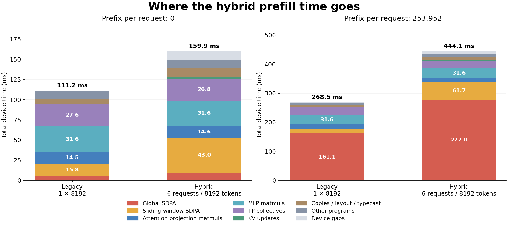

# Global JSON tuning: same 8k comparison

Using the tuned JSON reduces long-prefix hybrid device time from **564.85 to 444.09 ms (21.4%)**. Prefix-zero time is essentially unchanged. Legacy timing is also unchanged within 0.1%.

| Prefix per request | Legacy remeasured ms | Previous hybrid ms | JSON-tuned hybrid ms | Hybrid time reduction |
|---:|---:|---:|---:|---:|
| 0 | 111.17 | 160.06 | 159.87 | 0.1% |
| 253,952 | 268.51 | 564.85 | 444.09 | 21.4% |

Legacy is one 8192-token request. Hybrid is 512 + 512 + 1024 + 1536 + 2048 + 2560 tokens. Every request uses the indicated prefix. Full Gemma4 31B, 60 layers, CP8/TP4, five warmed samples per cell. These are device spans including gaps, excluding loading, compilation, capture, input/metadata staging and warmup. KV history is synthetic; no PCC was measured in this performance test.

## What changed

The striped global path now selects Q chunk, K chunk, maximum K splits and segmented accumulation directly from `ring_sdpa_configs.json` for the model's eight local heads and 110 compute cores. Selection covers every request span, including local slabs that are not 128-row aligned, and preserves the tuned K chunk even when it does not divide cache capacity. A missing required table entry is an error. Legacy global attention uses the same table. Sliding-window configuration is unchanged. Other model geometries retain their existing heuristic path.

The benchmark saves the actual selected hybrid program configurations in `hybrid_sdpa_configs`. All recorded global entries match the JSON exactly:

| Request tokens | Q chunk | K chunk | Max K splits | Segmented accumulation |
|---:|---:|---:|---:|---|
| 512 (twice) | 64 | 256 | 4 | Off |
| 1024 | 64 | 128 | 4 | Off |
| 1536 | 96 | 288 | 4 | Off |
| 2048 | 64 | 288 | 3 | Off |
| 2560 | 96 | 256 | 3 | Off |

## Where the gain comes from

At prefix 253,952, global SDPA time falls from **398.85 to 276.96 ms** across the model. The 2560-token request falls from **14.215 to 5.749 ms per global layer**, saving 84.66 ms over the ten global layers. The other requests provide the remaining global-attention savings.

| Global request | Previous ms/op | JSON-tuned ms/op |
|---|---:|---:|
| First 512 | 4.972 | 3.975 |
| Second 512 | 4.957 | 3.988 |
| 1024 | 5.046 | 4.442 |
| 1536 | 5.601 | 4.393 |
| 2048 | 5.093 | 5.149 |
| 2560 | 14.215 | 5.749 |

The remaining long-prefix gap versus legacy is **175.59 ms**: global SDPA adds 115.90 ms, SWA adds 44.98 ms, uncovered device gaps add 8.07 ms, and the remaining programs add a net 6.64 ms. Projection/MLP matmuls remain approximately 46.2 ms. Hybrid is still 1.65× legacy device time at the long prefix; this comparison also changes one request into six independent histories and is not an isolated measurement of trace dispatch overhead.



## Artifacts and validation

- [Interactive timeline](index.html), served at `http://localhost:8280/tuned/`. The page links back to the previous capture.
- [Exact measurements](measurements.md), [analysis JSON with selected configurations](analysis.json), [Perfetto/Chrome trace](trace.json.gz), and [vector chart](breakdown.svg).
- [Previous findings](../findings.md) and [previous measurements](../measurements.md) are retained unchanged apart from a link to this rerun.
- 107 host configuration tests passed, including all 48 JSON chunk entries through the striped selector and missing-table/entry failure checks.
- The full-model comparison passed in 109.30 seconds. All four cells have five complete captures, matching program counts on all 32 chips, and non-overlapping critical-chip spans. The initial attempt failed in mesh discovery before model loading; `/usr/local/bin/tt-smi -r` cleared it. No C++ changes or rebuild were needed.

The committed measurements were captured on base revision `4934945c9e6` plus this tuning change. Native SDPA spans include internal all-gather/halo communication. Each exported timeline is the median sample's longest-span chip; the selected chip can differ between runs, so small category changes also reflect rank placement on the critical path. Raw profiler JSON/logs are local and ignored; compact data, traces and figures are committed.

To repeat, use the same environment and pytest command in [the original capture instructions](../findings.md), with `GEMMA4_PERF_OUTPUT=investigations/gemma4_hybrid_8k_profile/tuned`. Then run:

```bash
python_env/bin/python investigations/gemma4_hybrid_8k_profile/analyze.py \
    investigations/gemma4_hybrid_8k_profile/tuned/results.json
```
