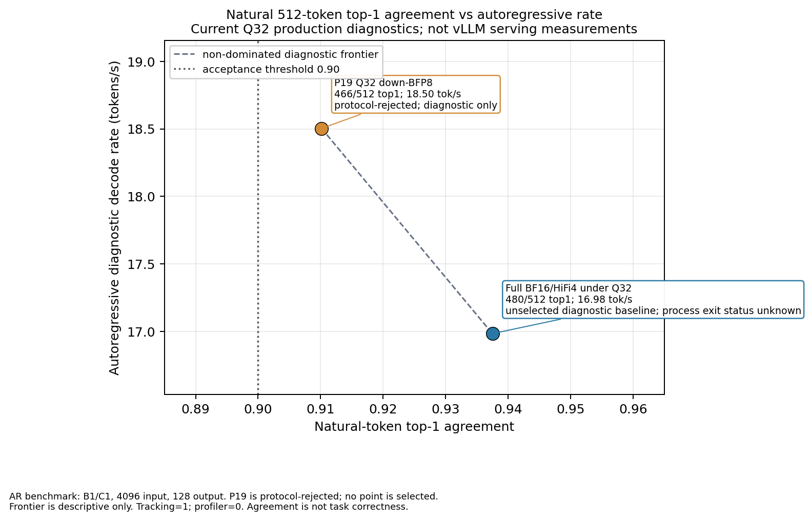
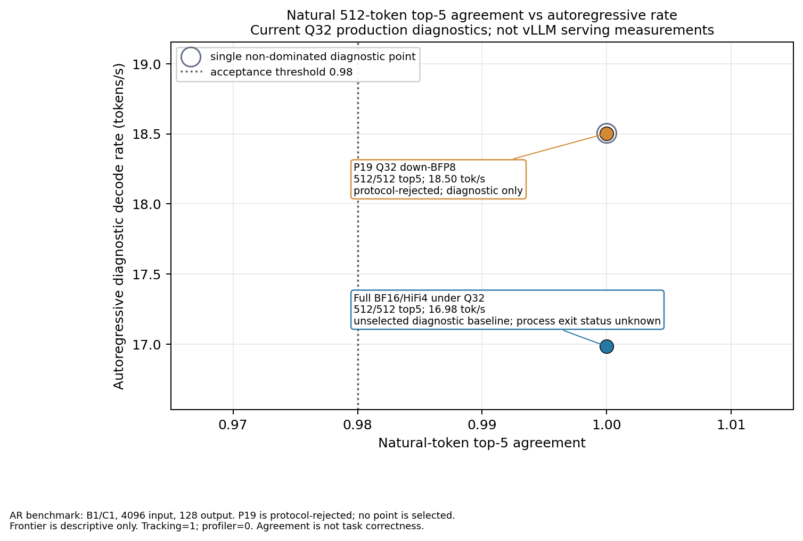

# Gemma 4 31B text autoport

The current stage-12 policy is `stage12_head_bfp8_lofi`: BFP8/LoFi LM-head weights with the BFP4/LoFi decoder retained. Phase 1 GPQA and phase 2 SWE-bench passed their score-interval and explained-time gates. Extended GPQA passed; extended SWE is not passed yet, below its reference band, with three verifier outcomes still unknown. Precision-repair validation remains incomplete; see the [agentic evaluation report](doc/agentic_evals/REPORT.md). The model retains context 262144 and a 1×4 mesh.

**Current-policy vLLM performance at 4096 input tokens, 128 generated tokens, batch 1 and concurrency 1: 755.63 ms mean TTFT and 34.77 decode tokens/s/user.** Eight serial requests completed after one warmup, all with exact token counts. Decode is 1.52% slower than the preserved BFP4-head baseline; both predeclared comparison ranges passed. See the [measurement and limits](doc/agentic_evals/current/headline-head-bfp8-b1/summary.json) and [evaluation serving rates](doc/benchmark/serving_rates.json).

Historical stage-10 BFP4-head target measurement: TTFT 754.43 ms and decode 35.32 tokens/s/user, through this autoport and the stock TT plugin, with prefix caching and async device sampling. One measured request per arm; decode is 1000/mean TPOT. The historical serving profiles passed and their independent review returned `clean-pass` ([report](doc/optimized_vllm/stage_review.md)); that review does not cover the ongoing stage-12 evaluation.

In the same historical BFP4-head measurements, short batched prefill reduces cold128-input/32-output,C32 meanTTFT from 1981.70 ms to 857.83 ms while preserving the128/128,B1/C1 latency gate. Secondary local CI-shaped100/100/32 capacity throughput improves from 551.30 to 741.36outputtokens/s; it is not headline decode speed or a remoteCI result.

HF/tokenizer revision:`842da3794eaa0b77d5f08bae87a17459d91ff475`. This is a new text-only implementation built from the HF reference and generic TTNN operations. Non-aligned prompts, chunked continuation, shared vLLM KV ownership and allocator-driven page growth remain supported.

The operator-authorized served default is top_k=32, retaining checkpoint temperature 1/top_p0.95. Stock intermediate-containing prefill and explicitly requested host-only features use documented host compatibility; measured decode and eligible all-final prefill stay on the canonical traced device sampler. Historical qualitative controls retain the prose/language and 256-token output-cap limitations described in the optimized-vLLM report. Current agentic results separately record repeated-text anomalies, precision controls, output limits and any unresolved investigations.

[Optimized vLLM report](doc/optimized_vllm/README.md), [metrics](doc/optimized_vllm/perf_summary.json), [work log](doc/optimized_vllm/work_log.md), [context contract](doc/context_contract.json), [serving contract](doc/full_model/serving_contract.json), [datatype selection](doc/datatype_sweep/README.md), [historical full-model report](doc/full_model/README.md). No serving profiler collection or pushes.

Current Q32 diagnostic comparisons use natural-text token agreement and matching 4096-input/128-output autoregressive generation, with trace-allocation tracking enabled. P19 is protocol-rejected; full BF16 is an unselected diagnostic baseline with recorded broad and 262144-token boundary checks. Its outer wrapper was interrupted; the child completed its artifacts and released the devices, but its exit code is unknown. These charts do not replace the vLLM headline measurement above or establish task correctness. [Source and scope](doc/agentic_evals/setup/precision-pareto/q32-production/source.json).

