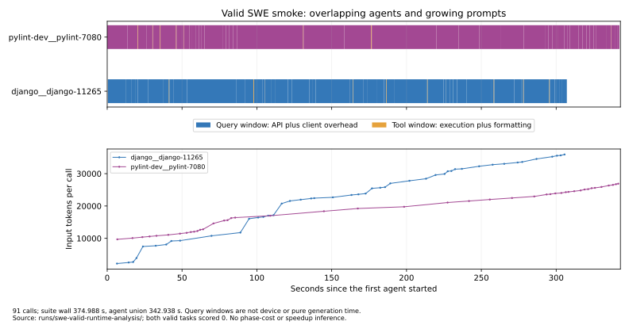

# Stage 12 — active

| Suite | functional_at | Evaluation hours/run | Score (95% Wilson interval) | Reference |
|---|---:|---:|---|---|
| GPQA Diamond | 10 | 0.26306 | 9/10, 90% (59.58–98.21%) | Published84.3%, GPU83.33% |
| SWE-bench Verified | 2 | 0.10416 | 0/2, 0% (0–65.76%) | NA |
| Terminal-Bench 2.1 | 2 | 0.63756 | 0/2, 0% (0–65.76%) | NA |

The GPQA server-sized list completed ten samples in947.013seconds, versus946.951seconds for the prior nightly run. Both scored9/10 with byte-identical visible answers; these are not20 independent accuracy samples. The latest CI device job took0.50889hours and workflow1.63944hours. This subset cannot establish parity with full-suite references. See `runs/server-sized-gpqa-c2/audit.json`.

SWE activation-repair smoke2 (42200513517) is valid: both original tasks submitted normally using their prepared environments, with no external agent retrieval or limit loss. Score0/2 reflects model patch failures. Evaluation took374.988seconds, device job0.22306hours and workflow1.16528hours. Nightly5 (42210467509) finished in0.90456evaluation hours/1.29250device-job hours, against7.82152workflow hours forecast. Raw1/5 (95%Wilson3.62–62.45%) is excluded: Xarray reached its issue’s external dataset endpoint and is quarantined. Three fully audited tasks scored0/3 (0–56.15%); Astropy submitted0 but three missing malformed responses prevent resolving one apparent32768-token cap. The frozen5 is not banked and functional_at stays2. The same5 repeat42228448171 uses accepted metadata-only token retention with unchanged limits/tasks/seed policy; conservative7.7925hour forecast. See runs/nightly-swe-observable/audit.json. The earlier network-contaminated smoke remains quarantined; its longer time does not establish a causal serving speedup. See `runs/smoke2-swe-activation-repair/audit.json`. Terminal lifecycle-repair smoke2 (42190891568) completed validly: both tasks ended normally, with task-quality failures and no agent external retrieval or limit cutoff. Evaluation took2295.205s, device job0.88611h and workflow1.96083h. Frozen nightly10 is dispatched as42206258311 at C2/B8; exploratory6.25h workflow forecast includes a1.5x task-mix margin over linear smoke scaling and build/queue allowance. This is not release admission evidence. Terminal42182632490 selected the correct implementation but failed before tasks: its delayed Docker launch survived a30s timeout and the retry collided with port8000. Generic fix `fix/docker-launch-ownership` passed a failing-baseline regression,51 focused tests and83 combined tests/fullhooks; publication2c4a262 is confirmed by the valid smoke; the actual lock also confirms the pinned Harbor revision. Terminal retry42175367781 failed before tasks because its dispatch omitted the implementation and selected stock; GPQA nightly42176391791 had the same omitted argument and is disqualified before score. Corrected replacements preserve all source SHAs/cohorts/limits and explicitly select the autoport. The first Terminal attempt failed before model initialization on a CI fabric-topology fault and has no score. The earlier SWE registration was superseded after an actual tool request exposed HTTP400; it was not cancelled for queueing. Frozen cohorts and sources are in `cohorts.json`, immutable run SHAs in `compute.json`.

No dry run or release has started. This is extended mode,48hours, starting2026-11-06T04:28:49UTC and ending2026-11-08T04:28:49UTC for release start; each release run has12hours. Next rungs depend on valid scores and measured projections. GPQA full198 (42208934357) was stopped for a non-fitting progress projection. At14:00:52UTC,10/198 completions were reported over1.48771hours, with two requests still decoding for over an hour. Extrapolation gives29.4567hours, or24.5473hours even treating both active requests as complete, exceeding12hours. These are uncertain empirical projections, not proof of looping or a mathematical lower bound. The original11.08496hour launch estimate was inadequate for the observed tail. Only build artifacts were uploaded after cancellation; private live logs were preserved, and no new accuracy is claimed. GPQA retains functional_at10. See runs/full-gpqa-observable/stop.json. Operator decision8 authorizes CI for Docker tasks, GPQA and final dry/release; local Docker remains unavailable. The stock CI early-stop/evidence limitation and proposed completed no-score rehearsal remain an unanswered operator question in `blocked.json`.

## Effort predictions and results

Device hours below are recorded effort costs, not end-to-end CI build/queue time. Unknown savings stay unknown until real workload timing supports a release-level estimate. Each effort's original confirmation and evidence are retained in `efforts.json`.

| Effort | Predicted device hours | Used device hours | Change / problem | Confirmed result |
|---|---:|---:|---|---|
| local-sandbox-runtime | 0.0000 | 0.0000 | none / solved | {"success":false,"result":"Backend unavailable; host-side provisioning required.","resolution":"Operator decision8 removes local Docker requirement by authorizingCI; environment remains unchanged, no runtime repair claimed."} |
| gpqa-local-credential | 0.0000 | Unknown | — / solved | Operator keeps local credential unavailable; valid GPQA smoke on authorized CI resolves dataset access for this stage. No local credential effort needed. |
| agent-capacity-and-contention | 0.2500 | 0.0776 | none / open | Both12/12 successful, exactAPIpromptparity, no preemptions; returningreuse.998871. Both31.9s, no speedup. C4sampledmaxrunning2/waiting3, so4residentrequests notproven; C2 retained. |
| source-only-packaging | 0.0000 | 0.0000 | kept / solved | {"policy":"byte-identical selected policy","generator":"complete class AST unchanged","host_checks":"4 packaging checks,7 precision tests,existing host contract passed","boundary":"Device-dependent imports stubbed; no native live CI/serving validation"} |
| harness-registration | 0.0000 | 0.0000 | kept / solved | {"host_tests_passed":110,"live_validation":false,"live_confirmation":{"evidence":"runs/current-runtime-benchmark/result.json","result":"Current full60 runtime exact stock TTI matrix completed8/8; real suite jobs import autoport"}} |
| suite-registration | 0.0000 | 0.0000 | kept / solved | {"host_tests_passed":7,"live_validation":false,"live_confirmation":{"evidence":["runs/server-sized-gpqa-c2/audit.json","runs/smoke2-swe-activation-repair/audit.json","runs/smoke2-terminal-lifecycle-repair/audit.json"],"result":"All three suites now have valid original smoke; frozen selections/limits confirmed"}} |
| ci-release-route | 0.0000 | 0.0000 | none / open | {"benchmarks":"Stock local existing-server path resolves exact stage11 matrix; no Docker required","eval_route":"Stock per-suite CI workflows omit spec tests","remaining":"CI exact early-stop dry-run control/artifact retention not exposed; no route change made"} |
| local-serving-check | 0.2000 | 0.0921 | none / solved | {"success":true,"registration":"full60 autoport;14 published hashes match","synthetic_growing_clients":2,"final_context_tokens":32768,"late_hit_fraction":0.9965343876604676,"client_wall_seconds":76.469,"real_agent_capacity":"not yet measured"} |
| local-host-contention | 0.1000 | 0.0985 | none / solved | {"success":true,"requests_per_wave":32,"idle_tokens_per_second":985.554416731418,"busy_tokens_per_second":645.0344483642087,"host_metric":"process CPU/step, not wall/device time"} |
| nightly-registration-preparation | 0.0000 | 0.0000 | none / solved | {"source_patches_prepared":3,"tests_per_candidate":23,"ruff":"pass","published":false,"dispatch":"requires valid smoke first"} |
| local-long-context | 0.1500 | 0.2540 | none / solved | {"success":true,"phase_seconds":[140.41494534397498,443.72461584897246],"max_prompt_tokens":262136,"generated_tokens":8,"concurrency":2,"preemptions":0,"new_trace_captures":0,"quality":"not measured; deterministic continuation stress"} |
| parser-protocol | 0.1000 | 0.1058 | kept / solved | {"swe_baseline_http":400,"candidate_http":200,"actual_mini_parser":"pass","actual_terminal_parser":"pass","exact_generated_token_pairs":[168,168],"focused_tests":30,"full_host_hooks":"pass","ci_score_validity":"pending"} |
| ci-fabric-topology | 0.2167 | 0.0000 | none / solved | {"original_result":"Host diagnosis excludes mesh alias error; physical channel deficit observed; recovery pending retry42175367781","live_confirmation":{"evidence":"runs/smoke2-terminal-lifecycle-repair/audit.json","result":"Later authorized stock CI runner completed valid Terminal smoke; no claim original faulty runner repaired"}} |
| native-tool-roundtrip | 0.0028 | 0.0005 | none / solved | HTTP200 and valid parsed submissionaction, no commands executed |
| ci-cache-routing | 0.0833 | 0.0528 | kept / open | Pinned cache files identical; full60healthy;2x168tokenIDs exact. CIstartup saving still unmeasured. |
| immutable-harbor-release-source | 0.0000 | 0.0000 | kept / solved | {"original_result":"Fullhosthooks pass; generic optionalpin locallyintegrated. Modelpin/actualCIcheckout confirmation pending.","live_confirmation":{"evidence":"runs/smoke2-terminal-lifecycle-repair/audit.json","result":"Actual completed run lock confirms model-scoped pinned Harbor source; transitive dependencies not claimed frozen"}} |
| nightly-current-base-preparation | 0.0000 | 0.0000 | none / solved | Each independent candidate passed10 host tests on eac7465; no publication edits or dispatch |
| real-history-capacity-preparation | 0.0000 | 0.0000 | none / open | GPQA each single-turn; reconstructed counts differ from API, so no meaningful multi-turn replay. Tool history extraction requirements prepared; capacity remains open |
| stage12-zero-cost-checker | 0.0000 | 0.0000 | none / open | 7 tests pass on candidate, original defect reproduced; installed skills unchanged pending operator decision |
| explicit-autoport-dispatch | 0.0000 | 0.0000 | kept / solved | {"original_result":"Host resolves explicit implementation correctly; replacement CI jobs dispatched. Existing SWE logs prove same explicit route loadsautoport. Replacement completion pending.","live_confirmation":{"evidence":["runs/smoke2-terminal-lifecycle-repair/audit.json","runs/server-sized-gpqa-c2/audit.json","runs/smoke2-swe-activation-repair/audit.json"],"result":"Explicit implementation confirmed in full60 autoport imports and valid completed suite runs"}} |
| harbor-model-pin-confirmation | 0.0000 | 0.0000 | kept / solved | {"result":"Live Terminal smoke42190891568 completed both valid tasks with pinned Harbor and no startup leaks; score0/2 not gated.","evidence":"runs/smoke2-terminal-lifecycle-repair/audit.json"} |
| gpqa-server-sized-preparation | 0.0000 | 0.0000 | none / solved | {"host_tests":32,"full_hooks":"pass","prepared_only":true,"live_admission":"pending actual nightly and measured capacity"} |
| nightly-resource-preparation | 0.0000 | 0.0000 | none / solved | {"definition_hashes_checked":15,"swe_storage_gib":50,"terminal_storage_gib":100,"runner_admission":"Unknown until assigned runner reports free space; no extra admission hook"} |
| prefill-under-load | 0.1500 | 0.1528 | none / solved | {"completed_requests":6,"client_seconds":278.58576828590594,"longest_prompt_tokens":86016,"longest_prefill_host_seconds":35.41071608196944,"max_stream_gap_ms":2427.0438690437004,"release_hours_saved":"not measured; no optimization change"} |
| long-prefill-decode-interference | 0.2500 | Unknown | — / not_run | Observed diagnostic stalls only; real overlap, return lengths and release projection pending. No scheduler change justified yet. |
| docker-startup-timeout-leaks-own-container | 0.0000 | 0.0000 | kept / solved | {"result":"Live Terminal smoke42190891568 completed both valid tasks with pinned Harbor and no startup leaks; score0/2 not gated.","evidence":"runs/smoke2-terminal-lifecycle-repair/audit.json"} |
| terminal-current-base-preparation | 0.0000 | 0.0000 | none / solved | {"focused_tests":32,"full_hooks":"pass","stock_resolved":"exact smoke2/C2/B8,peer0","published":false} |
| gpqa-terminal-state-capacity | 0.1000 | 0.0000 | none / open | {"C8_admitted":false,"reason":"Saved final content omits separated reasoning; cannot reconstruct complete real generated states or simultaneous C8 residency. Retain observed C2."} |
| gpqa-current-base-confirmation | 0.0000 | 0.0000 | none / solved | {"focused_tests":32,"full_hooks":"pass","stock_resolved":"exactGPQA10/C8/B8,peers0","publication":"not applied"} |
| nightly-current-base-reconfirmation | 0.0000 | 0.0000 | none / solved | Both patches32 focused tests/fullhooks, current2c4 base |
| gpqa-server-sized-c2-preparation | 0.0000 | 0.0000 | none / solved | Exact frozen10,C2/B8,peers0;32focused/fullhooks |
| gpqa-nightly-runtime-analysis | 0.0000 | 0.0000 | none / open | Ten prefills,max2active rows;29488device decode submissions; full-state/per-request tail unavailable |
| ci-phase-autoexport | 0.1500 | 0.1039 | kept / solved | {"host_tests":13,"exact_pairs":2,"tokens_per_pair":168,"complete_phase_steps":170,"errors":0,"file_mode":"0600","CI_artifact_collection":"Confirmed normal SWE rung; runs/swe-phase-accounting-confirmation/result.json","path_uniqueness":"explicitpid/timeplaceholdershostverified"} |
| swe-network-validity | 0.0000 | 0.0000 | kept / solved | {"host_tests":"7focused;3771passed15skipped fullsuite andhooks","generic_commit":"91e38023e0561504443361df8c8a21ed88c58b16","published_commit":"e368f08a23516f5594a7ed853b9e3d776a3a42fe","live_confirmation":{"run_id":42200513517,"valid_tasks":2,"external_retrieval":false,"limits_hit":false,"evidence":"runs/smoke2-swe-activation-repair/audit.json","device_cost":"charged to normal rung"}} |
| django-cap-loop-diagnosis | 0.2500 | 0.5402 | none / open | {"prefix_tokens":42823,"full_layers":60,"kl_hf_tt":0.13518481679154684,"top1_equal":true,"release_support_kl_infinite":true,"native_replays_looped":0,"native_replays":2,"root_cause":"unresolved; numerical differences and non-reproduction do not prove inherent behavior"} |
| real-history-capacity-replay | 0.0500 | 0.0161 | none / solved | {"calls":6,"errors":0,"preemptions":0,"client_seconds":58,"higher_capacity":"unproven"} |
| measured-workload-prefill | 0.1500 | 0.2758 | kept / solved | {"requests_passed":5,"cold_lengths":[4096,31755,107585],"cold_ttft_seconds":[2.2282864099834114,16.951805428951047,72.68344746797811],"overlap_seconds":78.910179,"overlap_anchor_tokens":28,"host_regime":"concurrent16threadHFCPU; no idlecomparison","change_scope":"Diagnosticclienttimeoutonly; servingunchanged"} |
| terminal-smoke-runtime-analysis | 0.0000 | 0.0000 | none / solved | {"calls":47,"call_coverage":1,"aggregate_api_seconds":2305.829807281494,"aggregate_non_api_seconds":313.6840307185059,"parse_error_request_seconds":403.8074607849121,"limitation":"No separate device generation/prefill/queue or actual tool timestamps; release savings unknown."} |
| next-rung-after-terminal-preparation | 0.0000 | 0.0000 | none / solved | {"tree_files_compared":1821,"identical_to_previously_tested_candidates":true,"resolved_configs_equal":true,"previous_validation":"61focused/fullhooks per candidate; unchanged tests not repeated"} |
| native-history-retention | 0.0000 | 0.0000 | none / solved | {"setting":"agent_kwargs.store_all_messages=true","paired_export_check":"identical LLM call kwargs/native content; only result metadata added","limits":"Final message list may omit earlier calls after summarization or recovery; require coverage audit."} |
| terminal-server-sized-retention-preparation | 0.0000 | 0.0000 | none / solved | {"candidate":"296fdd5f9eb066ab1404ec082002930ffce0eb18","base":"4b94cf3ba86d30a6816149872e59cc34438748ae","focused_tests":34,"hooks":"pass","paired_native_request_exact":true,"published":false} |
| swe-phase-accounting-confirmation | 0.0000 | 0.0000 | none / solved | {"steps":9680,"prefill_steps":98,"decode_steps":9582,"prefill_input_tokens":65628,"host_compatibility_prefill_steps":9,"all_decode_device_sampled":true,"errors":0,"pending_at_end":0,"truncated":false} |
| larger-cohort-preparation | 0.0000 | 0.0000 | none / solved | {"nightly_prefixes_exact":true,"swe_catalog":500,"terminal_catalog":89,"nested_unique":true} |
| swe-valid-runtime-analysis | 0.0000 | 0.0000 | none / solved | {"calls":91,"query_window_seconds":643.4552664756775,"tool_window_seconds":5.513179779052734,"suite_seconds":374.9880950450897,"exact_api_time":null,"device_time":null} |
| ci-disk-admission-basis | 0.0000 | 0.0000 | none / open | {"declared_storage_gib":{"swe_smoke":20,"swe_nightly":50,"terminal_smoke":20,"terminal_nightly":100},"docker_filesystem_free":null,"task_admission_reserve":null,"result":"Stock evidence does not prove inequality; operator clarification requested, no added admission checks."} |
| measured-workload-idle-regime | 0.2000 | 0.1090 | none / solved | {"requests":5,"client_seconds":166.855,"cold_ttft_ms":[782.8310740878806,8284.344288986176,48065.079889958724],"overlap":{"input_tokens":107585,"concurrent_decode_requests":1,"window_seconds":49.25943780597299,"other_delivered_tokens":28,"other_output_tokens_per_second":0.5684189923216062,"all_anchors_live_through_window":true,"timing_boundary":"long request submit through first token, including scheduler wait"},"configuration_match":true,"causal_speedup_claim":false} |
| serving-shortfall-pricing | 0.0000 | 0.0000 | none / open | {"result":"Existing host accounting gives descriptive costs but does not identify causal per-release savings; explicit gaps retained","evidence":"runs/serving-shortfall-pricing/RESULT.json"} |
| ci-image-reuse | 0.0000 | 0.0000 | none / open | {"source_parity":"Proven immutable digest TT439c/plugin ca7; separate dispatched TTI checkout supplies task config","live_confirmation":"Pending next eligible normal task-list-only rung; no extra device job","saving":"50min per build hypothesis; measure actual workflow on reuse"} |
| current-runtime-benchmark-confirmation | 0.1690 | 0.0874 | none / solved | {"matrix_completed":8,"headline_completed":8,"runtime_matches_publication":true,"phase_export_errors":0,"within_box":true} |
| native-token-retention | 0.0000 | 0.0000 | none / open | {"supported":"return_token_ids true retained for parsed native calls; complete engine response sequence","limitation":"FormatError responses remain discarded","next":"Separate paired exactness/config confirmation effort"} |
| native-token-retention-confirmation | 0.1200 | 0.0623 | kept / solved | Identical native content/tool arguments/finish/usage, equal stock SamplingParams, all104on-sideIDs retained by actualLiteLLM1.108.1/mini2.2.8. Off rawIDs unavailable; no off/on ID claim. |
| malformed-response-retention | 0.0000 | 0.0000 | none / open | AutoDebug verifies upstreammini2.2.8 response loss; AutoFix cannot deploy supported TTI-only repair. Published repairedmini or authorizedgenericHarbor sourcecapability required; no wrapperintroduced. |
| nightly-swe-network-reach | 0.0000 | 0.0000 | none / open | AutoDebug/AutoFix: firstmodelaction intentionallyprobesissueURL, beforeenvironmentfailure; localreproductionworks. No genericharnessdefect oradmissiblerepair. Quarantine persists. Independentlydispatchedsame5repeat testsrepeatability withacceptedmetadata; no promise ofvalidity. |
| gpqa-c4-capacity | 0.1800 | 0.1405 | none / open | Four resident131072-input contexts,8/8 completions,no preemptions; scoredC4 confirmation pending. |
| gpqa-c4-scored10 | 0.5089 | Unknown | — / running | Same10 scored comparison;5.0089h conservative workflow projection,5.5h device box. |

Missing original prediction fields are retained explicitly in `efforts.json`; current conservative planning credit is not a retroactive forecast. No unmeasured savings are reported as results.

## Current configuration and measured limits

Full60-layer fresh autoport, HF/tokenizer revision842da3794eaa0b77d5f08bae87a17459d91ff475, context262144, mesh1x4. Current runtime publication439c22b0e991e5af626efafa7224edf28f84795b adds opt-in periodic phase export; earlier runs used08ee8790bcbcd9e85cb799593b2bbaf40b785134; the latest B1 confirmation below measures439c. Stock plugin ca7a18246e4111629ed6cb4a7d1192002749fccf remains unchanged. Native Gemma reasoning/tool parsers and automatic tool choice are enabled. Served defaults retain temperature1/top_p0.95 with operator top_k32; suite limits/settings are independently recorded in `serving_config.json`.

Smoke and current nightly runs use planned_clients2 and the smallest supported batch at or above it,8. Validated batches are1/8/16/32. Prefix caching, chunked prefill and asynchronous scheduling remain enabled. Decode and all-final prefill use the canonical device sampler; mixed/intermediate prefill may use the accepted stock host sampler. GPQA smoke observed5480 device-decode submissions and2 device-prefill submissions, no host sampling; submissions are not emitted-token counts. Actual saved SWE histories span up to107585 prompt-plus-completion tokens; six last-prefix requests atC2/B8 completed in58seconds with0preemptions and0.99958 inferred prefix reuse. Those earlier stress-history scores remain quarantined; valid repaired SWE smoke has a35998-token maximum. This diagnostic does not establish continuous peak residency or fastest concurrency. The GPQA saved histories are single-turn and unsuitable for a multi-turn capacity replay.

Local synthetic C2 traffic reached262136prompt+8output tokens without preemptions or new captures. This establishes a physical envelope, not real-agent capacity or long-context accuracy. Host CPU contention reduced synthetic C32 delivery from985.55 to645.03tokens/s; release hours saved by a remedy cannot yet be priced because real tool generation/CPU shares are pending.

Local synthetic prefill interference is measured in `runs/prefill-under-load/RESULT.md`:4K/32K/84Ki probes took1.43/9.52/35.41seconds to first token while an anchor decoded. Longer probes coincided with up to2.43second stream-event gaps. Short sequential baselines and HTTP event coalescing limit attribution; release cost remains unknown until actual task overlap is available.

The unchanged stage11 TTI benchmark matrix completed8/8 requests in27.121seconds after parser registration. Fresh full-model vLLM headline4096input/128output/B1/C1 completed8/8: mean TTFT752.844ms and decode35.304tokens/s/user. These are separate from agent-suite scores. Device time and rooflines are unknown: live vLLM profiling is prohibited, and host-wall phase estimates are not device measurements. Evidence: `runs/parser-tti-benchmark/result.json`.

Cache routing to existing persistent mounts passed identical-file checks, live environment checks and two exact168-token output pairs; TTI publication8437f18 includes it. CI startup savings are not yet measured. A default-preserving generic Harbor source-pin repair passed full host hooks on defect branch `fix/model-scoped-harbor-revision` at7079fe2 and is locally integrated at eac7465. Model-specific pin e76c762fca5267dfb36e1f900f0a7724ed72e735 is published at8a3c949 after58focusedtests and fullhooks. The completed Terminal smoke confirms this exact Harbor revision in its lock. Transitive package identity is not claimed frozen.

Execution changes are committed locally and logged in the multigoal stage commit manifest. This execution checkout has no remote and is never pushed. Source-only CI publications use the separately authorized checkouts/branch. The compact telemetry packet7ef7a2c1-3dce-40e4-b6d3-0c83a631ac7e exists locally with current-runtime headline values, all three valid subset scores and explicit missing measurements. Historical blocked attempts are preserved in Git and setup diagnostics; they are not current completion claims.

The full42823-token conditional HF/TT comparison agrees on the top token but has KL0.135185 and differing truncated sampling support. Two native replays did not loop. The original capped response remains a failure; root cause remains open, with further probes deferred until a normal-rung recurrence supplies exact onset evidence. See `runs/django-cap-loop-diagnosis/RESULT.md`.

The idle-host workload repeat passed5requests: cold TTFT0.783/8.284/48.065seconds at4096/31755/107585tokens; overlap49.259seconds with28anchor tokens delivered. The prior HF-contended measurements remain separate; neither single regime establishes a causal speedup or release-level saving. See `runs/measured-workload-idle-regime/RESULT.md`.

Query windows include API work and client overhead; the plot does not separate device generation, prefill or queue time. The two agents overlap, so summed lane time exceeds suite wall time.

Capacity preparation has a conditional C4 SWE5 source candidate (`3d5d41d149ac8d12465842232c97d11d413baf9b`) with34focused tests and hooks passing. It is not dispatched or device-validated. The current planning guess is25% less eval wall time on provisional GPQA198/SWE5/Terminal10 lists,2.164hours total, with0.15local device hours estimated; these are forecasts, not measurements or frozen release projections. Acceptance still needs distinct real histories, resource admission and a same-cohort scored comparison. C2 rungs proceed independently.

Current-runtime B1 confirmation used the published439c source with bounded phase export. The exact stock TTI matrix completed8/8 in27.08750s (dataset128/128; chat-template prefills141–143). The standard headline completed8/8 exact4096/128 requests in34.81444s: TTFT756.10ms and35.32313decode tokens/s/user. Device hold0.08735h versus0.169h forecast, within0.20h box. This is route confirmation, not a release or isolated speedup; device-time rooflines remain unknown. See `runs/current-runtime-benchmark/RESULT.md`.

Stock CI can reuse the immutable server image for unchanged TT/plugin runtime and TTI-only task configuration, avoiding an estimated50minute build per job. The next normal rung will confirm that path; no measured saving is claimed yet. See `runs/ci-image-reuse/RESULT.md`.

Native token retention confirmation: metadata-only SWE request option accepted after native fields/finish/usage and stock SamplingParams matched; actual LiteLLM/mini retained all104 generated IDs. Device use0.06232h versus0.12h predicted/.20h box. Off-side IDs unavailable; FormatError loss remains open. See runs/native-token-retention-confirmation/result.json.

GPQA four-client capacity confirmation used 0.140462 device hours versus 0.18 predicted (0.30-hour box). Four full 131072-token input contexts were simultaneously resident; all eight requests completed, with no preemptions or post-warmup captures and 99.854% return-prefix reuse. This is synthetic capacity evidence, not a scored result or proof of four advertised-length contexts. Same-ten-task scored C4 comparison `42232104462` is active on TTI `82da396ef63bbe95cedbe254bb5433d905cd0491`, TT `439c22b0e991e5af626efafa7224edf28f84795b`, stock plugin, B8. Its conservative projection is 5.008889 hours including a full four-hour request-tail allowance and half-hour queue margin; expected device cost before that allowance is 0.508889 hours. C4 is not yet accepted.

Terminal nightly10 `42206258311` was stopped after the 14:15:44UTC snapshot still showed2/10 completed in2.2evaluation hours. Completed-throughput extrapolation gives11evaluation hours, or12.14861hours including observed queue/setup, exceeding12hours without tail margin. This small, right-censored sample is uncertain; it does not prove no possible completion could fit. Repeated prefills and continuous decode exclude a device stall, but logs cannot classify task loops or give a valid partial score. Terminal decision is stop, functional_at2, with the earlier valid smoke score retained. See `runs/nightly-terminal-observable/stop.json`.

GPQA dispatch correction: attempts42232104462 and42233126698 were mistakenly submitted to `workflow=agentic`, which excludes common GPQA and produced no score. AutoDebug verified the route and198 focused host tests passed; no model, limits, or cohort changes were needed. Corrected `workflow=evals` runs are42234229161 (ten/C4) and42234274300 (nested twenty/C2), on the same immutable candidate SHAs. The C4 failed device job cost0.122222hours and counts against its5.5-hour effort box. The twenty-task projection is7.721257hours: slower observed full-rung completed-throughput scaled to twenty, measured setup, full four-hour request-tail allowance, and half-hour queue margin. It is an uncertain admission estimate, not a measured twenty-task result.

C4 GPQA candidate42234229161 completed the frozen10 with9/10 correct (Wilson95%59.58–98.21%) in0.178457evaluation hours,0.295556device-job hours and0.301111workflow hours. All visible answers match historicalC2, but its older runtime differs in phase-export instrumentation. ContemporaryC2 baseline42237390829 is running on the same CI host; C2 remains selected until the pair is assessed. See `runs/gpqa-c4-scored10-evals/audit.json`.

SWE retained repeat42228448171 completed in1.122755evaluation hours (1.210833device-job,1.215833workflow), raw1/5 with Wilson95%3.62–62.45%. Four tasks are valid and no external retrieval was observed; Astropy remains held because missing response75 aligns with32767decode steps and its body cannot distinguish repetition from interrupted progress. All220saved responses retain IDs matching usage. The frozen5 is not banked; functional_at remains2. Model-owned token retention is a new bounded repair hypothesis, not a selected replacement task list. See `runs/nightly-swe-retained-repeat/audit.json`.

The contemporary GPQA pair accepts C4/B8 for GPQA:938.039050s atC2 versus642.445722s atC4, a31.5118% reduction and0.0821093hours saved on the frozen10. Both score9/10 (Wilson95%59.58–98.21%), all visible hashes match, and executed work matches2390prefill tokens/56042active decode-row steps. Total effort0.761667device hours includes the failed wrong-route attempt, above0.508889forecast and within5.5hour box; predicted saving was0.0657648hours. One sequential same-host pair supports this cohort-level choice, not independent accuracy replication or full198 fit. Tool suites stayC2. See `runs/gpqa-c4-scored10/RESULT.md`.
