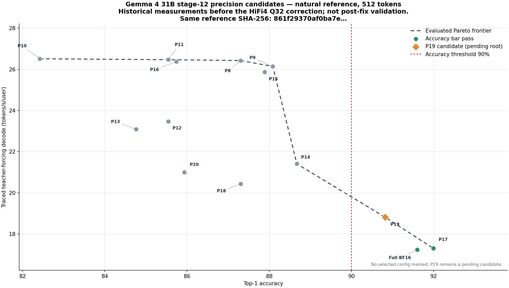
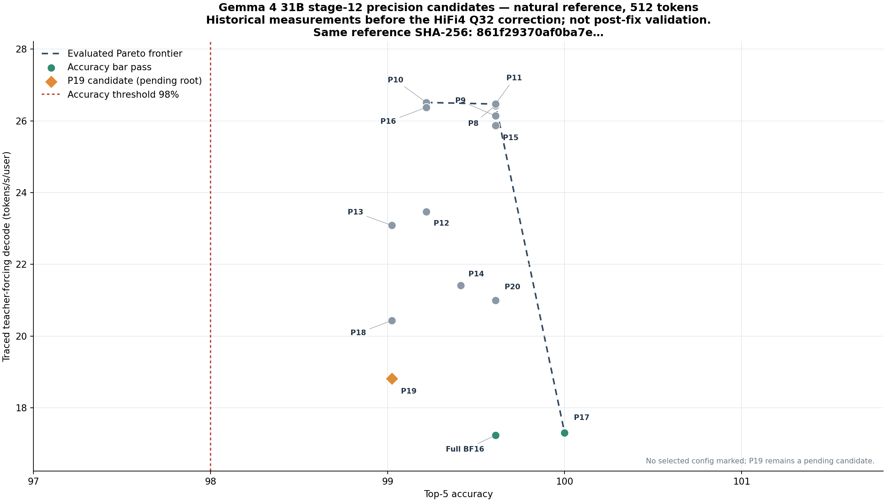

# Stage-12 natural-512 precision candidates

> **Scope:** Historical measurements before the HiFi4 Q32 correction; not post-fix validation. The precision rows use policy-specific historical Q geometry; Q size is not uniform across candidates, and this plot does not claim every point used Q128.

Download the [compact CSV data](stage12-natural512-pareto.csv) or [machine-readable summary](stage12-natural512-pareto.json).

Performance is traced teacher-forcing decode tokens/s/user on the same 512-token natural-text reference. These are accuracy-round diagnostic rates, not vLLM serving rates. No config is currently marked selected; P19 is still pending root selection.

| Candidate | Top-1 | Top-5 | Top-100 | Traced decode t/s/u | Policy | Status |
|---|---:|---:|---:|---:|---|---|
| P8 | 87.3047% (447/512) | 99.6094% (510/512) | 100.0000% | 26.427 | attn=bfp8_lofi; mlp=bfp8_lofi; down=bfp8_lofi; head=bfp8_lofi; KV=bfloat8_b | below_accuracy_bar |
| Full BF16 | 91.6016% (469/512) | 99.6094% (510/512) | 100.0000% | 17.236 | attn=bf16; mlp=bf16; down=bf16; head=bf16; KV=bfloat16 | accuracy_pass |
| P9 | 88.0859% (451/512) | 99.6094% (510/512) | 100.0000% | 26.142 | attn=bfp8; mlp=bfp8; down=bfp8; head=bfp8; KV=bfloat8_b | below_accuracy_bar |
| P10 | 82.4219% (422/512) | 99.2188% (508/512) | 100.0000% | 26.513 | attn=bfp8_lofi; mlp=bfp8_lofi; down=bfp8_lofi; head=bfp8_lofi; KV=bfloat8_b | below_accuracy_bar |
| P11 | 85.5469% (438/512) | 99.6094% (510/512) | 100.0000% | 26.469 | attn=bfp8_lofi; mlp=bfp8_lofi; down=bfp8_lofi; head=bfp8_lofi; KV=bfloat8_b | below_accuracy_bar |
| P12 | 85.5469% (438/512) | 99.2188% (508/512) | 100.0000% | 23.466 | attn=bfp8_lofi; mlp=bfp8_lofi; down=bf16; head=bfp8_lofi; KV=bfloat8_b | below_accuracy_bar |
| P13 | 84.7656% (434/512) | 99.0234% (507/512) | 100.0000% | 23.087 | attn=bf16; mlp=bfp8_lofi; down=bfp8_lofi; head=bfp8_lofi; KV=bfloat8_b | below_accuracy_bar |
| P14 | 88.6719% (454/512) | 99.4141% (509/512) | 100.0000% | 21.408 | attn=bfp8_lofi; mlp=bf16; down=bfp8_lofi; head=bfp8_lofi; KV=bfloat8_b | below_accuracy_bar |
| P15 | 87.8906% (450/512) | 99.6094% (510/512) | 100.0000% | 25.870 | attn=bfp8_lofi; mlp=bfp8_lofi; down=bfp8_lofi; head=bf16; KV=bfloat8_b | below_accuracy_bar |
| P16 | 85.7422% (439/512) | 99.2188% (508/512) | 100.0000% | 26.377 | attn=bfp8_lofi; mlp=bfp8_lofi; down=bfp8_lofi; head=bfp8_lofi; KV=bfloat16 | below_accuracy_bar |
| P17 | 91.9922% (471/512) | 100.0000% (512/512) | 100.0000% | 17.300 | attn=bf16; mlp=bf16; down=bf16; head=bf16; KV=bfloat8_b | accuracy_pass |
| P18 | 87.3047% (447/512) | 99.0234% (507/512) | 100.0000% | 20.433 | attn=bf16; mlp=bfp8_lofi; down=bf16; head=bf16; KV=bfloat8_b | below_accuracy_bar |
| P19 | 90.8203% (465/512) | 99.0234% (507/512) | 100.0000% | 18.810 | attn=bf16; mlp=bf16; down=bfp8_lofi; head=bf16; KV=bfloat8_b | candidate_pending_root_selection |
| P20 | 85.9375% (440/512) | 99.6094% (510/512) | 100.0000% | 20.999 | attn=bfp8_lofi; mlp=bf16; down=bfp8_lofi; head=bf16; KV=bfloat8_b | below_accuracy_bar |

Acceptance thresholds shown for reference: top-1 ≥90%, top-5 ≥98%. The natural-reference scores are the comparability filter used here; this table does not assert other readiness gates have passed.
