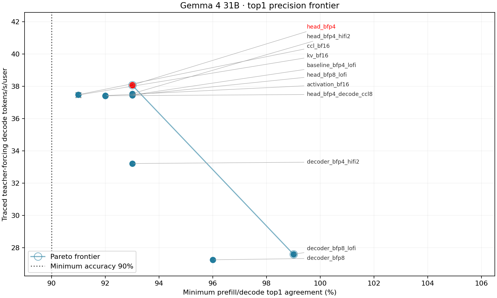
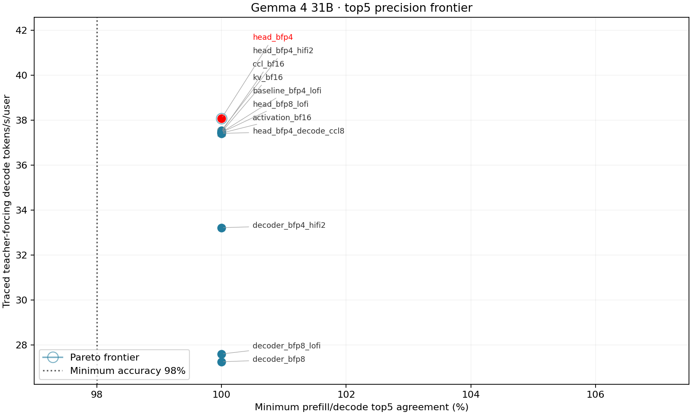

# Datatype sweep

Selected **head_bfp4**: BFP4/LoFi decoder projections and LM head; BFP8 KV and prefill MLP/CCL values; BF16 residuals, decode CCL, logits and sampling values. No layer exceptions.

Default-path full-model agreement: top1 **93%**, top5 **100%**, top100 **100%**. Required gates: **90% / 98% / 100%**. Accuracy covers100 continuation positions from one AIME24 chat-template prompt, not the full dataset.

Traced teacher-forcing (161-token prompt,100 continuation positions,B1): TTFT **93.86ms**, decode **38.071tokens/s/user**. Post-selection warmed token-out (**4096 input /128 output /batch1 /one request**): TTFT **656.18ms**, decode **34.830tokens/s/user**. Later serving comparisons must use this token-out number. It includes first-token and final-history reads, with no per-token readback in the decode loop.

## Evaluated full-model policies

| Config | Minimum top1 | top5 | top100 | Traced TF t/s/u | Token-out t/s/u | Gate |
|---|---:|---:|---:|---:|---:|---|
| baseline_bfp4_lofi | 93% | 100% | 100% | 37.456 | 34.296 | pass |
| decoder_bfp4_hifi2 | 93% | 100% | 100% | 33.213 | 30.696 | pass |
| decoder_bfp8_lofi | 99% | 100% | 100% | 27.594 | 25.855 | pass |
| decoder_bfp8 | 96% | 100% | 100% | 27.247 | 25.532 | pass |
| head_bfp4 | 93% | 100% | 100% | 38.071 | 34.830 | pass |
| head_bfp4_hifi2 | 93% | 100% | 100% | 37.544 | 34.626 | pass |
| head_bfp8_lofi | 93% | 100% | 100% | 37.450 | 34.304 | pass |
| kv_bf16 | 91% | 100% | 100% | 37.457 | 34.126 | fail |
| activation_bf16 | 92% | 100% | 100% | 37.424 | 34.295 | pass |
| ccl_bf16 | 91% | 100% | 100% | 37.481 | 34.296 | pass |
| head_bfp4_decode_ccl8 | 92% | 100% | 100% | 37.410 | 34.587 | pass |

Top-k table/plot values conservatively use the minimum of prefill and decode agreement. All policies meet accuracy; BF16 KV fails the target working-set memory check. Other policies are rejected for speed. The selected default-path confirmation replaces its search point in the final plots; the original38.035TF measurement remains in head_bfp4/readiness_accuracy.json. The final confirmation repeats span38.043–38.097t/s/u; token-out measures34.830t/s/u. No eager timing ranks a policy.





The top1 frontier trades the selected93% agreement for the slower99% BFP8/LoFi decoder control. At top5=100% the selected policy is fastest. Red marks selection; dotted lines mark the required gate. BFP4 LoFi/HiFi2 controls cover attention, gate/up, down and head. BFP8 LoFi/HiFi2 controls cover the same projection groups. Combined BFP8 decode-CCL plus the selected head also loses in both timing regimes.

## Capability, memory and quality

Advertised and supported context remains262144. selected_default/full_context_post_barrier.json proves262143/262144 prefill and decode at position262143. Non-aligned prompts and repeated sampled/greedy replay pass. Full target32-agent execution retains the requested label through32,083-token chat prefixes in every slot. The estimated workload remains32 agents ×32768 live tokens, typical context4096; the allocated pool is1048576 tokens. memory_plan.json reconciles selected allocator snapshots at all configured batches and preserves the conservative prior-stage transient reserve with its scope.

BF16 KV initially failed an SDPA L1 admission check. AUTODEBUG.md derives the exact2048-byte overlap; AUTOFIX.md records the Q64/K128 repair, tracked non-aligned smoke and subsequent full-model result. It is rejected for target-pool capacity, not the initial error. No advertised capability was reduced.

qualitative_verdict.md reviews all six prompt-correct shared outputs against pinned HF controls. The long-prefix JSON fence is reproduced by baseline and higher-precision controls; it is not strict tool-call conformance. Fixed128-token suite caps also truncate HF controls; no complete code/functionality claim is made from partial snippets.

## Default construction and reproduction

selected_precision_config.json is required by Gemma4Model and build_generator default construction. Missing artifacts fail instead of silently changing precision. configs/baseline_bfp4_lofi.json is the explicit safe-baseline override. runtime_policy.json files serialize actual weight dtypes and kernel attributes; runner assertions verify them. Residual, norm, decode-CCL backing, activation, KV, head, logits/sampling and context fields feed construction. Layer exceptions use the same dtype/fidelity aliases.

activation_dtype denotes prefill gate/up outputs and their intermediates; remaining activation paths are BF16. Norms use HiFi4, attention HiFi2, head FP32 accumulation, decoder projection FP32 accumulation only for the BF16/HiFi4 alias; approximation is off and packer accumulation on. Sampling_dtype denotes BF16 values; token IDs/history remain UINT32. No MoE/router exists in this target.

Run from this checkout after the installed model-bringup environment.py setup:

```bash
TT_METAL_TRACE_ALLOC_TRACKING=0 TT_METAL_DEVICE_PROFILER=0 python_env/bin/python -m models.autoports.google_gemma_4_31b_it.tests.run_datatype_candidate --id selected_default --acceptance
```

Per-candidate commands, branch/commit, hardware, mesh, policies, traces and environment are in sweep_results.json / sweep_results.csv. All runs use local TP4 Blackhole p300c, mesh1×4. Performance batches are below; diagnostics-enabled state checks are separate. Source manifests and work_log.md preserve provenance. selected_acceptance_snapshot/source_manifest.json scopes the earlier full-context and qualitative acceptance artifacts; selected_default/source_manifest.json scopes the final accuracy/performance refresh. Selected branch equivalence is documented in work_log.md. No full-model device-time/roofline numbers are inferred from host times, and no new profiling was needed.

| Batch / concurrent requests | Token-out TTFT ms | Token-out t/s/user |
|---:|---:|---:|
| 1 | 656.18 | 34.830 |
| 32 | 20649.79 | 23.485 |
| 16 | 10316.59 | 29.597 |
| 8 | 5156.53 | 32.905 |

VLLM integration is explicitly outside this stage. propagation_check.json proves the required default model/generator artifact; it makes no claim about an adapter that has not yet been implemented. Future serving must inherit this default and verify registration in stage09.

## Acceptance status

Independent stage review: **clean-pass** (stage_review.md). Validation complete. Local checkpoint SHAs are recorded in work_log.md. No push or vLLM integration.

Validation: seven host policy tests pass; source hooks pass; strict context checker passes. Agentic-serving checker exits1 with only the documented tied-weight representation advisory: BF16 row-major lookup and BFP4 tiled/transposed head require two accounted-for layouts. See validation_summary.json and memory_plan.json.
