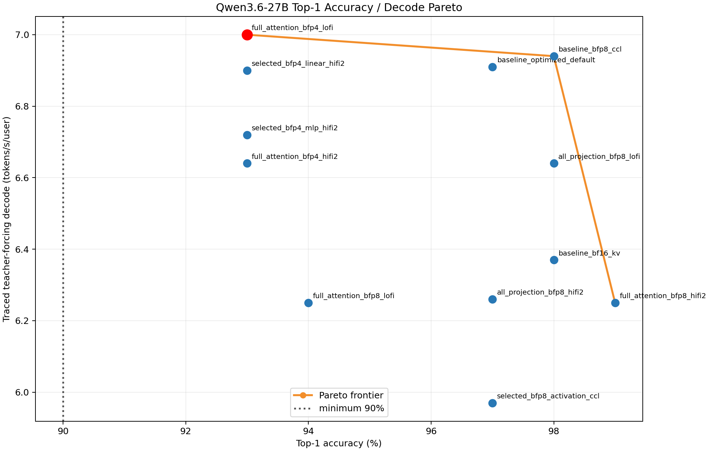
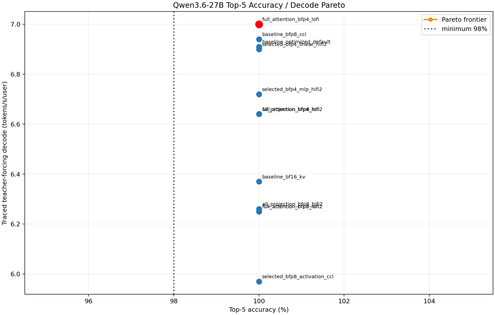

# Qwen3.6-27B datatype sweep — selected and validated

**Selected: `gdn_attn8_head8_mlp4_lofi`**, written to [selected_precision_config.json](selected_precision_config.json) and consumed by the normal constructor when no explicit override is supplied. It is the fastest of the **25 evaluated full-model policies** that passes the full-model accuracy gates and current-source P1: **37.645631771010 traced teacher-forcing tokens/s/user**, versus the refreshed baseline median **30.887764405383** (21.8788% higher). See [sweep_results.json](sweep_results.json) and [sweep_results.csv](sweep_results.csv). The next fastest policy, combined gate/up LoFi, also passes P1 at **36.421227901194776 t/s/u**; the **1.224403869815170 t/s/u** gap exceeds baseline noise **0.03898973165338404**.

The selected full-model TF minima are **top-1 91.796875%, top-5 98.828125%, top-100 100%** (natural-text reference); AIME24 gives **98% / 100% / 100%**. Required thresholds are **90% / 98% / 100% per reference**, for both prefill and teacher forcing. Selected TF TTFT is **95.784 ms on AIME P161/G100** and **85.861 ms on natural P128/G512**.

The normal selected-default **post-selection token-out benchmark** passes: **75.380767 ms TTFT, 37.817704 tokens/s/user (26.442642 ms/token)**. This is batch1, P128/G128, all64 layers, 262144-token cache allocation, serial TP4, median of three warmed 127-step resident decode windows with device sampling/feedback and no per-token host readback. Use this token-out number for later reports and vLLM comparisons. The prior optimized full-model same-harness result was 86.850814 ms / 30.999750 t/s/u; the new measured throughput is 21.9936% higher. Teacher forcing remains the sweep selection metric.

All four final P1 checks pass, including the HF control over 6144 measured positions. The stage runner gate and the artifact inventory passes (**149 required checks pass; 7 optional checks are not evaluated**). Selected-default token-out, trace-allocation tracking, non-aligned/32769-token smoke, resumed prefill and shared qualitative checks finished successfully. Independent [stage review](stage_review_round1.md) returned **clean-pass**, with no required work; local checkpoint details are in [commit_receipt.json](commit_receipt.json). This stage does not begin vLLM integration.

The selected policy uses inner MLP gate/up and down **BFP4/LoFi**, preserving baseline MLP exceptions at layers **0 and 63**; GDN attention **BFP8/HiFi2**, full-attention attention **BFP8/LoFi**, head **BFP8/HiFi2**, activation/residual/projection inputs and CCL **BF16**, and unchanged **BFP8 KV**. Embedding, logits/sampling and recurrent state stay BF16; norm scales and correction types retain the explicit validated policy. Complete fields and exceptions are in the selected artifact. Selection satisfies P1; no BFP4-required-to-fit waiver is used.

## Thresholds, references and timing noise

Acceptance requires **top-1 ≥90%, top-5 ≥98%, top-100 =100% on each reference and on both prefill and teacher forcing**. P1 must also pass against the highest-precision full-context reference that fits. No BFP4-required-to-fit limitation has been established.

All completed rows use the full 64-layer model, batch 1, serial TP4 on four Blackhole p300c devices (P300x2, chips 0–3), and **262144-token cache allocation**. The common references are:

- [AIME24 chat reference](../../readiness_aime24_chat.refpt): chat-template prompt, 161 prompt tokens and **100 generated target tokens**. Provenance is retained in the prior [reference command manifest](../full_model/commands.json).
- [Natural-text reference](../../readiness_natural_p128_g512.refpt): 128 prompt tokens and **512 real next tokens** from a contiguous passage of *A Tale of Two Cities*, with HF top-100 scores at each position. See the [provenance sidecar](../../readiness_natural_p128_g512.refpt.provenance.json) and [reference generator](generate_natural_reference.py). These are natural tokens, not an HF-greedy continuation.

Each process repeats traced teacher forcing twice. Reported throughput is total timed decode tokens divided by total elapsed decode time across both references/repeats. Timing includes host reference-token updates and token readback. Trace IDs and capture/replay counters are checked; eager decode is not ranked. The completed post-selection benchmark is the separate warmed token-out/no-readback path.

[Refresh 3](refresh3_bfp8_baseline.json) and [refresh 4](refresh4_bfp8_baseline.json) provide weighted repeat rates **30.8917365746, 30.9047181087, 30.8657283771 and 30.8837922362 t/s/u**. Their median is **30.8877644054** and max-minus-min spread is **0.0389897317 t/s/u**, independently recomputed by [report.py](report.py) and recorded in [baseline_spread.json](baseline_spread.json). A gain must exceed that spread; candidates within it tie. The baseline table row uses refresh 3's combined-repeat rate, **30.898226**; refresh 4 is **30.874758**. These process aggregates differ from the four-repeat median by construction.

Repeated timing does not multiply accuracy sample size. Each reference's top-1 Wilson interval is in the JSON; one AIME token changes its score by one percentage point, so small score differences do not establish quality superiority.

## All completed full-model measurements

Accuracy columns are percentages. AIME top-5/top-100 are **100% for every row**. Natural columns show worst-repeat TF top-1/top-5/top-100; the prefill column shows the lower top-1 across references. All prefill top-5/top-100 gates pass. TTFT shows the per-reference median in AIME/natural order. The numerical gate considers every prefill and TF row, not only these display minima. The P1 column distinguishes measured passes, unmeasured candidates and the primary runtime error. A short-reference pass alone is not selection eligibility. Exact unrounded values remain in the linked JSON; displayed throughput uses six decimals.

| Config / exact command | AIME TF top-1 | Natural TF top-1 / 5 / 100 | Min prefill top-1 | AIME / natural TTFT, ms | Traced TF t/s/u | Numerical gate | P1 |
|---|---:|---:|---:|---:|---:|---|---|
| [`bfp8_baseline`](refresh3_bfp8_baseline.json) ([cmd](refresh3_bfp8_baseline.command.json)) | 100.00 | 97.8516 / 100.0000 / 100.0000 | 98.6328 | 105.033 / 97.448 | 30.898226 | Pass | Pass |
| [`attention8_hifi2`](full_attention8_hifi2.json) ([cmd](full_attention8_hifi2.command.json)) | 100.00 | 97.8516 / 100.0000 / 100.0000 | 97.6562 | 100.300 / 91.767 | 32.936961 | Pass | Not evaluated |
| [`attention8_lofi`](full_attention8_lofi.json) ([cmd](full_attention8_lofi.command.json)) | 100.00 | 97.4609 / 100.0000 / 100.0000 | 97.8516 | 98.545 / 91.091 | 32.975061 | Pass | Not evaluated |
| [`bf16_all_hifi4`](full_bf16_all_hifi4.json) ([cmd](full_bf16_all_hifi4.command.json)) | 100.00 | 99.0234 / 100.0000 / 100.0000 | 99.0234 | 140.796 / 133.883 | 23.447036 | Pass; historical control | Not evaluated |
| [`bf16_hifi4`](full_bf16_hifi4.json) ([cmd](full_bf16_hifi4.command.json)) | 100.00 | 98.4375 / 100.0000 / 100.0000 | 99.0234 | 120.308 / 111.727 | 24.312887 | Pass; historical control | Not evaluated |
| [`bfp8_accuracy`](full_bfp8_accuracy.json) ([cmd](full_bfp8_accuracy.command.json)) | 99.00 | 98.2422 / 100.0000 / 100.0000 | 98.4375 | 105.517 / 98.112 | 30.459304 | Pass | Not evaluated |
| [`ccl8`](full_ccl8.json) ([cmd](full_ccl8.command.json)) | 100.00 | 97.0703 / 100.0000 / 100.0000 | 97.6562 | 105.708 / 98.170 | 30.265895 | Pass | Not evaluated |
| [`down4_hifi2`](full_down4_hifi2.json) ([cmd](full_down4_hifi2.command.json)) | 100.00 | 94.9219 / 99.8047 / 100.0000 | 94.7266 | 103.693 / 96.024 | 31.457139 | Pass | Not evaluated |
| [`down4_lofi`](full_down4_lofi.json) ([cmd](full_down4_lofi.command.json)) | 100.00 | 94.9219 / 99.8047 / 100.0000 | 94.7266 | 103.577 / 95.831 | 31.829739 | Pass | Runtime error; unscored |
| [`gateup4_hifi2`](full_gateup4_hifi2.json) ([cmd](full_gateup4_hifi2.command.json)) | 98.00 | 93.7500 / 99.4141 / 100.0000 | 94.3359 | 101.631 / 94.112 | 32.097349 | Pass | Not evaluated |
| [`gateup4_lofi`](full_gateup4_lofi.json) ([cmd](full_gateup4_lofi.command.json)) | 98.00 | 93.7500 / 99.4141 / 100.0000 | 94.3359 | 101.438 / 93.939 | 33.109271 | Pass | Pass |
| [`gdn_attn8_head8_down4_lofi`](full_gdn_attn8_head8_down4_lofi.json) ([cmd](full_gdn_attn8_head8_down4_lofi.command.json)) | 99.00 | 94.5312 / 99.8047 / 100.0000 | 94.7266 | 99.494 / 89.473 | 34.845850 | Pass | Not evaluated |
| [`gdn_attn8_head8_gateup4_hifi2`](full_gdn_attn8_head8_gateup4_hifi2.json) ([cmd](full_gdn_attn8_head8_gateup4_hifi2.command.json)) | 98.00 | 94.1406 / 99.6094 / 100.0000 | 94.3359 | 95.366 / 88.146 | 35.203185 | Pass | Not evaluated |
| [`gdn_attn8_head8_gateup4_lofi`](full_gdn_attn8_head8_gateup4_lofi.json) ([cmd](full_gdn_attn8_head8_gateup4_lofi.command.json)) | 98.00 | 94.1406 / 99.6094 / 100.0000 | 94.3359 | 96.602 / 87.729 | 36.421228 | Pass | Pass |
| [`gdn_attn8_head8_mlp4_hifi2`](full_gdn_attn8_head8_mlp4_hifi2.json) ([cmd](full_gdn_attn8_head8_mlp4_hifi2.command.json)) | 98.00 | 91.7969 / 98.8281 / 100.0000 | 91.9922 | 93.977 / 86.456 | 35.921563 | Pass | Not evaluated |
| [`gdn_attn8_head8_mlp4_lofi`](full_gdn_attn8_head8_mlp4_lofi.json) ([cmd](full_gdn_attn8_head8_mlp4_lofi.command.json)) | 98.00 | 91.7969 / 98.8281 / 100.0000 | 91.9922 | 95.784 / 85.861 | 37.645632 | Pass | **Pass; selected** |
| [`gdn_attn8_hifi2_head8_hifi2`](full_gdn_attn8_hifi2_head8_hifi2.json) ([cmd](full_gdn_attn8_hifi2_head8_hifi2.command.json)) | 99.00 | 98.2422 / 100.0000 / 100.0000 | 97.8516 | 98.620 / 91.144 | 33.724553 | Pass | Pass |
| [`head8_hifi2`](full_head8_hifi2.json) ([cmd](full_head8_hifi2.command.json)) | 100.00 | 97.6562 / 100.0000 / 100.0000 | 98.0469 | 104.315 / 96.626 | 31.533211 | Pass | Not evaluated |
| [`head8_lofi`](full_head8_lofi.json) ([cmd](full_head8_lofi.command.json)) | 100.00 | 97.6562 / 100.0000 / 100.0000 | 98.2422 | 104.353 / 96.754 | 31.531361 | Pass | Not evaluated |
| [`kv4`](full_kv4.json) ([cmd](full_kv4.command.json)) | 99.00 | 94.7266 / 99.6094 / 100.0000 | 95.5078 | 99.215 / 91.840 | 30.881834 | Pass | Not evaluated |
| [`kv_bf16_control`](full_kv_bf16_control.json) ([cmd](full_kv_bf16_control.command.json)) | 100.00 | 97.6562 / 100.0000 / 100.0000 | 97.8516 | 125.915 / 118.163 | 30.875317 | Pass | Not evaluated |
| [`mlp4_hifi2`](full_mlp4_hifi2.json) ([cmd](full_mlp4_hifi2.command.json)) | 98.00 | 91.9922 / 98.4375 / 99.8047 | 92.5781 | 100.465 / 92.687 | 32.688547 | Fail: natural TF top-100 | Not evaluated |
| [`mlp4_lofi`](full_mlp4_lofi.json) ([cmd](full_mlp4_lofi.command.json)) | 98.00 | 91.9922 / 98.4375 / 99.8047 | 92.5781 | 100.002 / 92.317 | 34.131078 | Fail: natural TF top-100 | Not evaluated |
| [`mlp8_lofi`](full_mlp8_lofi.json) ([cmd](full_mlp8_lofi.command.json)) | 99.00 | 96.6797 / 100.0000 / 100.0000 | 97.0703 | 105.025 / 97.653 | 30.872975 | Pass | Not evaluated |
| [`mlp_activation8`](full_mlp_activation8.json) ([cmd](full_mlp_activation8.command.json)) | 100.00 | 98.0469 / 100.0000 / 100.0000 | 98.4375 | 106.335 / 98.006 | 30.796993 | Pass | Not evaluated |

The two BF16 controls are **historical measurements from before the fixed-field consumption source revision**. They remain useful precision/fit controls, but do not constitute current-source selection evidence. All other table rows match the source map in [refresh3_bfp8_baseline.command.json](refresh3_bfp8_baseline.command.json). Exact commands, environments, hardware, mesh, branch, commit and source hashes are linked per row; refresh 4's receipt is [here](refresh4_bfp8_baseline.command.json).

## Material matmul comparisons

There are **48 GDN (`linear_attention`) layers and 16 full-attention layers**. Baseline projection weights are BFP8. GDN attention input/output use HiFi4, GDN gate/up and down use HiFi2; all full-attention projection groups use LoFi. The BF16 head uses HiFi4. GDN's packed primary/correction treatment is recorded separately from the semantic input group.

The table below reports **whole-model traced TF rates**, not individual matmul latency. Group changes that also modify another group are identified explicitly. BFP4 MLP experiments affect both layer kinds and preserve baseline MLP layers **0 and 63**. The original isolated MLP policies leave attention unchanged; the five new combinations explicitly change GDN attention and the head as described below. Every evaluated material BFP4 group has both LoFi and HiFi2 evidence.

| Material group / scope | Evaluated dtype + fidelity policies | Full-model TF t/s/u | Numerical result / current interpretation |
|---|---|---:|---|
| GDN attention input + output | Baseline BFP8/HiFi4; `attention8_hifi2` BFP8/HiFi2; `attention8_lofi` BFP8/LoFi | 30.8982 / 32.9370 / 32.9751 | All pass; LoFi/HiFi2 speed difference **0.03810**, inside baseline spread. HiFi2 policy also raises full-attention input/output from LoFi to HiFi2; these are not isolated GDN-only comparisons. P1 not evaluated for these isolated policies; the selected combined policy passes. |
| Full-attention input + output | Baseline BFP8/LoFi; `attention8_hifi2` BFP8/HiFi2; canonical `bfp8_accuracy` BFP8/HiFi4 | 30.8982 / 32.9370 / 30.4593 | All pass. HiFi2 also changes GDN attention; accuracy policy also raises full-attention MLP to HiFi2. Do not attribute whole-model differences to this group alone. |
| GDN MLP gate/up + down | Baseline BFP8/HiFi2 versus `mlp8_lofi` BFP8/LoFi | 30.8982 / 30.8730 | LoFi passes but ties the repeated baseline median and lowers natural TF top-1 to 96.6797%. No demonstrated speed gain. |
| Full-attention MLP gate/up + down | Baseline BFP8/LoFi versus `bfp8_accuracy` BFP8/HiFi2 | 30.8982 / 30.4593 | Both pass; accuracy candidate also changes full-attention attention fidelity and is slower overall. |
| Inner MLP gate/up **and** down | `mlp4_lofi` BFP4/LoFi versus `mlp4_hifi2` BFP4/HiFi2 | 34.1311 / 32.6885 | **Both rejected numerically:** natural TF top-100 is 99.8047%, below 100%, despite passing top-1/top-5. |
| Inner MLP gate/up only | `gateup4_lofi` BFP4/LoFi versus `gateup4_hifi2` BFP4/HiFi2; down stays BFP8 at baseline fidelity | 33.1093 / 32.0973 | Both pass short-reference gates with natural TF top-1 93.7500%, top-5 99.4141%; LoFi is materially faster. LoFi passes primary P1; HiFi2 has no P1 measurement. |
| Inner MLP down only | `down4_lofi` BFP4/LoFi versus `down4_hifi2` BFP4/HiFi2; gate/up stays BFP8 at baseline fidelity | 31.8297 / 31.4571 | Both pass short-reference gates with natural TF top-1 94.9219%, top-5 99.8047%; LoFi is materially faster. Its primary P1 scoring ended in a runtime trace-allocation error, not a numerical rejection. |
| Vocabulary head | Baseline BF16/HiFi4; `head8_lofi` BFP8/LoFi; `head8_hifi2` BFP8/HiFi2 | 30.8982 / 31.5314 / 31.5332 | Both BFP8 choices pass and improve speed; LoFi/HiFi2 differ by only **0.00185 t/s/u**, a tie. P1 not evaluated for these isolated policies; the selected combined policy passes. |
| Combined GDN attention + head | `gdn_attn8_hifi2_head8_hifi2`: GDN input/output BFP8/HiFi2, head BFP8/HiFi2; full-attention remains baseline LoFi | 33.7246 | Numerical pass; natural TF top-1 98.2422%, top-5/top-100 100%. This combination preserves full-attention LoFi and is not the unexecuted `attn8_hifi2_head8_hifi2` policy. Primary P1 passes; no selection implied. |

The five additional combinations retain **GDN attention BFP8/HiFi2, head BFP8/HiFi2 and full-attention attention BFP8/LoFi**. They change only the identified inner MLP groups relative to `gdn_attn8_hifi2_head8_hifi2`; layers 0/63 retain baseline MLP groups. All five pass every short-reference gate and strict propagation. Combined gate/up LoFi and combined broad-MLP LoFi now also pass final P1; the latter is selected. The other three have no P1 measurement and are slower than the selected policy.

| Combined inner-MLP change | LoFi TF t/s/u | HiFi2 TF t/s/u | Exact interpretation |
|---|---:|---:|---|
| Gate/up BFP4; down BFP8 | 36.421227901194776 | 35.20318459894012 | Same short-reference scores; LoFi faster by 1.218043302254656 t/s/u. Both configurations measured. |
| Gate/up and down BFP4 | 37.645631771009946 | 35.92156349358751 | Same short-reference scores; LoFi faster by 1.724068277422436 t/s/u. Both configurations measured. |
| Down BFP4; gate/up BFP8 | 34.845850439768924 | Not evaluated in this combination | Short-reference pass. The same down group already has isolated LoFi/HiFi2 evidence above; no combined HiFi2 performance is claimed. |

The combined broad-MLP policies reach natural TF top-1 **91.796875%**, top-5 **98.828125%**, top-100 **100%**. Their top-100 pass does not retroactively repair the original `mlp4_lofi`/`mlp4_hifi2` failures: changing GDN/head arithmetic changes the complete-model logits, and each policy has its own measured gate. Combined gate/up gives **94.140625% / 99.609375% / 100%**. The broad-MLP LoFi rate is the selected teacher-forcing result. Neither rate is a post-selection token-out result.

The prior optimized-full-model [executed matmul inventory](../optimized_full_model/perf/runtime_matmul_policy.csv), [layer accounting](../optimized_full_model/perf/layer_accounting.json) and [analysis](../optimized_full_model/perf/analysis.md) motivated this matrix. Earlier GDN low-fidelity decoder failures remain in [the prior repair evidence](../optimized_multichip_decoder/AUTOFIX_contract29.md); current full-model numerical passes do not erase that history or replace P1.

Other measured decisions are precise rather than assumed:

- **`ccl8`** passes numerically but is **0.621870 t/s/u slower** than the repeated baseline median. **`mlp_activation8`** also passes but is **0.090772 t/s/u slower**, exceeding the measured spread. Neither shows a decode-performance win. `mlp_activation8` changes projection inputs; residual/normalized boundary outputs remain BF16. `ccl8` covers explicit projection/residual collectives; native fused prefill MMRS and norm-statistic transfers retain their documented native types.
- **`kv4`** passes the short full-model accuracy references and ties baseline decode speed (**−0.005930 t/s/u**). It improves measured TTFT and frees memory, but reduces natural TF top-1 to 94.7266%. Full-context allocation does not substitute for changed-KV short-prefix/B32, maximum-context and non-aligned checks. The [two-layer dtype smoke](kv4_dtype_smoke_retry.json) is explicitly diagnostic, not those acceptance controls.
- **`kv_bf16_control`** ties baseline decode speed (**−0.012448 t/s/u**) and has higher TTFT and cache memory use. It establishes the BF16-cache comparison policy; it is not itself the short-prefix/B32 paired control result.
- **`bfp8_accuracy`** passes but is **0.428461 t/s/u slower** than baseline median. The BF16 policies are deliberately slow, higher-precision controls, not rejected for failing accuracy.

Prepared fallback JSONs **without completed full-model results** are [`attn8_hifi2_head8_hifi2`](configs/attn8_hifi2_head8_hifi2.json), [`gdn_output8_hifi2`](configs/gdn_output8_hifi2.json), [`gdn_output8_lofi`](configs/gdn_output8_lofi.json), and [`head8_hifi4`](configs/head8_hifi4.json). They are not counted among the 25 evaluations or plotted as measurements.

## Memory, context and policy consumption

The baseline keeps activation/residual boundaries, embedding, head/logits/sampling and GDN recurrent state in BF16; hidden/final/QK norm scales are FP32, GDN norm scales BF16, and GDN correction weights BFP8. Swept fields and fixed supported assumptions are distinct. The measured summaries record actual tensor dtypes/fidelities; unsupported alternatives are rejected by policy validation.

[`bf16_hifi4`](configs/bf16_hifi4.json) retains the BFP8 packed GDN input/correction pair and BFP8 KV, moving other material projections to BF16/HiFi4. [`bf16_all_hifi4`](configs/bf16_all_hifi4.json) uses BF16 primary GDN input and other projection weights, a separate BFP8 residual correction, **BF16 KV**, and HiFi4 throughout. Both retain BF16 head/logits and the fixed norm/state assumptions. The latter is the strongest fitting control.

Prepared free DRAM is `num_banks × total_bytes_free_per_bank`, in decimal GB per chip. These are allocator snapshots after full cache preparation, not measured transient peaks:

| Policy | KV dtype | Prepared free GB/chip | Difference from baseline, GB/chip |
|---|---|---:|---:|
| `bfp8_baseline` | BFP8 | 15.006937 | 0 |
| `bf16_hifi4` — historical control | BFP8 | 5.776273 | −9.230664 |
| `bf16_all_hifi4` — historical control | BF16 | 2.465558 | −12.541379 |
| `gdn_attn8_hifi2_head8_hifi2` | BFP8 | 15.304970 | +0.298033 |
| `gateup4_lofi` / `gateup4_hifi2` | BFP8 | 17.769820 | +2.762883 |
| `down4_lofi` / `down4_hifi2` | BFP8 | 16.379621 | +1.372684 |
| `mlp4_lofi` / `mlp4_hifi2` — numerical rejects | BFP8 | 19.142504 | +4.135567 |
| `gdn_attn8_head8_gateup4_lofi` / `_hifi2` | BFP8 | 18.067853 | +3.060916 |
| `gdn_attn8_head8_mlp4_lofi` / `_hifi2` | BFP8 | 19.440537 | +4.433601 |
| `gdn_attn8_head8_down4_lofi` | BFP8 | 16.677654 | +1.670717 |
| `kv4` | BFP4 | 16.114249 | +1.107313 |
| `kv_bf16_control` | BF16 | 12.931002 | −2.075935 |

[The context contract](../context_contract.json), under `datatype_sweep.candidates`, contains **25 per-policy capacity recomputations**, including all measured KV dtypes, at the unchanged advertised **262144-token context**. No candidate reduces advertised capability. The regenerated contract identifies the selected policy and its unchanged capacity. Selected prepared free DRAM is **19440537088 bytes/chip (19.440537088 GB)**, with **8192 physical KV pages per layer/rank**. This establishes full allocation/preparation, not long execution. Since selected KV dtype/layout are unchanged, the passing selected **32769-token smoke** supplies the required long-context check; a changed-KV maximum-context rerun is not triggered.

Construction is `build_generator(precision_config=...)` → `Model` → per-layer policy, supplied through build kwargs. [check_propagation.py](check_propagation.py) checks material weight groups, layer exceptions, actual compute fidelities, paired SwiGLU, norms, terminal tensors, recurrent/cache states, activation/residual observations and sampler buffers. Current-source strict receipts include [refresh 3](refresh3_bfp8_baseline.propagation.json), [refresh 4](refresh4_bfp8_baseline.propagation.json), [the combined candidate](full_gdn_attn8_hifi2_head8_hifi2.propagation.json), [gate/up BFP4](full_gateup4_lofi.propagation.json), [down BFP4](full_down4_lofi.propagation.json), and [KV4](full_kv4.propagation.json); the other completed current-source rows have adjacent `.propagation.json` files. These are actual metadata observations from executed preparation/forward paths, not profiler traces of every arithmetic operation.

The older [propagation_check.json](propagation_check.json) and [propagation_bf16_all.json](propagation_bf16_all.json) cover historical evidence before the complete fixed-field observations. Their limitations remain explicit. The selected artifact now exists, and [precision.py](../../tt/precision.py) loads it whenever construction omits an explicit policy. The selected explicit-config measurement and [strict propagation receipt](full_gdn_attn8_head8_mlp4_lofi.propagation.json) establish actual field consumption. The completed [normal-default benchmark](post_selection_token_out.json) and [default propagation receipt](selected_default_propagation.json) confirm exact selected-policy consumption through Model and build_generator construction. Its measured token-out result is 75.380767 ms TTFT and 37.817704 t/s/u.

## P1 comparisons and cleanup repair — passed

The completed historical [calibration](p1_calibration_precision_reasoning.json) and [command](p1_calibration.command.json) passed for the old baseline source. That result is stale for refreshes 3/4 and the current matrix. The **primary P1** [verdict](p1_primary_precision_reasoning.json), [candidate map](p1_primary_candidates.json), [command](p1_primary.command.json) and [log](p1_primary.log) use the current source and full-context `bf16_all_hifi4` reference. Four reasoning texts contribute **23517 answer positions** (6144, 6144, 6144, 5085); traced decode comparison covers **1024 positions**. This run uses **`--hf-positions 0`**, so it is an intermediate precision comparison, not the final HF-control gate.

P1 accepts `dNLL <= max(2*SE, 0.004)` nats/token and `KL×1000 <= 5`, with at least 1000 positions. The HF reference-control KL bound is 4 when enabled. Exact primary measurements are:

| Candidate | dNLL | SE | KL×1000 | Top-1 agreement | Traced decode top-1 | P1 outcome |
|---|---:|---:|---:|---:|---:|---|
| `bfp8_baseline` | 0.00008 | 0.00019 | 0.47929 | 0.99537 | 0.93555 | `within_noise=true` |
| `gdn_attn8_hifi2_head8_hifi2` | 0.00015 | 0.00018 | 0.46898 | 0.99511 | 0.93359 | `within_noise=true` |
| `gateup4_lofi` | 0.00224 | 0.00047 | 2.76139 | 0.98907 | 0.93555 | `within_noise=true` |
| `down4_lofi` | — | — | — | — | — | Runtime TRACE allocation error; no boolean `within_noise` |

The strong reference's traced decode top-1 is **0.93457**. Primary's selected-runner target was `gdn_attn8_hifi2_head8_hifi2`, which passed its selected checks; this is **not a deployment selection**. The primary process exited 0 despite the other candidate's error. `sweep_results.json` currently labels down4 P1 `failed`; its actual meaning is **unscored runtime error**, never an evidenced numerical rejection.

[AutoDebug](AUTODEBUG.md) found that the installed runner calls an optional `teardown()`, while Qwen owns traces through `close()`. Four candidates retained **92471296 TRACE bytes**; the fifth needed **8060928 bank-footprint bytes** with **7536640 bytes free**. The [AutoFix record](AUTOFIX.md) documents the stage-local [p1_runner.py](p1_runner.py) adapter: synchronize, record opaque IDs and allocation, call existing generator close, require zero remaining IDs and TRACE bytes, otherwise abort the mesh. [run_p1.py](run_p1.py) now rejects runtime candidate errors and success without a new verdict. No TT model source, numerical threshold, policy, trace-region size or saved score cache changed. The adapter logs its own and the installed runner's hashes separately from the frozen TT source map.

Eleven CPU-only tests in [test_p1_runner.py](test_p1_runner.py) passed, including ordering, opaque IDs, orphan allocation, remaining IDs, synchronization/close exceptions, driver verdict handling and five fake builds with collection before rebuild. Formatting checks passed. The repaired device lifecycle then passed: [p1_lifecycle.json](p1_lifecycle.json) and its [command receipt](p1_lifecycle.command.json) record five shared-mesh builds, each with TRACE bytes **0 before build → 1130496 after preparation → 0 after close → 0 after GC**. This two-layer P128 stress uses actual 262144-token allocation for layers 0/3 and is ownership evidence, not full-model accuracy/capacity evidence.

The subsequent **full-model** [final contender verdict](p1_final_contenders_precision_reasoning.json), [command](p1_final_contenders.command.json), [candidate map](p1_final_contenders_candidates.json) and [log](p1_final_contenders.log) record both 64-layer contenders on the repaired path. Each releases **22937600 TRACE bytes → 0**, with no remaining IDs or candidate errors. AutoFix is resolved; no reset or process termination was needed. The original slower `down4_lofi` P1 score remains unmeasured and carried under the search cap, not reclassified as a numerical failure. It does not threaten the selected fastest point.

| Final contender | dNLL | SE | KL×1000 | Top-1 agreement | Traced decode top-1 | P1 outcome |
|---|---:|---:|---:|---:|---:|---|
| **`gdn_attn8_head8_mlp4_lofi` — selected** | 0.00248 | 0.00056 | 3.85138 | 0.98792 | 0.93555 | `within_noise=true` |
| `gdn_attn8_head8_gateup4_lofi` | 0.00218 | 0.00046 | 2.74163 | 0.98937 | 0.93652 | `within_noise=true` |

Both use the same **23517 reasoning positions** and **1024 traced decode positions**. Final runner checks `positions_scored`, `reference_vs_hf`, `selected_within_noise` and `decode_top1_within_noise` all pass. The command requests `--hf-positions 2048`; the runner scores a complete selected text, yielding **6144 actual HF-control positions**. HF-control **KL×1000=0.29102**, top-1 agreement **0.99756**, and dNLL **0.00043**. The current [readiness verdict](../eval_readiness/precision_reasoning.json) names the selected artifact's configuration.

The [readiness stage script receipt](stage_gate.command.json) exits **0**, with [passing output](stage_gate.log). Its [initial receipt](stage_gate_initial.command.json) and [log](stage_gate_initial.log) are preserved: exit **2** came from inherited [limitations.json](../eval_readiness/limitations.json) using an invalid `items` type. Converting inherited metadata to the required list schema corrected that gate; it did not alter the inherited observation, numerical thresholds or runtime. The separate full acceptance inventory also passes: 149 required checks pass and 7 optional checks are not evaluated; see [stage_artifacts_check.json](stage_artifacts_check.json).

[report.py](report.py) merges archived/current runner receipts, requiring exact source-map equality between each P1 run and the corresponding evaluated row. A later omission or stale global receipt cannot erase a matching measured comparison. Only measured `within_noise=False` is a numerical P1 rejection; runtime/scoring errors remain work. The final runner names the selected configuration and passes. No BFP4-required-to-fit limitation is used.

## Pareto interpretation





Every completed full-model policy, including numerical rejects, is plotted at its measured coordinates. Callouts identify the baseline, frontier and representative other policies; the full table remains authoritative. Dotted vertical lines mark **90% top-1** and **98% top-5**. The selected `gdn_attn8_head8_mlp4_lofi` point is marked **red** in the regenerated plots.

In this 25-row snapshot the top-1 frontier contains `gdn_attn8_head8_mlp4_lofi`, `gdn_attn8_head8_gateup4_lofi`, `gdn_attn8_head8_down4_lofi`, `gdn_attn8_hifi2_head8_hifi2`, `bf16_hifi4` and `bf16_all_hifi4`; the top-5 frontier contains the first four. The broad-MLP and gate/up LoFi combinations pass final P1; combined down-only remains unmeasured at P1 and is slower than the winner. Historical BF16 throughput controls remain historical rather than current-source deployment measurements; the strongest policy was separately rebuilt as the current-source P1 reference. Original `mlp4_lofi`/`mlp4_hifi2` remain plotted numerical rejects even though the new combinations dominate them. The two-dimensional frontier is not the complete acceptance gate.

## Search cap and untried handoff

The stage time/token search cap has been reached. The **25 measured policies are the frozen candidate inventory**; no additional policy exploration is implied. Lifecycle/P1, selection and the required selected-policy acceptance checks are complete. The four prepared fallback policies listed above remain **untried**, as do further mixed/layer-specific combinations and a HiFi2 version of the combined down-only policy. Their existence is neither a measured rejection nor proof of a global optimum. The selection claim is the fastest **evaluated, eligible** configuration within the measured noise rule, not a global optimum.

The selected broad-MLP LoFi policy passes P1 and is faster than every other measured point. Thus unmeasured P1 scores of slower policies cannot conceal a faster eligible candidate in this inventory. The original down4 scoring error remains an explicitly carried missing measurement, with its lifecycle cause repaired and demonstrated separately. Search-cap exhaustion does not waive final acceptance checks or mark the stage complete.

## Commands and exact artifacts

The complete numerical/runtime artifacts and exact command receipts are linked in the 25-row table. [run_sweep.py](run_sweep.py) serializes `evaluate.py`, then strict propagation checks and [capacity.py](capacity.py). `evaluate.py` receives both references and `--build-kwargs` containing `max_seq_len=262144` plus the explicit candidate config. [run_job.py](run_job.py) records hardware, mesh, source hashes, environment and exit status for each bounded job. All measured policy JSONs are under [configs](configs/).

CPU-only report regeneration and inventory checks:

```bash
python models/autoports/qwen_qwen3_6_27b/doc/datatype_sweep/report.py --selected gdn_attn8_head8_mlp4_lofi --complete
python models/autoports/qwen_qwen3_6_27b/doc/datatype_sweep/check_stage_artifacts.py --require-complete --output models/autoports/qwen_qwen3_6_27b/doc/datatype_sweep/stage_artifacts_check.json
```

The inventory distinguishes pending work from failed evidence and leaves plot content, qualitative interpretation, exact blocker/AutoFix evidence and independent stage review to explicit review. Prepared optional fallbacks are not required solely because their files exist.

The selected checks were run serially once with `python models/autoports/qwen_qwen3_6_27b/doc/datatype_sweep/run_selected_checks.py`; exact expanded commands, environment and exits are in each `.command.json` sidecar:

- [Token-out and context/non-aligned acceptance](post_selection_token_out.json), [command](post_selection_token_out.command.json): lengths33,127,128,129,511,512,513,1025,32769; greedy/sampled feedback equals the eager control. Four trace IDs, capture count4, program-cache entries24725 and persistent addresses stay unchanged. Each measured resident window has127 decode and sample replays, zero captures/readbacks, and one end synchronization. The 32769-token smoke also decodes correctly; advertised context remains262144.
- [Trace tracking](selected_trace_tracking.json), [command](selected_trace_tracking.command.json): `TT_METAL_TRACE_ALLOC_TRACKING=1`, program-cache allocations included, all runtime boundaries pass. This controls the generic potential-allocation-corruption warning in ordinary untracked runs.
- [Resumed prefill](selected_prefill_resume.json), [command](selected_prefill_resume.command.json): four cases at L2560, split32/68/2528/2559, default thresholds; PCC mean≥0.9992, minimum≥0.9946, top1≥0.988. Required negative controls fail as expected. The receipt is also installed at `readiness/prefill_resume_check.json`.
- [Qualitative TT outputs](qualitative_tt.json), [command](selected_qualitative.command.json), [review](qualitative_verdict.json): all12 TT and12 matched pinned-HF outputs read in full. The six shared chat prompts use greedy and sampled seed0,128tokens. Outputs remain relevant thinking text at this cap. The story's “thinking thinking” opening appears identically in HF and is recorded in limitations.json. This is an observational smoke, not a final-answer or population-quality claim.
- [Default propagation](selected_default_propagation.json): exact selected policy appears in the Model token-out receipt and build_generator resume/qualitative summaries. Actual weight/fidelity/boundary and persistent buffer records accompany the measured winner. No vLLM adapter was implemented or tested; later serving construction inherits this required default.

[run_selected_kv_checks.py](run_selected_kv_checks.py) preserves optional all64-layer B1/B32 comparisons against a matching BF16-cache control. Selected KV dtype/layout are unchanged, so changed-KV controls and maximum-context reruns are not triggered. Unselected KV policies are not advertised as accepted replacements. [work_log.md](work_log.md) retains the history and cap handoff notes. No device resets or process kills were needed.

## Review and checkpoint

Fresh independent xhigh [round1 review](stage_review_round1.md) returned **clean-pass**. It independently checked metrics, P1, source identity, policy propagation, context/trace receipts and actual qualitative text. The two documentation findings were corrected without changing measurements. The stage is complete; untried experiments remain handoff notes, not claimed wins. [commit_receipt.json](commit_receipt.json) and the work log record local checkpoint SHAs. No push; no vLLM work.
