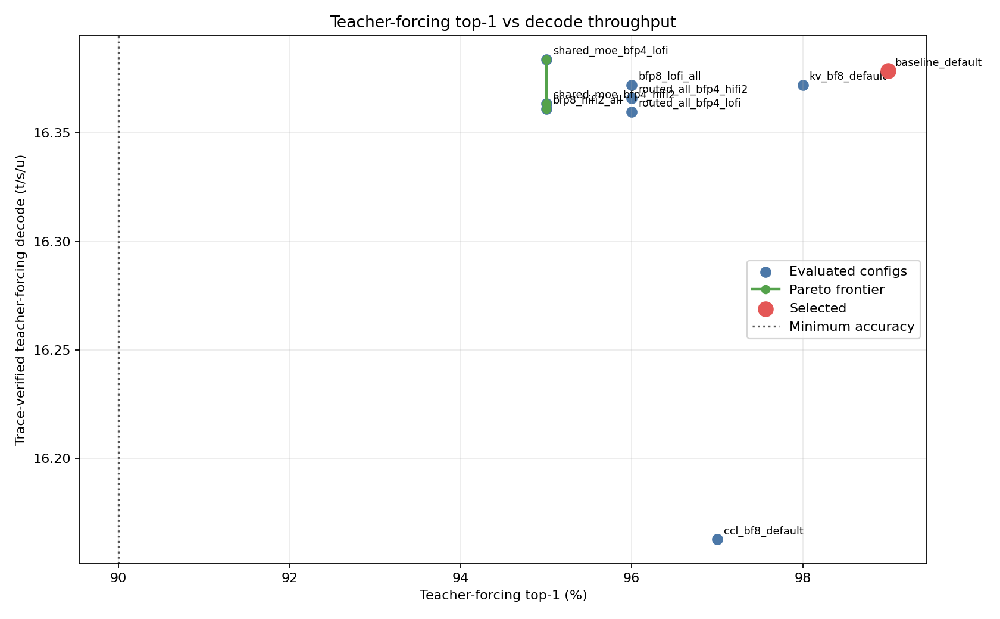
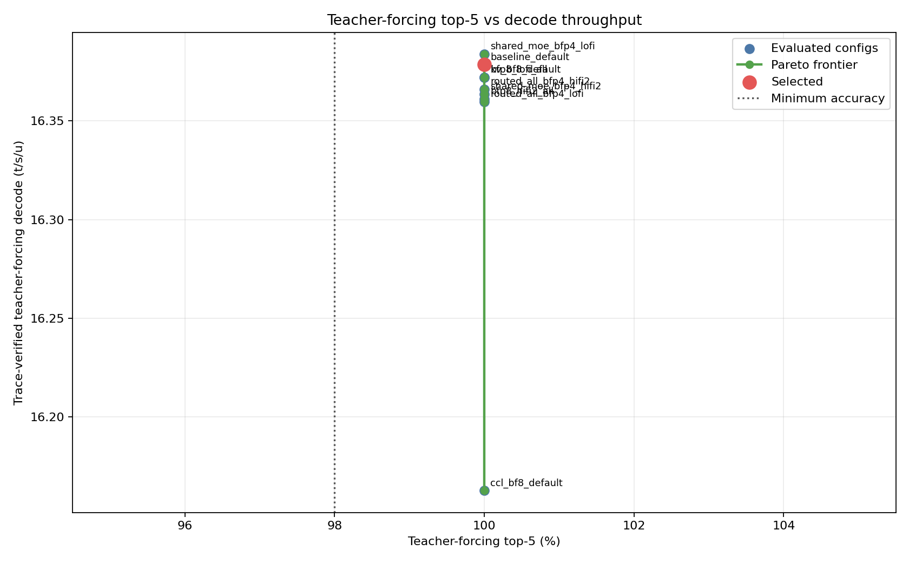

# Qwen3.6 datatype sweep — completed under stage cap

Retained config: **`baseline_bfp8`**, consumed by default from
[selected_precision_config.json](selected_precision_config.json). It passes
full-model accuracy and P1. Capability and qualitative acceptance are complete. Resumed-prefill PCC is an
[owner-accepted limitation](owner_decision.md). Independent
[stage review](stage_review_round1.md) returned **clean-pass** under the stage cap
and owner acceptance.

Teacher-forcing decode averages **47.760901 tokens/s/user**, with warmed
161-token resident-logit TTFT **3847.111 ms**, batch1, all40 layers, serial
1×4 Blackhole p300c mesh. Post-selection queued token-out is **46.690388 tokens/s/user**, warmed
TTFT **2799.037 ms**, on the128-input/128-output no-readback workload.
[Performance summary](post_selection_performance.json) and
[raw benchmark](post_selection_token_out.json) prove normal default construction,
127 model/sampler trace replays, and zero timed decode readbacks/input refreshes.
Use this post-selection token-out number in later reports and vLLM comparisons.
The separate caller-observed result with per-token readback is46.500566tokens/s/user;
it is not substituted for the requested no-readback comparison.

Acceptance requires top-1 ≥ 90%,
top-5 ≥ 98%, and top-100 = 100% independently on the AIME24 chat-template
reference with 100 predictions and the natural-text reference with 768
teacher-forced positions, plus P1 reasoning. Traced teacher forcing with logits
kept on device ranks policies. The warmed token-out benchmark is reported separately above.

The starting optimized model uses BFP8 weights, BF16 KV/CCL, and ordered
BF16/FP32 linear-attention exceptions on four Blackhole devices. The advertised
262,144 aggregate context tokens and 32 fixed slots remain preserved.

`activation_dtype=bf16` describes public tensor boundaries. The native grouped
MoE kernel uses fixed mixed BF16/BFP8 intermediates, including BFP8 input tiles,
gate/up partials, and SwiGLU/down inputs, even with BF16 expert weights.
[native_precision_contract.json](native_precision_contract.json) records exact
formats and source locations. No exposed intermediate-dtype toggle exists;
weight/fidelity/SR changes do not remove that internal quantization.

The current-source [baseline v5](baseline_bfp8_v5.json) and
[baseline v6](baseline_bfp8_v6.json) both pass all full-model accuracy gates.
AIME prefill and teacher forcing each reach98% top-1. Natural text reaches
97.9167% prefill top-1 and98.1771% teacher-forcing top-1; the minimum top-5 is
99.8698% and top-100 is100%. Across two independent serial processes, the four
resident-logit traced repeats span47.686910–47.827742 tokens/s/user
(mean47.760901). The measured noise floor is0.140832
tokens/s/user. Mean warmed161-token resident-logit TTFT is3847.111ms.
All94 required actual boundary observations, complete runtime weight/fidelity
policy, reference/source/native identities, and normal device closure are
verified. These controls supersede v2–v4 for ranking; historical evidence stays
available. P1 passes against the fitted high-precision reference.

The earlier [original-source baseline refresh](baseline_teacher_1.json) passes
98% / 100% / 100%. Its callback-path decode measurement of 46.4253 tokens/s/user
includes sampling/readback and is separate from the resident-logit ranking
regime. Both paths are traced; neither number is the post-selection token-out
headline.

The [BFP8 KV controls](kv_probe/comparison.json) pass on real layers 0 and 3 at
batch 32, prompt lengths 32 and 33, with disjoint pages and three traced decode
steps. Minimum per-user PCC is 0.99984617, with exact top-1 agreement against
the BF16-cache control. [Capacity calculations](context_candidates.json)
show 1,258,291,200 bytes saved per chip at full advertised context. This is not
a maximum-context acceptance result.

The strongest fitted evaluated P1 reference is `accuracy_bf16_experts20_ep`.
It promotes 20 complete expert layers, balanced across 15 linear and 5
full-attention layers, plus the grouped expert weights of layer 35. Its
[full-capacity preparation](memory_fit/accuracy_bf16_experts20_ep.json), including
2,048-token prefill and trace capture, leaves 264,947,200 bytes free per device.
Adding layer 35 indexed expert-down BF16 weights failed on allocator
fragmentation: the largest free block per bank was smaller than the required
combine buffer. This is the strongest fitting reference in the evaluated
promotion family, not a claim of globally optimal allocator packing.
[p1_memory_fit.json](p1_memory_fit.json) records both results.

[P1 result](p1/baseline_bfp8_v1.json): 12,288 positions, ΔNLL +0.001006
(SE0.000378), below max(2SE,0.004); KL×1000=0.903216, below5. Traced
decode512positions top1=0.90625 vs reference0.908203 passes the advisory
noise comparison. The final canonical
[reasoning gate](../eval_readiness/precision_reasoning.json) names the retained
config. Two HF-generated reasoning texts use128-position block standard errors;
this is a small text set, not broad task evaluation. The advisory HF reference
slice was skipped by the installed memory preflight (67GiB required vs49GiB
free host RAM), so no direct HF distribution agreement is claimed for P1.

The [baseline default resumed-prefill check](baseline_resume_check.json) passes
start 32 and fails PCC at starts 68, 2,528 and 2,559. Top-1 and the applicable
negative controls pass. [Matched HF controls](hf_resume_control/summary.json)
reproduce PCC failures at 68 and 2,528, but HF passes 2,559. Per-position HF comparisons also identify TT-only failures in the other splits;
shared failing positions do not establish shared causes. [AutoFix](AUTOFIX_resume.md) found no general repair before the stage cap. The raw gate has not been relaxed; the owner accepted the recorded limitation for stage closure.
Full-depth captures reproduce original logits bitwise and show preserved recurrent
and convolution state, followed by shape-dependent numerical drift. Uniform
grouped singleton MoE passes the 2,559 diagnostic; FP32 boundary carry and
stochastic-rounding removal do not provide a general repair. The legal q32/k32 attention diagnostic passes start68 but fails starts2528
and2559. The paired no-SR run fails start68 minimum PCC and start2528 top-1, although
start2559 passes. The BF16 dense policy also fails68/2528 and passes2559.
The BF16 grouped-expert control fails all three splits. Both proposed
production patches remain unapplied. The selected configuration completed the same default check once. See the
[wrap-up assessment](resume_wrapup_assessment.md) for TT-only failures and
historical diagnostic findings. The new [stage8 owner decision](owner_decision.md)
accepts the limitation and explicitly ends further resumed-prefill investigation.

## Policy and default construction

| Group or boundary | Retained policy |
| --- | --- |
| Indexed expert gate/up and down | BFP8, LoFi, FP32 destination accumulation |
| Grouped expert weights | BFP8, LoFi, BF16 destination accumulation |
| Attention input/output, shared packed/down, LM head | BFP8, HiFi2, FP32 destination accumulation |
| Public activation/residual, CCL, KV, logits/sampling | BF16; KV TILE |
| Linear attention | BF16 weights, ordered FP32 arithmetic; recurrent FP32 storage, conv BF16 |
| Layer exceptions | None beyond fixed model contracts in the complete policy |

`build_generator()` forwards the absent precision override to the model, whose
`resolve_precision(None)` loads the selected artifact. Explicit
`precision_config="baseline"` restores the safe baseline. Strict validation
rejects unsupported fields rather than silently ignoring them. The measured
v5/v6 records contain actual weight/fidelity/CCL/cache summaries and94 tensor
boundary observations; the report verifies them. Public BF16 fields are wired
into existing allocations/casts and checked at dispatched/captured boundaries.
Fixed router/norm/linear-attention contracts and native MoE internals remain
explicit. No vLLM adapter was added; later construction must use this common
factory and selected artifact.

## Results, Pareto interpretation, and scope

[JSON results](sweep_results.json) and [CSV results](sweep_results.csv) contain
per-reference scores, complete dtype/fidelity policy, commands, hardware, mesh,
serial traced measurement regime, P1, runtime identity and selection status.
Only the BFP8 policy completed ranked full-model measurements before the user's
stage cap. Its two independent processes establish a0.140832tokens/s/user noise
spread. The selected point is red and the dotted accuracy lines are0.90/0.98.
The frontier is the single evaluated policy; it establishes no lower-precision
win or global optimum. Prepared untried configurations are not rejected results.

## Reproduction and final acceptance

See [work_log.md](work_log.md) for exact commands, checkpoint SHAs, rejected
memory-fit promotions and failed resume diagnostics. The P1 command and score
bindings are retained in [p1/](p1/). [run_final_acceptance.sh](run_final_acceptance.sh)
runs the remaining acceptance checks once, serially, through the normal default
construction path. Exact expanded commands and statuses are retained in
`final_acceptance/*.attempt.json`, with bounded jobs and `logs/final_*.log`.
[The acceptance plan](selected_acceptance_command_plan.json) states each check's
scope. No maximum-context rerun is needed for unchanged BF16 KV; the required
32,769-token smoke uses a65,536-token allocation and preserves the262,144-token
advertised context. [Context contract](../context_contract.json) records both
KV capacity candidates and the retained policy; selected KV memory change is0.

## Carried to next stage

The user capped time/tokens and requested that untried ideas become hand-off
notes. [Candidate configs](configs/) and [serialized launchers](run_coarse_queue.sh)
remain for canonical accuracy, BFP4+LoFi/HiFi2 expert/shared groups, BFP8 fidelity
comparisons, BFP8 KV/CCL, and selective restoration/combinations. None is
represented as a full-model rejection. Native grouped MoE BF16 intermediate
support has no runtime toggle. Resume investigations and unapplied proposals
are listed in [resume_wrapup_assessment.md](resume_wrapup_assessment.md).
No new search or repair experiments are part of this wrap-up. No vLLM integration
or push belongs to this stage. Final acceptance and review results follow below.

## Final acceptance results

- Post-selection no-readback token-out: PASS,46.690388tokens/s/user;
  warmed TTFT2799.037ms. Normal selected-policy construction is verified.
- Nonaligned prompts1/33/2049: PASS, two traced decode steps each, no timed
  host input refresh/readback, unchanged native/Python/input identities.
- Default resumed-prefill: **FAIL** at68/2528/2559 PCC, with unchanged thresholds.
  All top1/final-argmax and applicable negative controls pass. All failed fresh
  and resumed tensors are bitwise identical to the baseline diagnostics;
  [equivalence evidence](final_acceptance/resume_baseline_equivalence.json)
  binds the existing matched HF classification to this final run. HF does not
  explain every TT-only failure. [Raw gate](final_acceptance/resume_default.failed.json)
  is retained as FAIL; [owner acceptance](owner_acceptance.json) makes this a
  known limitation for stage closure. AutoFix found no general repair.
- [Qualitative controls](final_acceptance/qualitative/verdict.json): PASS as a
  bounded smoke. All six TT outputs exactly match stage7; all12 paired
  completions reviewed; installed degeneracy checker has no findings.
  Default thinking consumes the token cap, so completed-task quality is unproven.
- [32K context smoke](final_acceptance/context_32769_alloc65536.json): PASS,
  logical32769 in65536 allocation, two traced decode steps, stable allocation
  and source/native/input identities, normal default selected construction.
  Free DRAM12,954,371,584bytes/device; advertised262144 context unchanged.
  Wrapper exit status was lost across interruption; passing artifact and normal
  device closure are retained, without inventing an exit code.
- [Installed stage08 P1 gate](stage08_final_gate.json): PASS, exit0.
- [Independent stage review, round1](stage_review_round1.md): **clean-pass**,
  no required work under the controlling cap and owner acceptance.
