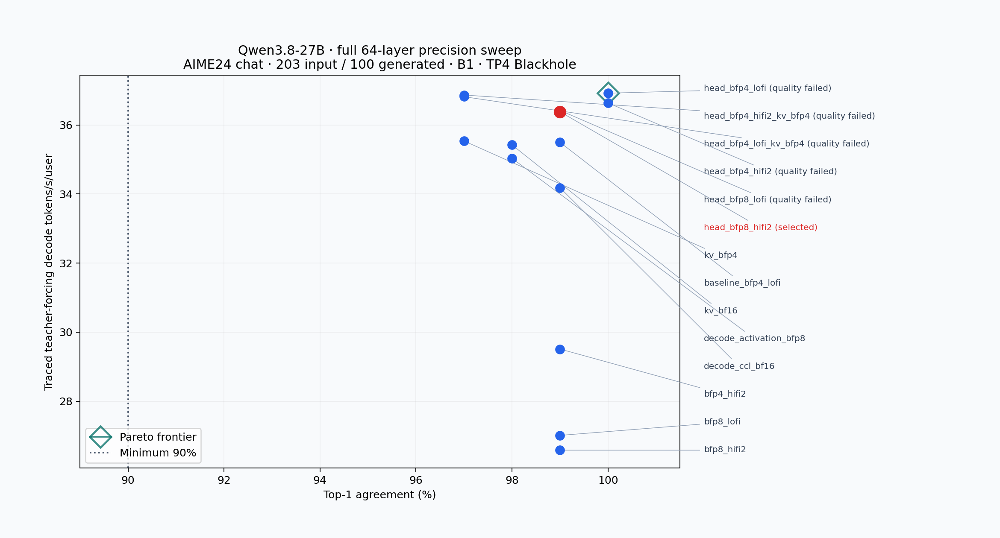
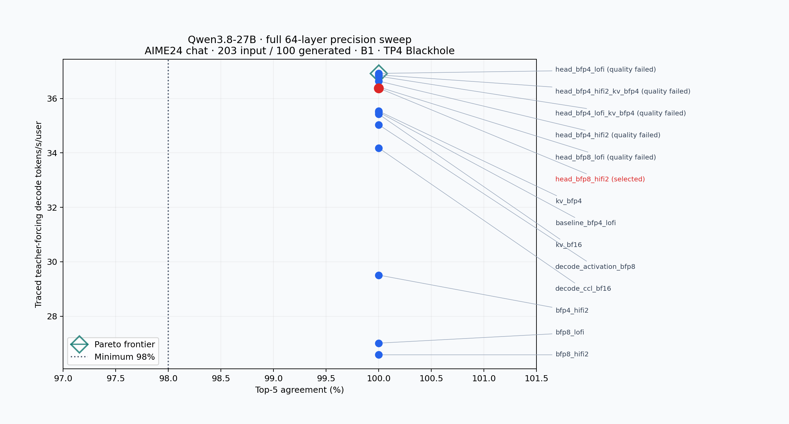

# Qwen3.8-27B datatype sweep — stage08

Selected policy: **head_bfp8_hifi2** — BFP4/LoFi decoder projections, BFP8/HiFi2 vocabulary head, BFP8 KV cache. Full-model prefill and teacher-forcing agreement is **99% /100% /100%** (top-1/top-5/top-100). Selection ranking: **36.381 tokens/s/user**, **122.818ms TTFT**, median of three warmed traced teacher-forcing runs at203 input/100 generated/B1/TP4.

Acceptance requires top-1 ≥90%, top-5 ≥98%, top-100 =100%, plus prompt-correct free-running quality, native context and agent memory checks. The main reference is one AIME24 chat problem with100 generated positions; these are token agreements, not AIME task accuracy.

## Post-selection autoregressive performance

These are warmed end-to-end **token-out** runs through the normal selected-config constructor, with no inner-loop host refresh/readback and EOS disabled for fixed128 output. Use this table, not teacher forcing, for subsequent serving comparisons. TTFT is host end-to-end first-token latency; no device-time roofline is claimed.

| Input tokens | Batch/concurrency | Repeats | TTFT ms | Decode tokens/s/user |
| ---: | ---: | ---: | ---: | ---: |
| 4096 | 1 | 3 | 431.263 | 36.171 |
| 4096 | 8 | 3 | 3565.352 | 21.335 |
| 4096 | 16 | 3 | 7305.290 | 13.860 |
| 4096 | 32 | 3 | 14741.964 | 8.900 |
| 32768 | 32 | 1 | 146763.283 | 7.463 |

## Full-model precision matrix

All14 numerical candidates pass the full-model readiness gate. Five faster policies fail fixed-budget free-running quality; their real outputs, controls and verdicts are preserved. Slower policies need no extra quality rejection to establish the fastest passing evaluated policy.

| Config | Top-1 | Top-5 | Top-100 | Traced TF tokens/s/user | TF TTFT ms | Decision |
| --- | ---: | ---: | ---: | ---: | ---: | --- |
| head_bfp4_lofi | 100% | 100% | 100% | 36.918 | 118.366 | quality rejected |
| head_bfp4_hifi2_kv_bfp4 | 97% | 100% | 100% | 36.865 | 122.558 | quality rejected |
| head_bfp4_lofi_kv_bfp4 | 97% | 100% | 100% | 36.816 | 121.304 | quality rejected |
| head_bfp4_hifi2 | 100% | 100% | 100% | 36.637 | 123.990 | quality rejected |
| head_bfp8_lofi | 99% | 100% | 100% | 36.420 | 120.292 | quality rejected |
| head_bfp8_hifi2 | 99% | 100% | 100% | 36.381 | 122.818 | selected; quality passes |
| kv_bfp4 | 97% | 100% | 100% | 35.535 | 122.412 | slower |
| baseline_bfp4_lofi | 99% | 100% | 100% | 35.496 | 118.675 | slower |
| kv_bf16 | 98% | 100% | 100% | 35.421 | 122.968 | slower |
| decode_activation_bfp8 | 98% | 100% | 100% | 35.033 | 122.967 | slower |
| decode_ccl_bf16 | 99% | 100% | 100% | 34.181 | 120.676 | slower |
| bfp4_hifi2 | 99% | 100% | 100% | 29.510 | 121.047 | slower |
| bfp8_lofi | 99% | 100% | 100% | 27.011 | 119.302 | slower |
| bfp8_hifi2 | 99% | 100% | 100% | 26.582 | 122.756 | slower |

Each row uses all64 target layers, the same203/100 chat reference, batch1, mesh1×4 Blackhole p300c, three warmed traced teacher-forcing repetitions. The refreshed baseline validation is99/100/100%,35.557 traced tokens/s/user and131.245ms TTFT; the three-repeat matrix baseline is35.496 and118.675ms. Repeat ranges, actual policies, fidelity arguments, trace counters, commands and runtime hashes are in [JSON](sweep_results.json) and [CSV](sweep_results.csv). Five historical full-model allocation/reset failures remain in the tables with no invented timing; they were repaired and rerun. Reduced probes never enter ranking.

The attention input/output, MLP gate/up and down groups each receive BFP4 LoFi/HiFi2 and BFP8 LoFi/HiFi2 through coherent grouped decoder controls. The head receives BF16 HiFi4, BFP8 LoFi/HiFi2 and BFP4 LoFi/HiFi2. Thus every material BFP4 matmul group has a real full-model LoFi candidate. Grouped runs measure complete-model effects, not isolated-group performance; see [search design](search_design.md). BFP4 KV plus each BFP4-head fidelity combines compatible numerical wins. Ordinary BFP8 activation and BF16 decode CCL controls are slower.

## Pareto interpretation





Blue points are all14 evaluated full-model policies; the red point is selected. The teal diamond marks the numerical non-dominated frontier (one point dominates in these two axes), and the dotted vertical line is the accuracy minimum. The numerical frontier fails the additional quality gate; selection therefore lies below it. Overlapping timings, especially BFP8-head LoFi/HiFi2, do not supersede observed quality differences.

## Quality and capability

[Qualitative verdict](qualitative_verdict.md), [exact prompt/control comparison](qualitative_comparison.json) and [prompt format](qualitative_prompt_format.json) document the shared128-token suite and long cases. Selected structured JSON is exact with EOS at114. Narrative4096/4095 prompts produce coherent final prose with EOS at1024/760. Factual4096 and32769 retrievals return exact JSON with EOS at47/33. Short explanation/code truncate in the HF controls as well as TT; no completed-code or dataset-accuracy claim follows. HF narrative controls use512 tokens versus TT1024, explicitly recorded.

Rejected head BF4 policies with BF8 KV never leave thinking on the4096 narrative by1024. Both BF4-KV/head combinations fail structured128; BFP8/LoFi head truncates its final JSON at128. Exact same-prompt HF and baseline controls complete the structured answer within128 and reach final narrative text within their recorded budgets. [Selection state](selection_state.json) and `quality_candidates/` retain each decision and actual output.

The native context contract remains262144, with target agent pool32×32768. [Context contract](../context_contract.json) records the final BFP8-KV allocation ledger plus the rejected provisional BF4-KV capacity calculations without reducing capability. [KV forecasts](kv_memory_forecast.json) are estimates, not proof of a physical limit. Final selected memory/native evidence is in `memory_capacity_plan.json`, `selected/benchmark_b1_perf.json:context_validation` and `../agentic_serving.json` (all complete). Native checks include nonaligned262141 plus3 outputs, explicit final decode input262143, exact262144 prefill and finite logits; no native-context HF accuracy claim is made.

## Runtime consumption and reproduction

[Selected precision config](selected_precision_config.json) is loaded automatically by `tt.precision.load_precision`, `Model` and `build_generator`. Explicit `precision_config` or `QWEN38_PRECISION_CONFIG` overrides it; `configs/baseline_bfp4_lofi.json` restores baseline. No vLLM integration is introduced in this stage; later adapters must use this shared constructor. [Policy contract](policy_contract.md) explains fixed BF16 residual/norm/logits/sampling, FP32 recurrence, phase-specific activation/CCL representations and empty layer exceptions. Fixed unsupported representations are rejected explicitly, not silently ignored. Runtime inventories and captured ordinary/fused kernel arguments are audited by `tests/audit_precision_runtime.py`, separately from offline schema checks.

```sh
# Run inside qwen38-functional-build; clean timing override follows wrapper.
bash models/autoports/qwen_qwen3_8_27b/tests/benchmark_selected_precision.sh
# Offline reconciliation from checkout.
python -m models.autoports.qwen_qwen3_8_27b.tests.audit_precision_runtime
python -m models.autoports.qwen_qwen3_8_27b.tests.summarize_precision_selection --packet-template /home/mvasiljev/agentic-research-data/experiment-26/bringup-logs/qwen38-27b/20261023-astra-medium-exp26-clean/telemetry/packets/72c6bef3-7aa8-4a33-8578-ceab07255f0d.template.json
```

Exact candidate and quality commands, hardware/environment, source revisions and chronology are in [work log](work_log.md). [Anomaly ledger](anomaly_ledger.md), [AutoDebug](AUTODEBUG.md), [AutoFix](AUTOFIX.md), [BF4 reset repair](kv_reset_autofix.md), [BF16 KV repair](kv_bf16_autofix.md) and [geometry review](geometry_alternative_review.md) document repaired failures, retained controls and scope limits. All device runs are serialized. Logs and large allocator dumps stay local; compact summaries are tracked.

All measurements, runtime propagation and strict context checks pass. The agent-memory checker has six documented representation-copy advisories and no critical finding; see [final checks](final_checks.json). [Independent final review](stage_review.md) returns **clean-pass**, with no required work. Local checkpoint commit receipts are recorded in work_log.md. No push or vLLM work is authorized here.
