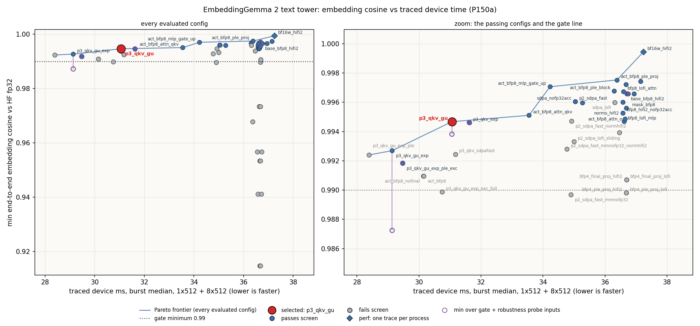
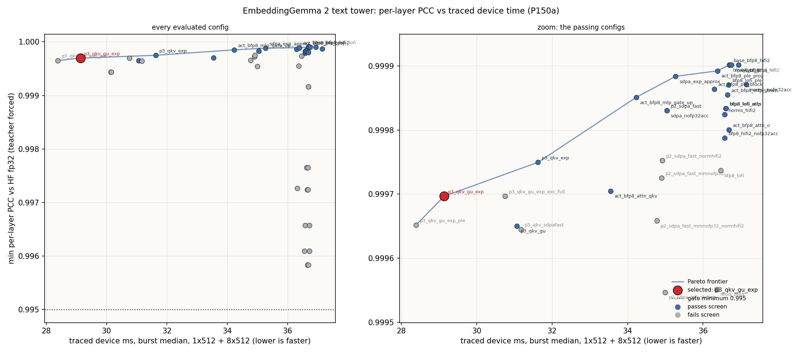

# EmbeddingGemma 2 text tower: datatype sweep (E6a)

## Selected config: `p3_qkv_gu`

The E5a text policy (bfp8 weights, HiFi2 + fp32 accumulation matmuls, bf16 activations, HiFi2 +
fp32 SDPA, HiFi4 norms, bfp4 masks) with one change: the fused QKV projection and the MLP gate and
up projections write their outputs in bfp8 (`attn_qkv.out_dtype`, `mlp_gate_up.out_dtype`). SDPA
keeps `exp_approx_mode` off.

It replaces the first E6a default `p3_qkv_gu_exp` (review E6a: 1.8e-5 margin on the last-hidden
gate; it fails on an input outside the test set, see Robustness probe). It is the default:
`tt/precision.py` loads `selected_precision_config.json` for every text construction path
(`TextModel.from_state_dict`, `TextEncoder.from_pretrained`, `EmbeddingGemma2.from_pretrained`).

Selection policy (orchestrator decision, E6a review): among `p3_qkv_gu_exp`, `p3_qkv_exp`,
`p3_qkv_gu`, the layer-exception twin `p3_qkv_gu_exp_ple_exc` and the E5a baseline, the fastest
(ranking aggregate) whose min last-hidden PCC >= 0.99 AND min embedding cosine >= 0.99 on the fixed
gate cases AND the robustness probe inputs, and that passes every gate as the default.

| candidate | ms (rank) | gate cases + probe | gates as default | result |
|---|---|---|---|---|
| `p3_qkv_gu_exp` | 29.14 | fails: last hidden 0.98236, cosine 0.98724 on a 3-token input | passed in E6a (`g1`) | rejected |
| `p3_qkv_gu_exp_ple_exc` | 29.48 | holds: >= 0.99035 / >= 0.99183 | **fails** `test_full_model.py::test_retrieval[audio]` and `demo.py::test_multimodal_demo` (text -> audio) | rejected |
| **`p3_qkv_gu`** | **31.06** | holds: >= 0.99106 / >= 0.99382 | pass (Gates) | **selected** |
| `p3_qkv_exp` | 31.62 | holds: >= 0.99146 / >= 0.99461 | full model + demo pass (override run) | slower |
| `base_bfp8_hifi2` | 36.71 | holds: >= 0.99692 / >= 0.99657 | pass (E5a) | slower |

The twin's retrieval failure **[M]** (`e6/logs/gate_r1_full_model_twin.log`, `gate_r1_demo_twin.log`,
commit `cff53689f6`): the row "a short clip of a person speaking" (caption_speech2s) is a near tie
in HF fp32 (speech10s 0.71541, tone3s 0.71078, margin 0.00463); with the twin TT scores 0.71417 /
0.71418 and picks tone3s. Audio items run through the text stack too, so the text precision moves
both sides. Same row, TT margin with the other candidates as the default (override runs,
`e6/logs/r_mm_*`): `p3_qkv_gu` 0.00198, `p3_qkv_exp` 0.00173, `p3_qkv_gu_exp` 0.00214 (all pick
speech10s; 30 / 2 passed).

| metric (vs live HF fp32) | E5a baseline | `p3_qkv_gu_exp` (E6a) | selected `p3_qkv_gu` | gate |
|---|---|---|---|---|
| min per-layer PCC (teacher forced, gated set) | 0.99990 | 0.99970 | 0.99965 | >= 0.995 |
| min attention / MLP module PCC (layers 0, 5) | 0.99988 | 0.99959 | 0.99950 | >= 0.995 |
| min last-hidden PCC, gate cases | 0.99692 | 0.99002 | 0.99184 (`[33]`) | >= 0.99 |
| min last-hidden PCC, probe inputs (90) | 0.99713 | **0.98236** (`[3]`) | **0.99106** (`[3]`) | >= 0.99 |
| min embedding cosine, gate cases | 0.99657 | 0.99269 | 0.99467 (batch-8 row 7) | >= 0.99 |
| min embedding cosine, probe inputs | 0.99794 | **0.98724** (`[3]`) | **0.99382** (`[3]`) | >= 0.99 |
| demo retrieval argmax TT == HF | yes | yes | yes | equal |

**Margin [M].** Over the gate cases and every probe input (102 inputs, 139 prompts): last-hidden
PCC 0.99106 against 0.99 (margin 1.1e-3; the 3-token probe input at corpus offset 24991; on the
gate cases alone 0.99184 at `[33]`, 1.8e-3); embedding cosine 0.99382 against 0.99 (margin 3.8e-3,
same input; gate cases 0.99467, 4.7e-3); per-layer PCC 0.99965 against 0.995 (4.6e-3); module PCC
0.99950 against 0.995 (4.5e-3); text -> audio retrieval row margin 0.00198 (HF 0.00463). The
32768-token gate case is not in the probe; its value is under Gates.

Traced device time per forward, one P150a, burst median of 5 windows of 20 replays after 3 s
idle; sweep harness `tests/perf/dtype_sweep.py`, all five traces captured in one process **[M]**:

| batch x bucket | E5a baseline ms | `p3_qkv_gu_exp` ms | `p3_qkv_exp` ms | selected `p3_qkv_gu` ms | selected vs baseline |
|---|---|---|---|---|---|
| 1 x 128 | 4.92 | 4.69 | 4.73 | 4.81 | -2.3 % |
| 1 x 512 | 7.31 | 6.49 | 6.63 | 6.83 | -6.6 % |
| 1 x 2048 | 22.05 | 17.07 | 17.50 | 20.05 | -9.1 % |
| 8 x 512 | 29.40 | 22.65 | 25.00 | 24.23 | -17.6 % |
| 1 x 8192 | 105.3-109.7 (see caveats) | 79.36 | 83.45 | 93.31 | -11 to -15 % |
| ranking aggregate 1x512 + 8x512 | 36.71 | 29.14 | 31.62 | 31.06 | -15.4 % |

The ranking aggregate (1x512 + 8x512, fixed in E6a) picks `p3_qkv_gu` over `p3_qkv_exp` by 0.56 ms
(1.8 %). On single long inputs `p3_qkv_exp` is faster (1x2048 -12.7 %, 1x8192 -10.6 %, from
`exp_approx` in SDPA, which dominates there) and slower at 8x512 (+3.2 %) **[M]**. If long single
documents are the target workload, `p3_qkv_exp` is the better default under the same accuracy
policy (its margins: last hidden 0.99146, cosine 0.99461).

Post-selection, normal construction path (`tests/perf/bench_sustained.py`, `TextEncoder.from_pretrained`
with no overrides, code commit `9adacfe162`), and the safe baseline in the same session through
`EMBEDDING_GEMMA2_PRECISION=baseline_precision_config.json` **[M]** (`e6/post_bench_r.jsonl`,
`e6/scripts/chain_r.sh`):

| batch x bucket | selected burst / sustained ms | baseline burst / sustained ms | burst change |
|---|---|---|---|
| 1 x 128 | 4.813 / 4.810 | 4.923 / 4.921 | -2.2 % |
| 1 x 512 | 6.833 / 6.829 | 7.314 / 7.309 | -6.6 % |
| 1 x 2048 | 20.054 / 20.053 | 22.042 / 22.046 | -9.0 % |
| 8 x 512 | 24.243 / 24.619 | 29.393 / 29.429 | -17.5 % |
| 1 x 8192 | 93.054 / 93.810 | 105.688 / 106.400 | -12.0 % |

Burst: 5 windows of 20 replays after 3 s idle; sustained: after a 10 s soak, 5 windows of 100
replays (30 at 1x8192). Sustained rises over burst at 8x512 (+1.6 %) and 1x8192 (+0.8 %), the
P150a current-limit throttle seen in E5a.

Acceptance bar (the "minimum allowed accuracy"): every existing text gate passes unchanged with the
candidate as the model default: `pytest tests/pcc -q -k "not s32768"` (per-layer / module PCC
>= 0.995, last-hidden PCC >= 0.99, embedding cosine >= 0.99, trace == eager, multimodal cosine),
`test_full_model.py`, `demo/demo.py`, and `test_text_model[b1_s32768]`. The sweep screens on the
same metrics and cases (all of `tests/common.CASES` plus the batch-8 padded case, and the demo
retrieval); the robustness probe adds inputs outside the test set (below); the selected config
then runs the full gate set (Gates).

## Robustness probe

`tests/perf/dtype_probe.py` **[M]** (`tt-ops/runs/embeddinggemma-2/e6/probe.jsonl`, logs
`e6/logs/r_probe.log`, `r_probe_mid.log`): free-running eager forward (replay == eager bit for
bit, `tests/pcc/test_trace.py`) against the live HF fp32 reference, with the metric code of
`test_text_model` (`tests/common.pcc` over the valid token rows of the whole batch, cosine per
prompt). Inputs:

- gate: the 12 end-to-end cases of `test_text_model` except `b1_s32768`, same corpus offsets;
- probe (54 inputs): 32 batch-1 inputs of 1-64 tokens (every length in 1-6, tile and bucket
  boundaries 16 / 17 / 31 / 32 / 33 / 63 / 64, odd lengths) at corpus offsets the tests do not use;
  13 padded batches that mix a long row with short rows (`[512, 33]` at three offsets, `[512, 7]`,
  `[512, 31]`, `[512, 1]`, `[512, 64, 17]`, `[1025, 33]`, `[2048, 33]`, `[256, 33, 9]`,
  `[128, 31, 7, 3]`, `[512, 480, 33, 7]`, `[64, 33, 31, 7, 1]`); the demo's 3 queries and 4
  documents with the demo prefixes, one at a time and as the demo's two padded batches;
- mid (36 inputs, `--inputs mid`): batch-1 lengths 100-2048, and 505 / 510-514 / 520 three times
  each, at new offsets (the gate's worst cases sit at 511-513).

Same README + tech-report corpus as the tests (`tests/common.make_batch`).

| config | ms (rank) | last hidden: gate | probe | mid | cosine: gate | probe | mid | holds |
|---|---|---|---|---|---|---|---|---|
| `p3_qkv_gu_exp` | 29.14 | 0.99002 (`[512, 33]`) | **0.98236** (`[3]`) | 0.99509 | 0.99269 | **0.98724** | 0.99865 | no |
| `p3_qkv_gu_exp_ple_exc` | 29.48 | 0.99035 (`[513]`) | 0.99645 (`[512, 64, 17]`) | 0.99551 | 0.99183 | 0.99677 | 0.99884 | yes (fails the multimodal retrieval gate) |
| **`p3_qkv_gu`** | **31.06** | 0.99184 (`[33]`) | 0.99106 (`[3]`) | 0.99441 | 0.99467 | 0.99382 | 0.99880 | **yes, selected** |
| `p3_qkv_exp` | 31.62 | 0.99146 (`[512, 33]`) | 0.99285 (`[3]`) | 0.99599 | 0.99461 | 0.99492 | 0.99886 | yes |
| `base_bfp8_hifi2` | 36.71 | 0.99692 (`[512]`) | 0.99713 (`[3]`) | 0.99829 | 0.99657 | 0.99794 | 0.99933 | yes |

`[3]` is a 3-token input at corpus offset 24991; it is the worst probe input for every config
without the layer exception. `p3_qkv_gu_exp` fails there (last hidden 0.98236, cosine 0.98724);
its next-worst inputs are the gate cases (0.99002 `[512, 33]`, 0.99267 `[33]`). The twin
(layers 0, 5 and 23 keep bf16 outputs, ple outputs bfp8) lifts that input to >= 0.9965 for 0.34 ms
of the ranking aggregate, but fails the multimodal retrieval gate (Selected config). For the
selected `p3_qkv_gu` the 3-token input is the overall minimum (0.99106 / 0.99382); its next-worst
inputs are gate cases (`[33]` 0.99184, `[511]` 0.99249). Mid lengths do not bind for any config.

## Pareto charts

x: traced device ms (burst median, 1x512 + 8x512); every evaluated config is a point, blue passes
the screen, grey fails it, a diamond was measured one trace per process (`bf16w_hifi2`); line:
non-dominated frontier over every evaluated config; red: selected; dotted: gate minimum; hollow
purple rings below a point (last-hidden and cosine charts): its minimum over the gate + probe
inputs. Left panel: every config; right: zoom on the passing ones.

The last-hidden PCC binds; the embedding cosine binds for some configs (`p3_qkv_gu_exp_exc_full`);
the per-layer PCC never binds (every config >= 0.9958). `sweep_results.csv` lists every metric
per config, the perf regime, and the probe minima.

## What was swept (49 configs, `sweep_results.{json,csv}`)

Ranking aggregate in ms (baseline 36.71); "pass" = all screen bars met.

| lever | configs | best result | decision |
|---|---|---|---|
| bf16 weights | `bf16w_hifi2` | 37.24 ms (+1.4 %); every shape slower than bfp8; cosine 0.99944, last hidden 0.99876 | rejected: slower; the 1x2048 forward hangs (below) |
| bfp4 weights, per group, HiFi2 and LoFi twins | 14 (`bfp4_<group>_{hifi2,lofi}`) | -0.15 ms at best | rejected: every group fails; LoFi == HiFi2 accuracy with bfp4 |
| LoFi matmuls (bfp8) | `bfp8_lofi`, `bfp8_lofi_{mlp,attn,ple}` | all: -0.25 ms, last hidden 0.98650 | all-LoFi fails; per-group LoFi passes but is within 0.1 ms of HiFi2: not kept |
| matmul fp32 accumulation off | `bfp8_hifi2_nofp32acc` | -0.14 ms, pass (0.99066) | not kept (noise-level gain, costs margin) |
| SDPA fp32_dest_acc off | `sdpa_nofp32acc` | -1.67 ms, pass (0.99240) | does not combine (see p3_qkv_sdpafast) |
| SDPA exp_approx | `sdpa_exp_approx` | -1.44 ms, pass (0.99608) | not in the default: with the bfp8 outputs it fails the probe (`p3_qkv_gu_exp`) or loses on the ranking aggregate (`p3_qkv_exp`) |
| SDPA LoFi | `sdpa_lofi`, `p2_sdpa_lofi_sliding` | -0.39 ms | rejected: attention PCC 0.99047 (layer 5, 8192); with full layers excepted last hidden 0.97774 |
| norms HiFi2 / fp32 acc off | `norms_hifi2`, `norms_nofp32acc` | -0.14 / +0.44 ms | not kept |
| projection outputs bfp8 (activation dtype) | `act_bfp8`, `act_bfp8_nofinal`, `act_bfp8_<group>` | all: -6.56 ms but last hidden 0.97814; qkv -3.16, gate/up -2.49 | **kept for attn_qkv and mlp_gate_up** |
| residual stream bfp8 | `resid_bfp8` | -0.35 ms | rejected: cosine 0.96778 |
| mask dtype bfp8 / bf16 vs bfp4 | `mask_bfp8`, `mask_bf16` | bit-identical accuracy, no speedup | bfp4 kept; context contract unchanged |
| combinations | `p2_*`, `p3_*` | see below | |

Combinations (accuracy erodes additively in 1 - PCC, so only the largest levers combine):

| config | ms | last hidden | cosine | result |
|---|---|---|---|---|
| `p3_qkv_gu_exp_ple` (+ ple outputs bfp8) | 28.39 | 0.98913 | 0.99240 | fail |
| `p3_qkv_gu_exp` | 29.14 | 0.99002 | 0.99269 | screen pass; fails the probe (0.98236) |
| `p3_qkv_gu_exp_ple_exc` (`_ple`, layers 0 / 5 / 23 keep bf16 qkv / gate_up / ple_block outputs) | 29.48 | 0.99035 | 0.99183 | screen pass, holds on the probe; fails the multimodal retrieval gate as the default |
| `p3_qkv_gu_exp_exc_full` (layers 5/11/17/23 keep bf16 outputs) | 30.75 | 0.99069 | 0.98988 | fail (and slower) |
| **`p3_qkv_gu`** | **31.06** | **0.99184** | **0.99467** | **pass, holds on the probe and every gate, selected** |
| `p3_qkv_sdpafast` (qkv + SDPA fp32 acc off + exp) | 31.17 | 0.98925 | 0.99245 | fail |
| `p3_qkv_exp` | 31.62 | 0.99146 | 0.99461 | pass, holds on the probe |
| `p2_sdpa_fast` (SDPA fp32 acc off + exp) | 35.04 | 0.99094 | 0.99605 | pass (exp_approx adds nothing on top of fp32 acc off) |
| `p2_sdpa_fast_mmnofp32`, `_normhifi2`, `_mmnofp32_normhifi2` | 34.77-34.92 | 0.97277-0.98865 | | fail |

Layer exceptions: `p2_sdpa_lofi_sliding` (LoFi SDPA on sliding layers only) and
`p3_qkv_gu_exp_exc_full` (full-attention layers keep bf16 outputs) fail; `p3_qkv_gu_exp_ple_exc`
(worst-PCC layers 0 / 5 plus the last layer keep bf16 outputs) passes the screen and the probe
but not the multimodal retrieval gate. The bfp4
groups were too far from the bar (cosine 0.91-0.99, last hidden 0.91-0.99) for first / last layer
exceptions to be worth a run, and none of them was faster than bfp8.

Per material matmul group (weight dtype, fidelity, ms aggregate, accuracy, decision):

| group | bfp8 HiFi2 (base) | bfp8 LoFi | bfp4 HiFi2 | bfp4 LoFi | bfp8 output |
|---|---|---|---|---|---|
| attn_qkv | 36.71 pass | 36.60 pass (with attn_o) | 36.72 fail cos 0.941 | 36.58 fail | **33.55 pass (kept)** |
| attn_o | 36.71 pass | (with attn_qkv) | 36.68 fail cos 0.915 | 36.66 fail | 36.68 pass, no gain |
| mlp_gate_up | 36.71 pass | 36.61 pass (with down) | 36.73 fail cos 0.957 | 36.56 fail | **34.23 pass (kept)** |
| mlp_down | 36.71 pass | (with gate_up) | 36.68 fail cos 0.953 | 36.65 fail | 36.65 pass, no gain |
| ple_proj | 36.71 pass | 36.68 pass (with block) | 36.69 fail cos 0.98982 | 36.68 fail | 36.39 pass; fails in combination without the layer exception |
| ple_block | 36.71 pass | (with ple_proj) | 36.67 fail cos 0.973 | 36.63 fail | 36.30 pass; fails in combination without the layer exception |
| final_proj | 36.71 pass | (in bfp8_lofi) | 36.69 fail last 0.98964 | 36.69 fail | in act_bfp8 only |

Why weights barely matter here **[I]**: bfp8 text weights are about 150 MB per forward, about
0.3 ms of DRAM time at 1x512; the forward is bound by the norms, SDPA and the activation traffic
between ops, which is what the output-dtype and SDPA levers cut.

### bf16 weights row (`bf16w_hifi2`)

Measured one trace per process **[M]** (`e6/scripts/bf16w_row.sh`, `bf16w_rest.sh`; logs
`e6/logs/r_bf16w*.log`): the five-trace sweep process hangs at 1x2048. Burst / sustained ms:
1x128 5.215 / 5.212, 1x512 7.560 / 7.556, 1x2048 22.198 / 22.208, 8x512 29.678 / 29.719,
1x8192 108.554 / 108.983; ranking aggregate 37.24 ms vs 36.71 for bfp8 (baseline 1x8192 in its
own sweep process: 109.68). 1x2048 ran burst windows plus five 5-replay sustained windows with
no soak (128 replays): the full loop (about 600 replays) hangs with one trace too. Accuracy
(full screen): pass, last hidden 0.99876, cosine 0.99944.

## The policy file

`selected_precision_config.json` (schema in `tt/precision.py`; unknown or missing keys raise):

- `text.weights.<group>`: `dtype` (bf16 / bfp8 / bfp4), `fidelity`, `fp32_acc`, `out_dtype` for
  `attn_qkv`, `attn_o`, `mlp_gate_up`, `mlp_down`, `ple_proj`, `ple_block`, `final_proj`.
- `text.layer_exceptions`: per-layer overrides of the per-layer groups and SDPA (empty in the
  selected config; `p3_qkv_gu_exp_ple_exc` in `sweep_results.json` shows one).
- `text.sdpa`: fidelity, fp32_acc, exp_approx. `text.norms`: fidelity, fp32_acc (every text
  RMSNorm). `text.residual_dtype`, `text.mask_dtype`.
- `vision`, `audio`: the current tower policies, recorded only; E6b wires them. The two towers keep
  their hard-coded E5b / E5c policies in E6a (the shared `tt/linear.py` / `tt/rms_norm.py`
  arguments default to the old behaviour).
- `kv_cache_dtype`, `ccl_dtype`, `logits_dtype`, `sampling`: "n/a: encoder, single chip".
- Fixed, not swept: token-embedding table bf16 (row-major `ttnn.embedding`), pooler matmul HiFi4
  with fp32 output.

Return to the safe baseline: `EMBEDDING_GEMMA2_PRECISION=<.../doc/datatype_sweep/baseline_precision_config.json>`,
or `precision=<that path>` in `TextEncoder.from_pretrained` / `EmbeddingGemma2.from_pretrained`.

## Proof the runtime consumes it

`tests/pcc/test_precision_config.py`:

- `test_default_loads_selected_file`: builds the model with no `precision=` argument, checks it was
  loaded from `selected_precision_config.json`, runs one forward with spies on `ttnn.linear`,
  `minimal_matmul`, SDPA and `rms_norm`, and checks every weight dtype, matmul fidelity / fp32 acc /
  output dtype (layer exceptions included), SDPA fidelity / fp32 acc / exp_approx, norm config,
  residual and mask dtype of all 24 layers against the file read with plain `json`
  (1211 checks on the selected config, gate run `r1`).
- `test_override_changes_runtime`: an override (mlp_down bfp4 LoFi, layer-0 exception bf16 HiFi4
  bfp8-output, flipped exp_approx, another mask dtype) changes the built tensors and the configs
  the forward passes.
- `test_invalid_value_rejected`: an invalid dtype or a missing group raises.

Pass / fail / pass on a planted value (E6a, `p3_qkv_gu_exp`) **[M]** (logs `e6/logs/`):
`mlp_down.dtype` planted to `bfp5` fails with `ValueError: text.weights.mlp_down.dtype: 'bfp5' not
in ['bf16', 'bfp8', 'bfp4']` (`pfp_2_planted.log`); planted to the valid `bfp4`, the
default-built model holds `BFLOAT4_B` `w_down` weights (`pfp_2b_planted_valid.log`); reverted, it
passes again (`pfp_3_reverted.log`).

The sweep records the same construction evidence per candidate (`construction` in
`sweep_results.json`: per-layer weight dtypes, policies, SDPA config, residual / mask dtype).

## Gates (final code commit)

All on code commit `9adacfe162` (selected config as the default, no `EMBEDDING_GEMMA2_PRECISION`),
`tt-ops/runs/embeddinggemma-2/e6/scripts/gates.sh r1` (from `chain_r.sh`), logs
`e6/logs/gate_r1_*.log`, metrics `e6/results_gates_r1.jsonl` **[M]**:

| gate | result | worst metric |
|---|---|---|
| `pytest tests/pcc -q -k "not s32768"` | 357 passed, 1 deselected | layer PCC 0.99970, attention 0.99950, MLP 0.99979, last hidden 0.991837 (`[33]`), embedding / trace cosine 0.99467; `test_precision_config` 1211 checks |
| `test_text_model[b1_s32768]` | 1 passed | last hidden 0.99451, cosine 0.99946 |
| `tests/pcc/test_full_model.py` | 30 passed | full-model cosine 0.99839 (audio_tone3s), batched 0.99931; text -> audio retrieval row margin 0.00198 |
| `demo/demo.py -s` | 2 passed | retrieval argmax TT == HF for every task |
| `tests/pcc/vision -q` (unchanged tower) | 91 passed | |
| `tests/pcc/audio -q -k "not perf"` (unchanged tower) | 109 passed, 7 deselected | |
| watcher (`TT_METAL_WATCHER=10`, text tests + precision test, `-k "not s32768"`) | 101 passed | 0 error lines in `e6/watcher_r1/.../watcher.log` |

The full-model traced checks (`test_full_model_trace.py`, inside `tests/pcc`) passed with
full-trace cosine >= 0.99899.

The intermediate default `p3_qkv_gu_exp_ple_exc` (commit `cff53689f6`) failed `test_full_model.py`
(29 passed, 1 failed: `test_retrieval[audio]`) and the demo (1 passed, 1 failed:
`test_multimodal_demo`, text -> audio); see Selected config.

## Trace robustness of the selected default

On code commit `9adacfe162`, default construction path, `e6/scripts/trace_robust.sh r1` **[M]**:

- `TT_METAL_TRACE_ALLOC_TRACKING=1` over `tests/pcc/test_trace.py` (6 passed),
  `tests/pcc/test_full_model_trace.py` (11 passed) and `demo/demo.py -s` (2 passed): no
  "still alive" error (`e6/logs/trk_r1_*.log`).
- Interleaved replay soak (`e6/scripts/interleaved_soak.py 205`): `capture_all` of 1x128, 1x512,
  1x2048, 8x512, 1x8192, each trace fed a different real-text input, then 205 round-robin rounds
  with a readback after every replay, then 205 rounds back to back (one sync per round) and a final
  readback of each shape: 2060 replays, no hang, every output (embedding and last hidden)
  bit-identical to the first replay of its shape. Run twice, with and without allocation tracking
  (`e6/logs/soak_r1_interleaved_trk.log`, `soak_r1_interleaved.log`).
- bf16w hang repro with `TT_METAL_TRACE_ALLOC_TRACKING=1` (`e6/logs/r_bf16w_trk_all_1x2048.log`):
  no unsafe live buffer is reported before any replay; the run hangs after 460-480 replays in the
  K / V `rms_norm` [1, 2, 2048, 256] (`e6/triage/bf16w_trk_all_1x2048.txt`). Classification
  (`work_log.md` section 9): a bf16w-only device hang in that op, not a trace issue. It also
  hangs with one trace (220-240 replays) and with no trace at all (eager, 760-780 forwards).

## Not done / caveats

- `bf16w_hifi2`: the 1x2048 forward hangs after a few hundred iterations, traced or eager
  (classification above). Not root-caused; in one run the firmware mailboxes of six worker cores
  held float-looking words **[M]**, which suggests a stray NoC write into worker L1 **[I]**; with
  the watcher on, 1500 single-trace replays complete with 0 watcher errors **[M]** (timing
  dependent, so a race in the op is as likely **[I]**).
  bf16 weights are slower than bfp8 on every measured shape, so this does not affect selection;
  the vision tower (bf16 weights, E5b) is a place to check in E6b. The shipped default
  `p3_qkv_gu` ran 5000 replays at 1x2048 with the five perf traces captured, no hang **[M]**
  (`e6/logs/review_soak_p3_qkv_gu_1x2048.log`, run on `1ea3591cc5`); `e6/logs/selected_soak_1x2048.log`
  is the earlier default `p3_qkv_gu_exp` (2000 replays, no hang).
- 1x8192 burst of the baseline is 109.7 ms when it is the first candidate of a sweep process and
  105.3-105.9 ms for the bfp8 configs with identical kernels later in a process (`mask_bfp8`,
  `bfp4_final_proj_*`) **[M]**; cause not investigated. Rankings use 1x512 + 8x512.
- The probe draws from the same two documents as the tests (model card + tech report) and the
  demo strings; other languages, code and very long padded batches (> 2048 + short rows) were not
  probed.
- Vision / audio precision: E6b, with this machinery.
