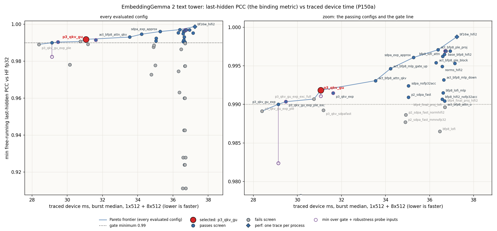
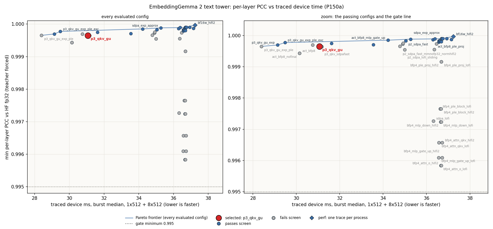
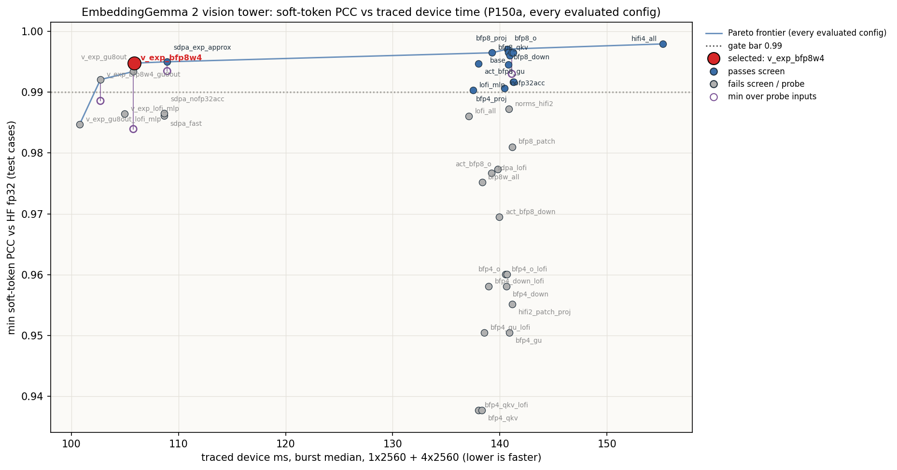
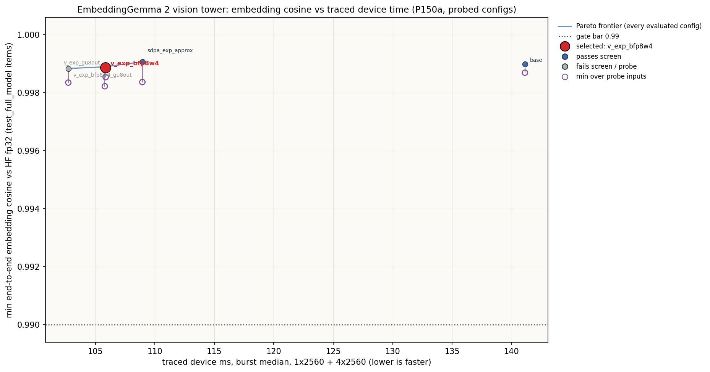
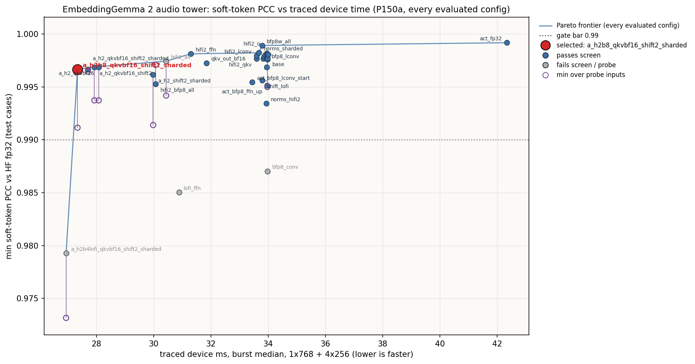
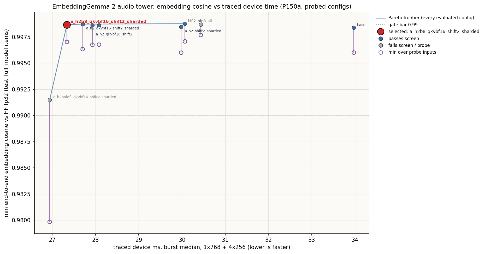

# EmbeddingGemma 2: datatype sweep (E6a text tower, E6b vision and audio towers)

Selected defaults (`selected_precision_config.json`): text `sdpa_nofp32acc` (E9.1-r re-selection at
the 12 x 10 grid, next section, as amended by E9.1-r2a; it replaces the E6a choice `p3_qkv_gu`),
vision `v_exp_bfp8w4` and audio `a_h2b8_qkvbf16_shift2_sharded` (E6b,
[Vision and audio towers (E6b)](#vision-and-audio-towers-e6b)).

## E9.1-r re-selection (2026-10-28): text `p2_sdpa_fast`, amended to `sdpa_nofp32acc`

### Amendment E9.1-r2a (2026-10-28): default switched to `sdpa_nofp32acc`

The E9.1-r record below is kept as written: it selected `p2_sdpa_fast`. The orchestrator then
changed the tie-break, and the text default is now `sdpa_nofp32acc` (the same policy without SDPA
`exp_approx`; `selected_precision_config.json` text section = `$G/precision/precision_sdpa_nofp32acc.json`
text section, checked equal by a JSON compare; vision / audio unchanged).

**Why the switch.** The two configs tie within noise on time (ranking aggregate 41.845 vs 41.843 ms
at 12 x 10; the baseline control moved 5 us in the same process). `sdpa_nofp32acc` has the wider
worst-case margin (short probe last-hidden PCC 0.99240 vs 0.99094) and no `exp_approx`.
`p3_qkv_gu` passed the E6 probe with a 1.1e-3 margin and then failed a new input (b1_s256), so the
tie-break within noise is the wider worst-case margin, not the 2 us.

**Gates with `sdpa_nofp32acc` as the default** (no override; run folder
`tt-ops/runs/embeddinggemma-2/e9/01r2a/` (`$A`), `$A/scripts/chain_r2a.sh`, `logs/chain_r2a.log`) **[M]**:

| gate | 12 x 10 | 13 x 10 (P150 default path) |
|---|---|---|
| text tests + `test_trace` + `test_precision_config` + `test_full_model` + `test_full_model_trace` + `test_generator_vllm` (`gates.sh`, `-k "not s32768"`) | 153 passed | 153 passed |
| `test_text_model[b1_s32768]` | 1 passed | 1 passed |
| `demo/demo.py` | 2 passed | 2 passed |
| min logged `last_hidden_pcc` (12 values) / `embedding_cosine` (22 values) | 0.99240 / 0.99605 | 0.99240 / 0.99605 |
| min per-layer PCC (`layer_pcc`, 72 values) | 0.99983 | 0.99983 |
| text -> audio near-tie row (`caption_speech2s`) TT margin | 0.00094 | 0.00094 |
| serving wrapper (`test_generator_vllm`) min embedding cosine, 18 rows | 0.99433 | 0.99433 |

`test_precision_config`: `default precision sdpa_nofp32acc ...: 1211 checks passed`. Logs:
`$A/logs/gates_r2a_{12x10,13x10}_{text,s32768,demo}.log`.

Contract gate, 10 buckets, traced replay vs cached HF fp32 (`e9/refs/`) at 12 x 10,
`TT_METAL_TRACE_ALLOC_TRACKING=1` (`$A/logs/gate_12x10.log`, `$A/run_gate_12x10/prefill.jsonl`)
**[M]**, last-hidden PCC / embedding cosine (bars 0.99 / 0.99), replay == eager bitwise on all 10:

| bucket | 128 | 256 | 512 | 1024 | 2048 | 4096 | 8192 | 16384 | 32768 | 65536 |
|---|---|---|---|---|---|---|---|---|---|---|
| PCC | 0.99424 | 0.99432 | 0.99537 | 0.99577 | 0.99574 | 0.99581 | 0.99628 | 0.99706 | 0.99693 | 0.99724 |
| cosine | 0.99834 | 0.99861 | 0.99912 | 0.99939 | 0.99952 | 0.99961 | 0.99965 | 0.99967 | 0.99965 | 0.99958 |

Probe at 12 x 10 (`dtype_probe.py run --candidates sdpa_nofp32acc`; the candidate's text section
equals the new default's, checked) **[M]**: short (E6 gate cases + probe) last 0.99240 (`[511]`) /
cos 0.99565; mid 0.99631 / 0.99901; e9 (b1_s256 family) 0.99345 (L 160) / 0.99861. Worst case
over the probe family and the contract inputs: last-hidden PCC 0.99240, embedding cosine 0.99565.
Same values as the E9.1-r screen (`c4_probe_short`, `c4_probe_mid`, `c_probe_e9`). Logs:
`$A/logs/probe_{short,mid,e9}_12x10.log`.

KNOWN HAZARDS soaks (the K / V `rms_norm` input is bf16 and sits in L1 at every bucket up to
4096): 2000 trace replays each on 12 x 10 with the new default, output re-read every 100 replays
and compared bitwise with the first **[M]**: 1 x 512 `wall_s 14.5 mismatches 0`, 1 x 2048
`wall_s 50.7 mismatches 0`, 1 x 4096 `wall_s 89.5 mismatches 0`; no hang, exit 0 each
(`$A/logs/soak_1x{512,2048,4096}_12x10.log`).

Cost vs `p3_qkv_gu` **[M]**: 13 x 10, `perf.py` default, text 1 x 512 forward, mean of 20 after 3
warm-up, order new / control / new in one session (`$A/run_perf_13x10_*`): `sdpa_nofp32acc` 7.078 /
7.091 ms vs `p3_qkv_gu` 6.861 ms (+3.3 %). 12 x 10 ranking aggregate (1x512 + 8x512 burst, E9.1-r
screen `$G/logs/c_rank_12x10.log`): 41.845 vs 38.234 ms (+9.4 %).

**Why.** E9 stage 1 found the E6a default `p3_qkv_gu` below the hard gate on the b1_s256 contract
input (offset 0, 192 tokens: last-hidden PCC 0.98872), and the person moved the target to a
12 x 10 compute grid (Galaxy). The orchestrator ordered a re-selection at 12 x 10 under the E6
policy, with a wider probe. Run folder: `tt-ops/runs/embeddinggemma-2/e9/01r-geometry-precision/`
(`$G`); every number is **[M]** at 12 x 10 (`EMBEDDING_GEMMA2_GRID=12x10`) unless marked.

**Policy (unchanged from E6a, applied at 12 x 10).** Candidates: the 18 E6a text configs that
passed the E6a screen and were at least as fast as the E5a baseline in `sweep_results.json`, plus
the baseline `base_bfp8_hifi2` as fallback. A candidate qualifies when, as the model default, it
passes every existing text test, `test_full_model`, the demo, and the robustness probe with
last-hidden PCC >= 0.99 and embedding cosine >= 0.99 on every input. The probe is the E6 set
(`--inputs short`: gate cases + probe; `--inputs mid`), plus, new by orchestrator decision, the
10 E9 contract inputs (3/4 of each bucket 128 ... 65536, offset 0, traced replay vs cached HF fp32,
`tests/perf/prefill.py` gate) and the b1_s256 family (`--inputs e9`: offset 0, L 160 / 176 / 192 /
200 / 208 / 224). Rank: burst 1x512 + 8x512 (`dtype_sweep.py --shapes 1x512,8x512`), baseline as
the first and last candidate of the process (in-session control: 45.021 / 45.016 ms). Select the
fastest qualifying config. Candidates were screened in rank order with the cheap, binding checks
first; slower candidates past the first qualifiers were not taken through every check.

| candidate | rank ms (1x512 + 8x512) | worst value / failing check | result |
|---|---|---|---|
| `p3_qkv_gu_exp` | 34.78 (6.69 + 28.09) | e9 probe: last hidden 0.98990 at L 208 | rejected |
| `p3_qkv_gu_exp_ple_exc` | - | crashes at 12 x 10 (`TT_THROW` static CBs clash with L1 buffers) | rejected (also failed the E6a retrieval gate) |
| `p3_qkv_exp` | 37.35 (6.85 + 30.50) | probes and 10 / 10 contract gates pass (min 0.99146, short `[512, 33]`); **fails** `test_full_model::test_retrieval[audio]` and `demo::test_multimodal_demo` (text -> audio near tie: TT 0.71355 vs 0.71371, HF margin 0.00463) | rejected |
| `p3_qkv_gu` (E6a default) | 38.23 (7.04 + 31.19) | e9 probe 0.98836 at L 200; contract b1_s256 0.98872 | rejected |
| `act_bfp8_attn_qkv` | 40.78 (7.18 + 33.60) | short probe 0.98953 on the 3-token input `[3]` | rejected |
| **`p2_sdpa_fast`** | **41.84 (7.26 + 34.58)** | all pass: e9 0.99438, short 0.99094 (`[511]`) / cos 0.99565, mid 0.99605, contract min 0.99424 / 0.99834 (b1_s128), retrieval row margin 0.00137 | **selected** |
| `sdpa_nofp32acc` | 41.85 (7.26 + 34.58) | all pass: e9 0.99345, short 0.99240 / 0.99565, mid 0.99631, contract min 0.99424 / 0.99834, retrieval margin 0.00094 | qualifies; ties on time |
| `sdpa_exp_approx` | 42.17 | retrieval + demo pass, mid 0.99765; contract session <= 8192 and short probe crash (static CBs clash with L1) | rejected |
| `act_bfp8_mlp_gate_up` | 42.51 | retrieval + demo pass, mid 0.99735; contract session <= 8192 crashes (same clash) | rejected |
| 9 configs 44.43-45.00 | 44.43-45.00 | e9 probe passes (>= 0.99117); not taken further (slower than two qualifiers) | not needed |
| `base_bfp8_hifi2` (fallback) | 45.02 | e9 0.99692, mid 0.99829; contract session <= 8192 and short probe crash (same clash); 16384-65536 pass | open item (below) |

Logs: rank `$G/logs/c_rank_12x10.log` (`c_rank_12x10.jsonl`); probes `c_probe_e9_12x10`,
`c_probe_{short,mid}_12x10`, `c4_probe_{short,mid}_12x10` (`.log` / `.jsonl`); contract gates
`c_gate_<id>_12x10.log` (`run_c_gate_<id>/prefill.jsonl`); retrieval + demo `c4_retrieval_<id>_12x10.log`;
`p3_qkv_exp` full gates `gates_c_p3exp_12x10_{text,s32768,demo}.log`.

**Tie and the rule.** `p2_sdpa_fast` (41.843 ms) and `sdpa_nofp32acc` (41.845 ms) differ by 2 us,
inside the run-to-run noise (the baseline control moved 5 us). The orchestrator's rule: pick the
fastest measured, `p2_sdpa_fast`, unless its full gates disqualify it; then `sdpa_nofp32acc`.
`p2_sdpa_fast` passed the full gates (below), so it is the default. (Superseded on the same day:
amendment E9.1-r2a above changed the tie-break to the wider worst-case margin, `sdpa_nofp32acc`.)

**Selected `p2_sdpa_fast`.** The E5a policy with SDPA fp32 accumulation off and `exp_approx` on;
the QKV and gate / up projection outputs go back to bf16 (they were bfp8 in `p3_qkv_gu`). The
K / V `rms_norm` input is therefore bf16 again (the E5a dtype), so the KNOWN HAZARDS soak ran
(below).

**Gates with `p2_sdpa_fast` as the default** (`selected_precision_config.json`, no override;
`$G/scripts/chain_c5.sh`, `logs/chain_c5.log`) **[M]**:

| gate | 12 x 10 | 13 x 10 (P150 default path) |
|---|---|---|
| text tests + `test_trace` + `test_precision_config` + `test_full_model` + `test_full_model_trace` + `test_generator_vllm` (`gates.sh`, `-k "not s32768"`) | 153 passed | 153 passed |
| `test_text_model[b1_s32768]` | 1 passed | 1 passed |
| `demo/demo.py` | 2 passed | 2 passed |
| min logged `last_hidden_pcc` (12 values) / `embedding_cosine` (22 values) | 0.99094 / 0.99605 | 0.99094 / 0.99605 |
| min per-layer PCC (`layer_pcc`, 72 values) | 0.99983 | 0.99983 |
| text -> audio near-tie row (`caption_speech2s`) TT margin | 0.00137 | 0.00137 |
| serving wrapper (`test_generator_vllm`) min embedding cosine, 18 rows | 0.99433 | 0.99433 |

`test_precision_config`: 1211 text checks pass against the new file. Logs:
`$G/logs/gates_c_p2_{12x10,13x10}_{text,s32768,demo}.log`.

Contract gate, 10 buckets, traced replay vs cached HF fp32 at 12 x 10, default precision,
`TT_METAL_TRACE_ALLOC_TRACKING=1` (`$G/logs/c5_gate_12x10.log`, `$G/run_c5_gate_12x10/prefill.jsonl`)
**[M]**, last-hidden PCC / embedding cosine (bars 0.99 / 0.99), replay == eager bitwise on all:

| bucket | 128 | 256 | 512 | 1024 | 2048 | 4096 | 8192 | 16384 | 32768 | 65536 |
|---|---|---|---|---|---|---|---|---|---|---|
| PCC | 0.99424 | 0.99438 | 0.99446 | 0.99558 | 0.99535 | 0.99566 | 0.99685 | 0.99710 | 0.99700 | 0.99725 |
| cosine | 0.99834 | 0.99873 | 0.99917 | 0.99935 | 0.99948 | 0.99961 | 0.99968 | 0.99967 | 0.99965 | 0.99958 |

KNOWN HAZARDS soak (K / V `rms_norm` input dtype changed): 2000 trace replays at 1 x 2048 on
12 x 10 with the new default, output re-read every 100 replays: `SOAK_DONE replays 2000 wall_s
50.7 mismatches 0`, no hang (`$G/logs/c5_soak_1x2048_12x10.log`).

Cost at 13 x 10 (P150 path, `perf.py` default, text 1 x 512 forward, mean of 20 after 3 warm-up,
order new / control / new, `$G/run_c5_perf_13x10_*`): `p2_sdpa_fast` 7.099 / 7.098 ms vs
`p3_qkv_gu` 6.857 ms (+3.5 %). At 12 x 10 the ranking aggregate is 41.84 vs 38.23 ms (+9.4 %):
the accuracy fix costs time; the two faster configs that pass every text gate (`p3_qkv_exp`) or
the contract gates (`act_bfp8_attn_qkv`) fail other parts of the policy (table).

**Per-bucket precision (stage-7 recommendation only, not implemented).** `p3_qkv_exp` is 10.7 %
faster on the ranking aggregate (37.35 vs 41.84 ms) and passes all 10 contract buckets and every
text probe; it fails only the text -> audio near-tie retrieval gate of the multimodal model. At
12 x 10 it also beats `p3_qkv_gu` on every timed shape (1x128 4.83 / 4.89, 1x512 6.85 / 7.04,
1x2048 23.23 / 27.94, 8x512 30.51 / 31.20, 1x8192 97.19 / 116.60 ms, `$G/logs/c_shapes_12x10.log`).
Stage 7 should evaluate it for the text-only prefill path (all contract buckets) with the
contract gates and the probe; `p3_qkv_gu_exp` (34.78 ms) fails the short b1_s256 family and would
need the same per-bucket evaluation for long buckets only.

**Open item for E9 stage 5: the baseline fallback crashes at 12 x 10.** `base_bfp8_hifi2` (and `sdpa_exp_approx`,
`act_bfp8_mlp_gate_up`, `p3_qkv_gu_exp_ple_exc`, which share bf16 Q/K/V with fp32-accumulating
SDPA in at least some layers; the configs that pass have bfp8 Q/K/V or SDPA fp32 accumulation off,
so a smaller SDPA CB region is the likely common factor **[I]**) fails at 12 x 10 in multi-bucket sessions <= 8192 with `TT_THROW:
Statically allocated circular buffers ... clash with L1 buffers`. Reproduced
(`$G/scripts/repro_cb_clash.py`, `logs/c_repro_cb_clash_base_*`): eager compile of buckets
128 ... 8192 in one session fails at the 1 x 4096 full-attention SDPA (head_dim 512, q_chunk 128).
Its static CB region ends at 1,437,056 B per core; the live L1 buffers (three L1-interleaved
[1, 1, 4096, 512] bf16 activations at 18 tiles per bank on 120 banks, 16 on 130, plus the L1 RoPE
tables of buckets <= 512) start at 1,421,312 B. Control: the same session at 13 x 10 starts at
1,445,888 B and passes; at 12 x 10 with the residual stream in DRAM (`EG2_RESIDUAL_L1=0`) it
passes; each bucket alone in its own session passes. So the fallback precision is not usable at
12 x 10 until stage 5 (memory placement) fixes the L1 budget; the selected default and the
13 x 10 path are not affected (gates below).

## E6a selection: `p3_qkv_gu` (default until 2026-10-28; superseded by the E9.1-r re-selection above)

The E5a text policy (bfp8 weights, HiFi2 + fp32 accumulation matmuls, bf16 activations, HiFi2 +
fp32 SDPA, HiFi4 norms, bfp4 masks) with one change: the fused QKV projection and the MLP gate and
up projections write their outputs in bfp8 (`attn_qkv.out_dtype`, `mlp_gate_up.out_dtype`). SDPA
keeps `exp_approx_mode` off.

It replaces the first E6a default `p3_qkv_gu_exp` (review E6a: 1.8e-5 margin on the last-hidden
gate; it fails on an input outside the test set, see Robustness probe). It is the default:
`tt/precision.py` loads `selected_precision_config.json` for every text construction path
(`TextModel.from_state_dict`, `TextEncoder.from_pretrained`, `EmbeddingGemma2.from_pretrained`).

Selection policy (orchestrator decision, E6a review): among `p3_qkv_gu_exp`, `p3_qkv_exp`,
`p3_qkv_gu`, the layer-exception twin `p3_qkv_gu_exp_ple_exc` and the E5a baseline, the fastest
(ranking aggregate) whose min last-hidden PCC >= 0.99 AND min embedding cosine >= 0.99 on the fixed
gate cases AND the robustness probe inputs, and that passes every gate as the default.

| candidate | ms (rank) | gate cases + probe | gates as default | result |
|---|---|---|---|---|
| `p3_qkv_gu_exp` | 29.14 | fails: last hidden 0.98236, cosine 0.98724 on a 3-token input | passed in E6a (`g1`) | rejected |
| `p3_qkv_gu_exp_ple_exc` | 29.48 | holds: >= 0.99035 / >= 0.99183 | **fails** `test_full_model.py::test_retrieval[audio]` and `demo.py::test_multimodal_demo` (text -> audio) | rejected |
| **`p3_qkv_gu`** | **31.06** | holds: >= 0.99106 / >= 0.99382 | pass (Gates) | **selected** |
| `p3_qkv_exp` | 31.62 | holds: >= 0.99146 / >= 0.99461 | full model + demo pass (override run) | slower |
| `base_bfp8_hifi2` | 36.71 | holds: >= 0.99692 / >= 0.99657 | pass (E5a) | slower |

The twin's retrieval failure **[M]** (`e6/logs/gate_r1_full_model_twin.log`, `gate_r1_demo_twin.log`,
commit `cff53689f6`): the row "a short clip of a person speaking" (caption_speech2s) is a near tie
in HF fp32 (speech10s 0.71541, tone3s 0.71078, margin 0.00463); with the twin TT scores 0.71417 /
0.71418 and picks tone3s. Audio items run through the text stack too, so the text precision moves
both sides. Same row, TT margin with the other candidates as the default (override runs,
`e6/logs/r_mm_*`): `p3_qkv_gu` 0.00198, `p3_qkv_exp` 0.00173, `p3_qkv_gu_exp` 0.00214 (all pick
speech10s; 30 / 2 passed).

| metric (vs live HF fp32) | E5a baseline | `p3_qkv_gu_exp` (E6a) | selected `p3_qkv_gu` | gate |
|---|---|---|---|---|
| min per-layer PCC (teacher forced, gated set) | 0.99990 | 0.99970 | 0.99965 | >= 0.995 |
| min attention / MLP module PCC (layers 0, 5) | 0.99988 | 0.99959 | 0.99950 | >= 0.995 |
| min last-hidden PCC, gate cases | 0.99692 | 0.99002 | 0.99184 (`[33]`) | >= 0.99 |
| min last-hidden PCC, probe inputs (90) | 0.99713 | **0.98236** (`[3]`) | **0.99106** (`[3]`) | >= 0.99 |
| min embedding cosine, gate cases | 0.99657 | 0.99269 | 0.99467 (batch-8 row 7) | >= 0.99 |
| min embedding cosine, probe inputs | 0.99794 | **0.98724** (`[3]`) | **0.99382** (`[3]`) | >= 0.99 |
| demo retrieval argmax TT == HF | yes | yes | yes | equal |

**Margin [M].** Over the gate cases and every probe input (102 inputs, 139 prompts): last-hidden
PCC 0.99106 against 0.99 (margin 1.1e-3; the 3-token probe input at corpus offset 24991; on the
gate cases alone 0.99184 at `[33]`, 1.8e-3); embedding cosine 0.99382 against 0.99 (margin 3.8e-3,
same input; gate cases 0.99467, 4.7e-3); per-layer PCC 0.99965 against 0.995 (4.6e-3); module PCC
0.99950 against 0.995 (4.5e-3); text -> audio retrieval row margin 0.00198 (HF 0.00463). The
32768-token gate case is not in the probe; its value is under Gates.

Traced device time per forward, one P150a, burst median of 5 windows of 20 replays after 3 s
idle; sweep harness `tests/perf/dtype_sweep.py`, all five traces captured in one process **[M]**:

| batch x bucket | E5a baseline ms | `p3_qkv_gu_exp` ms | `p3_qkv_exp` ms | selected `p3_qkv_gu` ms | selected vs baseline |
|---|---|---|---|---|---|
| 1 x 128 | 4.92 | 4.69 | 4.73 | 4.81 | -2.3 % |
| 1 x 512 | 7.31 | 6.49 | 6.63 | 6.83 | -6.6 % |
| 1 x 2048 | 22.05 | 17.07 | 17.50 | 20.05 | -9.1 % |
| 8 x 512 | 29.40 | 22.65 | 25.00 | 24.23 | -17.6 % |
| 1 x 8192 | 105.3-109.7 (see caveats) | 79.36 | 83.45 | 93.31 | -11 to -15 % |
| ranking aggregate 1x512 + 8x512 | 36.71 | 29.14 | 31.62 | 31.06 | -15.4 % |

The ranking aggregate (1x512 + 8x512, fixed in E6a) picks `p3_qkv_gu` over `p3_qkv_exp` by 0.56 ms
(1.8 %). On single long inputs `p3_qkv_exp` is faster (1x2048 -12.7 %, 1x8192 -10.6 %, from
`exp_approx` in SDPA, which dominates there) and slower at 8x512 (+3.2 %) **[M]**. If long single
documents are the target workload, `p3_qkv_exp` is the better default under the same accuracy
policy (its margins: last hidden 0.99146, cosine 0.99461).

Post-selection, normal construction path (`tests/perf/bench_sustained.py`, `TextEncoder.from_pretrained`
with no overrides, code commit `9adacfe162`), and the safe baseline in the same session through
`EMBEDDING_GEMMA2_PRECISION=baseline_precision_config.json` **[M]** (`e6/post_bench_r.jsonl`,
`e6/scripts/chain_r.sh`):

| batch x bucket | selected burst / sustained ms | baseline burst / sustained ms | burst change |
|---|---|---|---|
| 1 x 128 | 4.813 / 4.810 | 4.923 / 4.921 | -2.2 % |
| 1 x 512 | 6.833 / 6.829 | 7.314 / 7.309 | -6.6 % |
| 1 x 2048 | 20.054 / 20.053 | 22.042 / 22.046 | -9.0 % |
| 8 x 512 | 24.243 / 24.619 | 29.393 / 29.429 | -17.5 % |
| 1 x 8192 | 93.054 / 93.810 | 105.688 / 106.400 | -12.0 % |

Burst: 5 windows of 20 replays after 3 s idle; sustained: after a 10 s soak, 5 windows of 100
replays (30 at 1x8192). Sustained rises over burst at 8x512 (+1.6 %) and 1x8192 (+0.8 %), the
P150a current-limit throttle seen in E5a.

Acceptance bar (the "minimum allowed accuracy"): every existing text gate passes unchanged with the
candidate as the model default: `pytest tests/pcc -q -k "not s32768"` (per-layer / module PCC
>= 0.995, last-hidden PCC >= 0.99, embedding cosine >= 0.99, trace == eager, multimodal cosine),
`test_full_model.py`, `demo/demo.py`, and `test_text_model[b1_s32768]`. The sweep screens on the
same metrics and cases (all of `tests/common.CASES` plus the batch-8 padded case, and the demo
retrieval); the robustness probe adds inputs outside the test set (below); the selected config
then runs the full gate set (Gates).

## Robustness probe

`tests/perf/dtype_probe.py` **[M]** (`tt-ops/runs/embeddinggemma-2/e6/probe.jsonl`, logs
`e6/logs/r_probe.log`, `r_probe_mid.log`): free-running eager forward (replay == eager bit for
bit, `tests/pcc/test_trace.py`) against the live HF fp32 reference, with the metric code of
`test_text_model` (`tests/common.pcc` over the valid token rows of the whole batch, cosine per
prompt). Inputs:

- gate: the 12 end-to-end cases of `test_text_model` except `b1_s32768`, same corpus offsets;
- probe (54 inputs): 32 batch-1 inputs of 1-64 tokens (every length in 1-6, tile and bucket
  boundaries 16 / 17 / 31 / 32 / 33 / 63 / 64, odd lengths) at corpus offsets the tests do not use;
  13 padded batches that mix a long row with short rows (`[512, 33]` at three offsets, `[512, 7]`,
  `[512, 31]`, `[512, 1]`, `[512, 64, 17]`, `[1025, 33]`, `[2048, 33]`, `[256, 33, 9]`,
  `[128, 31, 7, 3]`, `[512, 480, 33, 7]`, `[64, 33, 31, 7, 1]`); the demo's 3 queries and 4
  documents with the demo prefixes, one at a time and as the demo's two padded batches;
- mid (36 inputs, `--inputs mid`): batch-1 lengths 100-2048, and 505 / 510-514 / 520 three times
  each, at new offsets (the gate's worst cases sit at 511-513).

Same README + tech-report corpus as the tests (`tests/common.make_batch`).

| config | ms (rank) | last hidden: gate | probe | mid | cosine: gate | probe | mid | holds |
|---|---|---|---|---|---|---|---|---|
| `p3_qkv_gu_exp` | 29.14 | 0.99002 (`[512, 33]`) | **0.98236** (`[3]`) | 0.99509 | 0.99269 | **0.98724** | 0.99865 | no |
| `p3_qkv_gu_exp_ple_exc` | 29.48 | 0.99035 (`[513]`) | 0.99645 (`[512, 64, 17]`) | 0.99551 | 0.99183 | 0.99677 | 0.99884 | yes (fails the multimodal retrieval gate) |
| **`p3_qkv_gu`** | **31.06** | 0.99184 (`[33]`) | 0.99106 (`[3]`) | 0.99441 | 0.99467 | 0.99382 | 0.99880 | **yes, selected** |
| `p3_qkv_exp` | 31.62 | 0.99146 (`[512, 33]`) | 0.99285 (`[3]`) | 0.99599 | 0.99461 | 0.99492 | 0.99886 | yes |
| `base_bfp8_hifi2` | 36.71 | 0.99692 (`[512]`) | 0.99713 (`[3]`) | 0.99829 | 0.99657 | 0.99794 | 0.99933 | yes |

`[3]` is a 3-token input at corpus offset 24991; it is the worst probe input for every config
without the layer exception. `p3_qkv_gu_exp` fails there (last hidden 0.98236, cosine 0.98724);
its next-worst inputs are the gate cases (0.99002 `[512, 33]`, 0.99267 `[33]`). The twin
(layers 0, 5 and 23 keep bf16 outputs, ple outputs bfp8) lifts that input to >= 0.9965 for 0.34 ms
of the ranking aggregate, but fails the multimodal retrieval gate (Selected config). For the
selected `p3_qkv_gu` the 3-token input is the overall minimum (0.99106 / 0.99382); its next-worst
inputs are gate cases (`[33]` 0.99184, `[511]` 0.99249). Mid lengths do not bind for any config.

## Pareto charts

x: traced device ms (burst median, 1x512 + 8x512); every evaluated config is a point, blue passes
the screen, grey fails it, a diamond was measured one trace per process (`bf16w_hifi2`); line:
non-dominated frontier over every evaluated config; red: selected; dotted: gate minimum; hollow
purple rings below a point (last-hidden and cosine charts): its minimum over the gate + probe
inputs. Left panel: every config; right: zoom on the passing ones.

The last-hidden PCC binds; the embedding cosine binds for some configs (`p3_qkv_gu_exp_exc_full`);
the per-layer PCC never binds (every config >= 0.9958). `sweep_results.csv` lists every metric
per config, the perf regime, and the probe minima.

## What was swept (49 configs, `sweep_results.{json,csv}`)

Ranking aggregate in ms (baseline 36.71); "pass" = all screen bars met.

| lever | configs | best result | decision |
|---|---|---|---|
| bf16 weights | `bf16w_hifi2` | 37.24 ms (+1.4 %); every shape slower than bfp8; cosine 0.99944, last hidden 0.99876 | rejected: slower; the 1x2048 forward hangs (below) |
| bfp4 weights, per group, HiFi2 and LoFi twins | 14 (`bfp4_<group>_{hifi2,lofi}`) | -0.15 ms at best | rejected: every group fails; LoFi == HiFi2 accuracy with bfp4 |
| LoFi matmuls (bfp8) | `bfp8_lofi`, `bfp8_lofi_{mlp,attn,ple}` | all: -0.25 ms, last hidden 0.98650 | all-LoFi fails; per-group LoFi passes but is within 0.1 ms of HiFi2: not kept |
| matmul fp32 accumulation off | `bfp8_hifi2_nofp32acc` | -0.14 ms, pass (0.99066) | not kept (noise-level gain, costs margin) |
| SDPA fp32_dest_acc off | `sdpa_nofp32acc` | -1.67 ms, pass (0.99240) | does not combine (see p3_qkv_sdpafast) |
| SDPA exp_approx | `sdpa_exp_approx` | -1.44 ms, pass (0.99608) | not in the default: with the bfp8 outputs it fails the probe (`p3_qkv_gu_exp`) or loses on the ranking aggregate (`p3_qkv_exp`) |
| SDPA LoFi | `sdpa_lofi`, `p2_sdpa_lofi_sliding` | -0.39 ms | rejected: attention PCC 0.99047 (layer 5, 8192); with full layers excepted last hidden 0.97774 |
| norms HiFi2 / fp32 acc off | `norms_hifi2`, `norms_nofp32acc` | -0.14 / +0.44 ms | not kept |
| projection outputs bfp8 (activation dtype) | `act_bfp8`, `act_bfp8_nofinal`, `act_bfp8_<group>` | all: -6.56 ms but last hidden 0.97814; qkv -3.16, gate/up -2.49 | **kept for attn_qkv and mlp_gate_up** |
| residual stream bfp8 | `resid_bfp8` | -0.35 ms | rejected: cosine 0.96778 |
| mask dtype bfp8 / bf16 vs bfp4 | `mask_bfp8`, `mask_bf16` | bit-identical accuracy, no speedup | bfp4 kept; context contract unchanged |
| combinations | `p2_*`, `p3_*` | see below | |

Combinations (accuracy erodes additively in 1 - PCC, so only the largest levers combine):

| config | ms | last hidden | cosine | result |
|---|---|---|---|---|
| `p3_qkv_gu_exp_ple` (+ ple outputs bfp8) | 28.39 | 0.98913 | 0.99240 | fail |
| `p3_qkv_gu_exp` | 29.14 | 0.99002 | 0.99269 | screen pass; fails the probe (0.98236) |
| `p3_qkv_gu_exp_ple_exc` (`_ple`, layers 0 / 5 / 23 keep bf16 qkv / gate_up / ple_block outputs) | 29.48 | 0.99035 | 0.99183 | screen pass, holds on the probe; fails the multimodal retrieval gate as the default |
| `p3_qkv_gu_exp_exc_full` (layers 5/11/17/23 keep bf16 outputs) | 30.75 | 0.99069 | 0.98988 | fail (and slower) |
| **`p3_qkv_gu`** | **31.06** | **0.99184** | **0.99467** | **pass, holds on the probe and every gate, selected** |
| `p3_qkv_sdpafast` (qkv + SDPA fp32 acc off + exp) | 31.17 | 0.98925 | 0.99245 | fail |
| `p3_qkv_exp` | 31.62 | 0.99146 | 0.99461 | pass, holds on the probe |
| `p2_sdpa_fast` (SDPA fp32 acc off + exp) | 35.04 | 0.99094 | 0.99605 | pass (exp_approx adds nothing on top of fp32 acc off) |
| `p2_sdpa_fast_mmnofp32`, `_normhifi2`, `_mmnofp32_normhifi2` | 34.77-34.92 | 0.97277-0.98865 | | fail |

Layer exceptions: `p2_sdpa_lofi_sliding` (LoFi SDPA on sliding layers only) and
`p3_qkv_gu_exp_exc_full` (full-attention layers keep bf16 outputs) fail; `p3_qkv_gu_exp_ple_exc`
(worst-PCC layers 0 / 5 plus the last layer keep bf16 outputs) passes the screen and the probe
but not the multimodal retrieval gate. The bfp4
groups were too far from the bar (cosine 0.91-0.99, last hidden 0.91-0.99) for first / last layer
exceptions to be worth a run, and none of them was faster than bfp8.

Per material matmul group (weight dtype, fidelity, ms aggregate, accuracy, decision):

| group | bfp8 HiFi2 (base) | bfp8 LoFi | bfp4 HiFi2 | bfp4 LoFi | bfp8 output |
|---|---|---|---|---|---|
| attn_qkv | 36.71 pass | 36.60 pass (with attn_o) | 36.72 fail cos 0.941 | 36.58 fail | **33.55 pass (kept)** |
| attn_o | 36.71 pass | (with attn_qkv) | 36.68 fail cos 0.915 | 36.66 fail | 36.68 pass, no gain |
| mlp_gate_up | 36.71 pass | 36.61 pass (with down) | 36.73 fail cos 0.957 | 36.56 fail | **34.23 pass (kept)** |
| mlp_down | 36.71 pass | (with gate_up) | 36.68 fail cos 0.953 | 36.65 fail | 36.65 pass, no gain |
| ple_proj | 36.71 pass | 36.68 pass (with block) | 36.69 fail cos 0.98982 | 36.68 fail | 36.39 pass; fails in combination without the layer exception |
| ple_block | 36.71 pass | (with ple_proj) | 36.67 fail cos 0.973 | 36.63 fail | 36.30 pass; fails in combination without the layer exception |
| final_proj | 36.71 pass | (in bfp8_lofi) | 36.69 fail last 0.98964 | 36.69 fail | in act_bfp8 only |

Why weights barely matter here **[I]**: bfp8 text weights are about 150 MB per forward, about
0.3 ms of DRAM time at 1x512; the forward is bound by the norms, SDPA and the activation traffic
between ops, which is what the output-dtype and SDPA levers cut.

### bf16 weights row (`bf16w_hifi2`)

Measured one trace per process **[M]** (`e6/scripts/bf16w_row.sh`, `bf16w_rest.sh`; logs
`e6/logs/r_bf16w*.log`): the five-trace sweep process hangs at 1x2048. Burst / sustained ms:
1x128 5.215 / 5.212, 1x512 7.560 / 7.556, 1x2048 22.198 / 22.208, 8x512 29.678 / 29.719,
1x8192 108.554 / 108.983; ranking aggregate 37.24 ms vs 36.71 for bfp8 (baseline 1x8192 in its
own sweep process: 109.68). 1x2048 ran burst windows plus five 5-replay sustained windows with
no soak (128 replays): the full loop (about 600 replays) hangs with one trace too. Accuracy
(full screen): pass, last hidden 0.99876, cosine 0.99944.

## The policy file

`selected_precision_config.json` (schema in `tt/precision.py`; unknown or missing keys raise):

- `text.weights.<group>`: `dtype` (bf16 / bfp8 / bfp4), `fidelity`, `fp32_acc`, `out_dtype` for
  `attn_qkv`, `attn_o`, `mlp_gate_up`, `mlp_down`, `ple_proj`, `ple_block`, `final_proj`.
- `text.layer_exceptions`: per-layer overrides of the per-layer groups and SDPA (empty in the
  selected config; `p3_qkv_gu_exp_ple_exc` in `sweep_results.json` shows one).
- `text.sdpa`: fidelity, fp32_acc, exp_approx. `text.norms`: fidelity, fp32_acc (every text
  RMSNorm). `text.residual_dtype`, `text.mask_dtype`.
- `vision`, `audio`: the tower policies, consumed by the tower construction paths since E6b
  (schema and results: [Vision and audio towers (E6b)](#vision-and-audio-towers-e6b)). In E6a they
  were recorded only.
- `kv_cache_dtype`, `ccl_dtype`, `logits_dtype`, `sampling`: "n/a: encoder, single chip".
- Fixed, not swept: token-embedding table bf16 (row-major `ttnn.embedding`), pooler matmul HiFi4
  with fp32 output.

Return to the safe baseline: `EMBEDDING_GEMMA2_PRECISION=<.../doc/datatype_sweep/baseline_precision_config.json>`,
or `precision=<that path>` in `TextEncoder.from_pretrained` / `EmbeddingGemma2.from_pretrained`.

## Proof the runtime consumes it

`tests/pcc/test_precision_config.py`:

- `test_default_loads_selected_file`: builds the model with no `precision=` argument, checks it was
  loaded from `selected_precision_config.json`, runs one forward with spies on `ttnn.linear`,
  `minimal_matmul`, SDPA and `rms_norm`, and checks every weight dtype, matmul fidelity / fp32 acc /
  output dtype (layer exceptions included), SDPA fidelity / fp32 acc / exp_approx, norm config,
  residual and mask dtype of all 24 layers against the file read with plain `json`
  (1211 checks on the selected config, gate run `r1`).
- `test_override_changes_runtime`: an override (mlp_down bfp4 LoFi, layer-0 exception bf16 HiFi4
  bfp8-output, flipped exp_approx, another mask dtype) changes the built tensors and the configs
  the forward passes.
- `test_invalid_value_rejected`: an invalid dtype or a missing group raises.

Pass / fail / pass on a planted value (E6a, `p3_qkv_gu_exp`) **[M]** (logs `e6/logs/`):
`mlp_down.dtype` planted to `bfp5` fails with `ValueError: text.weights.mlp_down.dtype: 'bfp5' not
in ['bf16', 'bfp8', 'bfp4']` (`pfp_2_planted.log`); planted to the valid `bfp4`, the
default-built model holds `BFLOAT4_B` `w_down` weights (`pfp_2b_planted_valid.log`); reverted, it
passes again (`pfp_3_reverted.log`).

The sweep records the same construction evidence per candidate (`construction` in
`sweep_results.json`: per-layer weight dtypes, policies, SDPA config, residual / mask dtype).

## Gates (final code commit)

All on code commit `9adacfe162` (selected config as the default, no `EMBEDDING_GEMMA2_PRECISION`),
`tt-ops/runs/embeddinggemma-2/e6/scripts/gates.sh r1` (from `chain_r.sh`), logs
`e6/logs/gate_r1_*.log`, metrics `e6/results_gates_r1.jsonl` **[M]**:

| gate | result | worst metric |
|---|---|---|
| `pytest tests/pcc -q -k "not s32768"` | 357 passed, 1 deselected | layer PCC 0.99970, attention 0.99950, MLP 0.99979, last hidden 0.991837 (`[33]`), embedding / trace cosine 0.99467; `test_precision_config` 1211 checks |
| `test_text_model[b1_s32768]` | 1 passed | last hidden 0.99451, cosine 0.99946 |
| `tests/pcc/test_full_model.py` | 30 passed | full-model cosine 0.99839 (audio_tone3s), batched 0.99931; text -> audio retrieval row margin 0.00198 |
| `demo/demo.py -s` | 2 passed | retrieval argmax TT == HF for every task |
| `tests/pcc/vision -q` (unchanged tower) | 91 passed | |
| `tests/pcc/audio -q -k "not perf"` (unchanged tower) | 109 passed, 7 deselected | |
| watcher (`TT_METAL_WATCHER=10`, text tests + precision test, `-k "not s32768"`) | 101 passed | 0 error lines in `e6/watcher_r1/.../watcher.log` |

The full-model traced checks (`test_full_model_trace.py`, inside `tests/pcc`) passed with
full-trace cosine >= 0.99899.

The intermediate default `p3_qkv_gu_exp_ple_exc` (commit `cff53689f6`) failed `test_full_model.py`
(29 passed, 1 failed: `test_retrieval[audio]`) and the demo (1 passed, 1 failed:
`test_multimodal_demo`, text -> audio); see Selected config.

## Trace robustness of the selected default

On code commit `9adacfe162`, default construction path, `e6/scripts/trace_robust.sh r1` **[M]**:

- `TT_METAL_TRACE_ALLOC_TRACKING=1` over `tests/pcc/test_trace.py` (6 passed),
  `tests/pcc/test_full_model_trace.py` (11 passed) and `demo/demo.py -s` (2 passed): no
  "still alive" error (`e6/logs/trk_r1_*.log`).
- Interleaved replay soak (`e6/scripts/interleaved_soak.py 205`): `capture_all` of 1x128, 1x512,
  1x2048, 8x512, 1x8192, each trace fed a different real-text input, then 205 round-robin rounds
  with a readback after every replay, then 205 rounds back to back (one sync per round) and a final
  readback of each shape: 2060 replays, no hang, every output (embedding and last hidden)
  bit-identical to the first replay of its shape. Run twice, with and without allocation tracking
  (`e6/logs/soak_r1_interleaved_trk.log`, `soak_r1_interleaved.log`).
- bf16w hang repro with `TT_METAL_TRACE_ALLOC_TRACKING=1` (`e6/logs/r_bf16w_trk_all_1x2048.log`):
  no unsafe live buffer is reported before any replay; the run hangs after 460-480 replays in the
  K / V `rms_norm` [1, 2, 2048, 256] (`e6/triage/bf16w_trk_all_1x2048.txt`). Classification
  (`work_log.md` section 9): a bf16w-only device hang in that op, not a trace issue. It also
  hangs with one trace (220-240 replays) and with no trace at all (eager, 760-780 forwards).

## Not done / caveats

- `bf16w_hifi2`: the 1x2048 forward hangs after a few hundred iterations, traced or eager
  (classification above). Not root-caused; in one run the firmware mailboxes of six worker cores
  held float-looking words **[M]**, which suggests a stray NoC write into worker L1 **[I]**; with
  the watcher on, 1500 single-trace replays complete with 0 watcher errors **[M]** (timing
  dependent, so a race in the op is as likely **[I]**).
  bf16 weights are slower than bfp8 on every measured shape, so this does not affect selection;
  the vision tower (bf16 weights, E5b) is a place to check in E6b. The shipped default
  `p3_qkv_gu` ran 5000 replays at 1x2048 with the five perf traces captured, no hang **[M]**
  (`e6/logs/review_soak_p3_qkv_gu_1x2048.log`, run on `1ea3591cc5`); `e6/logs/selected_soak_1x2048.log`
  is the earlier default `p3_qkv_gu_exp` (2000 replays, no hang).
- 1x8192 burst of the baseline is 109.7 ms when it is the first candidate of a sweep process and
  105.3-105.9 ms for the bfp8 configs with identical kernels later in a process (`mask_bfp8`,
  `bfp4_final_proj_*`) **[M]**; cause not investigated. Rankings use 1x512 + 8x512.
- The probe draws from the same two documents as the tests (model card + tech report) and the
  demo strings; other languages, code and very long padded batches (> 2048 + short rows) were not
  probed.
- Vision / audio precision: E6b, below.

# Vision and audio towers (E6b)

E6b wires the `vision` and `audio` sections of the precision file into the tower construction
paths and runs the same sweep per tower. Labels: **[M]** measured, **[I]** inferred. Run artifacts:
`tt-ops/runs/embeddinggemma-2/e6b/` (`sweep_vision.jsonl`, `sweep_audio*.jsonl`, `probe_*.jsonl`,
`logs/`, `scripts/`). Harness: `tests/perf/dtype_sweep_towers.py` (`run` screen, `probe`, `report`).

## Selected tower configs

| tower | selected | ranking aggregate, burst ms (E5 policy -> selected) | per shape, burst ms (E5 -> selected) |
|---|---|---|---|
| vision | **`v_exp_bfp8w4`**: SDPA `exp_approx` on; attn_qkv / attn_o / mlp_gate_up / mlp_down weights bfp8 (HiFi2 + fp32 acc, bf16 outputs); patch_embed / projector bf16 HiFi4; norms HiFi4; bfp4 mask | 1x2560 + 4x2560: 141.12 -> **105.86 (-25.0 %)** | 1x2560 26.11 -> 17.35; 4x2560 115.00 -> 88.51; 8x1280 87.19 -> 69.20 |
| audio | **`a_h2b8_qkvbf16_shift2_sharded`**: every projection bfp8 with HiFi2 + fp32 acc; fused QKV output bf16 (was fp32); lconv shift matmuls HiFi2; block-sharded RMSNorm round trip for <= 24 tile rows; conv, band attention and norms HiFi4 | 1x768 + 4x256: 33.97 -> **27.34 (-19.5 %)** | 1x256 8.72 -> 7.31; 1x768 14.91 -> 11.95; 4x256 19.06 -> 15.39 |

Sweep regime **[M]**: traced device time per forward, burst median of 5 windows of 20 replays after
3 s idle, the three perf traces of the tower captured in one process, inputs resident (the bench
inputs of `bench_vision.py` / `bench_audio.py`). Rankings fixed before the sweep: vision burst
1x2560 + 4x2560, audio burst 1x768 + 4x256. Post-selection, normal construction path: Gates.

Selection policy (brief E6b): the fastest config on the ranking aggregate that (1) passes every bar
of the tower's tests on the test cases (screen; the bars of `tests/pcc/vision` / `tests/pcc/audio`:
per-layer and module PCC >= 0.995, encoder-stack PCC >= 0.99, soft-token PCC >= 0.99 per image /
clip), (2) keeps soft-token PCC >= 0.99 and end-to-end embedding cosine >= 0.99 on >= 15 probe inputs
outside the test set plus the tower's `test_full_model.py` items, with `test_retrieval` argmax equal
to HF, and (3) passes every gate as the default (Gates). Worst-token cosine is reported, not gated
(the tests log it with bar 0.0).

| vision candidate | ms (rank) | screen: soft PCC min (case) | probe: soft PCC min / embedding cos min / full-model items min | result |
|---|---|---|---|---|
| `v_exp_bfp8w4_gu8out` (+ gate/up outputs bfp8) | 102.72 | 0.99207 (video8 f5) | **0.98857** (3-frame video) / 0.99835 / 0.99884 | fails the probe |
| `v_exp_gu8out` | 105.79 | 0.99340 (video8 f7) | **0.98394** (3-frame video) / 0.99823 / 0.99890 | fails the probe |
| **`v_exp_bfp8w4`** | **105.86** | 0.99477 (video8 f5) | 0.99479 (5-frame video) / 0.99854 / 0.99887 | **selected** |
| `sdpa_exp_approx` | 108.95 | 0.99499 (video8 f5) | 0.99347 / 0.99837 / 0.99907 | holds, slower |
| `base` (E5b) | 141.12 | 0.99653 (video8 f3) | 0.99301 / 0.99869 / 0.99899 | holds, slower |

| audio candidate | ms (rank) | screen: soft PCC min (case) | probe: soft PCC min / embedding cos min / full-model items min / retrieval TT margin | result |
|---|---|---|---|---|
| `a_h2b4lofi_qkvbf16_shift2_sharded` (bfp4 + LoFi on every group whose single bfp4 screen passed) | 26.94 | **0.97927** (s30) | 0.97315 / 0.97985 / 0.99150 / 0.00263 | fails |
| **`a_h2b8_qkvbf16_shift2_sharded`** | **27.34** | 0.99665 (short) | 0.99114 (1 kHz tone) / 0.99702 / 0.99867 / 0.00306 | **selected** |
| `a_h2_qkvbf16_shift2_sharded` (bf16 weights) | 27.70 | 0.99665 (short) | 0.99645 / 0.99633 / 0.99872 / 0.00042 | holds, slower |
| `a_h2_qkvbf16_shift2` | 27.93 | 0.99687 (short) | 0.99373 / 0.99676 / 0.99862 / 0.00022 | holds, slower |
| `a_h2_qkvbf16` | 28.08 | 0.99687 (short) | 0.99373 / 0.99676 / 0.99862 / 0.00022 | holds, slower |
| `a_h2_shift2_sharded` (QKV output fp32) | 29.98 | 0.99615 (short) | 0.99139 / 0.99599 / 0.99846 / 0.00090 | holds, slower |
| `hifi2_bfp8_all` | 30.07 | 0.99526 (short) | 0.99708 / 0.99707 / 0.99876 / 0.00409 | holds, slower |
| `hifi2_all` (E5c "E6 screen") | 30.44 | 0.99744 (short) | 0.99418 / 0.99768 / 0.99868 / **flips** the speech2s row | fails the probe |
| `base` (E5c) | 33.97 | 0.99769 (tone3) | 0.99500 / 0.99601 / 0.99839 / 0.00198 | holds, slower |

The audio retrieval row "a short clip of a person speaking" is the HF near tie found in E6a
(speech10s vs tone3s, HF margin 0.00463): `hifi2_all` flips it in the probe. The selected config
keeps it at a TT margin of 0.00306; `test_full_model.py` and the demo pass with it as the default
(Gates).

Margins of the selected configs **[M]**: vision soft-token PCC 0.99477 on the test cases and 0.99479
on the probe (bar 0.99; 4.8e-3), embedding cosine 0.99854 on the probe and 0.99887 on the full-model
items (8.5e-3); audio soft-token PCC 0.99665 on the test cases and 0.99114 on the probe (1.1e-3, a
synthetic 1.5 s 1 kHz tone; speech probe inputs >= 0.99732), embedding cosine 0.99702 (probe, the same
tone) and 0.99867 (full-model items). The weakest probe inputs are synthetic for both towers and for
the E5 baselines too (audio base: 0.99500 on the same tone; vision base: 0.99301 on a 3-frame video).

Worst soft-token cosine (reported, not gated): vision 0.7080 (test cases) and 0.7039 (probe; E5b base
0.8638 / 0.4930); audio 0.6969 (test cases, s30 token 559) and 0.6460 (probe, a 20 s speech
concatenation; E5c base 0.7726 at s30 token 267 / 0.7705). For s10 token 126 and s30 token 267 the
low cosine is a property of the model (Audio worst-token sensitivity, below); s30 token 559 under
the selected config was not put through that check **[I: same pattern, not measured]**.

The vision worst-token drop on the landscape case is TT-attributable to the combination of SDPA
`exp_approx` with bfp8 weights on the four layer matmuls (`v_exp_bfp8w4`), not to `exp_approx`
alone and not to model ill-conditioning **[M]**: landscape worst token is 0.7080 (token 191) for
`v_exp_bfp8w4`, 0.9273 for `sdpa_exp_approx` alone and 0.9278 for the E5b base
(`e6b/sweep_vision.jsonl`, `token_cos_per_case`), against 0.941 for HF bf16 vs HF fp32
(`hf_bf16_soft_token_cos_min`, `e6/results_gates_r1.jsonl`). The single-group bfp8 weight rows do
not drop landscape either (0.9279 to 0.9816). `exp_approx` alone has its own minimum, 0.7265, on a
different case only (video8 frame 2 token 21); its landscape value equals the base. On the probe
(`e6b/probe_vision.jsonl`, 18 inputs) the median per-input worst token is 0.9815 for both the base
and `sdpa_exp_approx`, and falls to 0.9706 only with `v_exp_bfp8w4`; the probe embedding cosine min
is 0.99854 for `v_exp_bfp8w4` against 0.99869 for the base. Worst-token cosine is not gated; the
pre-stated selection policy selects `v_exp_bfp8w4`. The base's own minimum, 0.864 (portrait token
45), equals HF bf16's 0.866 on the same case: that one is model-intrinsic.

### Probe inputs

`dtype_sweep_towers.py probe`, eager forward of the full model built with the candidate
(`EmbeddingGemma2.from_pretrained(precision=...)`), against HF fp32 (tower: `Gemma4VisionModel` /
`Gemma4AudioModel` + embedder; end to end: `EmbeddingGemma2Model` + sentence-transformers pooling).

- vision (18 inputs): six repo images outside the test set (`models/sample_data/demo.jpeg`,
  `ILSVRC2012_val_00048736.JPEG`, `huggingface_cat_image.jpg`, an efficientdet street frame, a yunet
  group photo, a perf-report chart PNG); eight synthetic images (noise 224x224 and 48x48, gradient
  1024x256, checkerboard 256x1024, gaussian blobs 640x480, 2000x100, 100x1500, a 3000x2000 ramp);
  videos of 1, 3 and 5 frames from other offsets of the repo screen recording (5 frames at 0.5 s
  steps) and a 4-frame synthetic moving pattern. Plus the 9 vision / video items of
  `test_full_model.py` and `test_retrieval[image]`.
- audio (17 inputs): each of the five in-tree speech clips whole (4-7.6 s); cuts of 0.3 s, 1.3 s and
  5 s at other offsets; 20 s and 25 s concatenations in reverse order; speech scaled x0.1 and x3
  (clipped); white noise 2 s; brown noise 4 s; 1 s silence + 2 s speech; a 1 kHz tone 1.5 s; an 8 s
  chirp. Plus the 5 audio items of `test_full_model.py` and `test_retrieval[audio]`.

Selected configs per input: `e6b/probe_vision.jsonl`, `e6b/probe_audio.jsonl` (`rows`).

## Pareto charts (vision, audio)

x: traced device ms (burst median, ranking aggregate); blue passes the screen, grey fails the
screen or the probe; line: non-dominated frontier over every plotted config; red: selected; dotted:
gate bar; hollow purple ring below a point: its minimum over the probe inputs. The soft-token PCC
charts plot every evaluated config with a perf measurement; the embedding-cosine charts plot the
probed configs (the end-to-end cosine needs the full model, measured for the finalists and the
baseline only).

## What was swept (vision 39 configs, audio 45; `sweep_results.{json,csv}`, `tower` column)

Vision, ranking aggregate (base 141.12 ms); screen = the test bars on the test cases **[M]**:

| lever | configs | result | decision |
|---|---|---|---|
| bfp8 weights, per group | `bfp8_{qkv,o,gu,down,patch,proj}`, `bfp8w_all` | qkv -1.9, o -0.3, gate_up -0.2, down -0.4, patch / projector 0 ms; all pass except `bfp8_patch` (soft 0.98102, video) and so `bfp8w_all` (0.97520) | qkv / o / gate_up / down kept in combination (-3.1 ms on top of exp_approx) |
| bfp4 weights + LoFi twins (groups where bfp8 passes) | `bfp4_{qkv,o,gu,down,proj}{,_lofi}` | layer groups fail (soft 0.938-0.960, layer PCC 0.9916-0.9940); projector passes (0.99165), +0.1 ms | rejected; bfp4 LoFi == bfp4 HiFi2 accuracy |
| LoFi (bf16 weights) | `lofi_attn`, `lofi_mlp`, `lofi_all` | -0.3 / -3.6 / -4.0 ms; `lofi_mlp` 0.99033, `lofi_all` fails | fails in combination (`v_exp_lofi_mlp` 0.98642) |
| HiFi2 for patch_embed / projector | `hifi2_patch_proj` | encoder stack 0.89958 on the 28x28 grayscale image | rejected |
| HiFi4 everywhere (accuracy up) | `hifi4_all` | +14.1 ms (+10 %), soft 0.99793, worst token 0.9105 | not needed |
| matmul fp32 accumulation off | `nofp32acc` | -0.7 ms, soft 0.99066, worst token 0.39 | not kept |
| SDPA fp32_dest_acc off | `sdpa_nofp32acc` | -32.4 ms, **fails** (soft 0.98656, video) | rejected (the E5b screen measured one image only) |
| SDPA exp_approx | `sdpa_exp_approx` | **-32.2 ms**, soft 0.99499 | **kept** |
| SDPA exp_approx + fp32 acc off | `sdpa_fast` | -32.5 ms, fails (0.98617) | rejected |
| SDPA LoFi | `sdpa_lofi` | -1.9 ms, fails (0.97673) | rejected |
| norms HiFi2 | `norms_hifi2` | -0.3 ms, fails (0.98724) | rejected |
| projection outputs bfp8 | `act_bfp8_gu` / `_o` / `_down` | gate/up -3.1 ms pass (0.99472); o and down fail (0.977 / 0.969) | gate/up tried in combination: fails the probe |
| projection outputs bfp8 into RoPE | `act_bfp8_qkv`, `act_bfp8_layers` | blocked: `TT_FATAL rotary_embedding_llama_device_operation.cpp:76: All input tensors must have dtype = bfloat16` (the q / k norms keep the bfp8 dtype; `ttnn.rms_norm` has no output dtype argument) | not run; would need a typecast op |
| mask dtype | (bfp4 in E5b; text E6a: bit-identical accuracy for bfp4 / bfp8 / bf16) | | bfp4 kept |
| combinations | `v_exp_*` | see the candidate table | `v_exp_bfp8w4` selected |

Audio, ranking aggregate (base 33.97 ms) **[M]**:

| lever | configs | result | decision |
|---|---|---|---|
| bfp8 weights, per group | `bfp8_{qkv,o,ffn,lconv,sub,proj}`, `bfp8w_all` | 0 to -0.2 ms each, -0.19 ms all; all pass | kept in combination (-0.36 ms on top of HiFi2) |
| bfp8 subsampling conv weights | `bfp8_conv` | fails (soft 0.98703, conv-stack module 0.99536) | rejected |
| bfp4 weights + LoFi twins | `bfp4_{qkv,o,ffn,lconv,sub,proj}{,_lofi}` (accuracy screen only) | FFN fails (0.97979); the others pass alone (soft 0.9908-0.9965) | combined (`a_h2b4lofi_...`, -0.4 ms): fails (0.97927) |
| HiFi2 per projection group | `hifi2_{qkv,o,ffn,lconv,sub,proj}`, `hifi2_all` | FFN -2.7 ms, all -3.5 ms, all pass the screen | kept; `hifi2_all` alone flips the retrieval row in the probe |
| LoFi FFN | `lofi_ffn` | -3.1 ms, fails (0.98504) | rejected |
| fused QKV output bf16 (was fp32) | `qkv_out_bf16` | **-2.1 ms**, pass (0.99727) | **kept** |
| band-attention block matmuls HiFi2 | `attn_hifi2` | 0.0 ms | not kept |
| lconv shift matmuls HiFi2 / LoFi | `shift_hifi2`, `shift_lofi` | HiFi2 -0.13 ms, soft-token PCC equal to HiFi4 on every test case to 6 digits; LoFi -0.17 ms, not exact (0.99562) | HiFi2 kept |
| block-sharded RMSNorm (E5c c21) | `norms_sharded` | -0.3 ms (1x256 -0.30, 1x768 -0.29), pass (0.99823) | kept |
| norms HiFi2 | `norms_hifi2` | 0.0 ms, worst token 0.44 | rejected |
| projection outputs bfp8 | `act_bfp8_ffn_up`, `act_bfp8_lconv_start` | 0.0 / -0.5 ms | not kept |
| fp32 activations (accuracy up) | `act_fp32` | +8.4 ms (+24.6 %), soft 0.99918, worst token 0.756 | not needed |
| combinations | `a_h2*` | see the candidate table | `a_h2b8_qkvbf16_shift2_sharded` selected |

Why weights barely matter **[I]**: both towers run large-M matmuls (2560-10240 patch rows, 256-768
audio rows), compute-bound at HiFi2 / HiFi4; bfp8 halves weight bytes, which are a small part of the
traffic. Fidelity (audio HiFi4 -> HiFi2), the SDPA exp (vision; SDPA is the largest op at 2560
patches) and the fp32 QKV output (audio) are what the time depends on.

## Proof the towers consume the policy

`tests/pcc/test_precision_config.py` (E6b additions):

- `test_default_vision_loads_selected_file` / `test_default_audio_loads_selected_file`: build
  `VisionModel` / `AudioModel` with no `precision=`, check the source is the selected file, run one
  forward (the 28x28 image; the 2 s clip) with spies on `ttnn.linear`, `minimal_matmul`, `ttnn.matmul`,
  SDPA, `rms_norm`, `layer_norm` and `conv2d`, and check every weight dtype, matmul fidelity / fp32 acc /
  output dtype (layer exceptions applied), SDPA fidelity / fp32 acc / exp_approx and the mask dtype it
  receives, every norm config, the band-attention and lconv-shift matmul configs, the conv weight dtype
  and compute config, and whether sharded norms ran, against the file read with plain `json`:
  619 checks (vision), 863 (audio) on the selected file.
- `test_override_changes_vision_runtime` / `..._audio_runtime`: an override (vision attn_o bfp4 LoFi
  bfp8-output + a layer-0 mlp_down exception + flipped exp_approx + another mask dtype; audio ffn_down
  bfp8 HiFi2 + a layer-0 LoFi exception + attention / shift / conv fidelity + flipped sharded norms)
  changes the built tensors and the configs the forward passes.
- `test_invalid_value_rejected`: also rejects an invalid vision / audio fidelity, a missing group and
  a non-boolean `sharded`.

Pass / fail / pass on a planted value **[M]** (logs `e6b/logs/`): selected file as committed: 7 passed
(`pfp_e6b_1.log`); `vision.weights.mlp_down.dtype` planted to `bfp5`: both tower tests fail with
`ValueError: vision.weights.mlp_down.dtype: 'bfp5' not in ['bf16', 'bfp8', 'bfp4']`
(`pfp_e6b_2_planted.log`); planted to the valid `bfp4` (and `audio.weights.ffn_down.dtype` to `bfp4`):
both pass and the default-built models hold `BFLOAT4_B` `w_down` / `ffw2` weights
(`pfp_e6b_2b_planted_valid.log`); reverted: passes (the gate run, `gate_g1_precision.log`).

Bit-identity of the wiring **[M]**: with the E5 policies in the file (before the selection), the
vision and audio suites logged 497 metric records (`e6b/results_wire.jsonl`); 488 equal the E6a
gate run r1 (`e6/results_gates_r1.jsonl`) value for value; the other 9 are timing rows (vision
latency device / e2e / host prep at 1x2560, 4x2560, 8x1280) that differ within run-to-run noise. The text section and
text parsing are unchanged (text gate results: Gates).

Return to the safe baseline: `EMBEDDING_GEMMA2_PRECISION=<.../doc/datatype_sweep/baseline_precision_config.json>`
(E5a text, E5b vision, E5c audio), or `precision=` in `VisionEncoder.from_pretrained`,
`AudioEncoder.from_pretrained`, `EmbeddingGemma2.from_pretrained` (one policy for all three towers).

## Gates (E6b final code commit)

All on code commit `68f46d1f16` (selected file as the default, no `EMBEDDING_GEMMA2_PRECISION`),
`e6b/scripts/gates.sh g1`, logs `e6b/logs/gate_g1_*.log`, chain log `e6b/logs/chain_final.log`,
metrics `e6b/results_gates_g1.jsonl` **[M]**:

| gate | result | worst metric |
|---|---|---|
| `tests/pcc/test_precision_config.py` | 7 passed | 1211 text, 619 vision, 863 audio checks |
| `pytest tests/pcc/vision -q` | 91 passed | soft-token PCC 0.99477 (video8 f5), encoder out 0.99468 (landscape), layer 0.99976, attention 0.99988 |
| `pytest tests/pcc/audio -q -k "not perf"` | 109 passed, 7 deselected | soft-token PCC 0.99665 (short), layer 0.99996, attention 0.99986, trace == eager (max abs 0.0) |
| `test_full_model.py` + `test_full_model_trace.py` | 41 passed | cosine: image / video / mixed items >= 0.99887 (video_text), audio items >= 0.99867 (tone3s), text items >= 0.99948; retrieval argmax TT == HF for images and audio (speech2s row TT margin 0.00307, E6a 0.00198) |
| `demo/demo.py -s` | 2 passed | |
| `pytest tests/pcc -q -k "not s32768"` | 361 passed, 1 deselected | text records equal to E6a gate r1 (246 of 247; `full_model_cosine` / `full_trace_cosine` of text_long 0.99947506 vs 0.99947500, a value E6a r1 itself logged both ways across its runs) |
| watcher (`TT_METAL_WATCHER=10`, `tests/pcc/vision` + `tests/pcc/audio`, `-k "not perf and not reference_matches"`) | 190 passed, 17 deselected | `watcher.log` 653 lines, 0 lines matching `error|assert|sanitiz|overflow|hang|exception|fault` |
| `TT_METAL_TRACE_ALLOC_TRACKING=1` over `test_vision_trace.py` + `test_audio_trace.py` | 19 passed | no "still alive" |
| interleaved replay soak (`e6b/scripts/tower_soak.py 170`), with and without alloc tracking | 2052 replays each, 0 mismatches, no hang, no "still alive" | `soak_g1_trk.log`, `soak_g1_notrk.log` |

Soak: both encoders on one device, vision 1x2560 / 4x2560 / 8x1280 and audio 1x256 / 1x768 / 4x256
captured jointly (inputs and conv preparation for all six, then compile, then capture: no tower
allocates after the other's captures), each fed its bench input; 170 rounds over the six traces with
every replay read back and compared bit for bit with the first replay of its shape, 170 rounds back
to back, a final read-back: 2052 replays (`e6b/logs/soak_g1_trk.log`). The selected audio policy
changes a norm path (block-sharded RMSNorm, L1 sharded) and the selected vision policy the SDPA
program; the E6a K/V-norm hang hazard (bf16 text weights) did not appear.

Post-selection traced bench through the normal construction path (`VisionEncoder` /
`AudioEncoder.from_pretrained`, no override; `tests/perf/bench_{vision,audio}.py`, burst 5 x 20
replays after 3 s idle, sustained 5 x 40 replays after a 10 s soak), then the safe baseline in the
same session through `EMBEDDING_GEMMA2_PRECISION=baseline_precision_config.json`
(`e6b/scripts/post_bench.sh`, `e6b/post_bench_g1.jsonl`) **[M]**:

| tower, batch x bucket | selected burst / sustained ms | E5 baseline burst / sustained ms | burst change |
|---|---|---|---|
| vision 1 x 2560 | 17.355 / 18.242 | 26.115 / 26.161 | -33.5 % |
| vision 4 x 2560 | 88.565 / 89.620 | 115.064 / 115.255 | -23.0 % |
| vision 8 x 1280 | 69.204 / 69.218 | 87.199 / 87.187 | -20.6 % |
| audio 1 x 256 | 7.311 / 7.307 | 8.718 / 8.714 | -16.1 % |
| audio 1 x 768 | 11.953 / 11.951 | 14.915 / 14.916 | -19.9 % |
| audio 4 x 256 | 15.381 / 15.377 | 19.066 / 19.073 | -19.3 % |

Sustained rises over burst for the selected vision policy at 1 x 2560 (+5.1 %) and 4 x 2560
(+1.2 %); the baseline does not (within 0.2 %). The P150a current-limit throttle seen in E5a
**[I]**: the faster SDPA draws more power; not investigated.

## Not done / caveats (E6b)

- The embedding-cosine Pareto charts plot only the probed configs (full-model runs); every other
  config has the screen metrics only.
- The audio bfp4 single-group candidates were screened for accuracy only (no perf run); the weight
  dtype is worth at most 0.4 ms in the audio tower (bfp8 measured), and their combination fails.
- Vision bfp8 QKV outputs are blocked by `rotary_embedding_llama` (bf16 inputs only); not fixed
  (a typecast op would eat most of the 2-3 % such outputs gave in text).
- The weakest probe inputs are synthetic (1 kHz tone 0.99114, 3- and 5-frame video 0.995): margins
  to the 0.99 bar of 1.1e-3 (audio) and 4.8e-3 (vision). Real-speech probe clips are >= 0.99732.
- The worst-token cosine is lower than the E5 baselines (vision 0.708 vs 0.864, audio 0.697 vs
  0.773) and is not a gate. The audio tokens checked (s10 token 126, s30 token 267) are
  ill-conditioned in the model (below); s30 token 559 is inferred to follow the same pattern, not
  measured. The landscape drop is TT-attributable to `exp_approx` combined with bfp8 layer weights
  (`v_exp_bfp8w4` 0.708 vs 0.928 base and 0.941 HF bf16), not to `exp_approx` alone (landscape
  0.9273 = base 0.9278; its 0.7265 minimum is on video8 frame 2 only), and not model
  ill-conditioning. Probe impact is small: median per-input worst token 0.9815 for base and
  `sdpa_exp_approx`, 0.9706 with `v_exp_bfp8w4` (18 inputs); embedding cosine 0.99854 vs 0.99869
  base. The base's 0.864 (portrait token 45) equals HF bf16's own 0.866 (model-intrinsic).
- `doc/context_contract.json` unchanged: no capacity change (bfp8 weights only shrink DRAM use).
- `sweep_results.json` holds summary rows for the tower configs (worst metrics, perf medians, probe
  summary; policy and construction evidence for the selected configs and the bases) to stay under
  the repository's 500 KB file limit; the full records (per-case values, perf windows, per-input
  probe rows, construction per candidate) are `e6b/sweep_*.jsonl` and `e6b/probe_*.jsonl`. That
  report-only change to `dtype_sweep_towers.py` (`cmd_report`) came after the gate run; no runtime
  or test path changed.

## Audio worst-token sensitivity (s10 token 126, s30 token 267)

Question (open since E3): s10 token 126 and s30 token 267 score a low soft-token cosine against HF
fp32 in TT (0.76-0.86 across E3-E6) and in HF bf16 (0.851 / 0.820). Is that the TT numerics or are
the tokens ill-conditioned in the model itself?

**Answer [M]: the tokens are ill-conditioned in the model itself.** Perturbations of the HF fp32
reference at bf16 rounding scale move these two tokens' outputs by up to four orders of magnitude
more than the median token; the error grows in the last two conformer layers; teacher-forced, TT's
per-layer error on these tokens is ordinary.

HF fp32 tower + `embed_audio` with one perturbation at a time (CPU, `e6b/scripts/audio_sensitivity.py`,
`e6b/audio_sensitivity.json`, log `e6b/logs/audio_sensitivity.log`). Each cell: 1 - cosine of the
token's soft token vs the unperturbed fp32 output, target / median token (ratio, rank of the target
among all tokens, 1 = moved the most):

| perturbation | s10 token 126 / median | s30 token 267 / median |
|---|---|---|
| input features rounded to bf16 | 3.78e-05 / 8.5e-06 (4x, rank 32/250) | 2.07e-03 / 5.8e-06 (354x, rank 4/750) |
| features + uniform noise within +-0.5 bf16 ulp, seed 0 | 3.52e-02 / 8.7e-06 (4041x, rank 1) | 1.05e-03 / 5.7e-06 (186x, rank 10) |
| same, seed 1 | 4.03e-02 / 8.3e-06 (4861x, rank 1) | 1.78e-02 / 5.6e-06 (3172x, rank 4) |
| same, seed 2 | 4.89e-04 / 5.5e-06 (88x, rank 3) | **1.58e-01** / 4.7e-06 (33660x, rank 1) |
| subsampling weights + 0.5-ulp noise | 2.34e-02 / 1.5e-05 (1517x, rank 1) | 1.84e-03 / 1.5e-05 (119x, rank 13) |
| FFN weights + 0.5-ulp noise | 1.25e-05 / 1.5e-06 (8x, rank 4) | 3.59e-05 / 2.1e-06 (17x, rank 7) |
| attention weights + 0.5-ulp noise | 2.21e-06 / 1.8e-07 (12x, rank 2) | 6.56e-07 / 2.4e-07 (3x, rank 70) |
| lconv weights + 0.5-ulp noise | 3.22e-05 / 1.2e-06 (27x, rank 1) | 7.57e-06 / 1.6e-06 (5x, rank 29) |
| norm weights + 0.5-ulp noise | 8.90e-05 / 8.0e-06 (11x, rank 5) | 1.60e-05 / 1.1e-05 (1x, rank 206) |
| output_proj weights + 0.5-ulp noise | 4.17e-07 / 3.6e-07 (1x, rank 42) | 3.58e-07 / 3.6e-07 (1x, rank 233) |
| subsampling output rounded to bf16 | 6.79e-06 / 1.8e-07 (38x, rank 3) | 8.34e-05 / 3.6e-07 (233x, rank 5) |
| FFN outputs rounded to bf16 | 2.62e-04 / 1.0e-05 (26x, rank 2) | 3.22e-04 / 1.5e-05 (22x, rank 8) |
| attention outputs rounded to bf16 | 1.92e-04 / 4.2e-07 (460x, rank 1) | 1.61e-05 / 4.8e-07 (34x, rank 12) |
| lconv outputs rounded to bf16 | 8.12e-03 / 6.0e-06 (1362x, rank 1) | 3.50e-04 / 7.7e-06 (45x, rank 14) |
| norm outputs rounded to bf16 | 3.91e-03 / 7.0e-06 (556x, rank 1) | 3.32e-04 / 9.5e-06 (35x, rank 11) |
| every module output above rounded to bf16 | 5.75e-02 / 2.7e-05 (2168x, rank 1) | 5.77e-04 / 3.4e-05 (17x, rank 14) |
| HF bf16 (whole tower + embed in bf16) | 1.49e-01 / 5.9e-05 (2512x, rank 1) | 1.80e-01 / 6.2e-05 (2915x, rank 1) |

Rounding the weights to bf16 is a no-op (the checkpoint is bf16: max abs change 0.0 for every
group), so the weight rows use noise of the same size instead. The response is erratic: the same
size of perturbation moves token 267 by 1e-3 or by 0.16 depending on the noise draw, while the
median token moves by about 5e-6 every time. That is the signature of an ill-conditioned output,
not of one bad op. Where it grows (HF fp32 reference, features + 0.5-ulp noise, seed 0, per-layer
output 1 - cos): token 126 sits at 2e-6 to 1.2e-5 (rank 26-144 of 250) through layer 10, then
2.1e-02 at layer 11 (rank 1); token 267 at 5e-6 to 1.8e-5 through layer 9, 3.3e-4 at layer 10
(rank 2), 6.4e-4 at layer 11.

TT, default construction path of the wired code with the E5c audio policy (run before the
selection; `e6b/scripts/audio_token_trace.py`,
`e6b/audio_token_trace.json`, log `e6b/logs/audio_token_trace.log`), 1 - cos vs HF fp32 per layer:

| | s10 token 126 / median (rank of 250) | s30 token 267 / median (rank of 750) |
|---|---|---|
| teacher forced, layers 0-11 (worst layer) | <= 1.1e-05 / 3.6e-06 (rank >= 15) | <= 6.5e-06 / 9.1e-06 (rank >= 172) |
| teacher forced, layer 11 sublayers (FFN1 / attention / lconv / FFN2) | 2.3e-6 / 1.4e-6 / 2.9e-6 / 4.7e-6 (ranks 104 / 225 / 52 / 20) | 3.6e-6 / 1.7e-6 / 4.1e-6 / 4.2e-6 (ranks 61 / 410 / 26 / 123) |
| free running, layers 0-9 | 2.4e-5 to 1.0e-4 (rank 25-59) | 2.7e-5 to 2.0e-4 (rank 14-99) |
| free running, layer 10 | 1.6e-3 (rank 1) | 2.0e-3 (rank 2) |
| free running, layer 11 | 8.2e-2 (rank 1), median 8.8e-5 | 1.13e-1 (rank 1), median 9.1e-5 |
| soft tokens | 0.166 (cos 0.834) | 0.227 (cos 0.773) |

So TT computes every layer on these tokens as accurately as on any other token (teacher forced),
and its free-running error on them is ordinary until layer 9; layers 10 and 11 amplify the small
upstream difference by 1-2 orders of magnitude per layer, exactly as they amplify a 0.5-ulp input
perturbation in the fp32 reference. No precision setting fixes this: the worst-token cosine is 0.773 with the
HiFi4 E5c baseline and 0.756 with fp32 activations (`act_fp32`) in the audio sweep table.
The low cosine of these tokens is a property of the model, not a TT defect. Soft-token PCC (the
gate) is not affected (both clips >= 0.998).
