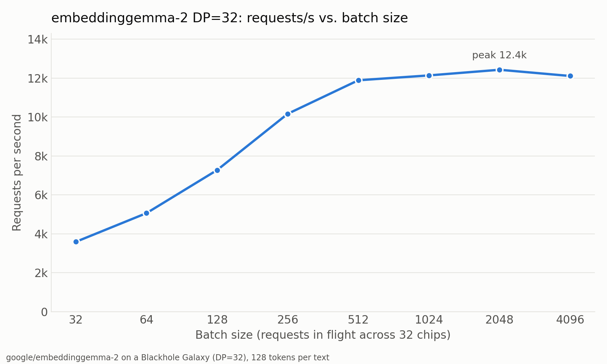
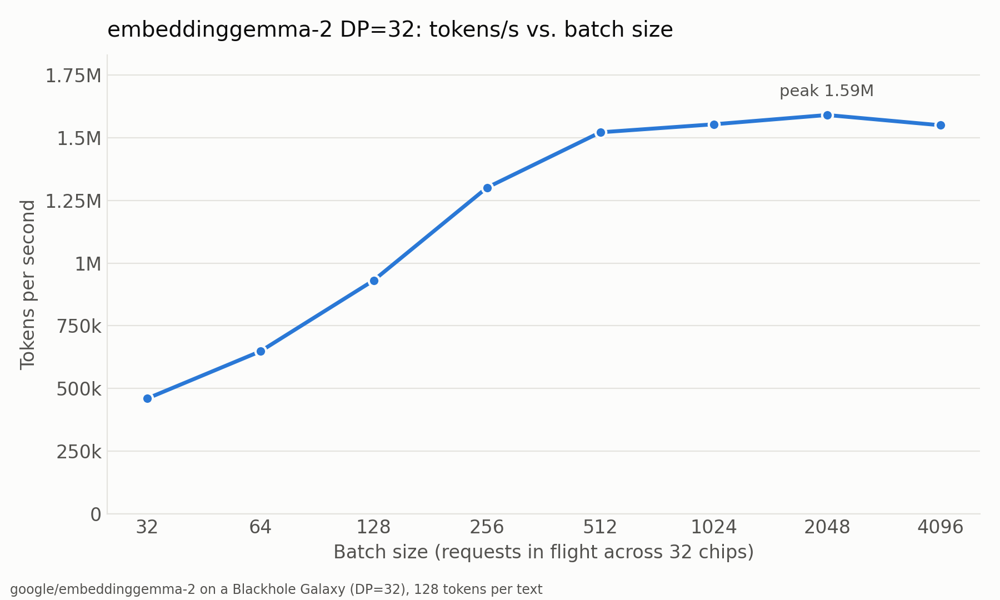

# embeddinggemma-2 DP=32 throughput (BH Galaxy, 2026-11-18)

google/embeddinggemma-2 served by `../emb_serve_fastapi.py` on all 32 chips of a Blackhole Galaxy (u20-40), one model
replica per chip, up to 32 texts per forward on each chip (needs the SDPA fix `7bdf862a756`), 16 server processes on
one port (`FRONTENDS=16 MAXB=32 ../run_fastapi_dp.sh`). Single-text requests of 128 tokens, closed-loop load from
the same host (`../emb_load_mp.py`, 16 client processes), 5 s warmup + 20 s per point, 0 errors on every point.

| Batch size (requests in flight) | Requests/s | Tokens/s | p50 ms | p99 ms |
|---|---|---|---|---|
| 32 | 3,590 | 460k | 7.6 | 18 |
| 64 | 5,063 | 648k | 12.0 | 24 |
| 128 | 7,275 | 931k | 17.0 | 32 |
| 256 | 10,167 | 1.30M | 23.9 | 45 |
| 512 | 11,890 | 1.52M | 38.6 | 252 |
| 1024 | 12,140 | 1.55M | 72.2 | 320 |
| 2048 | **12,430** | **1.59M** | 135.7 | 410 |
| 4096 | 12,111 | 1.55M | 281.8 | 575 |

Throughput saturates from batch 512. At that point the chips run a mean of 5-9 texts per forward, not 32: the host
(32 cores running the chip workers, the server processes and the load client) is the limit, not the chips.
The original single-chip server does about 117 requests/s at 128 tokens.

Files: `data/load_*.json` (one load point each), `data/batch_*.json` (texts-per-forward histograms from every server
process, via `../emb_fe_metrics.py`), `sat_stats.csv` (the full sweep: 8 and 16 server processes, 128 and 512 tokens,
with the batch-1 reference), `sweep_sat.sh` (the sweep as run; host paths), `plot_simple.py` (redraws the two charts).
