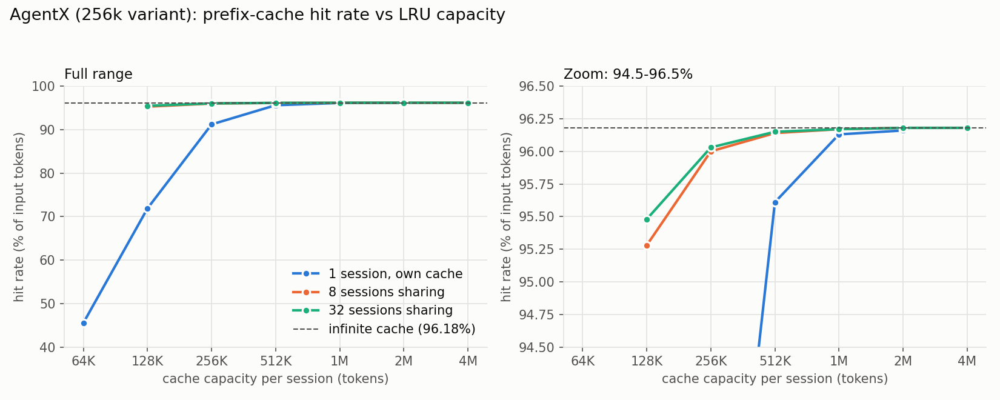

# AgentX P0: workload, hit rate and KV memory

Part of [tt-metal#60408](https://github.com/tenstorrent/tt-metal/issues/60408). Scripts: branch `akhan/agentx-replay-p0`, `models/demos/gemma4_d_p/scripts/agentx_replay/`.

Everything here is host-side analysis of the trace file. Nothing ran on a device.

## Summary

- The 96.2% ideal hit rate is an infinite per-session cache on the **256k variant** (I get 96.18%). The full dataset gives 98.31%.
- About **256K tokens of cache per active session** gets within 0.2 points of the ideal. 512K gets within 0.05.
- Today's KV cache costs about **435–462 KB per token**, which is about **2.2M tokens per 1 TB Galaxy**, or about 8 slots of 256K.

## The data

AgentX is SemiAnalysis's set of 393 anonymized Claude Code sessions. Each request has an arrival time, input and output token counts, and a list of 64-token prefix-cache block hashes. There is no prompt text. The block IDs are session-local, so sessions never share cache blocks. Each session includes sub-agent runs, which are nested in the file and have to be flattened to get all requests.

The 256k variant drops every request whose input plus output exceeds 256,000 tokens. It doesn't truncate. Sub-agent runs lose only the requests that fail.

| | Full | 256k variant |
|---|---|---|
| Requests | 98,827 | 68,266 |
| Input tokens | 21.6B | 6.9B |
| Median input | 142K | 89K |
| p90 input | 550K | 204K |
| Requests over 256K | 30% | 0% |

For the 256k variant, the median gap between requests in a session is 5.6 s, the p90 is 40 s and the p99 is 1,617 s.

New tokens per request after caching (infinite cache):

| New tokens | % of requests | % of new tokens |
|---|---|---|
| ≤1K | 39.4% | 4.8% |
| 1–4K | 43.4% | 25.4% |
| 4–16K | 13.3% | 26.0% |
| >16K | 3.9% | 43.7% |

K is 1024 here. A small share of requests carries most of the prefill work.

## Hit rate vs cache capacity

LRU cache, capacity counted in tokens. Each point is a total capacity, divided by the number of sessions sharing it. A cache hit counts only the leading run of cached blocks.



| Tokens per session | 1 session, own cache | 8 sharing | 32 sharing |
|---|---|---|---|
| 64K | 45.58% | | |
| 128K | 71.89% | 95.28% | 95.48% |
| 256K | 91.20% | 96.00% | 96.03% |
| 512K | 95.61% | 96.14% | 96.15% |
| 1M | 96.13% | 96.17% | 96.17% |
| 2M | 96.16% | 96.18% | 96.18% |

- A session with a cache to itself needs about 512K tokens to get close to the ideal.
- Sessions sharing one cache need much less per session, because idle sessions' blocks are evicted in favor of active ones. 8 and 32 sessions behave almost the same, so only the per-session amount matters.
- Misses cost prefill work. With 8 sessions sharing 1M tokens in total, new tokens are 23% above the ideal. At 2M total, 4.6% above.

## KV memory

From `models/demos/gemma4/configs/gemma-4-31B-it/config.json` and `kv_caches.py` / `ring_prefill.py` on main (8×4 layout, bfloat8_b):

| Layers | Per token per layer | Layers | Elements per token |
|---|---|---|---|
| Sliding | 2 × 16 heads × 256 = 8,192 | 50 | 409,600 |
| Full attention | 4 heads × 640 = 2,560 | 10 | 25,600 |
| **Total** | | 60 | **435,200** |

The full layers store 640 elements per head, the 128-wide rotary part of K plus the 512-wide V, because `attention_k_eq_v` is true.

At about 1 byte per element that's 435 KB per token. With the shared exponent in bfloat8_b (about 1.0625 B per element) it's 462 KB.

| | |
|---|---|
| Tokens in 10¹² B | about 2.16–2.30M |
| One 256K slot | 114–121 GB |
| Slots per Galaxy | about 8 |


## Assumptions and caveats

- Infinite or LRU caches per session, using session-local IDs. No cross-session sharing is possible with this data.
- Concurrency K means the first K sessions in the file, replayed together from t=0 and sharing one cache. How many sessions are really active together on a node is not known.
- 1 TB DRAM assumes 32 GB per chip. Weights (about 3–6%) are not subtracted.
- 1.0625 B per element for bfloat8_b is from memory and not checked in the code.
- The 4×8 layout would store the global KV heads twice. This all assumes 8×4.
- The runner reserves `max_seq_len` per slot up front, so slots limit capacity, not tokens. How a prefix cache maps to slots is a separate question.

## Repro

```bash
python3 -I agentx_stats.py <traces.jsonl>
python3 -I agentx_lru_sweep.py <traces.jsonl> 8 1m 2m 4m 8m 16m 32m
```

The stats script's expected totals are for the full dataset, so it prints MISMATCH on the 256k file. The other numbers are correct.