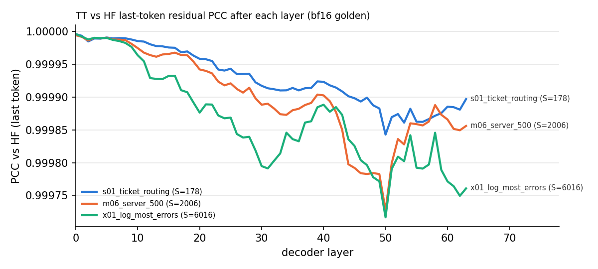

# Stage 6: full model, decision head and demo (prefill-only classifier)

Model `perplexity-ai/pplx-decider-v1-27b` (revision `b01a5cbaca5`), one Blackhole p150a, batch 1.
Branch `gtobarTT/pplx-decider-bringup`, built on the stage-2 fused layers (`63e7f42d76a`).
Precision policy unchanged from stages 1-2: `act_bf16__w_bfp8_all__hifi2` (BF16 activations, BFP8
weights for every projection, HiFi2 matmuls with fp32 accumulation, BF16 embedding and norms,
fp32 DeltaNet state). Labels: **measured** = a command and its output are recorded here or in
[`work_log.md`](work_log.md); **inferred** = follows from code or arithmetic.

## Result

**Decision agreement with HF bf16: 25/25 rows (measured).** The gate is >= 24/25, with a miss allowed
only on a near-tie. Readout-logit PCC over the valid options: min 0.99801, median 0.99995. All 64
layers are resident on the device: 27.30 GiB allocated, 4.54 GiB free.

Warmed end-to-end prefill latency, batch 1, one real prompt per bucket (measured,
`tests/perf/test_model_perf.py`, ms, median). **Burst** = each pass after 10 s idle (median of 5).
**Sustained** = passes back to back (2 warm-ups, median of 7). A request is tokenize + upload +
forward + readback of the probabilities.

| bucket | prompt tokens | device forward, burst | device forward, sustained | request, burst | request, sustained | decisions/s, burst | decisions/s, sustained |
|---:|---:|---:|---:|---:|---:|---:|---:|
| 128 | 100 | 146.9 | 146.6 | 148.4 | 149.6 | 6.74 | 6.69 |
| 1024 | 178 | 363.7 | 463.3 | 366.0 | 467.6 | 2.73 | 2.14 |
| 2048 | 2006 | 656.6 | 898.2 | 665.4 | 919.8 | 1.50 | 1.09 |
| 4096 | 3906 | 1474.3 | 1865.6 | 1481.5 | 1917.4 | 0.67 | 0.52 |
| 8192 | 7928 | 3487.8 | 3969.8 | 3512.9 | 4022.5 | 0.28 | 0.25 |

Decisions/s = 1000 / request ms at batch 1. Each pass computes the whole bucket, so latency
depends on the bucket, not on the prompt length inside it.

## What was built

| path | content |
|---|---|
| `tt/model.py` | `PplxDeciderModel`: embedding -> 64 `PplxDecoderLayer` (stage-2 modules, unchanged) -> `PplxDecisionHead`. `from_snapshot()` converts the weights one layer at a time and uploads them; the disk weight cache is used when present. `upload_tokens()` right-pads to the bucket; `forward()` returns device tensors; `decide()` returns the `count` probabilities. |
| `tt/head.py` | `PplxDecisionHead`: slice the last real token -> final RMSNorm -> readout (5120 x 256, column 255 zero) -> fp32 mask `>= count` with -1e9 -> `* 1/T` -> softmax. Only the [1, 1, 256] probabilities (and logits, for tests) come back. |
| `tt/weight_adapter.py` | `build_readout_weight(..., pad_to=256)` (one new keyword argument). |
| `demo/decider.py` | `TTDecider.predict(state, question)`: the snapshot's `Decider.predict`. Prompt rendering, tokenization, option count and `answer()` come from the snapshot `autojev` package via `reference/decision_prompts.AppTokenizer` (with its Python-3.10 `types.py` stub). |
| `demo/demo.py` | Runs the snapshot `inference.py` text example (Stripe message: urgency `noul` + team-routing `choice`) and prints JSON. `--compare-hf` compares it with HF answers. |
| `reference/hf_demo_reference.py` | HF bf16 answers for the demo rows (layer-streamed on CPU). |
| `tests/e2e/test_model.py` | Decision-agreement gate, logit/hidden PCC, layer-wise trace, bucket-padding check, determinism, runtime fallback audit of the full forward. |
| `tests/e2e/report_layer_trace.py` | Writes `layer_trace.md` / `layer_trace.png` from the e2e results. |
| `tests/perf/test_model_perf.py` | Per-bucket latency (burst and sustained), trace replay, profiler target. |

The forward is `embedding -> for layer: layer(x) -> head`. Between `upload_tokens` and the
probability readback it issues only TTNN device ops (audit below). The real length and the option
count are Python integers. They set the slice index and the comparison scalar; no tensor data
goes back to the host.

### Weight loading and the disk cache (measured, `artifacts/pplx_decider/stage6/load_times.json`)

| load | wall time | cache hits |
|---|---:|---:|
| first load, empty cache dir (read safetensors, convert, dump, upload) | 162.6 s | 0/66 |
| cached load, new process | 36.8 s | 66/66 |
| cached load, second device open in the same process (page cache warm) | 4.0 s | 66/66 |

- The cache is `artifacts/pplx_decider/weight_cache/<revision[:12]>/<policy name>/` (27 GB, 819 files).
  Stage 8 moved it to `<revision[:12]>/weights/`, one directory for every policy, because the file names
  carry the dtype. It now sits next to the weights, `<model dir>/tt_weight_cache/<revision>/`, or under
  `$TT_CACHE_PATH` (gemma4 convention; see the top-level README, "Where the weight cache goes").
- A cached load builds the weight bundles from `meta` tensors (shapes from the safetensors headers),
  so it reads no HF weight bytes. The model checks that every weight hits before it skips the real
  tensors.
- Host sources are swapped for meta tensors after each layer's upload. Host RAM stays at one layer.
- Fix found here: `LazyWeight` puts `device.id()` in the cache file name. That id is a per-process
  counter, so a second `open_device` in one process missed all 66 groups (measured 0/66 before the
  fix). `tt/model.py::CachedWeight` drops the id. The file holds an unsharded host tensor, so the id
  is not needed.

### DRAM (measured, `ttnn.get_memory_view`)

| item | GiB |
|---|---:|
| embedding table (BF16, 248320 x 5120) | 2.368 |
| per `linear_attention` layer (weights + fp32 zero state + scan constants) | 0.3857 x 48 |
| per `full_attention` layer (weights + 2 x 16 MiB BF16 K/V cache + page table) | 0.4003 x 16 |
| after load (all 64 layers, head, RoPE tables) | 27.296 allocated / 4.536 free of 31.831 |
| S=8192 peak at layer boundaries | 27.455 allocated / 4.376 free (largest free block 532 MiB per bank) |

All-BFP8 fits. The transient inside one layer pass is not visible to the allocator view. It is
inferred to be a few hundred MiB (one 2048-token chunk of intermediates), and every 8192-bucket run
completed. `doc/context_contract.json` has these numbers.

## Accuracy against the stage-6 HF golden (measured)

Golden: `artifacts/pplx_decider/goldens/decisions/` (`reference/hf_decision_golden.py`). It has 25
rows of HF bf16 on CPU, streamed one layer at a time, with the same token ids. Command:
`pytest models/demos/pplx_decider_v1_27b/tests/e2e/test_model.py -q -s`. Result: **6 passed in 87 s,
exit 0**. Results: `artifacts/pplx_decider/stage6/e2e_decisions.json`.

| row | type | seq_len | bucket | options | HF choice | HF p | TT choice | TT p | max abs prob diff | HF top-2 gap | logit PCC (valid) | final-hidden PCC |
|---|---|---:|---:|---:|---|---:|---|---:|---:|---:|---:|---:|
| s01_ticket_routing | choice | 178 | 1024 | 3 | billing | 0.9907 | billing | 0.9906 | 0.0002 | 0.9850 | 0.99999 | 0.99980 |
| s02_review_positive | noul | 172 | 1024 | 2 | true | 0.9972 | true | 0.9970 | 0.0002 | 0.9943 | 1.00000 | 0.99973 |
| s03_restaurant_stars | score | 188 | 1024 | 5 | 1 | 0.6600 | 1 | 0.6477 | 0.0123 | 0.3439 | 0.99995 | 0.99991 |
| s04_recipe_cuisine | choice | 210 | 1024 | 4 | japanese | 0.9929 | japanese | 0.9929 | 0.0000 | 0.9902 | 1.00000 | 0.99983 |
| s05_unit_conversion | choice | 183 | 1024 | 6 | 2,500 m | 0.9769 | 2,500 m | 0.9760 | 0.0009 | 0.9664 | 0.99998 | 0.99976 |
| s06_math_check | noul | 143 | 1024 | 2 | true | 0.9472 | true | 0.9413 | 0.0060 | 0.8945 | 1.00000 | 0.99973 |
| s07_language_id | choice | 148 | 1024 | 5 | de | 0.9916 | de | 0.9919 | 0.0004 | 0.9891 | 0.99999 | 0.99978 |
| s08_itinerary_airport | choice | 250 | 1024 | 12 | LIS | 0.9576 | LIS | 0.9619 | 0.0043 | 0.9443 | 0.99985 | 0.99969 |
| s09_bug_severity | score | 180 | 1024 | 3 | 0 | 0.9897 | 0 | 0.9901 | 0.0005 | 0.9825 | 0.99998 | 0.99981 |
| s10_match_winner | choice | 169 | 1024 | 2 | Hilltop Foxes | 0.9960 | Hilltop Foxes | 0.9960 | 0.0000 | 0.9920 | 1.00000 | 0.99983 |
| m01_sku_lookup_120opt | choice | 1784 | 2048 | 120 | SKU-1077 | 0.9841 | SKU-1077 | 0.9839 | 0.0001 | 0.9829 | 0.99984 | 0.99971 |
| m02_support_thread | choice | 1209 | 2048 | 8 | shipping_delivery | 0.9842 | shipping_delivery | 0.9843 | 0.0002 | 0.9785 | 0.99994 | 0.99968 |
| m03_orders_refunded | noul | 1521 | 2048 | 2 | false | 0.9780 | false | 0.9780 | 0.0000 | 0.9560 | 1.00000 | 0.99984 |
| m04_reviews_positive | score | 1674 | 2048 | 5 | 3 | 0.6314 | 3 | 0.5983 | 0.0394 | 0.3113 | 0.99844 | 0.99963 |
| m05_store_receipt | choice | 1903 | 2048 | 30 | Seattle Mall | 0.9571 | Seattle Mall | 0.9575 | 0.0003 | 0.9527 | 0.99985 | 0.99971 |
| m06_server_500 | noul | 2006 | 2048 | 2 | true | 0.9932 | true | 0.9936 | 0.0004 | 0.9864 | 1.00000 | 0.99973 |
| l01_faq_match_230opt | choice | 3303 | 4096 | 230 | faq_141 | 0.8492 | faq_141 | 0.8555 | 0.0063 | 0.8415 | 0.99801 | 0.99898 |
| l02_delivery_feed_json | noul | 2642 | 4096 | 2 | true | 0.8848 | true | 0.8958 | 0.0111 | 0.7695 | 1.00000 | 0.99921 |
| l03_service_health | score | 3617 | 4096 | 4 | 2 | 0.6658 | 2 | 0.6772 | 0.0117 | 0.3644 | 0.99990 | 0.99989 |
| l04_laptop_department | choice | 2301 | 4096 | 10 | hardware_repair | 0.9785 | hardware_repair | 0.9806 | 0.0021 | 0.9708 | 0.99966 | 0.99960 |
| l05_league_leader | choice | 3906 | 4096 | 8 | Lakeview United | 0.9786 | Lakeview United | 0.9778 | 0.0008 | 0.9697 | 0.99993 | 0.99972 |
| x01_log_most_errors | choice | 6016 | 8192 | 5 | payments | 0.9736 | payments | 0.9753 | 0.0017 | 0.9631 | 0.99986 | 0.99959 |
| x02_faq_returns | noul | 5005 | 8192 | 2 | true | 0.9960 | true | 0.9961 | 0.0001 | 0.9920 | 1.00000 | 0.99977 |
| x03_reviews_negative | score | 7004 | 8192 | 5 | 0 | 0.4805 | 0 | 0.4827 | 0.0038 | 0.0514 | 0.99983 | 0.99984 |
| x04_customer_lookup | choice | 7928 | 8192 | 25 | Priya Okafor | 0.9671 | Priya Okafor | 0.9672 | 0.0001 | 0.9638 | 0.99982 | 0.99961 |

- **Agreement 25/25.** The closest row, `x03_reviews_negative` (HF top-2 gap 0.0514), keeps its
  order on TT (TT gap 0.0517).
- **Readout-logit PCC over valid options:** min 0.99801 (`l01`, 230 options), median 0.99995.
  For the 6 two-option rows this PCC is 1.0 by construction (two points). Over all 255 raw logits:
  min 0.99772, median 0.99990.
- **Max abs prob diff:** 0.0394 (`m04_reviews_positive`, a flat 5-level score distribution, HF
  0.6314 vs TT 0.5983). All other rows are <= 0.0123.
- **Final-hidden (final-normed last token) PCC:** min 0.99898, median 0.99973.

### Layer-wise trace (measured, diagnostic)

The table is [`layer_trace.md`](layer_trace.md) (64 values for each flagged row; all 25 rows are in
`e2e_decisions.json`). The plot is below.



There is no steep decay. PCC drifts down slowly from 0.99999 at layer 0. The lowest point is layer
50 in all three rows (0.99984 / 0.99973 / 0.99972 for S=178 / 2006 / 6016). After layer 50 PCC
recovers, and layer 63 ends at 0.99990 / 0.99986 / 0.99976. The lowest value over all 25 rows and
64 layers is 0.99818. Longer prompts drift a little more. The dip happens at the same layer in
all rows, so it comes from that layer, not from the prompt. A likely cause is a layer where a few
large-magnitude residual channels change (inferred, not investigated; the effect is 1e-4).

### Bucket padding, determinism, fallback audit, watcher (measured)

- **Bucket padding** (`test_bucket_padding`): `s01` (178 tokens) at buckets 1024 and 2048, and `l05`
  (3906 tokens) at 4096 and 8192, give the same decision with **bit-identical** probabilities and logits
  (logit PCC 1.0). The real tokens' chunks are the same physical computation, and the pad tokens are
  causal-only.
- **Determinism** (`test_determinism`): `m06` twice, probabilities and logits bit-identical.
- **Fallback audit** (`test_full_forward_stays_on_device`, using `tests/runtime_audit.py`
  `count_host_calls`): `s01` (bucket 1024) and `x01` (bucket 8192) record **0** ttnn host conversions
  or torch calls between the token upload and the probability readback. The counter's positive control
  is in `tests/pcc/test_runtime_audit.py`.
- **Watcher**: `TT_METAL_WATCHER=10` full-forward run at bucket 1024 (`-k "test_full_forward_stays_on_device
  and s01"`): 1 passed, exit 0, 5 watcher dumps, 0 lines that match error/assert/sanitize/hang/overflow.
  Log: `artifacts/pplx_decider/stage6/watcher/generated/watcher/watcher.log`.

### Demo (measured)

`python models/demos/pplx_decider_v1_27b/demo/demo.py --compare-hf artifacts/pplx_decider/stage6/demo_hf_reference.json`, exit 0:

```json
{"urgency": {"type": "noul", "noul": 0.9929980981993036},
 "routing": {"type": "choice", "probabilities": {"billing": 0.0047046955642259655,
  "technical_support": 0.9917506372383665, "sales": 0.0035446671974075227},
  "choice": "technical_support", "confidence": 0.9876259558575496}}
```

HF bf16 (layer-streamed, `reference/hf_demo_reference.py`) gives urgency 0.99300 and routing
`technical_support` 0.99181. Both decisions match HF; the max abs prob diff is 0.0000 for urgency and
0.0002 for routing. The two demo prompts have 100 and 115 tokens, so they use the 128 bucket. Stage 2
assumed the 128 bucket is never used because the shortest golden prompt has 143 tokens. Short
real questions do use it.

## Performance analysis

### Projection vs measured (measured)

Projection = 48 x linear_attention layer + 16 x full_attention layer, from the stage-2 per-layer
medians (`doc/fused_decoder/README.md`).

| bucket | projected ms | burst ms | burst / projected | sustained ms | sustained / projected |
|---:|---:|---:|---:|---:|---:|
| 128 | 148.6 | 146.9 | 0.99 | 146.6 | 0.99 |
| 1024 | 369.9 | 363.7 | 0.98 | 463.3 | 1.25 |
| 2048 | 658.9 | 656.6 | 1.00 | 898.2 | 1.36 |
| 4096 | 1377.6 | 1474.3 | 1.07 | 1865.6 | 1.35 |
| 8192 | 3054.2 | 3487.8 | 1.14 | 3969.8 | 1.30 |

- A fresh pass (burst) matches the layer projection up to 2048. The embedding, the head and the
  per-layer handoff add nothing measurable.
- The tt-perf-report device-time sum of one 2048 forward is 648.0 ms against a 656.6 ms host-measured
  burst forward, so the host/dispatch gap is about 1 %.
- Back-to-back passes slow down. A cooldown experiment (`artifacts/pplx_decider/stage6/cooldown_experiment.json`)
  measured, at 1024: 363.9 ms after 10 s idle (5/5 passes), then 367.5 -> 390.5 -> 427.8 -> 453.8 ->
  462.6 ms back to back, then 364.0 ms again after 10 s idle. At 2048: 656.9 ms idle, 743 -> 900 ms back
  to back, 656.8 ms idle again.
- Inside one sustained pass, layer times rise from first to last (1024: L0 6.15 ms -> L63 6.6 ms). The
  4096 and 8192 bursts are already long single passes (1.5 s and 3.5 s) and show part of the same
  effect.
- Cause (inferred, not measured): device clock or power management under sustained load. The
  slowdown reverses with idle time and does not depend on the code path. AICLK was not sampled during
  the runs, because device commands run one at a time. The sustained numbers are the honest throughput
  for continuous serving, and the burst numbers apply to an isolated request.

### Host share and trace (measured)

- Tokenize: 0.76 ms (100 tokens) to 29.1 ms (7928 tokens). Upload: 0.08 to 0.49 ms. Request minus
  device forward (burst), which is tokenize + upload + readback: 1.5 ms (128) to 25.1 ms (8192). The
  tokenizer is most of it.
- Trace (`test_traced_forward`, buckets 128 / 1024 / 2048): replay output is bit-identical to eager.
  The speedup is 1.025x / 1.007x / 1.008x (eager 155.1 / 471.4 / 940.9 ms vs traced 151.2 / 468.0 /
  933.6 ms). The forward is device-bound, so trace is not worth its constraints at batch 1. The current
  trace bakes the last-token index and the option count, so a serving trace needs them as device
  inputs. Stage-7 candidate, low value.

### Profile (measured)

The Tracy capture is one warmed full forward at the 2048 bucket (`m06`, 2006 tokens), between the
`PREFILL_START` / `PREFILL_END` signposts. The run used `TT_METAL_PROFILER_PROGRAM_SUPPORT_COUNT=4000`
and flushed the profiler after load and after each warm-up. One forward is 1713 device ops, and every
op has a device time (0 missing). The DRAM profiler buffer warned "full" on two cores during the final
read. The window still has complete per-op data, so the drop is small but not zero. Summary table:
[`perf/full_S2048_summary.csv`](perf/full_S2048_summary.csv). The full per-op CSV and the stacked PNG
are in `artifacts/pplx_decider/stage6/perf_report/`.

| op | share | device ms | ops |
|---|---:|---:|---:|
| minimal_matmul (all projections) | 62.6 % | 405.9 | 320 |
| GDN chunk prep + scan | 13.8 % | 89.6 | 96 |
| binary eltwise | 4.5 % | 29.2 | 293 |
| RMSNorm | 4.2 % | 27.0 | 161 |
| GDN causal conv | 3.4 % | 22.1 | 48 |
| SDPA | 3.1 % | 20.4 | 16 |
| readout matmul (`MatmulDeviceOperation`, the only non-minimal matmul) | 0.01 % | 0.06 | 1 |

Stage-7 candidates: the sustained-load slowdown, matmul program configs (67 % mean FLOP
utilisation), the GDN prep/scan kernels, and per-chunk reshapes/untilize. Trace is low value, as
measured above.

## Batches

`TTDecider.from_pretrained(mesh_device, model_path=None, max_batch_size=1, max_seq_len=8192, vision=True)`
(the `models/demos/gemma4` argument order) and `predict_batch(rows)` / `predict_probabilities_batch(rows)`
run several requests per forward. `predict` and the batch-1 low-level calls are unchanged: their outputs are
bit-identical to the review_3b dumps (100/100 text tensors, 26/26 image tensors, measured with
`tests/e2e/compare_outputs.py`).

### Contract

- **Padding.** The rows of one forward are right-padded to one bucket, the bucket of the longest row.
  Both mixers are causal, so padding cannot change a row's real-token hidden states. The head reads each
  row's own last real token and applies each row's own option count and mask. The temperature is the
  checkpoint's single value (`decision_config.json`), the same for every row.
- **Scheduling** (`TTDecider.plan_batches`). Requests are grouped by their own bucket, in input order
  within a bucket, and each group is split into batches of `batch_cap(bucket, max_batch_size)`. A row is
  therefore never padded beyond the bucket it gets at batch 1. Answers come back in input order. Text and
  image rows of one bucket share a forward. If any row is over `max_seq_len`, the whole call is rejected
  before any device work.
- **Low level.** `PplxDeciderModel.upload_batch(ids_list)` / `prepare_batch(encoded_list)` give
  `tokens [B, bucket]`, the per-row last indices and, for image rows, the inputs of one batch-wide splice.
  `model(tokens, last_indices, counts, images=...)` then returns `probs` / `logits` `[1, B, 256]`.
  `decide_batch` is input prep, one forward and one readback.

### Device implementation

The forward stays on device: 0 host calls inside a B=4 forward at bucket 1024 (measured,
`test_batch_forward_stays_on_device_and_deterministic`), and two runs of the same batch are
bit-identical.

| part | batched how |
|---|---|
| embedding, splice | `[B, bucket]` tokens; image features spliced through one gather over `B * bucket` text rows plus all features |
| matmuls (all 7 shapes) | `[B, S, K]` runs as `[1, g*S, K]` calls over groups of g rows (`common.batch_rows_per_call`) |
| RMSNorms | interleaved norm on the `[1, B*S, D]` view; at bucket 128, block-sharded with one request per core row |
| gated full attention | projections batched; q/k norm, rope and causal SDPA on `[B, H, S, D]` in one op each; image rows rope per row (their own 3D-mRoPE tables) |
| Gated DeltaNet | projections batched; causal conv, chunked scan (fused 48-head program) and gated norm per row, each row with its own conv and recurrent state |
| head | per-row last-token slice, then final norm, readout, mask (per-row count), / T and softmax on `[1, B, 256]` |

**Why row groups.** A row's matmul output depends on the program that the call gets. When a call keeps
batch 1's K blocking and core-grid orientation, every row of the call is bit-identical to batch 1. In a
micro test (measured), the attention q|k|v shape (5120 x 8192) changed in two cases:
- when the row count crossed into a different path: the short 1D config with `in0_block_w` 4 against
  `minimal_matmul` with `K_block` 8;
- when `minimal_matmul` transposed its core grid, which it does for `M > N`.

The first full-model run without row groups gave the same 25/25 decisions but logit PCC down to
0.99709 against batch 1 at bucket 4096. Row groups therefore keep both properties:
- `minimal_matmul` calls get as many rows as keep `M > N` equal to batch 1's;
- 128-bucket calls use the batch-1 short config with up to 16 M tiles (4 requests);
- shapes that batch 1 runs with `ttnn.linear` auto (the GDN q|k|v projection at bucket 128) run one
  request per call;
- fused SwiGLU runs the whole batch.

All 7 shapes are bit-identical per row at buckets 128 to 4096 and B up to 32 (64 cases, measured). The
RMSNorm needed the same care: at bucket 128 an interleaved norm on the flattened batch differed from batch
1's sharded norm (PCC 0.9928).

### DRAM limit (measured, full model + vision tower resident, 3.55 GiB free after load)

| bucket | largest batch that runs | next power of two | `BATCH_CAPS` |
|---:|---:|---|---:|
| 128 | 32 (largest probed) | not probed | 32 |
| 1024 | 32 (largest probed) | not probed | 32 |
| 2048 | 16 | 32: allocator TT_FATAL | 16 |
| 4096 | 8 | 16: allocator TT_FATAL | 8 |
| 8192 | 4 | 8: allocator TT_FATAL | 4 |

The limit is about 32768 tokens per forward. A batch holds only transient activations: weights and the
persistent state are allocated at load, and the free DRAM after each cap run equals the free DRAM after
load. The failing sizes were probed before the row groups. `test_batch_caps_fit` runs every cap with
the final code. `max_batch_size` must be 1..32; per bucket it is clamped to `BATCH_CAPS`.

### Equivalence (measured, `tests/e2e/test_batch.py`, 14 passed)

| case | decisions vs batch 1 | bit-identical vs batch 1 | logit PCC vs batch 1 (min) | vs HF |
|---|---|---|---|---|
| 25 text rows, B = 2, 4, 8 (batches by bucket) | 25/25 | 25/25 | 1.0 | 25/25, logit PCC min 0.99721 |
| 8 image rows, B = 2, 4, 8 (B=8: one forward) | 8/8 | 8/8 | 1.0 | 8/8, logit PCC min 0.99923 |
| bucket 128, 8 seeded rows of 20-128 tokens, B = 8 | 8/8 | 8/8 | 1.0 | no golden |
| mixed batch, 2 text + 2 image rows | 4/4 | 4/4 | 1.0 | |
| x04 (7928 tokens) + s01 + s05 in one 8192 batch | 3/3 | x04 yes; s01, s05 no (padded to 8192, not 1024) | 0.99993 (s05) | |
| single-row batch (list path) | equal | yes | | |

Also passed: `predict_batch` on 19 shuffled rows (16 text, 3 image) with `max_batch_size=4`. It gave
batches of 4+4+4+1 at bucket 1024 and 4+2 at 2048 and answers in input order. It rejected a row over
8192 tokens and `max_batch_size` outside 1..32, and every cap in the table above ran.

### Performance

Measured with `tests/perf/test_batch_perf.py`, eager. The rows are the decision golden prompts of the
bucket, cycled to B, and B = 1 is the batch-1 path. "Request" is `predict_probabilities_batch`: tokenize,
pad, upload, forward and one readback. Sustained is the median of 5 back to back; burst is the median of
3, each after 10 s idle. Every request of a batch waits for the whole batch, so per-request latency is the
batch latency, and decisions/s = B / latency.

| bucket | B | device forward, sustained (ms) | request, sustained (ms) | request, burst (ms) | decisions/s sustained | decisions/s burst |
|---:|---:|---:|---:|---:|---:|---:|
| 1024 | 1 | 395 | 415 | 315 | 2.41 | 3.17 |
| 1024 | 2 | 756 | 760 | 591 | 2.63 | 3.38 |
| 1024 | 4 | 1462 | 1478 | 1202 | 2.71 | 3.33 |
| 1024 | 8 | 3007 | 3040 | 2734 | 2.63 | 2.93 |
| 1024 | 32 (cap) | 12212 | 12242 | 11844 | 2.61 | 2.70 |
| 2048 | 1 | 813 | 821 | 563 | 1.22 | 1.78 |
| 2048 | 2 | 1519 | 1548 | 1214 | 1.29 | 1.65 |
| 2048 | 4 | 3165 | 3221 | 2846 | 1.24 | 1.41 |
| 2048 | 8 | 6487 | 6540 | 6138 | 1.22 | 1.30 |
| 2048 | 16 (cap) | 12983 | 13062 | 12591 | 1.22 | 1.27 |

Batching buys little at these buckets. The best sustained gain is +12 % (B = 4 at 1024) and +6 % (B = 2
at 2048), while latency grows about linearly with B. One request of 1024 or 2048 tokens already keeps the
matmuls compute-bound, so a batch adds work without saving weight reads. Two things work against a burst
batch. A longer pass runs longer at the lower sustained clock. The row groups also re-read the weights
of the N = 5120 to 6272 projections once per group. Batching should pay more at the 128 bucket, where one
request is weight-read bound (not measured here; see the benchmark below).

**600-prompt benchmark at `--batch-size 4`** (measured, `benchmark/run_benchmark.py`, 200 rows at bucket
128 and 400 at 1024, compared with the batch-1 refresh run `stage11_refresh/run/predictions_accuracy.jsonl`):
- 0 of 600 choices changed, and the largest probability difference is 0 (bit-identical);
- accuracy unchanged: WinoGrande 174/200, FinancialPhraseBank 168/200, Belebele 193/200;
- mixed throughput 3.65 decisions/s (600 in 164.3 s) against 3.10 at batch 1 (+18 %);
- latency, which is the batch latency: p50 1487 ms overall, 286 ms at bucket 128, 1490 ms at bucket 1024.

The 128 bucket gains most: 4 requests in 286 ms against 114 ms for one at batch 1.

## Notes and deviations

- **Softmax in the head.** It is composed from fp32 `max / subtract / exp / sum / divide`, not
  `ttnn.softmax`. On a random fp32 [1, 1, 256] row, `ttnn.softmax` (HiFi4, fp32 acc) measured 2.1e-3
  relative error, and its probabilities summed to 0.9989. The composition measured 4e-7 (scratch
  probe; see the work log).
- **Batch.** `TTDecider.predict` is batch 1, as the app's `inference.py` is. `predict_batch` runs up to
  `max_batch_size` requests per forward and gives the same answers bit for bit: see [Batches](#batches).
- **Images** (vision tower) are a later stage. `TTDecider` is text only.

## Reproduce

```bash
pytest models/demos/pplx_decider_v1_27b/tests/e2e/test_model.py -q -s         # gate + checks, ~2 min with cache
python models/demos/pplx_decider_v1_27b/tests/e2e/report_layer_trace.py       # layer_trace.md / .png
python models/demos/pplx_decider_v1_27b/demo/demo.py                          # README example, JSON
pytest models/demos/pplx_decider_v1_27b/tests/perf/test_model_perf.py -q -s -k "test_model_perf and not traced and not profile"
pytest models/demos/pplx_decider_v1_27b/tests/perf/test_model_perf.py -q -s -k test_traced_forward
TT_METAL_PROFILER_PROGRAM_SUPPORT_COUNT=4000 python -m tracy -r -p -v --no-web-server -o <dir> -m pytest \
  "models/demos/pplx_decider_v1_27b/tests/perf/test_model_perf.py::test_profile_model"
tt-perf-report <dir>/reports/<ts>/ops_perf_results_<ts>.csv --start-signpost PREFILL_START \
  --end-signpost PREFILL_END --no-advice --summary-file <out>
```
