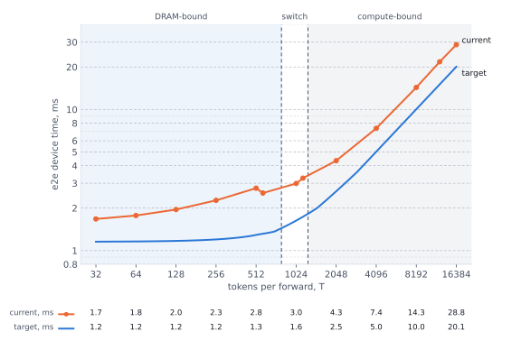

# Roofline: nomic-embed-text-v2-moe on one Blackhole chip

One p300c chip, the code of 2026-11-03, against the target of 2026-10-29, kept as it was. Each op's
target is the time it takes at 70% compute utilization (60% for SDPA) or 60% DRAM bandwidth,
whichever limits it; the ops run one after another, as the model is built today, so a layer's and the
forward's target is the sum of its ops' targets. The target was derived from the code of 2026-10-29,
whose fidelities and GELU the current code keeps: HiFi2 for QKV, fc1, fc2, the expert w1 and SDPA,
HiFi3 for out_proj, LoFi for the expert w2, HiFi4 for the router; grouped_matmul's polynomial GELU in
fc1 and the expert w1, 640 SFPU cycles a tile. It runs each token through its top-2 experts, reads
every weight once a layer, and moves the activation bytes that code moved per token at 8x512.

| symbol | meaning |
|---|---|
| B | sequences per forward (batch size) |
| S | tokens per sequence |
| T | total token count, B x S; 8x512 is B = 8, S = 512, T = 4096 |
| H | hidden size, 768 |
| A | attention heads, 12 |
| F | FFN and expert intermediate size, 3072 |
| E | experts per MoE layer, 8; the router picks 2 per token (top-2) |

## Target and current across T

## Layers and e2e
**Utilization:** ideal time / time taken. Compute is the target's FPU + SFPU work (overlapped for
  fc1 and w1, counter-measured for ops without FLOPs), with the experts top-2 routed; DRAM the bytes
  the code moves at 512 GB/s.
**Bound:** the bound of the ops that hold most of the target, with their share of it.
### 1x128: DRAM-bound

Bound by DRAM, reading the weights. Target: 60% DRAM bandwidth
| 1x128 | compute | DRAM | bound | target, ms | current, ms |
|---|---|---|---|---|---|
| Dense layer | 7% | 34% | DRAM (97%) | 0.05 | 0.10 |
| MoE layer | 4% | 49% | DRAM (99%) | 0.15 | 0.22 |
| **e2e** | 5% | 44% | DRAM (99%) | 1.17 | 1.95 |

### 4x288: past the switch

The forward turns compute-bound at 998 tokens, inside a band from 794 to 1256 where neither part holds
more than 56% of the target. The dense projections turn first (out_proj at 464 tokens, fc2 694, QKV and
fc1 + GELU 698), then the experts (w1 + GELU 1473, w2 2945); the embedding and dispatch + combine are
DRAM-bound at every T, SDPA and the norms compute-bound at every T.

| 4x288 | compute | DRAM | bound | target, ms | current, ms |
|---|---|---|---|---|---|
| Dense layer | 33% | 19% | compute | 0.10 | 0.20 |
| MoE layer | 25% | 34% | DRAM (74%) | 0.18 | 0.34 |
| **e2e** | 28% | 28% | compute (51%) | 1.66 | 3.26 |

### 8x256: compute-bound

Bound by compute. Target: 70% compute utilization (60% for SDPA)
| 8x256 | compute | DRAM | bound | target, ms | current, ms |
|---|---|---|---|---|---|
| Dense layer | 43% | 14% | compute | 0.17 | 0.27 |
| MoE layer | 34% | 26% | compute (71%) | 0.24 | 0.44 |
| **e2e** | 37% | 22% | compute (82%) | 2.47 | 4.33 |

### 8x512: compute-bound

Bound by compute. Target: 70% compute utilization (60% for SDPA)
| 8x512 | compute | DRAM | bound | target, ms | current, ms |
|---|---|---|---|---|---|
| Dense layer | 51% | 7% | compute | 0.36 | 0.49 |
| MoE layer | 44% | 16% | compute (98%) | 0.47 | 0.72 |
| **e2e** | 46% | 12% | compute (98%) | 5.02 | 7.35 |

## Per op

Every op as the code runs it: the ttnn call and its device time, per layer averaged over the 6 layers
of that type, with its share of the layer. A MoE layer runs each token through its two routed
experts: `routing_metadata` sorts the token rows by expert on the device, `routed_combine` gathers
them into each expert's region, one grouped matmul per projection multiplies each expert's rows by
that expert's weights, and `routed_combine` weights and sums each token's two rows. The norms split
the hidden axis over 8 core rows up to 128 tile rows (4096 tokens). From 3 tile rows a core the ops
around them read and write that layout, and only the embedding norm, the router's input and the
forward's output convert; below it (1x128 here) every norm converts in and out.

### Once a forward: the embedding and the output

| op | ttnn call | 1x128 us | % of forward | 4x288 us | % of forward | 8x256 us | % of forward | 8x512 us | % of forward |
|---|---|---|---|---|---|---|---|---|---|
| token embedding lookup | `ttnn.embedding` | 6.1 | 0.3 | 10.9 | 0.3 | 14.8 | 0.3 | 21.8 | 0.3 |
| layout conversions around the embedding norm | `ttnn.to_memory_config` x2 (1x128); `ttnn.to_memory_config` (4x288, 8x256, 8x512) | 1.8 | 0.1 | 2.6 | 0.1 | 4.1 | 0.1 | 7.8 | 0.1 |
| embedding norm | `ttnn.layer_norm` | 7.1 | 0.4 | 13.2 | 0.4 | 17.1 | 0.4 | 27.3 | 0.4 |
| the last norm's output to interleaved DRAM | `ttnn.to_memory_config` | 1.6 | 0.1 | 6.7 | 0.2 | 11.6 | 0.3 | 22.8 | 0.3 |

### Dense layer

| op | ttnn call | 1x128 us | % | 4x288 us | % | 8x256 us | % | 8x512 us | % |
|---|---|---|---|---|---|---|---|---|---|
| QKV projection | `ttnn.linear` (1x128); `ttnn.experimental.nomic_embed_text_v2_moe.grouped_matmul_w1` (4x288, 8x256); `ttnn.experimental.nomic_embed_text_v2_moe.pirotski_matmul` (8x512) | 12.7 | **12.7** | 28.0 | **13.9** | 41.6 | **15.2** | 71.4 | **14.5** |
| head split | `ttnn.experimental.nlp_create_qkv_heads` | 2.0 | **2.0** | 9.5 | **4.7** | 15.9 | **5.8** | 36.3 | **7.4** |
| rotary on q and k | `ttnn.experimental.rotary_embedding_llama` x2 | 6.8 | **6.8** | 22.2 | **11.0** | 37.9 | **13.9** | 51.9 | **10.5** |
| attention | `ttnn.transformer.scaled_dot_product_attention` | 6.6 | **6.6** | 24.8 | **12.3** | 23.5 | **8.6** | 73.0 | **14.8** |
| attention output projection | `ttnn.linear` (1x128); `ttnn.experimental.nomic_embed_text_v2_moe.pirotski_matmul` (4x288, 8x256, 8x512) | 8.6 | **8.5** | 14.5 | **7.2** | 19.7 | **7.2** | 32.5 | **6.6** |
| residual add + norm1 | `ttnn.layer_norm` | 7.4 | **7.4** | 14.0 | **6.9** | 18.6 | **6.8** | 29.7 | **6.0** |
| fc1 + GELU (FFN up-projection) | `ttnn.experimental.nomic_embed_text_v2_moe.grouped_matmul_w1` | 20.2 | **20.1** | 32.4 | **16.1** | 48.5 | **17.8** | 87.0 | **17.6** |
| fc2 (FFN down-projection) | `ttnn.linear` (1x128); `ttnn.experimental.nomic_embed_text_v2_moe.pirotski_matmul` (4x288, 8x256, 8x512) | 24.3 | **24.2** | 41.4 | **20.6** | 48.6 | **17.8** | 82.8 | **16.8** |
| residual add + norm2 | `ttnn.layer_norm` | 7.5 | **7.4** | 14.6 | **7.2** | 18.7 | **6.9** | 28.9 | **5.9** |
| layout conversions around the split norms | `ttnn.to_memory_config` x4 | 4.3 | **4.2** | - | - | - | - | - | - |
| **layer total** | | 100.3 | **100** | 201.2 | **100** | 273.0 | **100** | 493.5 | **100** |

### MoE layer

| op | ttnn call | 1x128 us | % | 4x288 us | % | 8x256 us | % | 8x512 us | % |
|---|---|---|---|---|---|---|---|---|---|
| QKV projection | `ttnn.linear` (1x128); `ttnn.experimental.nomic_embed_text_v2_moe.grouped_matmul_w1` (4x288, 8x256); `ttnn.experimental.nomic_embed_text_v2_moe.pirotski_matmul` (8x512) | 12.3 | **5.5** | 28.1 | **8.4** | 41.6 | **9.4** | 71.3 | **9.9** |
| head split | `ttnn.experimental.nlp_create_qkv_heads` | 1.9 | **0.9** | 9.5 | **2.8** | 16.5 | **3.7** | 35.9 | **5.0** |
| rotary on q and k | `ttnn.experimental.rotary_embedding_llama` x2 | 6.4 | **2.9** | 22.3 | **6.6** | 37.8 | **8.6** | 51.8 | **7.2** |
| attention | `ttnn.transformer.scaled_dot_product_attention` | 6.6 | **3.0** | 24.6 | **7.3** | 23.4 | **5.3** | 73.1 | **10.2** |
| attention output projection | `ttnn.linear` (1x128); `ttnn.experimental.nomic_embed_text_v2_moe.pirotski_matmul` (4x288, 8x256, 8x512) | 8.6 | **3.8** | 14.5 | **4.3** | 19.6 | **4.4** | 31.9 | **4.4** |
| residual add + norm1 | `ttnn.layer_norm` | 7.5 | **3.4** | 13.8 | **4.1** | 18.2 | **4.1** | 30.1 | **4.2** |
| router scores | `ttnn.linear` + `ttnn.add` | 7.5 | **3.4** | 10.7 | **3.2** | 12.8 | **2.9** | 21.6 | **3.0** |
| router softmax | `ttnn.softmax` | 3.8 | **1.7** | 4.0 | **1.2** | 4.2 | **1.0** | 6.1 | **0.8** |
| x to row-major, for the dispatch | `ttnn.to_layout` | 2.3 | **1.0** | 5.3 | **1.6** | 13.0 | **2.9** | 20.4 | **2.8** |
| routing metadata: each token's top-2, each slot's row sorted by expert | `ttnn.experimental.nomic_embed_text_v2_moe.routing_metadata` | 6.1 | **2.7** | 7.7 | **2.3** | 10.8 | **2.4** | 12.8 | **1.8** |
| dispatch: each token's row into its two experts' regions (gather mode) | `ttnn.experimental.nomic_embed_text_v2_moe.routed_combine` | 4.4 | **2.0** | 9.9 | **2.9** | 12.9 | **2.9** | 21.7 | **3.0** |
| expert w1 + GELU, each token's 2 experts | `ttnn.experimental.nomic_embed_text_v2_moe.grouped_matmul_w1` | 64.6 | **29.0** | 75.6 | **22.4** | 99.2 | **22.5** | 164.6 | **22.9** |
| expert w2 | `ttnn.experimental.nomic_embed_text_v2_moe.grouped_matmul_w1` (1x128); `ttnn.experimental.nomic_embed_text_v2_moe.grouped_matmul_w2` (4x288, 8x256, 8x512) | 69.4 | **31.2** | 79.6 | **23.6** | 88.7 | **20.1** | 106.4 | **14.8** |
| combine: each token's two rows weighted and summed, plus the bias | `ttnn.experimental.nomic_embed_text_v2_moe.routed_combine` | 10.2 | **4.6** | 13.1 | **3.9** | 19.1 | **4.3** | 31.2 | **4.3** |
| residual add + norm2 | `ttnn.layer_norm` | 8.1 | **3.6** | 14.8 | **4.4** | 18.9 | **4.3** | 29.8 | **4.2** |
| layout conversions around the split norms | `ttnn.to_memory_config` x3 (1x128); `ttnn.to_memory_config` (4x288, 8x256, 8x512) | 3.3 | **1.5** | 3.3 | **1.0** | 4.7 | **1.1** | 9.7 | **1.3** |
| **layer total** | | 222.7 | **100** | 336.8 | **100** | 441.3 | **100** | 718.5 | **100** |
