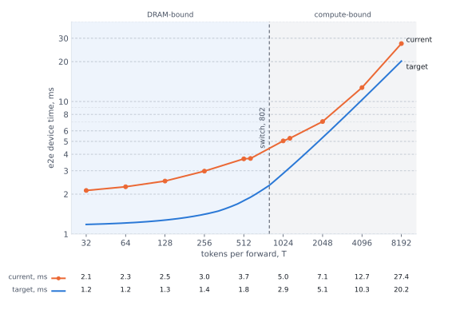

# Roofline: nomic-embed-text-v2-moe on one Blackhole chip

One p300c chip, the code of #60284 (routed top-2 experts), against its target. Each op's target is
the time it takes at 70% compute utilization (60% for SDPA) or 60% DRAM bandwidth, whichever limits
it; the ops run one after another, as the model is built today, so a layer's and the forward's
target is the sum of its ops' targets. The target runs each token through its top-2 experts only, as
the code does, and reads every expert's weights once a layer. The targets were derived on #59455's
code, which ran all 8 experts, with its expert traffic scaled to top-2; they are kept as they were.

| symbol | meaning |
|---|---|
| B | sequences per forward (batch size) |
| S | tokens per sequence |
| T | total token count, B x S; 8x512 is B = 8, S = 512, T = 4096 |
| H | hidden size, 768 |
| A | attention heads, 12 |
| F | FFN and expert intermediate size, 3072 |
| E | experts per MoE layer, 8; the router picks 2 per token (top-2) |

## Target and current across T

## Layers and e2e
**Utilization:** ideal time / time taken. Compute is the target's FPU + SFPU work (overlapped for
  fc1 and w1, counter-measured for ops without FLOPs), with the experts top-2 routed; DRAM the bytes
  the code moves at 512 GB/s.
**Bound:** the bound of the ops that hold most of the target, with their share of it.
### 1x128: DRAM-bound

Bound by DRAM, reading the weights. Target: 60% DRAM bandwidth
| 1x128 | compute | DRAM | bound | target, ms | current, ms |
|---|---|---|---|---|---|
| Dense layer | 9% | 23% | DRAM (98%) | 0.05 | 0.13 |
| MoE layer | 5% | 32% | DRAM (99%) | 0.16 | 0.29 |
| **e2e** | 6% | 29% | DRAM (99%) | 1.27 | 2.51 |

### 4x288: past the switch

The switch is a step at 802 tokens, where expert w1 + GELU turns compute-bound. Above it the norms,
expert w2 and dispatch + combine stay DRAM-bound

| 4x288 | compute | DRAM | bound | target, ms | current, ms |
|---|---|---|---|---|---|
| Dense layer | 31% | 14% | compute (85%) | 0.18 | 0.34 |
| MoE layer | 27% | 26% | compute (52%) | 0.33 | 0.53 |
| **e2e** | 28% | 21% | compute (63%) | 3.07 | 5.28 |

### 8x256: compute-bound

Bound by compute. Target: 70% compute utilization (60% for SDPA)
| 8x256 | compute | DRAM | bound | target, ms | current, ms |
|---|---|---|---|---|---|
| Dense layer | 40% | 14% | compute (85%) | 0.31 | 0.48 |
| MoE layer | 36% | 25% | compute (57%) | 0.54 | 0.69 |
| **e2e** | 37% | 21% | compute (67%) | 5.12 | 7.06 |

### 8x512: compute-bound

Bound by compute. Target: 70% compute utilization (60% for SDPA)
| 8x512 | compute | DRAM | bound | target, ms | current, ms |
|---|---|---|---|---|---|
| Dense layer | 43% | 11% | compute (86%) | 0.66 | 0.92 |
| MoE layer | 44% | 21% | compute (62%) | 1.04 | 1.19 |
| **e2e** | 43% | 17% | compute (71%) | 10.29 | 12.74 |

## Per op

Every op as the code runs it: the ttnn call and its device time, per layer averaged over the 6 layers
of that type, with its share of the layer. A MoE layer runs each token through its two routed
experts: `routing_metadata` sorts the token rows by expert on the device, and one `grouped_matmul`
per projection multiplies each expert's rows by that expert's weights. Windows of up to 256 tokens
(w1) and 512 (w2) give each expert its own core row, 1x128 here.

### Embedding, once a forward

| op | ttnn call | 1x128 us | % of forward | 4x288 us | % of forward | 8x256 us | % of forward | 8x512 us | % of forward |
|---|---|---|---|---|---|---|---|---|---|
| token embedding lookup | `ttnn.embedding` | 6.2 | 0.2 | 13.0 | 0.2 | 18.8 | 0.3 | 31.3 | 0.2 |
| embedding norm | `ttnn.layer_norm` | 15.9 | 0.6 | 20.4 | 0.4 | 24.0 | 0.3 | 46.9 | 0.4 |

### Dense layer

| op | ttnn call | 1x128 us | % | 4x288 us | % | 8x256 us | % | 8x512 us | % |
|---|---|---|---|---|---|---|---|---|---|
| QKV projection | `ttnn.linear`; `ttnn.experimental.minimal_matmul` above 1024 tokens | 13.5 | **10.6** | 44.8 | **13.0** | 64.6 | **13.6** | 112.3 | **12.2** |
| head split | `ttnn.experimental.nlp_create_qkv_heads` | 1.9 | **1.5** | 9.9 | **2.9** | 16.2 | **3.4** | 36.2 | **3.9** |
| rotary on q and k | `ttnn.experimental.rotary_embedding_hf` x2 | 8.5 | **6.6** | 25.3 | **7.3** | 42.0 | **8.8** | 81.3 | **8.8** |
| attention | `ttnn.transformer.scaled_dot_product_attention` | 7.4 | **5.8** | 29.1 | **8.4** | 32.9 | **6.9** | 111.8 | **12.1** |
| head concat | `ttnn.experimental.nlp_concat_heads` | 1.7 | **1.3** | 3.3 | **1.0** | 5.3 | **1.1** | 11.7 | **1.3** |
| attention output projection | `ttnn.linear`; `minimal_matmul` above 1024 tokens | 9.0 | **7.0** | 23.8 | **6.9** | 31.0 | **6.5** | 52.6 | **5.7** |
| residual add + norm1 | `ttnn.layer_norm` | 19.2 | **15.0** | 22.5 | **6.5** | 27.8 | **5.8** | 52.5 | **5.7** |
| fc1 + GELU (FFN up-projection) | `ttnn.linear` + `ttnn.gelu`; one `ttnn.matmul` with the GELU fused above 1024 tokens | 22.1 | **17.3** | 82.3 | **23.9** | 140.0 | **29.4** | 259.4 | **28.2** |
| fc2 (FFN down-projection) | `ttnn.linear`; `minimal_matmul` above 1024 tokens | 25.5 | **19.9** | 81.1 | **23.5** | 87.7 | **18.4** | 151.2 | **16.4** |
| residual add + norm2 | `ttnn.layer_norm` | 19.2 | **15.0** | 22.7 | **6.6** | 28.2 | **5.9** | 52.6 | **5.7** |
| **layer total** | | 128.0 | **100** | 344.9 | **100** | 475.7 | **100** | 921.5 | **100** |

### MoE layer

| op | ttnn call | 1x128 us | % | 4x288 us | % | 8x256 us | % | 8x512 us | % |
|---|---|---|---|---|---|---|---|---|---|
| QKV projection | `ttnn.linear`; `ttnn.experimental.minimal_matmul` above 1024 tokens | 13.2 | **4.6** | 44.3 | **8.4** | 65.4 | **9.4** | 112.3 | **9.4** |
| head split | `ttnn.experimental.nlp_create_qkv_heads` | 2.0 | **0.7** | 9.7 | **1.8** | 16.4 | **2.4** | 36.5 | **3.1** |
| rotary on q and k | `ttnn.experimental.rotary_embedding_hf` x2 | 8.7 | **3.0** | 25.4 | **4.8** | 42.1 | **6.1** | 81.2 | **6.8** |
| attention | `ttnn.transformer.scaled_dot_product_attention` | 7.5 | **2.6** | 28.8 | **5.4** | 32.8 | **4.7** | 113.6 | **9.6** |
| head concat | `ttnn.experimental.nlp_concat_heads` | 1.7 | **0.6** | 3.3 | **0.6** | 5.2 | **0.8** | 11.6 | **1.0** |
| attention output projection | `ttnn.linear`; `minimal_matmul` above 1024 tokens | 8.6 | **3.0** | 23.7 | **4.5** | 30.8 | **4.4** | 52.5 | **4.4** |
| residual add + norm1 | `ttnn.layer_norm` | 19.1 | **6.7** | 22.6 | **4.3** | 27.8 | **4.0** | 52.8 | **4.4** |
| router scores | `ttnn.linear` + `ttnn.add` | 9.1 | **3.2** | 16.5 | **3.1** | 24.5 | **3.5** | 46.9 | **3.9** |
| router softmax + top-2 | `ttnn.softmax` + `ttnn.topk` | 21.2 | **7.4** | 23.3 | **4.4** | 23.2 | **3.3** | 35.7 | **3.0** |
| x to row-major, for the dispatch | `ttnn.to_layout` | 2.2 | **0.8** | 7.1 | **1.3** | 11.5 | **1.7** | 19.2 | **1.6** |
| routing metadata: each slot's row, sorted by expert | `ttnn.experimental.nomic_embed_text_v2_moe.routing_metadata` | 3.9 | **1.3** | 5.6 | **1.1** | 6.7 | **1.0** | 7.6 | **0.6** |
| dispatch: each token's row into its two experts' regions | `ttnn.embedding` | 18.4 | **6.4** | 21.5 | **4.1** | 36.6 | **5.3** | 48.1 | **4.0** |
| expert w1 + GELU, each token's 2 experts | `ttnn.experimental.nomic_embed_text_v2_moe.grouped_matmul`, GELU fused | 77.9 | **27.1** | 134.2 | **25.3** | 177.2 | **25.6** | 287.6 | **24.2** |
| expert w2 | `ttnn.experimental.nomic_embed_text_v2_moe.grouped_matmul` | 67.6 | **23.6** | 121.1 | **22.9** | 134.3 | **19.4** | 178.4 | **15.0** |
| combine: each token's two rows weighted and summed, plus the bias | `ttnn.experimental.nomic_embed_text_v2_moe.routed_combine` | 6.5 | **2.3** | 16.5 | **3.1** | 25.9 | **3.7** | 38.8 | **3.3** |
| residual add + norm2 | `ttnn.layer_norm` | 19.4 | **6.8** | 25.8 | **4.9** | 33.2 | **4.8** | 65.6 | **5.5** |
| **layer total** | | 286.9 | **100** | 529.4 | **100** | 693.6 | **100** | 1,188.0 | **100** |
