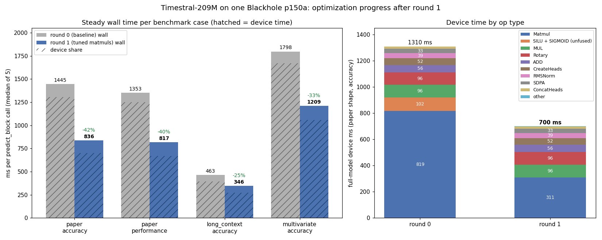

# Timestral-209M on TTNN: progress report after optimization round 1

One Blackhole p150a (11 x 10 = 110 worker cores). Headline workload: `predict_block` at the paper shape (1024 series x 2048 context → 64-step forecast). That is M = 98304 tokens per linear (1024 rows x 96 tile-padded tokens, 66 real).

**TL;DR:** round 1 replaced the auto-selected matmul configs with tuned ones and fused the SiLU/sigmoid activations into the matmuls. The paper shape went from **1445 ms to 836 ms** wall (**−42 %**) and from 1307 to 702 ms device (−46 %). Every guard shape improved by 25–40 %. Accuracy held: paper normalized PCC is 0.99993 (0.99995 before), and all 15 device PCC tests pass. The device is now 178x faster than the CPU reference at the paper shape (was 103x).

## Results

Steady wall time is the median of 5 calls (host prepare + upload + device + postprocess). Device is `forward_device` plus a sync. "vs CPU" is against the upstream PyTorch reference on this host.

| case | round 0 wall | round 1 wall | change | round 0 device | round 1 device | vs CPU (r0 → r1) | series/s (r0 → r1) | PCC (norm, r1) |
|---|---|---|---|---|---|---|---|---|
| paper, accuracy (headline) | 1445.3 ms | **836.4 ms** | **−42.1 %** | 1307.2 ms | 702.0 ms | 103x → 178x | 708 → 1224 | 0.99993 |
| paper, performance (bf8 weights, LoFi) | 1353.0 ms | 817.0 ms | −39.6 % | 1251.3 ms | 670.2 ms | 110x → 183x | 757 → 1253 | 0.99977 |
| long_context (32 x 32768 → 1024) | 463.4 ms | 345.9 ms | −25.4 % | 394.4 ms | 272.9 ms | 159x → 214x | 69 → 93 | 0.99976 |
| multivariate (128 x 8 variates x 2048) | 1797.5 ms | 1209.3 ms | −32.7 % | 1668.9 ms | 1059.3 ms | 82x → 122x | 71 → 106 | 0.99994 |

## What was built (in commit order)

| commit | change |
|---|---|
| `721e3e8f868` … `3a933dc4d08` | Pinned upstream reference loader; host weight rearrangement (RMSNorm gains folded into the next linears, Q/K/V rows reordered for head splitting); CPU golden tests that decompose the reference into the same dataflow the device uses. |
| `54d0b875b54` | Vanilla TTNN model using only stock ttnn ops: patch embedding, 18 `time` + 6 `time_variate` transformer layers (RoPE + SDPA time attention, gated variate attention, SwiGLU MLP), quantile head. |
| `d47b0aa3d9a`, `e8c08b83abd` | Device PCC tests against the reference (modules, tiny model, 5M and 209M checkpoints, forecaster). The bug fix: the variate-attention reshape left stale data in the tile padding that masked SDPA read as key rows (PCC ≈ 0). It is now zeroed with `fill_implicit_tile_padding`. |
| `c05e67b4cc7` | `predict_block` and forecast benchmarks against the CPU reference (3 shapes x 2 precisions, cached CPU outputs). |
| `cb29e7f9d82`, `cd375a82837` | Optimization harness: a reduced-layer Tracy profile (embed + one layer of each kind + head, with section signposts), the `perf_iteration.sh` runner, the `summarize_profile.py` report, and the round 0 baseline, analysis and proposals. The reduced-profile estimate matches the measured full-model device time to within 0.2–0.3 %. |
| `f82f587603e` | **Round 1: explicit matmul configs with fused activations** (below). |
| `5f4fd996bf7` | Round 1 analysis and round 2 proposals. |

## Round 1: what changed

**The problem (round 0 analysis):** every linear used the auto-selected 1D config (`per_core_M=28`, `in0_block_w=2`, output block narrower than the core's N slice). It re-read the 151 MB activation from DRAM once per N block (3–6x) and ran at about 180 GB/s, with every matmul at 13–20 % of peak FLOPs. `ttnn.linear(activation=...)` only fuses the activation when a core grid is given, so the 56 SiLU/sigmoid calls ran as separate ops (102 ms).

**The sweep:** `tests/perf/sweep_matmul.py` timed every linear role at the exact paper shape on about 50–60 candidates each. The candidate families were the default config, an explicit core grid, 1D full-N, 2D multicast (out_block_h x in0_block_w x subblock) and `ttnn.experimental.minimal_matmul` (several blockings plus the tt_dit heuristic). Both precisions were covered. Results are in `iter_01/matmul_sweep_accuracy.md` and `iter_01/matmul_sweep_performance.md`.

**The rule** (`tt/program_configs.py`, used by `tt/common.py::linear` for every linear):
- **2D multicast** (`MatmulMultiCoreReuseMultiCastProgramConfig`) by default:
  - M is split over the 10 grid rows and N over the grid columns, and each core holds its whole N slice, so the activation is read once.
  - The activation is fused in the packer (`fused_activation`).
  - `in0_block_w` is the largest K divisor ≤ 12 that fits L1.
  - `out_block_h` is in [6, 12] and chosen to pad `per_core_M` the least: paper 308 = 11 x 28; long_context 106 → 108 = 12 x 9.
- **`minimal_matmul`** (8 x 8 x 8 tile blocks) when N is too narrow to use all 11 grid columns (N = 768 uses 8) and no activation is fused. It also works with bf8 weights and bf16 activations.
- The formulas reproduce the sweep's best candidate for every role at the paper shape, and land within 1 % of the best in both precisions. The tiny test model and other shapes get legal configs from the same formulas; there is no per-shape table.

| role (paper shape) | calls | round 0 ms (incl. separate unary) | round 1 ms | engine | speedup |
|---|---|---|---|---|---|
| MLP up (+ SiLU) 768→2048 | 24 | 192.4 | 66.9 | 2D 11x10, SiLU fused | 2.88x |
| MLP down 2048→768 | 24 | 191.6 | 40.4 | minimal 8/8/8 | 4.74x |
| QKV 768→2304 | 24 | 140.5 | 62.2 | 2D 11x10 | 2.26x |
| attention gate (+ sigmoid) 768→768 | 30 | 132.2 | 40.8 | 2D 8x10, sigmoid fused | 3.24x |
| MLP gate 768→2048 | 24 | 126.6 | 54.8 | 2D 11x10 | 2.31x |
| attention out 768→768 | 30 | 98.0 | 32.5 | minimal 8/8/8 | 3.02x |
| variate V 768→768 | 6 | 19.7 | 6.6 | minimal 8/8/8 | 2.98x |
| embed + head (6 matmuls) | 6 | 19.5 | 6.5 | mixed | 3.0x |
| **all matmuls** | **168** | **920.5** | **310.8** | | **2.96x** |

Matmul weighted FLOPs utilization went from 14.5 % to 35.9 % in the profiled window (41 % for the full model). The op count fell from 513 to 457 because the activations are fused.

## Where the time goes now (paper, 702 ms device)

| op type | ms | % | per call | note |
|---|---|---|---|---|
| all matmuls | 310.8 | 44 % | — | QKV / MLP at 36–45 % FLOPs, down at 60 % |
| BinaryNg MUL (MLP and gate products) | 96.2 | 14 % | 1.0–2.7 ms | DRAM-bound |
| Rotary embedding | 95.8 | 14 % | 2.0 ms | 30 % of DRAM peak (serialized single-tile reads) |
| BinaryNg ADD (residuals) | 56.0 | 8 % | 1.0 ms | DRAM-bound |
| NLP create heads | 51.7 | 7 % | 2.2 ms | |
| RMSNorm | 39.1 | 6 % | 0.7 ms | |
| SDPA | 32.8 | 5 % | 1.4 ms | |
| NLP concat heads | 17.3 | 2 % | 0.7 ms | |

Non-matmul ops are now 56 % of device time, and none of them changed in round 1. Host work (prepare 52 ms + upload 36 ms + postprocess 18 ms) is 12.6 % of the headline wall time.

## Proposed next (round 2, awaiting approval)

Details are in `iter_01/proposals.md` and `iter_01/analysis.md`. The estimates are full-model device ms and overlap.

| # | proposal | est. savings | confidence |
|---|---|---|---|
| R2-1 | Fused SwiGLU: `minimal_matmul(fuse_swiglu=True)` replaces up + gate + MUL | 70–100 ms | medium |
| R2-2 | RoPE via `rotary_embedding_llama`, with Wq/Wk rows permuted at load | 45–60 ms | medium |
| R2-3 | Residual ADD fused into wo / w_down (`dit_minimal_matmul_addcmul_fused`) | 25–35 ms | medium |
| R2-4 | SDPA `output_concat_heads=True` | 15–17 ms | high |
| R2-5 | Gate sigmoid moved into the consumer MUL; wg on `minimal_matmul` | ≈ 8 ms | medium-high |
| R2-6 | Host prepare / upload / postprocess cleanup | 30–60 ms wall | low |
| R2-7 | Drop per-row tile padding outside attention | 0–50 ms | low |

With R2-1 through R2-5 at their midpoints, the analyst projects about 510 ms device. The structural floor of the current graph, with every op at its DRAM/compute roofline, is about 428 ms.

## Artifacts

- `doc/optimize/candidates.md`: every candidate with its decision and evidence.
- `doc/optimize/iter_00/`, `iter_01/`:
  - `bench.json`;
  - `summary.md` (section table, op types, slowest ops);
  - `perf_report.txt` (tt-perf-report with advice) and `perf_report_stacked.png`;
  - `analysis.md` (analyst subagent);
  - `proposals.md`;
  - the matmul sweeps (round 1).
- To reproduce a round: `models/experimental/timestral/tests/perf/perf_iteration.sh <iter_dir>`. It runs the benchmark, the Tracy profile and the summary. Never run it with `TT_METAL_WATCHER` set.
