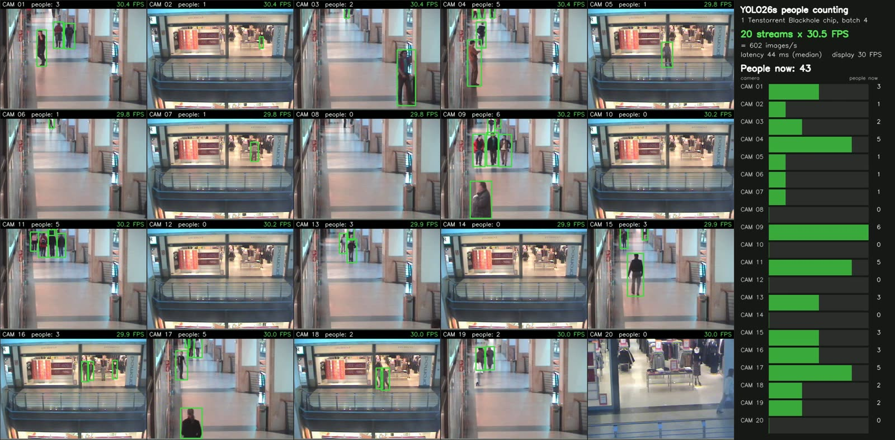

# YOLO26 on Tenstorrent Blackhole (TTNN)

TTNN implementation of Ultralytics [YOLO26](https://docs.ultralytics.com/models/yolo26/) object detection
(`yolo26n`, `yolo26s`) at 640×640, using the NMS-free end-to-end (one2one) head. Runs traced with two command queues
(trace + 2CQ) at batch 1, 2 or 4 per chip, on one Blackhole chip or data parallel across the 4 chips of a QuietBox 2.



*20 shopping-centre camera streams × 30 FPS on one Blackhole chip (yolo26s, batch 4): live person counts per camera.*

- **Accuracy**: PCC vs Ultralytics (fp32, CPU) per image: yolo26s cls 0.9979–0.9980, box ≥ 0.9990; yolo26n cls ≥ 0.9982.
  Detections match Ultralytics 1:1 on the bundled test images (IoU ≥ 0.995).
- **Throughput**, end-to-end (upload, trace, read-back), yolo26s: 660 FPS on one chip, ~2,377 FPS on 4 chips;
  yolo26n: 1,094 FPS on one chip, ~2,566 FPS on 4 chips.
- **Demo**: 20 video streams × 30 FPS on one chip; 80 streams × 30 FPS on 4 chips.

This branch keeps every activation in L1, which allows up to batch 4 per chip. Batch > 4 (DRAM staging) and a
lower-latency version of the multi-stream demo are on the branch `sdawle/tvardhineni/yolov26_dram_batch`.

Contents: [Setup](#setup) · [PCC tests](#pcc-tests) · [Performance tests](#performance-tests) ·
[Performance](#performance) · [Demos](#demos) · [Viewing the live demo remotely](#viewing-the-live-demo-remotely) ·
[Demo results and video](#demo-results-and-video) · [Known issues](#known-issues) · [Files](#files)

## Setup

Tested on a Tenstorrent QuietBox 2 (4 × Blackhole p300c chips).

```bash
cd tt-metal
source python_env/bin/activate
export TT_METAL_HOME=$PWD PYTHONPATH=$PWD
pip install ultralytics          # if not installed (or run models/experimental/yolo26/setup.sh)
```

Weights (`yolo26n.pt`, `yolo26s.pt`) are downloaded by Ultralytics on first use into the working directory.

**One chip.** The QB2 exposes 4 chips; to run on one, select it and give the single-chip mesh descriptor (without the
descriptor `TT_VISIBLE_DEVICES` alone fails with `TT_FATAL ... Custom fabric mesh graph descriptor path must ...`):

```bash
export TT_VISIBLE_DEVICES=0
export TT_MESH_GRAPH_DESC_PATH=$TT_METAL_HOME/tt_metal/fabric/mesh_graph_descriptors/p150_mesh_graph_descriptor.textproto
```

**All 4 chips** (data-parallel tests and the 4-chip demo): leave both unset.

```bash
unset TT_VISIBLE_DEVICES TT_MESH_GRAPH_DESC_PATH
```

Reset the chips if a previous run was killed or hung (see [Known issues](#known-issues)):

```bash
tt-smi -r          # on the QB2: ~/.tenstorrent-venv/bin/tt-smi -r
```

## PCC tests

One chip (environment above):

```bash
pytest models/experimental/yolo26/tests/pcc -q
```

Expected: `17 passed` (about 10 s once kernels are compiled; the first run compiles them). The suite compares TTNN
against the Ultralytics PyTorch model:

| File | Covers |
|---|---|
| `test_tt_yolo26.py` | Full model, yolo26n and yolo26s, float input and the raw uint8 input path used by the runner and demos |
| `test_pcc.py` | Full model end to end (all scales, boxes and class scores) |
| `test_full_model.py`, `test_detailed_e2e.py` | Full model, per-output detail |
| `test_end_to_end.py`, `test_full_neck.py`, `test_c2psa.py` | Backbone + neck, the neck, the C2PSA attention block |
| `test_backbone_only.py`, `test_backbone_continuous.py`, `test_layer_by_layer.py` | Backbone and individual layers |

## Performance tests

End-to-end trace + 2CQ: each iteration uploads the input (CQ1), runs the trace (CQ0) and reads the outputs back
(CQ1), with the next upload overlapping the current trace. 10 warm-up and 50 measured iterations;
FPS = images per iteration / mean iteration time.

One chip; variant `yolo26n` / `yolo26s`, batch `1`, `2` or `4`:

```bash
pytest models/experimental/yolo26/tests/perf/test_yolo26_trace_2cq.py::test_yolo26_trace_2cq_perf \
    -k "yolo26s-640-4" -s
```

All 4 chips (data parallel, batch per chip; unset the single-chip variables first):

```bash
pytest models/experimental/yolo26/tests/perf/test_yolo26_trace_2cq.py::test_yolo26_trace_2cq_perf_dp \
    -k "yolo26s-640-4" -s
```

Each run logs, for example:

```
Batch size: 4 per device x 1 devices
Average inference time: 6.06 ms
Throughput: 660.1 FPS
```

Omit `-k` to run every variant and batch. `test_yolo26_device_perf.py`, `test_e2e_performant.py` and `test_perf.py`
predate the current model outputs and are not maintained.

## Performance

640×640, end-to-end trace + 2CQ (FPS):

| Configuration | yolo26s | yolo26n |
|---|---|---|
| As first brought up (batch 1, 1 chip) | 85.0 | 85.9 |
| 1 chip, batch 1 | 418.4 | 527.0 |
| 1 chip, batch 2 | 604.2 | 795.2 |
| 1 chip, batch 4 | 659.7 – 660.1 | 1,092.6 – 1,094.4 |
| 4 chips, batch 1 per chip | 1,582.5 | 1,772.6 |
| 4 chips, batch 2 per chip | 1,795.4 – 1,812.8 | 1,866.2 – 1,870.2 |
| 4 chips, batch 4 per chip | 2,347.4 – 2,438.0 (mean of the latest 5 runs: 2,406) | 2,560.7 – 2,570.5 |

Model only (traced forward, input already on the chip), yolo26s on one chip: batch 1 2.31 ms (433 FPS), batch 2
3.18 ms (629 FPS), batch 3 4.66 ms (644 FPS), batch 4 5.86 ms (683 FPS); yolo26n batch 4 3.43 ms (1,166 FPS).

Scaling of yolo26s batch 4 to 4 chips (2026-10-29, chips reset before every run): each chip alone gives 659.6,
653.8, 659.1 and 665.4 FPS (chips 0–3, sum 2,638); dp=4 gives 2,363.1, 2,402.6, 2,404.0, 2,420.6 and 2,438.0 FPS
(mean 2,406, about 91 % of the sum). Per iteration, one chip takes 6.06 ms and the 4-chip mesh 6.56 – 6.77 ms.

Ranges are separate runs. How each number was measured, and every optimization step from 85 FPS, are in
[`post_mortem.md`](post_mortem.md) (entries YOLO26-0015 to 0025).

## Demos

### Single images

Runs one or more images through the model as one batch, draws the detections, and with `--compare` also runs the
Ultralytics reference and saves side-by-side images:

```bash
ASSETS=$(python -c "from ultralytics.utils import ASSETS; print(ASSETS)")
python models/experimental/yolo26/demo/demo.py -i $ASSETS/bus.jpg $ASSETS/zidane.jpg \
    -o output.jpg --variant yolo26s --compare
```

Writes `output_bus.jpg`, `output_zidane.jpg` (and `*_vs_reference.jpg` with `--compare`) and prints the detections
and how many reference detections were matched (bus: 5/5, zidane: 3/3).

| Option | Default | |
|---|---|---|
| `-i`, `--input` | (required) | one or more images; several run as one batch (up to 4) |
| `-o`, `--output` | `output.jpg` | output path (per-image suffix with several inputs) |
| `--variant` | `yolo26n` | `yolo26n` or `yolo26s` |
| `--conf-threshold` | `0.25` | detection confidence threshold |
| `--compare` | off | also run Ultralytics and save side-by-side images |

### Multi-stream people counting, one chip (`multistream_demo.py`)

20 video streams paced at 30 FPS each (600 images/s), run through yolo26s at batch 4: every 1/30 s tick the newest
frame of each stream is letterboxed and the 20 frames go through the chip as 5 batches of 4. People (COCO class 0)
are counted per camera and shown on a 5 × 4 mosaic with a side panel (per-camera count, total, throughput, latency),
served live as MJPEG and optionally recorded.

**Videos.** The demo was built with 20 clips of the CAVIAR shopping-centre set (384×288, 25 FPS MPEG-2; CC BY-SA,
EC-funded CAVIAR project IST 2001 37540). Any directory of `.mpg` / `.mp4` files works; with fewer clips than streams,
clips are reused from a different start frame. To fetch the same 20 clips:

```bash
mkdir -p ~/yolo26_store_videos && cd ~/yolo26_store_videos
for c in EnterExitCrossingPaths1cor EnterExitCrossingPaths1front EnterExitCrossingPaths2cor OneShopOneWait1cor \
         OneShopOneWait2front ShopAssistant1cor ShopAssistant1front ShopAssistant2cor ThreePastShop1cor \
         ThreePastShop1front ThreePastShop2cor ThreePastShop2front TwoEnterShop1cor TwoEnterShop1front \
         TwoEnterShop2cor TwoEnterShop3front TwoLeaveShop1cor TwoLeaveShop2front WalkByShop1cor WalkByShop1front; do
    [ -f $c.mpg ] && continue
    until curl -fsS -C - -o $c.mpg.part https://homepages.inf.ed.ac.uk/rbf/CAVIARDATA2/$c/$c.mpg; do sleep 2; done
    mv $c.mpg.part $c.mpg
done
```

The server is slow (tens of KB/s per connection), hence the resume-and-retry loop.

**Run** (one chip, environment above, from the `tt-metal` directory):

```bash
python models/experimental/yolo26/demo/multistream_demo.py --videos ~/yolo26_store_videos
```

| Option | Default | |
|---|---|---|
| `--videos` | (required) | directory of `.mpg` / `.mp4` clips |
| `--variant` | `yolo26s` | model variant |
| `--streams` | `20` | number of streams (a multiple of `--batch-size`) |
| `--fps` | `30` | target frame rate per stream |
| `--batch-size` | `4` | images per pass (1, 2 or 4) |
| `--duration` | `60` | seconds to run |
| `--port` | `8090` | live MJPEG view port (`0` = off) |
| `--record` | off | record the mosaic to this `.mp4` (H.264, real time) |
| `--snapshot` | off | save the last mosaic to this `.jpg` |
| `--conf` | `0.35` | person confidence threshold |
| `--prep-workers` | `2` | processes that letterbox frames |

At the end it logs throughput and latency, for example:

```
20 streams on 1 chip(s), target 30 FPS each: processed 12000 images in 20.0 s = 599.8 images/s = 30.0 FPS per stream;
... capture-to-results median per pass (chip 1 cameras): CAM 01-04 14.4 ms; ... CAM 17-20 38.7 ms;
on screen (median ms, frames shown): (42.6, 600)
```

*Capture-to-results* is the time from a frame's capture to its people counts, per group of 4 cameras; *on screen*
is the time to the published mosaic.

### Multi-stream people counting, 4 chips (`multichip_demo.py`)

The same pipeline on all 4 chips of the QB2: each chip serves 20 streams (the same 20 clips, each chip starting at a
different frame), 80 streams × 30 FPS = 2,400 images/s, shown as 80 small tiles with a per-chip panel.

```bash
unset TT_VISIBLE_DEVICES TT_MESH_GRAPH_DESC_PATH
python models/experimental/yolo26/demo/multichip_demo.py --videos ~/yolo26_store_videos
```

Same options as above, plus `--chips` (default 4) and `--streams-per-chip` (default 20).

## Viewing the live demo remotely

The demos serve the live view at `http://<host>:8090/`. From your own machine, forward the port over SSH (add
`-J <user>@<jump-host>` if you reach the QB2 through a jump host):

```bash
ssh -L 8090:localhost:8090 <user>@<qb2-host>
```

then open <http://localhost:8090/> while the demo runs. In VS Code Remote-SSH, forwarding port 8090 in the *Ports*
panel does the same. Recordings (`--record`) can be copied off with `scp` and played in any player.

## Demo results and video

yolo26s, batch 4 per chip, 60 s runs with the live view on and recording (MEASURED):

| | 1 chip, 20 streams | 4 chips, 80 streams |
|---|---|---|
| Throughput | 599.9 images/s = 30.0 FPS per stream | 2,399.1 images/s = 30.0 FPS per stream |
| Capture → results, cameras 1–4 | 17.3 ms | 32.7 ms |
| Capture → results, cameras 5–8 | 19.7 ms | 34.3 ms |
| Capture → results, cameras 9–12 | 28.8 ms | 49.4 ms |
| Capture → results, cameras 13–16 | 32.3 ms | 51.3 ms |
| Capture → results, cameras 17–20 | 39.6 ms | 55.4 ms |
| Capture → on screen (median) | 43.4 ms | 61.0 ms |
| Capacity (asking for more than 30 FPS per stream) | 661 images/s (33 FPS per stream) | 2,598 images/s (32.5 FPS per stream) |

(4 chips: cameras of chip 1; the 4 chips run in lockstep.) All 20 cameras of a chip are captured at the start of each
tick and go through the chip as 5 batches of 4, one after another, so later groups wait for the earlier ones. The
screenshot at the top of this page is from the 1-chip recording.

Recordings (2340×1152, H.264, 60 s, ~110 MB each; too large for the repository) on the QB2 used for this work:

- 1 chip, 20 streams: `/home/ttuser/sdawle/yolo26_demo_outputs/multistream/yolo26s_20streams_1chip_v4.mp4`
- 4 chips, 80 streams: `/home/ttuser/sdawle/yolo26_demo_outputs/multistream/yolo26s_80streams_4chips_v2.mp4`

Limits: counts are per frame (no tracking); the clips are 25 FPS sources played at 30 FPS; video decoding of live
cameras is not included (clips are decoded into memory at start).

## Known issues

- **Intermittent hang in trace capture.** Rarely a run stops in `capture_trace_2cq` (seen on 1 and 4 chips, root
  cause unknown). Kill it, `tt-smi -r`, and rerun.
- **Batch > 4 per chip** runs out of L1 on this branch (batch 5 fails at `model.2.cv2`); see the DRAM branch.
- **Live-view port taken.** In Tracy-enabled builds every process that imports ttnn opens a Tracy listener on the
  first free port from 8086 up; the demo's processes use 8086–8089 with the default 2 prep workers. With more workers,
  or if 8090 is busy, pass another `--port`.

## Files

```
models/experimental/yolo26/
├── README.md
├── post_mortem.md                 # every defect, fix and measurement, with method (YOLO26-0001 ...)
├── common.py                      # BN folding, L1_SMALL size
├── setup.sh                       # installs ultralytics, downloads weights
├── images/                        # README image
├── tt/
│   ├── ttnn_yolo26.py             # TTNN model: backbone, neck (C2PSA attention), NMS-free head
│   └── model_preprocessing.py     # weight loading from Ultralytics
├── runner/
│   ├── performant_runner.py       # trace + 2CQ runner (uint8 input, persistent L1 input)
│   └── yolo26_test_infra.py       # model construction, inputs, data-parallel sharding
├── demo/
│   ├── demo.py                    # single-image / batch demo, optional Ultralytics comparison
│   ├── multistream_demo.py        # 20 streams × 30 FPS on one chip, live MJPEG view, recording
│   ├── multichip_demo.py          # 80 streams × 30 FPS on 4 chips
│   └── simple_demo.py             # minimal TTNN vs PyTorch comparison
└── tests/
    ├── pcc/                       # PCC tests (17)
    └── perf/test_yolo26_trace_2cq.py   # end-to-end trace + 2CQ performance, 1 chip and data parallel
```
