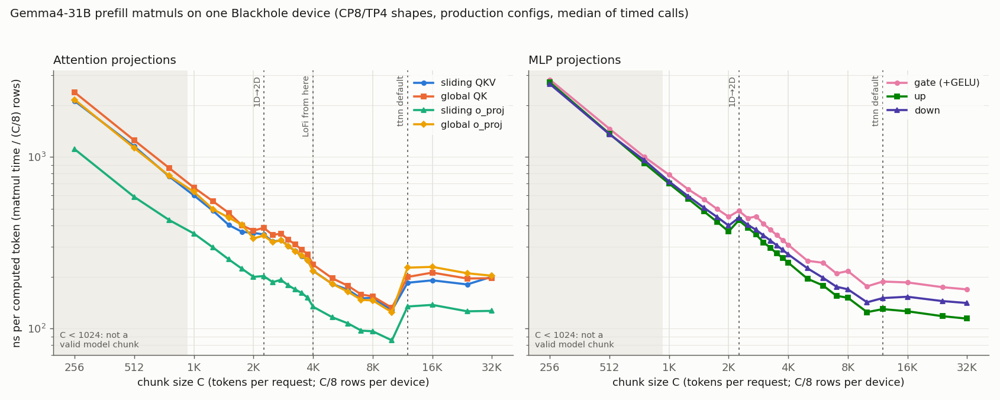

## Results: prefill matmul ns/token vs chunk size (Blackhole, CP8/TP4)

**Recommendation: C = 8192.** It is the smallest valid chunk in the low region of the matmul curves on main. Below it,
the projections cost much more per token. Above it, 16384 is no better, because the attention projections fall back to
ttnn's default program config. The lowest attention ns/token measured is at C = 10240 (not a valid chunk), about 15%
under 8192. Most of that gap is that 8192 runs the explicit 2D config on 96 of 120 cores.



### Method

- Each projection runs alone on one Blackhole chip with one CP8/TP4 device's shapes: C/8 token rows, the TP4 weight
  shard in bfp8, bf16 activations. No padding at any C (C is a multiple of 256).
- The matmul is issued through the model's own code (`attention.operations.apply_attn_projection`, `MLP._project`), so
  the program config, compute config, fused GELU and input/output layouts are the model's at every C. Inputs are
  created in the layout the model hands each projection: the all-gather's L1 width-sharded layout at short M, the
  `nlp_concat_heads` DRAM output for o_proj, the L1 `gate*up` output for down.
- Device kernel duration from the device profiler, 2 warm-up calls + 10 timed calls per point; median reported.
  ns per computed token = median duration / (C/8). Collectives and host overhead are excluded from these numbers
  (the layer runs below report CCL separately).
- 25 chunk sizes from 256 to 32768 (every 256 up to 4096). Valid model chunks are multiples of 1024 that divide the
  context, i.e. 1K/2K/4K/8K/16K at 256K.

| Op (per device) | K x N |
|---|---|
| sliding QKV | 5376 x 4096 |
| global tied QK | 5376 x 4608 |
| sliding o_proj | 2048 x 5376 |
| global o_proj | 4096 x 5376 |
| MLP gate (GELU fused) / up / down | 5376 x 5376 |

### ns per computed token (FPU utilization over 120 cores)

| Op | 1K | 2K | 4K | **8K** | 10K* | 16K |
|---|---|---|---|---|---|---|
| sliding QKV | 597 (22%) | 361 (37%) | 217 (31%) | **151 (44%)** | 128 (52%) | 191 (69%) |
| global QK | 663 (23%) | 372 (40%) | 236 (32%) | **154 (48%)** | 132 (56%) | 212 (70%) |
| sliding o_proj | 358 (19%) | 200 (33%) | 134 (25%) | **96 (34%)** | 85 (39%) | 137 (48%) |
| global o_proj | 626 (21%) | 335 (40%) | 217 (31%) | **146 (45%)** | 124 (53%) | 229 (58%) |
| gate | 787 (11%) | 448 (19%) | 307 (28%) | **216 (40%)** | 176 (49%) | 186 (47%) |
| up | 700 (12%) | 368 (24%) | 242 (36%) | **151 (58%)** | 125 (70%) | 126 (69%) |
| down | 720 (12%) | 398 (22%) | 271 (32%) | **169 (51%)** | 142 (61%) | 153 (57%) |

\*10240 is not a valid model chunk; it is the largest C that still gets the explicit 2D config.

Utilization = ideal FPU cycles (M*K*N/32^3 tiles x 16 cycles for LoFi, 32 for HiFi2) / measured cycles at 1.35 GHz,
over the full 120-core grid. It is relative to each point's fidelity, so the HiFi2 points (attention at C <= 3840 and
C >= 12288) look more utilized than they are fast.

**Variability.** Interquartile range over the 10 calls: 0.7% median, 4.9% worst. Across 3 independent runs on a second
galaxy: 0.4% median, 3.7% worst. The two machines agree within 5% for C > 2048. At C <= 2048 the second machine was
5-18% faster. That region is bound by weight reads from DRAM (300-380 GB/s), so absolute small-C numbers depend on the
machine; the curve shapes do not.

### Configurations (the curves change regime at these C)

| C | Program config | Attention compute | MLP compute |
|---|---|---|---|
| <= 2048 | 1D in0-mcast, in0 width-sharded in L1 (64-84 cores; down 42) | HiFi2, fp32 acc, packer L1 acc | LoFi, fp32 acc, packer L1 acc |
| 2304-3840 | explicit 2D mcast (72-120 cores) | HiFi2, fp32 acc | LoFi, fp32 acc |
| 4096-10240 | explicit 2D mcast | LoFi, fp32 acc | LoFi, fp32 acc |
| >= 12288 | ttnn default (per_core_M > 4 does not fit L1) | HiFi2, bf16 acc (ttnn default) | LoFi, bf16 acc |

Data formats are fixed throughout (bf16 x bfp8). The attention fidelity is not, so attention was also swept with
fidelity pinned:
- At C <= 2048, LoFi vs HiFi2 differs by only 0-10%, because these points wait on weight reads.
- At 8K, LoFi is 1.3-1.6x faster than HiFi2.

The full program config of every point is in `summary.csv`.

Things that cost time on main:
- The 1D -> 2D switch at C = 2304 is a step backwards for every op (e.g. up 94 -> 123 us).
- C = 8192 uses 96 of 120 cores: 32 M tiles split 4 per core fill 8 of the 10 grid rows. As a result 8192 runs about
  the same ns/token as 7168.
- Past 10240 the fallback is the limit, not math. Forcing LoFi + fp32 accumulation onto the default config improved
  only global QK (125-131 ns/token at 12K-24K). The o_proj ops got 1.4-1.6x worse and the MLP ops 7-15% worse.

### Correctness

- PCC vs a torch reference (dequantized weights) >= 0.9987 at every point. The lowest is gate under the bf16-acc
  fallback at C >= 12K (0.9987-0.9994); all explicit configs are >= 0.9997.
- Real TP-rank-0 weights (layer 0 sliding, layer 5 global) at C = 1K-16K time within 1.3% of random weights, with
  PCC >= 0.9997.

This is op-level correctness, not a model accuracy check.

### Contribution to layer time

`test_prefill_layer_perf_chunk_n` on the 8x4 galaxy, `chunkci` cells, sizes 2K/4K/8K/16K. Medians over 32 devices;
in-model matmul times match the isolated numbers within ~3%. The 256K totals below are estimated as 256K/C chunks x
(50 sliding layers at chunk 1 + 10 global layers at the mean of the first and last chunk). They are device time from
the layer traces, not end-to-end.

| C | Matmuls | Share | SDPA | CCL | Layer total |
|---|---|---|---|---|---|
| 2048 | 3.52 s | 32% | 4.47 s | 1.34 s | 11.1 s |
| 4096 | 2.33 s | 32% | 2.86 s | 1.08 s | 7.3 s |
| **8192** | **1.56 s** | **25%** | 3.13 s | 0.89 s | 6.2 s |
| 16384 | 1.60 s | 28% | 2.74 s | 0.82 s | 5.7 s |

Ops that still benefit materially from larger chunks:
- **MLP gate/up/down.** 15-19% lower ns/token at 10240 than at 8192, and up/down keep falling at the default config
  to 32K. At 8K the MLP is about 68% of matmul time (1.06 of 1.56 s), about 17% of layer time.
- **Attention projections.** Only up to 10240 on main (about 15% below 8K), then they regress on the default config.
  At 8K they are 0.51 s, about 8% of layer time.
- At 8K, SDPA (50% of layer time, mostly global layers late in the context) is a larger lever than the matmuls.

### Reproduce

Branch `mmanzoor/gemma4-matmul-chunk-sweep`, from the tt-metal root with the python env active:

```bash
S=models/demos/gemma4_d_p/scripts/run_matmul_chunk_sweep.sh
$S <out> sweep 3                        # 1 chip, ~8 min per run: every projection x C, attention prod/LoFi/HiFi2
$S <out> real                           # 1 chip: real TP-rank-0 weights at C=1K..16K
$S <out> fallback                       # 1 chip: LoFi + fp32 acc on ttnn's default config at C >= 10K
$S <out> layers 4096 8192 16384 2048    # 8x4 galaxy, ~50 min: per-layer profile, shares of layer time
$S <out> report                         # no device: summary.csv, raw.csv, figures, layer_shares.csv
```

Results (summaries for both galaxies, layer shares, figures) are in `perf_data/gemma4_59851/` on the branch.
Raw profiler data: `/data/mmanzoor/matmul_chunk_sweep_c04u02/` and `/data/mmanzoor/matmul_chunk_sweep/`.

### Open items

- Collect FPU utilization from the device's perf counters; the numbers above are ideal-cycle estimates.
- Fix the 8192 grid (96/120 cores), and give C >= 12288 an explicit config that fits L1, so that 16K does not fall
  back to HiFi2/bf16-acc. Either could move the recommendation.
