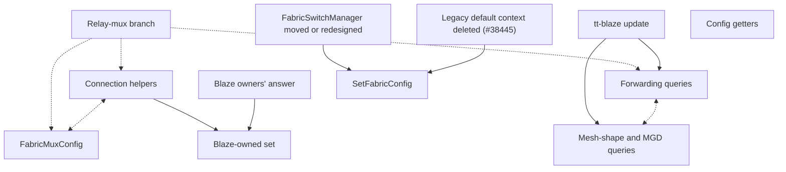

# Fabric → MetalEnv uplift: step 4 (public API)

Part of the [uplift plan](Fabric-MetalEnv-Uplift-Plan.md), which has the overall progress, the decisions (including the config freeze from #59387) and steps 1 to 3. Tracking issue: [#39772](https://github.com/tenstorrent/tt-metal/issues/39772).

Status as of 2026-10-14: PR-A to PR-C are merged ([#59551](https://github.com/tenstorrent/tt-metal/pull/59551), see [Done](#done)). `main` has 29 lookups: the 27 long poles below, which are recorded, not scheduled, plus 2 that [#56703](https://github.com/tenstorrent/tt-metal/pull/56703) added on 2026-10-14 (see [Regressions since #59551](#regressions-since-59551)).

The detailed execution plan is the Cursor plan `fabric_step_4_replan_b38ce44e.plan.md`, which is not in the repo. This file keeps the rules and the long poles.

On `main` (re-checked 2026-10-14, no fabric commits since #56703), the 29 are: 20 in `fabric.cpp`, 4 in `fabric_mux_config.cpp`, 2 in `pipeline_builder.cpp` and 3 in `fabric_switch_manager.cpp`. Branch `ruizhang/fabric-relay-mux-own-control-plane` brings that to 26 (see the [quick win](#ratings)). None of them is a live bug. A bare `instance()` resolves to the wrong context only when a mock context and a silicon context coexist, or several mocks do (`metal_context.cpp:392-433`). The goal is to delete that fallback, which is documented as a bridge for #38445.

## Rules

- **Handle.** Public APIs take `const MeshDevice&` and resolve internally through `mesh_device.impl().metal_env()`. Callers get their `FabricNodeId`s from a mesh device, so one is always in scope. No fabric API takes `MetalEnv`; see [Mesh-shape and MGD fabric-type queries](#mesh-shape-and-mgd-fabric-type-queries-investigated) for the pre-device case.
- **No parallel versions.** Change a signature in place and port every caller in the same PR. No shims.
- **Blaze-owned APIs are left alone.** These are the five `internal::` functions (`get_fabric_kernel_defines`, `compute_fabric_connection_rt_args`, `append_routing_plane_connection_rt_args_no_defines`, `get_all_fabric_mesh_ids`, from #48851, and `fabric_connection_rt_args_size`, from #56703) and the pipeline family (`pipeline_get_forwarding_direction`, `pipeline_get_chip_neighbors`, `resolve_graph_layout`; see the Blaze notes in `pipeline_builder.cpp` and `test_pipeline_builder.cpp`). Their 6 lookups stay until the owners are involved.

## Design notes

- **Resolving through a `Program`'s context is dropped.** `CreateProgram()` binds `DEFAULT_CONTEXT_ID`, and `instance(DEFAULT_CONTEXT_ID)` takes the same fallback as bare `instance()`, so it would change nothing. The `ProgramDescriptor` instantiations have no context at all. The program-scoped connection helpers therefore need a `MeshDevice&` parameter, like the other APIs.
- **The config getters no longer depend on core.** With a `MeshDevice` handle, the size, topology and config getters don't need core to expose the env publicly. They return the *effective* config, because config is frozen once a mesh exists. `MetalEnv::get_fabric_config_descriptor()` (#59387) remains the *requested*-config getter.

## Done

PR-A to PR-C went out as one PR, [#59551](https://github.com/tenstorrent/tt-metal/pull/59551), merged 2026-10-09. It removed 10 lookups:

- **PR-A (4):** deleted three free functions and the dead `FabricMuxConfig` setters, and made `get_fabric_mux_compile_time_main_args` private.
- **PR-B (5):** `get_neighbor_eth_directions`, `get_forwarding_eth_core` and `read_fabric_telemetry(FabricNodeId)` take `const MeshDevice&`; `get_number_of_available_routing_planes` resolves through its mesh device.
- **PR-C (1):** the `FabricMuxV2Config` constructor takes `const MeshDevice&`.

It was built and tested locally on a single N150 only; CI covered the multi-chip paths.

## Regressions since #59551

[#56703](https://github.com/tenstorrent/tt-metal/pull/56703) (merged 2026-10-14, "let workers pass semaphore addresses instead of ids") added 2 lookups to `fabric.cpp`. Both are in the Blaze-facing `internal::` connection-args family; the PR thread says the change was made in tandem with tt-blaze work. [#57696](https://github.com/tenstorrent/tt-metal/pull/57696) (link health) added none in fabric code. Its only hit under `tt_metal/fabric/` is a usage example in `README_fabric_reliability_mode.md`, and its other new lookups are in two test files.

| Lookup | Where | Classification |
| --- | --- | --- |
| HAL read for the L1-address bounds check | `internal::compute_fabric_connection_rt_args` (`fabric.cpp:774`), only when `sem_args_are_l1_addresses` is set | **Undone, no API change** (commit on `ruizhang/fabric-relay-mux-own-control-plane`). The function now resolves the control plane once at the top and reads the HAL from `get_fabric_context().get_hal()`. This restores the pre-#56703 count, but the function's one remaining lookup is its existing Blaze-owned one, so it is still not multi-context-safe (marked `TODO(#52020)`). |
| Fabric context, to check whether 2D routing is enabled | New `internal::fabric_connection_rt_args_size(size_t)` (`fabric.cpp:732`), bound as `ttnn.fabric_connection_rt_args_size` | **Joins the [Blaze-owned set](#blaze-owned-set-investigated).** It is a new handle-less public function, so removing the lookup needs an API change. Its only in-repo caller is `compute_fabric_connection_rt_args`, which can use a file-local helper that takes the `FabricContext` it already holds. That avoids the extra lookup at runtime but doesn't change the count. |

The `README_fabric_reliability_mode.md` example shows `MetalContext::instance().get_control_plane()` as the way to reach the new link-health API. `MetalEnv` has no public control-plane accessor (only `get_system_mesh()`), so there's no handle-based path to document instead.

## Long poles (recorded, not scheduled)

The ratings come first, then the [order and dependencies](#order-and-dependencies), then one subsection per item, in priority order. All items have been investigated.

### Ratings

A bare lookup gives the wrong context only when more than one context is live, so these columns ask the following:

- **Blast radius:** does a multi-context app break just by running ordinary ttnn ops or dispatch, or only if it calls the API itself?
- **Breaks Python:** does the fix have to change a Python binding? This assumes the no-shim rule. A binding could always keep a no-argument form that resolves the default context inside ttnn, but that moves the lookup rather than removing it.
- **Impact:** repo-local, or external too?
- **Goes away with MetalEnv bootstrapping:** does the problem disappear once apps create a `MetalEnv` and open meshes from it, either because the API stops being used or because passing the `MetalEnv` fixes it?
- **Effort:** a rough estimate of the in-repo change (how many callers to port, and how many need a device plumbed through) plus any cross-repo coordination. Low is a small PR, Medium a focused PR of a few dozen files, High a large port across ttnn and Python. The counts come from each item's subsection.

| Item | Blast radius | Breaks Python | Impact | Goes away with MetalEnv bootstrapping | Effort |
| --- | --- | --- | --- | --- | --- |
| Config getters | Effectively everywhere | Yes (4 bindings) | External, the widest | No | High: 79 C++ files and 29 Python files, mostly mechanical; about 14 ttnn helpers and 14 Python sites need the device passed in |
| Program-scoped connection helpers | Effectively everywhere | Yes (3 bindings) | External | No | High: 66 C++ files and 18 Python files, plus moving the internal helpers onto a context and the test-infra accessor |
| `FabricMuxConfig` | Effectively everywhere on multi-chip systems | Yes (1 experimental binding) | External, small | No | Medium: 13 op files and 5 tests; caching in the constructor needs care (tensix config timing, the two compile-time getters) |
| Forwarding queries | About 20 ops | Yes (2 bindings) | External (Blaze, descriptor users) | No | Medium: about 34 C++ files and 7 Python files; three helpers need the device passed in; Blaze update |
| Mesh-shape and MGD fabric-type queries | A few ops, low severity; Blaze | Yes (2 bindings) | External (Blaze) | Partly | Low in-repo (about 6 call sites, plus a context-free MGD reader); the Blaze update must land together |
| Blaze-owned set | tt-blaze, plus about 6 ops | Depends on when Blaze calls them | External (Blaze) | Partly | Low to medium in-repo (2 ops, bindings, 2 tests); blocked on the Blaze owners |
| `SetFabricConfig` | None | Not until legacy is deleted | External at deletion | Yes | High, but part of legacy deletion: 23 C++ files, 48 Python files and the pytest fixtures |
| `FabricSwitchManager` | One app (TT-Switch bring-up) | No | Repo-local in practice | Yes, after the redesign | Low to move into its test; High for the redesign |

**Why each item rates the way it does:**

- **Config getters.**
  - About 62 ttnn op files call them while building programs. `GetFabricConfig` picks most CCLs' topology, and the size getters size packets and buffers.
  - App migration doesn't help, because ttnn holds a `MeshDevice`, not a `MetalEnv`. Only direct app-level reads of the requested config move to `MetalEnv::get_fabric_config_descriptor()`.
  - `ttnn.get_fabric_config` (26 in-repo sites) is almost certainly used out-of-tree.
- **Program-scoped connection helpers.**
  - Every op that opens a fabric connection uses them (about 46 op files), and so does dispatch, through the mux run-time args.
  - The Python helpers are used by 18 in-repo files, mostly `deepseek_v3_b1`, and by any out-of-tree users of generic-op descriptors.
- **`FabricMuxConfig`.**
  - The dispatch relay mux builds one for every remote (non-MMIO) chip on N300, T3K and Galaxy.
  - About 13 mux-based CCL ops build one too, including `all_gather_async` and `reduce_scatter_minimal_async`.
  - The only Python binding is the experimental `fabric_mux.Config`, which has one in-repo test.
- **Forwarding queries.**
  - The 2D-fabric CCLs reach these through the shared multicast helper in `ccl_common` (12 factories). So do send/recv, deepseek_prefill, ring SDPA, the D2D stream service, and one relay-mux branch.
  - In-repo, the deepseek family, `llama_3p1_8b_d_p` and the ring-attention users are affected.
  - These are op-internal, so app migration doesn't remove them.
- **Mesh-shape and MGD fabric-type queries.**
  - `get_physical_mesh_shapes` is behind the same 2D CCL helpers, but only for a check on the mesh count and dimensions, so a wrong-context answer is almost always the same answer.
  - Its pre-device job (finding the shape to open) goes away for apps that use `MetalEnv::get_system_mesh().shape()`. The check inside `ccl_common` stays.
  - `get_all_mgd_fabric_types` gets *worse* with `MetalEnv`. Reaching the env's control plane freezes the fabric config the function is meant to help choose, so it has to become context-free either way.
- **Blaze-owned set.**
  - The `internal::` functions are used only by tt-blaze. The pipeline helpers are also reached from ring SDPA, indexer score, the padded KV cache update, high-bandwidth all-gather (through `mesh_ring_plan`) and `reduce_scatter_minimal_direct`.
  - Blaze's own pre-device calls could take a `MetalEnv` if Blaze migrated and Python had `MetalEnv` bindings. The op-internal calls stay.
- **`SetFabricConfig`.**
  - This is the legacy default-context setter. Multi-context apps use `MetalEnv::configure_fabric`, so it isn't a hazard and goes away with legacy deletion.
  - Deleting it removes `ttnn.set_fabric_config` (95 sites in 48 files) and the pytest fixture path.
- **`FabricSwitchManager`.**
  - It has one in-repo test caller and no binding.
  - Under `MetalEnv`, switch-mesh bring-up belongs in env or mesh creation. Once that's built, the singleton isn't needed.

**What this means:**

- The three items with the widest blast radius are also the three that app migration can't fix. They need the API changes.
- The items that do go away with migration are the legacy entry points, and they carry no multi-context risk.

**Quick win: the relay mux's dispatch exposure.** Most of the "effectively everywhere on multi-chip systems" exposure comes through the dispatch relay mux, and it can be removed without any API or Python change. After #59551, the relay mux still reaches bare lookups in three places:

- the `FabricMuxConfig` constructor;
- `get_fabric_mux_run_time_args`, which goes into the eth branch of `append_fabric_connection_rt_args`;
- `get_forwarding_link_indices`, in one branch.

Moving those onto the relay mux's own control plane is a small, repo-local change that makes dispatch safe on multi-chip systems with a second context before any of the API changes land. It is implemented on branch `ruizhang/fabric-relay-mux-own-control-plane` (pushed, no PR yet; based on `a95f8092b32`, and `main` has no fabric changes since):

- The relay mux builds its config through `FabricMuxConfig(const ControlPlane&, ...)`, made public for metal code that has a context but no `MeshDevice`. The default-context constructor delegates to it (`TODO(#52020)`: becomes the `const MeshDevice&` form).
- Its run-time args go through `append_fabric_connection_rt_args_in_context(const FabricContext&, ...)` (metal-internal, `fabric_connection.hpp`), which the public `append_fabric_connection_rt_args` also delegates to.
- Its link indices come from a new `get_forwarding_link_indices(const ControlPlane&, src, dst)` overload (`fabric_host_utils`).
- It also undoes #56703's HAL lookup (see the regressions table).

Net: 29 to 26. One each from the `FabricMuxConfig` constructor (its two HAL reads become one control-plane lookup), the connection helpers (the eth-branch cluster read now comes from the `FabricContext`) and the regression. No Python change, and no behavior change for non-dispatch callers.

### Order and dependencies

The items are in priority order: widest blast radius first, then whether MetalEnv bootstrapping fixes them. The top four need API changes because app migration doesn't help; the last two are legacy entry points with no multi-context risk. Once the relay-mux branch lands, `FabricMuxConfig`'s exposure shrinks to its ~13 CCL ops, close to the forwarding queries' ~20. It stays ahead because it is best done together with the connection helpers.

Solid arrows are hard dependencies; dashed ones are recommended orderings or bundles.

- **Relay-mux branch first (recommended).** It takes dispatch off the connection helpers, `FabricMuxConfig` and the forwarding queries, so none of those changes needs a device-free path for the relay mux.
- **Connection helpers with `FabricMuxConfig` (bundle).** The ~13 mux-based CCL ops call both the mux constructor and `get_fabric_mux_run_time_args`, which is in the connection helpers' API table, so landing them together touches those files once. Both also need the mesh-device accessor on `IDeviceInfoProvider` for the fabric test infra. Either can land first; until the connection helpers land, a device-built `FabricMuxConfig` still writes its run-time args through the default context.
- **Connection helpers before the Blaze-owned set (hard).** Moving `_impl` onto a context gives Blaze's `append_routing_plane_connection_rt_args_no_defines` wrapper its own lookup, which grows the Blaze-owned set from 6 to 7. The Blaze item is also blocked on the owners saying which functions they call before opening a device.
- **Forwarding queries and mesh-shape queries need a tt-blaze update (hard, cross-repo).** Blaze calls `get_eth_forwarding_direction`, `get_physical_mesh_shapes` and `get_all_mgd_fabric_types` from Python, so its update lands with the tt-metal change. The two items share two Python callers (`test_attn_res_gather_softmax.py`, `deepseek_v3_d_p/tests/fabric_profiles.py`), so they can share one PR and one heads-up. Converging the two direction queries waits for the Blaze-owned item.
- **`SetFabricConfig` last (hard).** Deleting it needs the legacy default context gone (#38445), and its library users off it first: `FabricSwitchManager` (moved into its test, or redesigned) and the scaleout `fabric_manager_utils` tool.
- **Config getters: no dependencies.** They can land at any time; doing them early also fixes the `FabricMuxV2Config` sizing mismatch.

### Config getters (investigated)

There are 5 lookups, one each in `get_tt_fabric_channel_buffer_size_bytes`, `get_tt_fabric_packet_header_size_bytes`, `get_tt_fabric_max_payload_size_bytes`, `get_fabric_topology` and `GetFabricConfig`. All five take `const MeshDevice&` in place and return the *effective* values for that mesh's context, which #59387's freeze keeps stable once a mesh exists. No in-repo caller needs them before a device exists. The one conftest use (`deepseek_v3_d_p`) requests `mesh_device` first. Before a device exists, the *requested* config is available from `MetalEnv::get_fabric_config_descriptor()`, in C++ only.

**API changes:**

| API | C++ | Python |
| --- | --- | --- |
| The three size getters | `mesh_device` added | `ttnn.get_tt_fabric_packet_header_size_bytes(mesh_device)`, `ttnn.get_tt_fabric_max_payload_size_bytes(mesh_device)`, `ttnn.experimental.fabric_mux.channel_buffer_size_bytes(mesh_device)` |
| `get_fabric_topology` | `mesh_device` added | Not bound |
| `GetFabricConfig` | `mesh_device` added | `ttnn.get_fabric_config(mesh_device)` |

Every caller changes anyway, so two tightenings cost nothing extra:

- **One packet-spec getter** can replace the three size getters. The channel buffer size is header plus max payload (`fabric_context.cpp:147-149`), so a single call returning all three avoids three separate queries.
- **`ttnn::ccl::is_fabric_2d()` has no callers** and can be deleted.

**In-repo callers:**

- **C++: 79 files.** These are 62 ttnn op files, 1 ttnn core file, 15 test files and 1 tt-train file.
  - Most have a `MeshDevice` in scope.
  - About 14 ttnn files call a getter from a validation or helper function, where the device has to come from a tensor argument or be passed in.
  - On `main`, the `FabricMuxConfig` constructor also calls two size getters. On the relay-mux branch it reads them from the fabric context instead, so nothing under `tt_metal/` outside `fabric.cpp` calls these getters.
- **Python: 55 sites in 29 files.**
  - 41 sites have a device in scope.
  - The other 14 are in helpers: the `deepseek_v3_b1` chunk-size helpers, the `minimax_m3` route logger, a few test checks, and `deepseek_v3_d_p`'s `per_axis_topology`, which already accepts an optional `fabric_config`.

This also fixes the mux sizing mismatch: the three ttnn `FabricMuxV2Config` callers currently size the mux from the default context, while the constructor validates against the mesh's.

**External impact.** All four Python bindings break. `ttnn.get_fabric_config()` is the most widely used fabric query in the repo (26 sites), so out-of-tree model code very likely calls it too. Any caller that reads it before opening a device has no Python replacement until Python gets `MetalEnv` bindings.

### Program-scoped connection helpers (investigated)

There are 5 lookups on `main`: two in `append_fabric_connection_rt_args` (control plane; cluster, for the eth-dispatch branch), and one each in the routing-direction overload of `append_routing_plane_connection_manager_rt_args`, `inject_fabric_kernel_defines` and `append_routing_plane_connection_manager_rt_args_impl`. The relay-mux branch removes the cluster one, leaving 4. A `Program` or `ProgramDescriptor` has no usable context (see Design notes), so the public helpers take `const MeshDevice&` in place.

The internal helpers (`inject_fabric_kernel_defines`, `_impl`, and the body of `append_fabric_connection_rt_args`) take the context instead. The relay-mux branch already does this for the body: `append_fabric_connection_rt_args_in_context(const FabricContext&, ...)`, with the cluster from `FabricContext::get_cluster()`. Internally, `_impl` stops calling the public forwarding queries and uses the control plane directly. Blaze's `internal::append_routing_plane_connection_rt_args_no_defines` also calls `_impl`. It keeps its signature and resolves the control plane with its own lookup, so the Blaze-owned set grows by one and the net reduction here is 4 from `main` (3 after the relay-mux branch).

**API changes:**

| API | C++ | Python |
| --- | --- | --- |
| `append_fabric_connection_rt_args` | `mesh_device` added as the first parameter | `ttnn.setup_fabric_connection(mesh_device, ...)` |
| `append_routing_plane_connection_manager_rt_args` (both overloads) | `mesh_device` added as the first parameter | `ttnn.setup_routing_plane_connection(mesh_device, ...)` |
| `FabricMuxConfig::get_fabric_mux_run_time_args` | `mesh_device` added as the first parameter | `fabric_mux.Config.kernel_runtime_args(mesh_device, ...)` |
| `add_fabric_mux_v2_to_program`, the two overloads that take `FabricNodeId`s | `mesh_device` added | Not bound |

The mux entries are needed because both mux configs keep no handle after construction, and their connection paths call `append_fabric_connection_rt_args`. The relay mux doesn't use `get_fabric_mux_run_time_args` on the relay-mux branch; it calls `append_fabric_connection_rt_args_in_context` with its own context. The tensix datamover builder (`fabric_tensix_builder_impl.cpp`) is fabric-internal and passes its own control plane.

**In-repo callers:** this is the largest of the investigated items.

- **C++: 66 files.** These are 46 ttnn op files, 1 ttnn core file (the D2D stream service) and 19 test files (the relay mux used to be a 67th; see above). All but two have a `MeshDevice` in scope:
  - `all_to_all_dispatch`'s `build_dispatch_program_descriptor` needs the device passed in.
  - The fabric test infra (`tt_fabric_test_device_setup.cpp`) needs the same `IDeviceInfoProvider` accessor as the `FabricMuxConfig` item.
- **Python: 18 files, 36 call sites.** 16 are `deepseek_v3_b1` micro-ops and 2 are tests, and all have a device in scope.

**External impact.** Both Python helpers are ttnn's public way to wire fabric connections into a `ProgramDescriptor` for the generic op ([#35323](https://github.com/tenstorrent/tt-metal/pull/35323)), so any out-of-tree descriptor users break. Blaze uses its own `internal::` path, which is unchanged.

**Ordering:** independent once the relay-mux branch lands, since the relay mux no longer goes through the public helpers. It doesn't depend on the forwarding-queries change.

### `FabricMuxConfig` (investigated)

On `main` after #59551, `fabric_mux_config.cpp` has 4 lookups: two HAL reads in the constructor (L1 alignment, L1 bounds) and two in `get_fabric_mux_compile_time_args` (builder context, tensix config). The constructor also calls the free size getters (`get_tt_fabric_channel_buffer_size_bytes`, `get_tt_fabric_packet_header_size_bytes`), which have lookups of their own. On the relay-mux branch, the default-context constructor has one lookup and delegates to the `ControlPlane` constructor, which reads the HAL and sizes from the fabric context, so there are 3. Every value comes from the fabric context, so the fix follows `FabricMuxV2Config`: resolve everything in the constructor and keep no handle.

**API changes:**

| API | C++ | Python |
| --- | --- | --- |
| Constructor | `FabricMuxConfig(const MeshDevice&, ...)`: `mesh_device` is the new first parameter, as in V2. It replaces the default-context constructor. | `ttnn.experimental.fabric_mux.Config(mesh_device, ...)` |
| `FabricMuxConfig(const ControlPlane&, ...)` | Unchanged. Public on the relay-mux branch, for metal code with a context but no `MeshDevice`. | Not bound |
| `get_fabric_mux_compile_time_args()` | Unchanged. Reads values cached by the constructor, which also removes the three `mutable` members. | Unchanged (`kernel_compile_time_args()`) |
| `get_fabric_mux_compile_time_args_for_relay_mux(const ControlPlane&)` | Drops its parameter | Not bound |

The relay mux is dispatch code with no `MeshDevice` (dispatch is configured before any device exists), so it builds the config through the public `ControlPlane` constructor with its own control plane. Nothing else changes. The client-side helpers in ttnn (`fabric_mux_connection_ct_args` / `_rt_args`) have no lookups.

**In-repo callers:**

- **13 ttnn op files (16 constructor sites)** all have a `MeshDevice` in scope, as `mesh_device` or `input_tensor.device()`. `selective_reduce_combine` builds the config in a helper, which needs the device passed through.
- **5 test files** have a `MeshDevice`: `test_generic_op`, `test_fabric_mux_connection_args`, `test_tt_fabric_mux_bandwidth`, `test_basic_fabric_mux` and the Python `test_experimental_fabric_mux.py`. The fabric test infra (`tt_fabric_test_device_setup.cpp:167`) only sees an `IDeviceInfoProvider`, so that interface needs a mesh-device accessor; the fixture behind it already owns one.
- **The relay mux** (`relay_mux.cpp:75`) uses the `ControlPlane` constructor above.

**External impact.** The Python `Config` is experimental and was added on 2026-09-30 ([#56433](https://github.com/tenstorrent/tt-metal/pull/56433)) for "descriptor-driven frontends", which aren't named. The new required argument breaks those callers. Give bnorris a heads-up.

**To check before implementing:**

- **Caching at construction needs live fabric state.** The router config exists once the fabric context does, which the constructor already requires. The tensix config is only filled in when the device opens (`initialize_fabric_tensix_datamover_config`), which holds for every caller that has an open `MeshDevice`.
- **Run-time args still go through the default context.** `get_fabric_mux_run_time_args` calls `append_fabric_connection_rt_args`, which is the program-scoped connection-helper long pole. That call stays on the default context until that change lands, and then `get_fabric_mux_run_time_args` takes the device too.

**Optional:** give V1 an `append_client_connection_rt_args` like V2 and move the ttnn client helpers into fabric. That tightens the API but removes no lookups.

### Forwarding queries (investigated)

`get_forwarding_link_indices` and `get_eth_forwarding_direction` have one lookup each, used only to reach the control plane. Both take `const MeshDevice&` in place. The device only selects the context: `src` and `dst` don't have to belong to it, which matters for cross-process callers (the D2D stream service, the multihost socket tests).

**API changes:**

| API | C++ | Python |
| --- | --- | --- |
| `get_forwarding_link_indices` | `(const MeshDevice&, src, dst)` | `ttnn.get_forwarding_link_indices(mesh_device, src, dst)` |
| `get_eth_forwarding_direction` | `(const MeshDevice&, src, dst)` | `ttnn.get_eth_forwarding_direction(mesh_device, src, dst)` |

**In-repo callers:**

- **`get_forwarding_link_indices`: 28 C++ files and 5 Python files.**
  - The ttnn ops, the D2D stream service, the multihost socket utils and the fabric addrgen/benchmark tests have a `MeshDevice` in scope.
  - Two helpers that are each copied into deepseek_prefill `combine` and `dispatch` (`compute_per_neighbor_forwarding_links`), plus `build_stream_schedule` in `all_to_all_async_generic`, need the device passed in from their program factories.
  - Fabric tests on `BaseFabricFixture` (`test_basic_1d_fabric`, `test_channel_trimming_capture`, ...) only show a control plane at the call site, but the fixture holds `MeshDevice`s (`get_devices()`), and any of them selects the right context.
  - The relay mux has no `MeshDevice`. On the relay-mux branch it already calls the internal `get_forwarding_link_indices(const ControlPlane&, src, dst)` overload (`fabric_host_utils.hpp`) with its own control plane; the public form delegates to that overload.
  - Python: four `llama_3p1_8b_d_p` files (model and tests) have `mesh_device`. The fifth is a callable-only export test.
- **`get_eth_forwarding_direction`: 6 ttnn files and 2 Python files.** All have a `MeshDevice` (`all_to_all_async_generic` again through `build_stream_schedule`). The Python callers are the same two that use `get_physical_mesh_shapes`: `test_attn_res_gather_softmax.py` and `deepseek_v3_d_p/tests/fabric_profiles.py`.

This also fixes a mixed-context case: the deepseek_prefill fabric2d placement code currently takes link indices from the default context and the eth core for each index from the mesh. After the change, both come from the mesh.

**External impact.** Both Python signatures break.

- **`get_eth_forwarding_direction`** was bound to Python by tt-blaze ([#48851](https://github.com/tenstorrent/tt-metal/pull/48851), esmalTT), so Blaze needs a matching update, as it does for the mesh-shape queries.
- **`get_forwarding_link_indices`** was bound for descriptor-driven frontends ([#52642](https://github.com/tenstorrent/tt-metal/pull/52642), bnorris), the same audience as the mux `Config`.

**Optional:** converge `get_eth_forwarding_direction` with Blaze's `pipeline_get_forwarding_direction`, which additionally returns nothing when no routing plane is active in that direction. This removes no lookups, and the pipeline variant is in the Blaze-owned set, so it waits for the owners.

### Mesh-shape and MGD fabric-type queries (investigated)

`get_physical_mesh_shapes` and `get_all_mgd_fabric_types` (`fabric.cpp:71-99`) have one lookup each. Neither should take `MetalEnv`: reaching the env's control plane freezes the fabric config, and Python has no `MetalEnv` bindings.

**API changes.** Both change in place, and the no-argument forms go away.

| API | C++ | Python |
| --- | --- | --- |
| `get_all_mgd_fabric_types` | `get_all_mgd_fabric_types(const MeshGraphDescriptor&)`, with no context | `ttnn.get_all_mgd_fabric_types(mgd_path)` |
| `get_physical_mesh_shapes` | `get_physical_mesh_shapes(const MeshDevice&)` | `ttnn.get_physical_mesh_shapes(mesh_device)` |

**In-repo callers:**

- **`get_all_mgd_fabric_types`:** none besides a Python export test. The offline C++ test's copy of the implementation (`infer_fabric_types`, `test_mesh_graph_descriptor.cpp:138`) can call the real function instead.
- **`get_physical_mesh_shapes`:**
  - The NoC event profiler (`noc_event_profiler_utils.hpp:88`) stops using the API and reads the control plane through its own `context_id`.
  - `validate_fabric_2d_dynamic_config` (`ccl_common.cpp:1746`, 2 call sites) passes its `*mesh_device`.
  - tt-train `nano_gpt` (`main.cpp:44`) moves its shape check to after the device opens.
  - Two Python tests (`test_attn_res_gather_softmax.py`, `deepseek_v3_d_p/tests/fabric_profiles.py`) pass their `mesh_device`.

**Impact on Blaze.** Both functions were upstreamed for tt-blaze ([#48629](https://github.com/tenstorrent/tt-metal/pull/48629), [#51509](https://github.com/tenstorrent/tt-metal/pull/51509)), and both no-argument Python calls break. Blaze keeps every capability:

- **Fabric types:** pass the MGD path, i.e. the file set through `TT_MESH_GRAPH_DESC_PATH`. Results are unchanged. Without an MGD, both the old and new forms fail.
- **Mesh shapes before a device opens:** use `ttnn._ttnn.multi_device.SystemMeshDescriptor().shape()`. It gives the same answer when a rank has one local mesh. After a device opens, pass `mesh_device`.

The Blaze update has to land together with the tt-metal change; give esmalTT and nkodkaniTT a heads-up first. The Blaze call sites themselves haven't been checked; the above is based on the two upstreaming PRs.

### Blaze-owned set (investigated)

There are 6 lookups on `main`, and 7 once the connection helpers land:

- the five `internal::` functions: `get_all_fabric_mesh_ids`, `get_fabric_kernel_defines`, `compute_fabric_connection_rt_args`, `fabric_connection_rt_args_size` (added by #56703), and the `append_routing_plane_connection_rt_args_no_defines` wrapper, which gets its own lookup when the connection helpers change;
- `pipeline_get_forwarding_direction` and `pipeline_get_chip_neighbors`.

`resolve_graph_layout` has no lookup of its own, but it calls the two pipeline helpers.

**In-repo callers:**

- **The five `internal::` functions** are reached only through their Python bindings, and nothing in the repo calls those from Python. Their only consumer is tt-blaze. The one in-repo C++ use is `compute_fabric_connection_rt_args` calling `fabric_connection_rt_args_size`.
- **The pipeline helpers** are called by two ttnn ops (`mesh_ring_plan.cpp`, `reduce_scatter_minimal_direct_factory.cpp`), both with a `MeshDevice` in scope, and by their Python bindings.
- **`resolve_graph_layout`** is called by its binding, `test_pipeline_builder.cpp` and the multihost `multi_host_pipeline.cpp` test.

**Shape of a change, if the owners agree:**

- **The pipeline helpers and `resolve_graph_layout`** take `const MeshDevice&`, like everything else. In-repo, that's a small port.
- **The `internal::` functions depend on when Blaze calls them.** The two connection functions and `fabric_connection_rt_args_size` run while a program is being built, so they can take the device. `get_fabric_kernel_defines` probably can too. `get_all_fabric_mesh_ids` reads the mesh ids from the mesh graph. If Blaze calls it before opening a device, it could go context-free like `get_all_mgd_fabric_types`.
- **Converging the two direction queries** (`get_eth_forwarding_direction` and `pipeline_get_forwarding_direction`) belongs here too.

**Next step:** ask the Blaze owners (esmalTT) which of these they call before opening a device. Nothing else blocks this item.

### `SetFabricConfig`, `FabricSwitchManager` (investigated)

**`SetFabricConfig` (1 lookup)** is the legacy setter that runs before a device exists, so there's no device to pass. Its replacement is `MetalEnv::configure_fabric`, which has 7 in-repo callers so far.

- It has 49 C++ sites in 23 files, mostly tests. The only library users are `FabricSwitchManager` and the scaleout `fabric_manager_utils` tool.
- `ttnn.set_fabric_config` has 95 Python sites in 48 files, plus the pytest `device_params` fixtures.
- It goes away only with the legacy default context (#38445). Until then it stays as it is.

**`FabricSwitchManager` (3 lookups)** is a public experimental singleton ([#33096](https://github.com/tenstorrent/tt-metal/pull/33096)). It opens the switch-mesh devices through the legacy device manager and calls `SetFabricConfig` itself.

- Its only caller is `tests/tt_metal/multihost/ttswitch_tests/test_mesh_device_ttswitch.cpp`.
- **Near-term option:** move it into that test, or into test utilities, and delete the public API. That takes 3 lookups out of `tt_metal/fabric/` without affecting any in-repo user. External users are unknown, which is acceptable for an experimental API.
- **Long term:** switch-mesh bring-up belongs in env or mesh creation, which is a redesign.

Totals: #59551 removed 10 lookups, and #56703 added 2. The relay-mux branch removes 3 (29 to 26), one of them the HAL regression. The investigated changes remove 15 more from there: net 3 for the connection helpers, 3 for `FabricMuxConfig`, 5 for the config getters, 2 for the forwarding queries, and 2 for the mesh-shape and MGD fabric-type queries. That leaves about 11: the Blaze-owned set (7), `SetFabricConfig` (1) and `FabricSwitchManager` (3, or 0 if it moves into its test).
