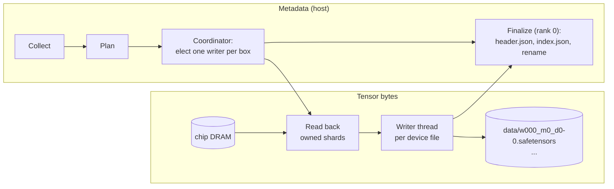
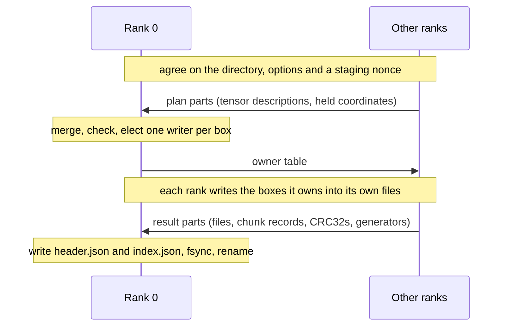

# Distributed Checkpointing

`ttml.distributed_checkpointing` saves and loads a training run's model, optimizer, scheduler, dataloader and random
generators. Every device writes its own shards straight to the shared filesystem, one index records where each block
of every tensor lives, and any mesh can load the result: a checkpoint saved with one mesh shape and parallelism
strategy loads onto another.<sup>[*](#moe-expert-parallelism-across-ep-sizes)</sup>

This guide covers how to use it, the components of a save, the box arithmetic that frees a checkpoint from the
parallelism that wrote it, the coordinator that extends it across processes and hosts, and the files it leaves on disk.

- [1. Using it](#1-using-it)
- [2. The components of a save](#2-the-components-of-a-save)
- [3. Every tensor is a set of boxes](#3-every-tensor-is-a-set-of-boxes)
- [4. Several processes: the coordinator](#4-several-processes-the-coordinator)
- [5. What a checkpoint looks like on disk](#5-what-a-checkpoint-looks-like-on-disk)
- [6. Current limitations and future work](#6-current-limitations-and-future-work)

---

## 1. Using it

Two calls. Save from the training loop every N steps; on restart, build the model and optimizer for whatever mesh you
now run on and load the latest checkpoint into them. Under `tt-run` every rank makes the same call at the same point;
a single process uses exactly the same code.

```python
import os
import ttml.distributed_checkpointing as dcp

CKPT_ROOT = "/shared/runs/llama8b"

# Save: every rank calls this at the same step.
ckpt_dir = os.path.join(CKPT_ROOT, dcp.step_dir_name(step))  # .../step_0001000
result = dcp.save(
    ckpt_dir,
    model=model,
    optimizer=optimizer,
    scheduler=scheduler,                      # optional: anything with get_state_dict / set_state_dict
    dataloader=dataloader,                    # optional
    header={"step": step, "run": "llama8b"},  # any JSON dict, returned by load
)
print(f"{result.bytes_written / 2**30:.1f} GiB in {result.stats['total_s']:.0f} s")

# Resume, on any mesh shape and parallelism: build model and optimizer for this mesh first.
latest = dcp.find_latest(CKPT_ROOT)  # highest complete step, or None
if latest is not None:
    result = dcp.load(
        latest,
        model=model,            # restored in place
        optimizer=optimizer,
        scheduler=scheduler,
        dataloader=dataloader,  # and with these two, the random generators
    )
    start_step = result.header["step"] + 1
```

- **Directories.** A save writes into a staging directory, `<dir>.partial-<nonce>`, and renames it to `<dir>` only at
  the end. `save` refuses a `<dir>` that already exists unless you pass `overwrite=True`, including one that another
  save commits while this one is writing: the final rename fails when the name is taken, so of two saves racing to the
  same directory, the first to finish keeps it and the second raises `CheckpointError`. A save that crashes leaves only
  its `.partial-` directory, which `find_latest` skips and warns about, naming it; nothing removes it, since it may
  belong to a save still running in another job.
- **Strict by default.** A live tensor the checkpoint lacks, or a saved one the model lacks, is an error. Pass
  `strict=False` to get them listed in `result.missing` and `result.unexpected` instead.
- **Restore what you pass.** `load` restores the objects it is given: a training checkpoint loaded with only a model
  leaves its optimizer, scheduler and dataloader state unread, which is how a model is loaded for evaluation.
- **Random generators.** `save` captures them by default. `load` restores them whenever it restores a scheduler or
  dataloader, since a resume that keeps the current generators takes a different step; under `tt-run` the ranks agree
  on that default, so a rank that passes neither restores its generators when another rank resumes its dataloader.
  `rng=False` keeps them (a deliberate reseed), and `rng=True` restores them with only a model. A damaged RNG block is
  refused before anything is placed; `load(..., rng=False)` still restores everything else.
- **No device needed to inspect.** `dcp.read_header(dir)`, `dcp.read_index(dir)` and `dcp.read_train_state(dir)` read
  a checkpoint's metadata from any machine, and refuse a header or index that `save` would not write: another format, a
  newer version, a missing field.
- **Errors.** Every failure of `save` and `load`, on one process as on many, is a `CheckpointError` or one of its
  subclasses. An error from outside the package (an `OSError` for a full disk, a `TypeError` for a bad argument) is
  raised as a `CheckpointError` that names the step that failed, with the original error as its cause. A
  `CheckpointFatalError` means the ranks can no longer agree; see [section 4](#4-several-processes-the-coordinator).

### Public API

| Name | What it does |
|---|---|
| `save(ckpt_dir, *, model=None, optimizer=None, header=None, scheduler=None, dataloader=None, rng=True, threads=None, max_inflight_bytes=4 << 30, overwrite=False) -> SaveResult` | Write the model, optimizer state and train state to `ckpt_dir`. `threads` caps the writer threads, by default one per device file; with fewer, each thread writes several files. `max_inflight_bytes` caps the host memory waiting to be written. Collective under `tt-run`. |
| `load(ckpt_dir, *, model=None, optimizer=None, scheduler=None, dataloader=None, rng=None, strict=True, threads=None) -> LoadResult` | Restore what is passed, in place, onto any mesh shape and parallelism. `rng=None` restores the generators whenever a scheduler or dataloader is restored on any rank. `threads` caps the reader threads (default 32). Collective under `tt-run`. |
| `SaveResult` | `path`, `bytes_written`, `files`, `keys` (tensors saved), `stats` (timings in seconds, `total_s` among them). |
| `LoadResult` | `path`, `header` (the `header=` dict passed to `save`), `scalars` (optimizer steps, learning rates, ...), `missing` and `unexpected` (with `strict=False`), `fast_path_keys` (keys loaded with the same layout they were saved with), `train_state`, `restored` (the names restored: `scheduler`, `dataloader`, `rng.*`), `stats`. |
| `step_dir_name(step, prefix="")` | The directory name for a step: `step_0001000`, or `<prefix>_step_0001000`. |
| `find_latest(root, prefix="", include_replaced=False)` | The complete checkpoint under `root` with the highest step, or `None`. Warns about the `.partial-` and `.replaced-` directories it skips. |
| `is_complete(path)` | Whether `path` is a final (not staging) checkpoint directory holding an `index.json`. |
| `read_header(ckpt_dir)` | The `header=` dict passed to `save`, without a device. |
| `read_index(ckpt_dir)` | The checkpoint's index, without a device. |
| `read_train_state(ckpt_dir)` | The stored scheduler, dataloader and RNG state, without a device. |
| `capture_rng(world_rank=None)` / `restore_rng(state, world_rank=None)` | Capture or restore this process's generators (ttml, `ttml.init`, Python, NumPy, torch when imported) outside a save or load. |
| `CheckpointError` | Base class of every checkpoint failure. |
| `CheckpointFatalError` | An exchange between the ranks failed; end the job (section 4). |
| `IncompleteCheckpointError` | A staging directory, or a missing, truncated or malformed `index.json` or `header.json`. |
| `VersionError` | Another format, or a newer version than this reader knows. |
| `MissingKeyError` / `UnexpectedKeyError` | A live tensor without an entry, or an entry no live tensor wants (`strict=True`); also a scheduler or dataloader asked for that the checkpoint does not hold. |
| `ShapeMismatchError` / `DtypeMismatchError` | The checkpoint's canonical shape or dtype for a key differs from the live tensor's. |
| `RoleMismatchError` | A live tensor resolved to a checkpoint entry of another role (a parameter to optimizer state, say). |
| `LayoutError` | A layout declaration or transform does not fit the tensor it describes. |
| `CoverageError` | Boxes that must tile a shape exactly do not. |
| `TopologyError` | A tensor's topology label cannot be used as a layout, or changed when it must not. |
| `LazyParameterError` | A parameter that has not been materialized yet. |

---

## 2. The components of a save

A save is one call: `dcp.save(dir, model=, optimizer=, scheduler=, dataloader=, header=)`. It runs in every process
that holds part of the mesh, and every process takes the same path. When a save spans several processes, as under
`tt-run` on multiple hosts, a *coordinator* ties them together: it gathers each process's plan, decides which process
writes each block of each tensor, and finalizes the checkpoint once every process has finished
([section 4](#4-several-processes-the-coordinator)). A single process has nothing to coordinate with, so its
coordinator is a group of one and runs the same steps with only itself.

Metadata and tensor bytes take separate paths. Metadata stays in the host processes until rank 0 writes the index.
Tensor bytes move from each chip's DRAM into that chip's own file, and are never gathered.



**The save path on one rank.** Collect and Plan are pure metadata. The coordinator decides which replica writes each
box. Read back and write move only the boxes this rank owns. Each device file has one writer thread fed by a queue
(`threads` caps the writers, which then share the files); it converts its shards to row-major on the host, writes them
and records their CRC32, and after its last write syncs and closes its own files. Readback of the next tensor overlaps
the conversion and writes of the last. Readback, the host conversion, `pwrite`, CRC32 and `fdatasync` all release the
GIL, so they run in parallel within one process. Rank 0 writes `index.json` last and renames the staging directory, so
a checkpoint is complete exactly when its name has no `.partial-` suffix.

| Component | Module | What it does |
|---|---|---|
| Collect | `_state_dict` | Walks the model and optimizer and gives every tensor a key (`model/<fqn>`, `optimizer/<state>/<fqn>`), its topology label and its layout declaration. Tied weights are recorded under every name that reaches them. Optimizer scalars travel separately. |
| Train state | `_train_state` | Captures the scheduler and dataloader through their `get_state_dict` (JSON, checked to read back as written) and the RNG state of every generator training draws from, one entry per world rank. The dataloader state is stored once when the ranks' states agree, and per world rank when they differ. On load the stored states are checked whole before any generator is set. |
| Plan | `_topology`, `_layouts`, `_planner` | Turns each label into the box each device holds, groups devices holding the same box, checks the boxes tile the tensor, and lays out one safetensors file per device with every offset fixed before a byte moves. Pure functions of labels and shapes. |
| Coordinator | `_coordinator` | Runs each step as a phase that ends in a status exchange; gathers plan parts to rank 0, which merges them and elects one owner chip per box among the chips that hold a replica of it; gathers result parts for the index. One process is a group of one and takes the same code path. |
| Read back and write | `_save` | Reads only the owned shards, one read per tensor returning a host tensor per shard, and queues each shard to its file's writer thread, which converts it to row-major on the host and writes it with `pwrite` at the planned offset, recording its CRC32. Host memory waiting to be written is capped by `max_inflight_bytes` (4 GiB). |
| Finalize | `_index` | Rank 0 writes `header.json` and `index.json`, fsyncs, and renames the staging directory to its final name. |
| Load | `_load` | Plans the reads of every destination shard, fills host arrays with a reader pool while the previous key is placed, assembles them under the live tensor's label, and installs them with `set_value` after checking the TensorSpec. The live label is asserted unchanged afterwards. |

**The load path.** The same box arithmetic runs per destination shard. A saved chunk is read whole, once, and checked
against its CRC32 when the destination shards together need at least half of it, which on one host is always; a chunk
that no loading rank needs half of (one split over three or more ranks) is read whole and checked by one of its
readers, which rank 0 elects; and a chunk that is its one destination shard, as in a same-world load, is read straight
into that shard's host array. Otherwise each overlap is read as contiguous runs of a sub-box. The live model and
optimizer are untouched until every check that needs no device has passed: keys, shapes, dtypes, layouts, optimizer
param groups, the TP split of fused-looking weights, data file sizes, and the train state.

---

## 3. Every tensor is a set of boxes

`ttml.checkpointing` stores each tensor whole: writing it means gathering every shard to one host, and reading it means
scattering the whole tensor again under the new mesh's mapper. `ttml.distributed_checkpointing` stores blocks. Each
tensor is described by its global array, and every chunk in a checkpoint is an axis-aligned box of that array: an offset
and a size per dimension. Saving and loading are both box arithmetic, so the mesh that wrote a checkpoint and the mesh
that reads it never need to match.

1. **Label to boxes.** A tensor's topology label lists one placement per mesh axis, `Replicate` or `Shard(dim)`, and
   the mesh coordinate of every shard. The box a device holds follows from its coordinate and its local shape; mesh
   axes that split the same dim count outermost first. Labels are trusted and never compared with the data.
2. **Replicas are written once.** Devices whose boxes are equal form a replica group, and exactly one of them writes the
   box. Rank 0 elects the writers by bytes: a box with one holder is that holder's, and the others, largest first, go
   to the holder whose rank, and then whose device, has the fewest bytes so far. The writes spread evenly over every
   rank and every device even when a few keys hold most of the bytes. The bytes written equal the unique bytes of the
   training state.
3. **Boxes tile.** Before any byte moves, every shard dim of a key's label must lie within the tensor's rank. A label
   that passes gives unique boxes that cover the global shape exactly, with no overlap; one that does not is refused at
   save, instead of producing a checkpoint that every load would reject.
4. **A canonical layout.** Two things change with the TP size besides the split: the row order inside a fused
   projection and the vocab padding. The index stores, per key, a transform from the saved device layout to the
   *canonical* array, the one a single-device TP 1 model holds: `identity`, `pad` (logical and padded rows; padding with
   no saved source loads as zeros) or `segments` (device start, canonical start, length). Each transform maps a box to a
   few boxes, so none ever needs a whole tensor. Each entry also records the tensor's TP split, how many shards the mesh
   axes other than its FSDP axis cut each dim into, so a load can tell when a fused weight saved without a declaration
   would come back scrambled.
5. **Load intersects.** Each destination shard's box goes to canonical coordinates through the destination's transform,
   then into the saved device layout through the inverse of the saved transform, and is intersected with the saved
   chunks. Each overlap is one read of a sub-box. The reads, plus any padding fills, must tile the destination shard
   exactly. A same-layout load skips all of this: each shard reads the saved chunk with its box, whole, found by a
   dictionary lookup.

**Example: the boxes of one weight.** A row-parallel weight of global shape `[1, 1, 4096, 4096]` saved on a loudbox at
DP 2 by TP 4 is split into four column blocks, each replicated over the two DP rows: four unique boxes, each held by two
chips and written by one. Loaded onto eight devices with FSDP on rows, each destination row strip reads one sub-box from
each saved box.

```
saved: DP 2 x TP 4                         loaded: FSDP 8 (rows)
columns  0..1023 1024..2047 2048..3071 3072..4095
        +--------+--------+--------+--------+  rows    0..511  <- reads 4 sub-boxes, one per saved box
        |   b0   |   b1   |   b2   |   b3   |  rows  512..1023 <- reads 4 sub-boxes
        | 2 chips| 2 chips| 2 chips| 2 chips|  ...
        |1 writer|1 writer|1 writer|1 writer|  rows 3584..4095 <- reads 4 sub-boxes
        +--------+--------+--------+--------+
```

**Why a canonical layout is needed.** Llama's attention fuses Q, K and V into one column-parallel weight and builds it
per TP shard, so its global rows run `[Q0; K0; V0; Q1; K1; V1; ...]` and the order changes with the TP size. The layer
declares its segment sizes, `fused_segments=(4096, 1024, 1024)` for an 8B model; from that and the label, save records
a `segments` map to the canonical `[Q; K; V]` order, and a load onto another TP size maps canonical rows back to its own
interleave. The MLP's fused `[gate; up]` weight works the same way. A padded vocab weight declares its logical row count
instead and gets a `pad` transform.

### Declaring layouts in a model

Topology labels describe how a tensor is split, which is all a checkpoint needs for most weights. The two facts a label
cannot carry are declared where the layer is built:

- **A fused projection** declares its segment sizes along the fused dim. `ttml.modules.ColumnParallelLinear` takes
  them as `fused_segments=(...)` and records them on its weight (and bias). Another layer can set the attribute
  itself: `weight.checkpoint_layout = {"fused": (dim, (size_0, size_1, ...))}`.
- **A padded vocab weight** declares its logical row count: `weight.checkpoint_layout = {"logical_extent": (dim, rows)}`.

`save` checks every declaration against the tensor's label and refuses one that does not fit. A weight whose name
suggests a fused projection but that declares nothing is saved with a warning, since its checkpoint reshards correctly
only between equal TP sizes; `load` refuses it (`LayoutError`) when its TP split differs between the checkpoint and the
live model, rather than load its rows scrambled.

### The checks cost nothing

Every check is on metadata, so none of them reads a tensor twice.

- **Save:** every shard dim of a label lies within the tensor's rank; every optimizer moment has its parameter's
  per-device shape; a fused declaration agrees with the label. A fused dim split by two mesh axes, or a weight both
  fused and padded, is refused because no transform describes it.
- **Load:** every shape and box in the index is checked as it is decoded; the saved chunks tile their global shape;
  reads and fills tile every destination shard; every chunk read whole matches its recorded CRC32; a weight whose name
  suggests a fused projection is refused when the TP split it leaves undescribed differs between the checkpoint and the
  live model; each restored tensor matches the live TensorSpec before `set_value`; and the live tensor's topology label
  is asserted unchanged afterwards, so a load cannot leave behind a label that the next save, which trusts labels, would
  turn into wrong boxes.

---

## 4. Several processes: the coordinator

Under `tt-run` several processes share one checkpoint: one mesh spread over hosts, or one mesh per host. Each rank holds
only some mesh coordinates. The coordinator turns the ranks' pieces into one checkpoint with one index. Only metadata
goes over MPI; tensor bytes go through the shared filesystem, each rank writing its own files.

**Requirements.** `save` and `load` are collective: every rank of the world calls them at the same point, with the same
directory and options. The directory must be on a filesystem every host sees. While a save or load runs, no other
point-to-point MPI traffic may be outstanding between the ranks, and no other code may use the MPI tag `DCP_TAG`
(`0x7DC0`) on the world communicator: the ranks' metadata travels under it.



- **Every step is a phase.** A phase runs the rank's local work, then a status exchange: an allgather of one int per
  rank, zero or the error class of a failure. If any rank failed, every rank raises the same class
  (`IncompleteCheckpointError`, `MissingKeyError`, ...) with the failing ranks' own messages, so no rank is left
  blocked in the next collective. An interrupt on one rank goes through the same exchange before it propagates. The
  arguments, and what a rank can fail alone (the header and train state, the index it reads), are checked in phases of
  their own before any device work, so a check failing on one rank stops every rank before any rank reshards its FSDP
  modules. On one process, an error from outside the package is raised as a `CheckpointError` naming the phase, with
  the error as its cause, so one handler serves any number of ranks.
- **One writer per box across hosts.** Rank 0 merges the plan parts into a union, checks that every rank describes each
  key the same way, and elects owners by bytes over all ranks' replicas. A replica held on two hosts is written by
  exactly one of them.
- **Agreement before any work.** On save the ranks agree on the directory, the overwrite flag, whether an optimizer is
  saved and its scalars, and a staging nonce. Rank 0 creates the staging directory under that nonce, refusing one that
  already exists, and the other ranks join it, refusing before anything is written when they do not see it (a
  directory the hosts do not share). The ranks' scheduler states must be equal, since the checkpoint stores one copy;
  their dataloader states are stored once when they agree and per world rank when they differ; RNG state is stored per
  world rank. On load the ranks agree on the directory, `strict` and whether an optimizer is loaded, then on the
  index's id and creation time, so neither a stale NFS listing nor per-host copies at one path can make ranks restore
  different checkpoints.
- **Scheduler and dataloader across ranks.** Each rank restores the scheduler and dataloader it passes. A rank that
  passes no dataloader while another rank passes one, and the checkpoint holds state for it, warns that the state goes
  unread. The scheduler state is one copy every rank restores, so a strict load refuses ranks that disagree on passing
  a scheduler, on every rank alike; a load that is not strict warns instead.
- **Rank 0 finalizes.** It merges the result parts into `index.json`, checks that every elected box was reported by its
  writer, records each optimizer param group's members and each key's live names as the union over ranks, writes the
  metadata, fsyncs and renames. A crash before the rename leaves a `.partial-` directory that never looks complete.
- **Load across rank counts.** Every rank reads the index and restores the shards of the coordinates it holds; `strict`
  is judged over the union of the ranks' live keys, since on a multi-mesh world no single rank holds every key, and so
  is each optimizer param group's membership. Each rank opens and checks every data file it will read while the load is
  planned, so no rank places a tensor before every rank has checked its files.
- **A load that fails partway.** Everything that can be checked without reading tensor data is checked before the
  first tensor is placed. A failure after that (a read error, the device out of memory) leaves the model and optimizer
  partly restored, and every rank's error says how many tensors each rank had placed. On a mesh of one rank's own, load
  again or discard the model. On a mesh several ranks share, every rank must make the same device allocations in the
  same order, and ranks that stopped at different points may no longer do so: every rank's error, on the ranks that
  placed nothing too, says to end the job and restart it instead of loading again.
- **Failures that end the world.** If a collective itself fails, for example a peer that died, no further collective
  is attempted, in this save or load or any later one, and `CheckpointFatalError` propagates with the staging directory
  left for inspection. A peer may still wait in a collective this rank left, so the job should end with `os._exit`: a
  handler that keeps training, or a normal exit through `MPI_Finalize`, would wait for it.

```python
try:
    dcp.save(ckpt_dir, model=model, optimizer=optimizer)
except dcp.CheckpointFatalError:
    traceback.print_exc()
    sys.stderr.flush()
    os._exit(1)  # skips MPI_Finalize, so the launcher ends every rank
```

---

## 5. What a checkpoint looks like on disk

```
runs/llama8b/
├── step_0000100/                      complete: no suffix, and index.json opens
│   ├── index.json                     where every box of every tensor lives
│   ├── header.json                    your header, plus scheduler, dataloader and RNG state
│   └── data/
│       ├── w000_m0_d0-0.safetensors   world rank 0, mesh 0, mesh coordinate (0, 0)
│       ├── w000_m0_d0-1.safetensors
│       └── ...                        one per device: 8 on a loudbox, 32 on a galaxy
├── step_0000200.partial-1f3a9c2e/     a save in progress, or one that crashed; never loaded
└── step_0000200.replaced-7d01b4a9/    left behind only if an overwrite=True swap was interrupted
```

`find_latest(root)` picks the highest complete step, and warns about the `.partial-` and `.replaced-` directories it
skips. A file's name records who wrote it, so ranks on different hosts never contend for a file, and the index refers to
files by exact name.

**One device file.** The container is the published safetensors format, so any file opens with the `safetensors`
package or its C++ reader. ttml writes the header itself because every offset must be known before the writer threads
start. The header's metadata names the format; the writer is in the file's name and the index.

### `index.json`

Abridged from a Llama-8B checkpoint saved on a loudbox (one process, DP 2 x TP 4):

```json
{
  "format": "ttml-dcp",
  "version": 1,
  "checkpoint_id": "dcp_step_1",
  "created": "2026-11-12T09:26:56Z",
  "world": {
    "group_size": 1,
    "ranks": [
      {
        "rank": 0,
        "world_rank": 0,
        "mesh_id": 0,
        "shape": [2, 4],
        "axis_names": ["dp", "tp"],
        "local_coords": [[0, 0], [0, 1], [0, 2], [0, 3], ...]
      }
    ]
  },
  "files": [
    {
      "path": "data/w000_m0_d0-0.safetensors",
      "nbytes": 4862464000,
      "writer": {"world_rank": 0, "mesh_id": 0, "coord": [0, 0]}
    },
    ...
  ],
  "labels": [
    {
      "placements": [["replicate"], ["shard", 3]],
      "distribution_shape": [2, 4],
      "mesh_coords": [[0, 0], [0, 1], [0, 2], [0, 3], ...]
    },
    ...
  ],
  "state": {
    "model/Llama/blocks/0/attention/qkv_linear/weight": {
      "role": "param",
      "dtype": "BF16",
      "layout": "TILE",
      "global_shape": [1, 1, 6144, 4096],
      "canonical_shape": [1, 1, 6144, 4096],
      "transform": {
        "kind": "segments",
        "dim": 2,
        "map": [[0, 0, 1024], [1024, 4096, 256], [1280, 5120, 256], [1536, 1024, 1024], ...]
      },
      "label": 1,
      "live_keys": ["model/Llama/blocks/0/attention/qkv_linear/weight"],
      "chunks": {
        "n": 4,
        "offsets": [[0, 0, 0, 0], [0, 0, 1536, 0], ...],
        "sizes": [[1, 1, 1536, 4096]],
        "file": [4, 5, ...],
        "data_offset": [7472676864, 5371330560, ...],
        "nbytes": [12582912],
        "crc32": ["281ccafc", "4aa7d189", ...]
      },
      "tp_split": [1, 1, 4, 1]
    },
    ...
  },
  "scalars": {
    "optimizer/steps": {"type": "int", "value": 1},
    "optimizer/param_groups.0.lr": {"type": "float", "value": 0.0009903926402330399},
    ...
  }
}
```

| Field | Contents |
|---|---|
| `format`, `version` | `ttml-dcp`, 1. Readers refuse a newer version and ignore unknown fields, and refuse an index that lacks a field every save writes. A field readers require, or one that changes how the rest is read, bumps the version. The file is compact JSON. |
| `world` | The saving world: the group size and, per rank, its world rank, mesh id, mesh shape and axis names, and the coordinates it held. A record only; load never requires the loading world to match it. |
| `files` | Every data file with its byte size and writer (world rank, mesh id, coordinate). Load checks each file's size before placing anything. |
| `labels` | Every distinct topology label the writer trusted, once each: a model's keys share a handful, and each lists every device's mesh coordinate. |
| `state.<key>` | One entry per canonical key: role, dtype, layout, global and canonical shape, the transform, its label's position in `labels`, every live name the tensor had on any rank (more than one for tied weights), the chunk table, and `tp_split`: per dim, how many shards the mesh axes other than the FSDP axis cut it into. |
| `chunks` | Columnar, one row per unique box: offsets, sizes, file, data offset, byte count, CRC32. A whole-chunk read checks the checksum. `sizes` and `nbytes` are stored once when every row has the same value. |
| `scalars` | Typed optimizer scalars: steps, learning rates, betas, and each param group's members. |

### `header.json`

```json
{
  "format": "ttml-dcp",
  "version": 1,
  "checkpoint_id": "dcp_step_1",
  "user": {"step": 1, "run": "llama8b"},
  "train_state": {
    "scheduler": {"m_last_step": 1, "m_base_lrs": [0.001], "m_last_lrs": [0.00099], "m_T_max": 16, "m_eta_min": 0.0},
    "dataloader": {"position": 1},
    "rng": {
      "format": 1,
      "ranks": {
        "0": {"ttml": "7 4097098180 357282266 ...", "python": "...", "numpy": "...", "ttml_init": "...", "torch": "..."}
      }
    }
  }
}
```

| Field | Contents |
|---|---|
| `user` | The `header=` dict, checked at save to be JSON that reads back as written. `dcp.read_header(dir)` returns it without touching a device. Every field `save` writes is required on read, `train_state` included. |
| `train_state` | Scheduler state, one copy for the world; dataloader state, one copy when the ranks' agree and one per world rank (`dataloader_ranks`) when they differ; and an RNG block with one entry per world rank: the ttml generator, `ttml.init`'s weight-initialization generator, Python's, NumPy's, and torch's CPU generator when torch is imported. |
| `checkpoint_id` | The directory's final name, so a copied or renamed checkpoint can be told apart from its source. |

### Rank numbers in a split launch

Data file names and the RNG entries in `header.json` are keyed by world rank, the process's rank in the whole MPI job.
In a normal launch that equals its rank in the save's group. When `tt-run` splits a job into sub-contexts, for example a
GRPO trainer and a rollout server launched together, each sub-context saves to its own directory and its ranks keep
their job-wide numbers: a trainer at world ranks 4 to 7 writes `w004_...` to `w007_...`. A process alone in its
sub-context saves as a group of one but keeps its world rank too, the same number `dcp.capture_rng` and
`dcp.restore_rng` use.

Loading is unaffected, since the index lists every file by exact name. The RNG entries restore only if the trainer runs
at the same world ranks again. Resumed alone at ranks 0 to 3, each rank keeps its current generators with a warning, so
the run continues correctly but not bit-exactly.

---

## 6. Current limitations and future work

### Save and load on the training ranks only

`save` and `load` are collectives over every rank of the current MPI context. A world where some ranks never call them,
such as an asynchronous GRPO run whose trainer and rollout worker are ranks of one MPI world, waits forever in the first
collective: the rollout rank, waiting for its next request, never joins. The planned fix lets `save` and `load` run on a
chosen subset of ranks, the training processes, with the same behavior as today when the subset is left unset. Tracked
in [#65436](https://github.com/tenstorrent/tt-metal/issues/65436).

### Declare layouts for the C++ models

Layout declarations are Python attributes, so the parameters of C++-bound models (the C++ `DistributedLlama`,
`PipelineParallelLlama` and distributed GPT-2) carry none and are saved with an identity layout. Resuming on the same
mesh is correct, but with TP these models do not reshard onto another TP size: `load` refuses their fused `kv_linear`
and `qkv_linear` weights at another TP size (`LayoutError`), and their vocab, rounded up inside the model's
configuration, makes a load on another device count fail with `ShapeMismatchError`. Save and load warn that a checkpoint
of such a model restores correctly only onto the same TP size. The Python models, used by the SFT and GRPO trainers,
are unaffected. Tracked in [#65584](https://github.com/tenstorrent/tt-metal/issues/65584).

### MoE expert parallelism across EP sizes

DeepSeek's sparse expert-parallel MoE registers each EP rank's local experts as separate parameters named by local
index (`w_gate_{i}`, `w_up_{i}`, `w_down_{i}`), so a global expert's identity is split between a parameter name and a
row. Changing the EP size changes both the key set and each key's meaning, so a DeepSeek `sparse_ep` checkpoint loads
only onto the same EP size; any other EP size fails the shape check before anything is placed. The fix is model-side:
one stacked parameter per projection, sharded over the EP axis, so that a change of EP size becomes ordinary resharding
of one tensor. Tracked in [#67120](https://github.com/tenstorrent/tt-metal/issues/67120).
