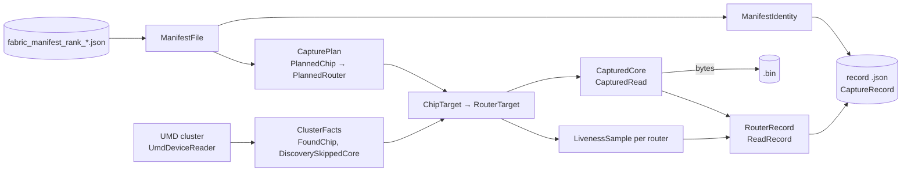

# Fabric capture

## Overview

When a fabric run hangs or misbehaves, the routers' state is on the chips: in each router core's L1 and registers.
Capture reads that state and saves it, so it can be decoded and looked at after the chips are reset.

- **What it takes:** one rank's fabric manifest, which the run wrote at fabric init (see the manifest's
[README](../manifest/README.md)). The manifest says which chips and routers the rank owned, where each router's core
is, the L1 range to read, and the address of every register to read.
- **What it does:** it opens the chips it can see through UMD, read only, and matches the manifest's chips and routers
to them. It samples every router a few times to see which are still running, then reads each router core in full:
its registers, its whole L1, and its registers again.
- **What it outputs:** two files per rank, in the run's folder:
  - a `.bin` holding the bytes it read;
  - a JSON record saying what it read and from where, where each read's bytes are in the `.bin`, and what it couldn't
  read and why.

Capture reads bytes and interprets nothing. Decode turns them into values, using the manifest. Capture runs as its own
process, so it works on a run that has exited, been killed or is stuck, and it needs no tt_metal runtime: it links UMD
and nothing of tt_metal.

## Running it

Run the workload with `TT_METAL_FABRIC_GENERATE_MANIFEST=1`, so each rank writes its manifest. Then run `fabric_capture`, one process per rank, on the hosts the run ran on:

```bash
build/tools/fabric_capture --capture-id <id>
```

| Option | Default | What it does |
| --- | --- | --- |
| `--manifest <file>` | This rank's manifest in the newest run (see below) | The manifest to capture |
| `--capture-id <id>` | The UTC time now, such as `20261105T221500Z` | Names the capture's folder. Every rank captured together needs the same one |
| `--liveness-rounds <n>` | 3 | How many times every router is sampled before any core is read |
| `--liveness-interval-ms <ms>` | 1000 | The time between liveness rounds |

Without `--manifest`, capture looks for this rank's manifest the way the run wrote it:

- **Its rank:** `TT_RUN_RANK`, else `OMPI_COMM_WORLD_RANK`, else 0. Its job's size: `OMPI_COMM_WORLD_SIZE`, else 1.
- **Its logs folder:** `TT_METAL_LOGS_PATH`, else the working folder.
- **The run:** the newest run under the logs folder that has the rank's manifest.

`TT_METAL_CLUSTER_ID`, when the run set it, names the host the same way in the record.

**Exit status:**

| Status | Meaning |
| --- | --- |
| 0 | Everything the manifest names on this rank was read |
| 1 | The files were written, but something wasn't read: a chip wasn't found, a core wasn't read, or a read failed. The record says what |
| 2 | Capture failed and wrote no record: an unreadable manifest, a capture that already exists, UMD failing to open, or a file it couldn't write |

### With tt-run

A multi-rank run is captured the way it ran: one capture process per rank, launched with the run's rank bindings (and
the same hosts), all with one capture id.

```bash
tt-run --rank-binding <the run's rank bindings> -- build/tools/fabric_capture --capture-id "$(date -u +%Y%m%dT%H%M%SZ)"
```

tt-run gives each process its rank (`TT_RUN_RANK`) on the host that rank ran on, so each finds its own manifest. Give
the id on the command line, rather than letting each rank default to its own start time, so every rank's files land in
one capture folder even when the ranks start a second apart.

Each process opens every chip it can see and reads only the chips its manifest owns, matching them by their unique id,
not by device number. So the numbering `TT_VISIBLE_DEVICES` gives doesn't matter, as long as the process can see the
rank's chips, which the run's rank bindings give it. Several capture processes can open the same chips at once.

### When to run it

- **After the run exits** is the main path: the run hangs or is killed, then capture runs. Routers keep running after
the host process is gone, so liveness still shows a stuck router.
- **Beside a stuck run** works too: capture opens its own UMD cluster read only, and doesn't disturb a live workload.
- **Before any reset.** A chip reset wipes L1. On Exabox, run capture in the same job as the workload, since the next
tt-sbatch job resets the galaxy first.

## Mental model

Capture goes from the manifest to the files in a few steps. Each step's result is a plain type, and each step works
only from the results before it.



1. **Read the manifest.** `read_manifest_file` parses and hashes it into a `ManifestFile`, once. From it,

   `collect_capture_plan` takes what to read, the `CapturePlan`:
   - the architecture, the L1 range, the heartbeat word's address, and the core registers (`CoreRegister`), which every
   router core shares;
   - the chips this rank owns (`PlannedChip`, by `asic_id`), each with its routers (`PlannedRouter`: path, Ethernet
   channel, the core the run launched it on, and its stream registers' addresses).

    `collect_manifest_identity` takes which run it is from, the `ManifestIdentity`: run id, rank, world size, host, the
    run's commit, and the file's hash. Then the parsed manifest is freed. A galaxy rank's manifest is tens of MB, and
    nothing after this needs it.
2. **See what's there.** `UmdDeviceReader` opens every chip this process can see through UMD, read only.

   `collect_umd_cluster_facts` turns what UMD found into `ClusterFacts`: each chip (`FoundChip`) with its unique id,
    architecture and Ethernet core for each channel, and the Ethernet cores UMD's discovery skipped
    (`DiscoverySkippedCore`).
3. **Match the plan to the chips.** `resolve_capture_targets` pairs each `PlannedChip` with the `FoundChip` that has its

   `asic_id`, giving a `ChipTarget` with a `ChipLocation`, and each of its routers with the chip's core for its channel,
    giving a `RouterTarget` with a `CoreLocation`. A router whose location is `FOUND` or `CORE_MISMATCH` is read
    (`RouterTarget::is_read`), at the core the manifest names. No other router is read.
4. **Check liveness.** `collect_liveness_rounds` samples every router that's read, a few rounds apart: its heartbeat

   word and its core registers, such as the wall clock (`LivenessSample`). These come before any full read, so they show
    which routers were running when capture started.
5. **Read each router core, one at a time.** `read_router_core` reads a core in `ReadStep` order and gives a

   `CapturedCore` of `CapturedRead`s:
   - `REGISTERS_BEFORE`: the core registers, then the router's stream registers;
   - `L1`: the whole L1 range;
   - `REGISTERS_AFTER`: the same registers again. A register that changed shows the router moved during the L1 read.

    The first read that fails is the core's last. `CaptureBinWriter::append_core` writes the core's bytes to the `.bin`
    straight away and keeps only where they went: a `RouterRecord` of `ReadRecord`s, each with its `.bin` offset. So
    memory holds one core's L1 at a time, never a rank's.
6. **Write the files.** `CaptureBinWriter::finish` moves the finished `.bin` into place. Then `write_capture_record`

   writes the `CaptureRecord`: the `ManifestIdentity`, the capture's id, commit and times, the `.bin`'s size and hash,
    and each chip (`ChipRecord`) with each router's `RouterRecord`.

`capture_rank` is steps 1 and 3 to 6, given a reader and its facts, and returns a `CaptureResult`: the files'
paths and a `CaptureOutcome`, which the tool turns into its exit status. `fabric_capture_main.cpp` does step 2 and
calls it.

Reading a capture back is `load_capture`: it parses the record, maps the `.bin` beside it read only, and checks that
the `.bin` is the one the record names before giving out any bytes. `LoadedCapture::get_read_bytes` then gives each
read's bytes.

### What isn't read, and what fails

Capture records what it couldn't read and carries on, so one bad chip doesn't lose the rest of the rank. It fails only
when it can't trust what it would write.

| Case | What happens | In the record |
| --- | --- | --- |
| No chip has the manifest's `asic_id` | Its routers aren't read | The chip's `location` is `missing` |
| The chip is another architecture | Its routers aren't read: the manifest's addresses don't apply | `arch_mismatch` |
| UMD puts the router's channel at another core | The manifest's core is read, since that's where the run launched the router | The router's `location` is `core_mismatch`, with both cores |
| The chip has no core for the channel, or the manifest's core isn't an Ethernet core | Not read: a NOC read of a coordinate that isn't a core can hang the NOC | `channel_not_found` or `core_not_found` |
| UMD's discovery skipped the core | Read as usual | `discovery_skipped` is true |
| A read fails | Nothing more is read from that core, which bounds a remote read's timeout to one per core | The read has an `error` and no `bin_offset` |
| The manifest is unreadable, of another kind or version, or missing a key | Fails, exit 2 | No files; the message names the key's JSON pointer |
| The manifest isn't in its run's folder | Fails: the capture's folder goes in the run's folder | No files |
| The capture's files already exist | Fails before any chip is read | No files |
| UMD doesn't open, or can't vouch for the chips' unique ids | Fails | No files |

## Files

### On disk

A capture's files go in its own folder, inside the folder of the run it captured:

```
<logs_dir>/generated/fabric/runs/<run_id>/
    fabric_manifest_rank_<r>_of_<n>.json      one per rank on this host, written by the run
    captures/<capture_id>/
        fabric_capture_rank_<r>_of_<n>.json   the record
        fabric_capture_rank_<r>_of_<n>.bin    the bytes it read
```

`<r>` is the rank in the whole job plus 1, as in the manifest's name. A run can be captured many times, each time with
a new capture id, and a capture never replaces another: a name that's already there fails.

With tt-run across several hosts, each host holds its own ranks' manifests and captures, in a run folder of the same
name, since every rank of a run shares the run id. One capture id gives every host's capture folder the same name too,
so a later step can gather one capture from every host by those two names.

### The record

The record is JSON, with chips keyed by path and routers by key, as in the manifest:

```json
{
  "capture_version": 1,
  "file_kind": "fabric_capture",
  "manifest": { "file": "fabric_manifest_rank_1_of_4.json", "blake3": "…", "run_id": "20261105T221500Z-1a2b3c4d",
                "mpi_rank": 0, "world_size": 4, "host_name": "…", "git_sha": "…" },
  "capture": { "capture_id": "20261105T223000Z", "git_sha": "…", "cluster_id": "…",
               "started_at": "2026-11-05T22:30:00Z", "finished_at": "2026-11-05T22:30:09Z",
               "liveness": { "num_rounds": 3, "interval_ms": 1000 } },
  "bin": { "file": "fabric_capture_rank_1_of_4.bin", "size_bytes": 201326592, "blake3": "…" },
  "discovery_skipped_cores": [],
  "chips": {
    "M0/C7": {
      "asic_id": "0x…", "reader_chip_id": 3, "location": "found",
      "routers": {
        "E0": {
          "eth_chan": 0, "manifest_core": [20, 25], "stream_register_addresses": [ … ],
          "reader_core": [20, 25], "location": "found", "discovery_skipped": false,
          "liveness": [ { "round": 0, "t_ns": …, "heartbeat": …, "core_registers": [ … ], "error": null } ],
          "reads": [
            { "step": "registers_before", "address": …, "size_bytes": 4, "t_ns": …, "bin_offset": 0, "error": null },
            …,
            { "step": "l1", "address": 0, "size_bytes": 524288, "t_ns": …, "bin_offset": …, "error": null },
            …
          ]
        }
      }
    }
  }
}
```

- `liveness[].core_registers` holds the `arch.core_registers` values in the manifest's order.
- Each read's bytes are `size_bytes` bytes at `bin_offset` in the `.bin`, as the device holds them (little endian).
A failed read has an `error` and no offset, and no bytes in the `.bin`.
- `t_ns` is on the capture process's steady clock: only differences between them mean anything.
- `capture.git_sha` beside `manifest.git_sha` shows whether capture was built from the run's commit.

### Source

| File | What it holds |
| --- | --- |
| `fabric_capture.{hpp,cpp}` | `capture_rank`: the steps above, given a reader and its facts |
| `fabric_capture_manifest.{hpp,cpp}` | Reading the manifest: `ManifestFile`, `CapturePlan`, `ManifestIdentity` |
| `fabric_capture_device.hpp` | What a reader gives capture: `DeviceReader`, `ClusterFacts` |
| `fabric_capture_targets.{hpp,cpp}` | Matching the plan to the chips: `resolve_capture_targets` |
| `fabric_capture_reads.{hpp,cpp}` | The reads: `collect_liveness_rounds`, `read_router_core`, `CaptureClock` |
| `fabric_capture_record.{hpp,cpp}` | The record and its JSON, both ways |
| `fabric_capture_files.{hpp,cpp}` | Writing the files: their paths, `CaptureBinWriter`, `write_capture_record`, `make_capture_id` |
| `fabric_capture_load.{hpp,cpp}` | Reading a capture back: `load_capture` |
| `fabric_capture_json.{hpp,cpp}` | `JsonReader`, whose errors name the document and the key's JSON pointer |
| `fabric_capture_utils.{hpp,cpp}` | `CoreXY` and BLAKE3 hashing |
| `fabric_capture_umd.{hpp,cpp}` | The only UMD code: `UmdDeviceReader`, `collect_umd_cluster_facts` |
| `fabric_capture_main.cpp` | The `fabric_capture` tool: options, finding the manifest, the exit status |

What the stages share is in [`../common`](../common): the file kinds and versions, the names of the folders and files
(`fabric_visualizer_files.hpp`), and the commit the build came from (`fabric_visualizer_build_identity`).

The code builds as three targets:

- `fabric_capture_core`, everything but UMD. It links nlohmann_json, TT::STL and BLAKE3, so it builds and tests
without devices and can't reach a `MetalContext`.
- `fabric_capture_umd`, the UMD backend, on top of the core.
- `fabric_capture`, the tool, in `build/tools`.

## How it stays faithful

- **It only reads.** Its UMD cluster is never started or closed, so it resets nothing and writes nothing to a chip. It
maps no hugepages, so it doesn't take the host memory a run uses.
- **A record on disk means a complete capture.** The `.bin` is written to a temporary name and moved into place, then
the record is written the same way, last. A capture that fails before its `.bin` is finished leaves no files; one
whose record fails to write leaves a `.bin` with no record, which nothing reads.
- **Nothing is overwritten.** Files are moved into place with a hard link, which fails on a name that's already
there.
- **Each file names its parents.** The record holds the manifest's run id and hash, and the `.bin`'s size and hash, so
`load_capture` can refuse a `.bin` that isn't the one the record was written with.
- **The manifest is matched by unique id.** A chip is found by its `asic_id`, which UMD reads from the chip, so it
doesn't matter how the devices are numbered or which are visible. Capture fails if UMD can't vouch for those ids.

## Testing

- `fabric_capture_unit_tests` (in `tests/tt_metal/tt_fabric/fabric_capture/`) are device-free and link only the
core. They cover matching (every `ChipLocation` and `CoreLocation` case) and the files: each read's offset finds its
bytes, a capture never replaces another, and an unfinished `.bin` leaves nothing behind.
- **The manifest fixtures** (`Manifest*Fixture` in `fabric_unit_tests`) check capture against real manifests, on
every mock cluster `tests/scripts/run_fabric_manifest_tests.sh` brings up:
  - `CapturePlan` reads each manifest through capture and checks the plan against the live fabric: ranks, the HAL's
  L1 range and core registers, each router's channel, chip id and stream registers. It also matches the plan against
  `collect_umd_cluster_facts` on the mock cluster's UMD driver, which must find every router.
  - `Manifest1DFixture.CaptureRank*` run `capture_rank` end to end on a T3K's manifest, with a fake reader whose bytes
  come from each read's chip, core and address, and read the result back with `load_capture`. One checks that every
  read's bytes come back as read; the other drops a chip and fails a core's L1 read, and checks that the capture is
  still written and says what's missing.

  Mock chips don't read, so these use a fake `DeviceReader`. UMD's reads themselves need hardware, which these don't
  cover.

## Limits and future work

- **One process per manifest.** Capture runs per rank. A mode that captures every manifest on a host from one process
could be added as another way to pick manifests, without changing the library.
- **Discovery's skipped cores are incomplete.** UMD doesn't check Blackhole's Ethernet heartbeats during discovery, so
a Blackhole chip never reports a skipped core, and a core with a corrupt heartbeat signature is only logged.
Liveness shows a stalled core either way.
- **Gathering is a later stage.** Each host keeps its own captures. Bringing every host's captures to one place is
part of joining them.
