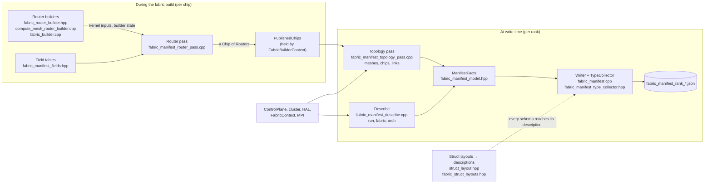

# Fabric manifest

## Purpose

When a fabric run hangs or misbehaves, the useful questions are about the routers: which ones exist and how they
connect, what each router kernel was configured with, and what each router is doing right now. Answering them takes
two things: a snapshot of each router's state, and a map that says where that state lives and how to read it. The
fabric manifest is the map.

The fabric build writes the manifest itself, from the same builder objects and compile-time arguments that configured
the routers, so it describes exactly what ran. Capture uses it to know what to read from each router, decode uses it
to turn those bytes into values, and the viewer uses it to draw the fabric.

## What it is

One JSON file per MPI rank, written at fabric init. It describes every mesh and chip in the fabric. Chips this rank
opened (its local chips) also list their routers. The top level blocks are described below.

| Block        | What it holds                                                                                                                        |
| ------------ | ------------------------------------------------------------------------------------------------------------------------------------ |
| `run`        | This process and build: host rank, MPI rank, world size, when the file was written, and the commit                                   |
| `fabric`     | The fabric settings the run asked for (`config`), and what fabric derived from them: topology, routing mode, packet sizes            |
| `arch`       | What the architecture fixes on every router core: L1 areas such as telemetry and the routing table, stream registers, core registers |
| `types`      | Every struct and enum the manifest's schemas name, with their layouts and values, so a reader can interpret bytes                    |
| `vocabulary` | Every value each label can hold, such as every channel status                                                                        |
| `meshes`     | Each mesh's shape, its chips, and each local chip's routers: their links, channels, credits, fields and L1 regions                   |

Anything in L1 or a stream register is described by its address and a **schema**, which names how to read it. A schema
is an integer width, `bytes`, `pad`, or a `struct:`/`enum:` name that `types` describes. For example, a sender channel's
`conn_info` field, and the type it names:

```json
"conn_info": {
  "category": "control_info",
  "kind": "l1",
  "address": 98528,
  "size": 64,
  "schema": "struct:EDMChannelWorkerLocationInfo",
  "cleared_by_host": false
}

"types": {
  "structs": {
    "EDMChannelWorkerLocationInfo": {
      "size": 64,
      "members": [
        { "name": "worker_semaphore_address", "offset": 0, "size": 4, "schema": "u32" },
        ...
        { "name": "worker_xy", "offset": 32, "size": 4, "schema": "struct:WorkerXY" },
        ...
```

[docs/FORMAT.md](docs/FORMAT.md) describes every block and key, and has a glossary of the terms used here.
[`fabric_manifest_schema.json`](fabric_manifest_schema.json) is the file's JSON Schema. Readers depend on its shapes and on `manifest_version`.

## Using it

Set `TT_METAL_FABRIC_GENERATE_MANIFEST=1`. Each MPI rank writes:

`<logs_dir>/generated/fabric/fabric_manifest_rank_<rank + 1>_of_<world_size>.json`

`logs_dir` is `TT_METAL_LOGS_PATH`, or the working directory when that isn't set.

- The file is written after the routers are compiled and launched, and before the host waits for router sync, so a
run that hangs during bring-up still leaves a manifest. A file on disk doesn't mean the routers reached sync.
- It's written to a temporary name and renamed into place, so a reader never sees a partial file.
- Fabric init deletes a stale manifest at that path whether or not the option is set.
- Mock clusters (`TT_METAL_MOCK_CLUSTER_DESC_PATH`) write manifests without hardware.
- When the manifest code can't describe what fabric built, fabric init fails with `Failed to write fabric manifest ...` and a message starting with `Fabric manifest:` that names what to update (see "Changing fabric" below).

## How it's built

Most of what the manifest records exists only while the fabric program is being built: the router builder objects are
destroyed once the program compiles. So the manifest is built in two phases. During the build, each router's facts are
collected and kept. At write time, those are combined with what the rest of the system knows and written out.



### The parts

**Struct layouts and descriptions** ([docs/STRUCT_LAYOUTS.md](docs/STRUCT_LAYOUTS.md)).

C++ can't list a struct's fields, so each struct the manifest describes has a hand-written layout (`fabric_struct_layouts.hpp`), checked against the real struct at compile time. The build turns each layout into a description. Every type in the manifest points to its description, which is how `types` gets written.

**Builder hooks** ([docs/BUILDER_HOOKS.md](docs/BUILDER_HOOKS.md)).

The few places fabric's builders hand facts to the manifest: each router records what it passed to `CreateKernel`, each router builder answers `collect_manifest_router`, and each chip's `FabricBuilder` publishes its routers to `PublishedChips`, which outlives the builders.

**Field tables** ([docs/FIELD_TABLES.md](docs/FIELD_TABLES.md), generated reference in [docs/FIELDS.md](docs/FIELDS.md)). Most of what a router records is a value the kernel was fed: an L1 address, a stream id, a flag. Each such field is one table entry saying which argument feeds it and how to read it. Every argument and define fed to the kernel must be read by a table or the router pass, or listed with a reason.

**Router pass** ([docs/ROUTER_PASS.md](docs/ROUTER_PASS.md)).

Runs per router during the build. It reads the field tables, and computes the facts that need logic: the router's shape, each channel's status and who services it, credits, and the edges to its sibling routers.

**Topology pass** ([docs/TOPOLOGY_PASS.md](docs/TOPOLOGY_PASS.md)).

Runs at write time. It lays out every mesh and chip, decides which chips are local, and resolves each published router's Ethernet channels into the routers they name: its key, its peer on the other end of the link, whether the link wraps or crosses hosts, and its sibling producers.

**Describe** ([docs/DESCRIBE.md](docs/DESCRIBE.md)).

Runs at write time. It describes the blocks stated once per manifest: the run, the fabric settings, the architecture, and each local mesh's credit transport.

**Writer and type collector** ([docs/WRITER.md](docs/WRITER.md)).

Turns `ManifestFacts` into the JSON. The writer is the one place that decides key names and shape. Every schema it writes passes its type to a `TypeCollector`, which follows each type to the types it names, and `types` is written from what it collected.

## How it stays correct

The manifest is only useful if it matches what ran. A few checks keep it that way, and each fails loudly rather than
writing a wrong manifest:

- **Every kernel input is accounted for.** Every named compile-time argument and define fed to a router kernel is read
by a field table or the router pass, or listed as left out with a reason. A new argument fails fabric init until it
is.
- **Layouts match their structs.** Each struct layout is checked against the struct at compile time, so adding,
resizing or moving a field fails the build until the layout follows.
- **Every schema resolves.** `types` is built from the schemas the manifest writes, so a schema can't name a type that
isn't described.
- **What the builder and the manifest each know must agree.** For example, a chip must publish exactly the routers its
builder initialized, and a sender that waits for a sibling must have a sibling edge landing on it.
- **The file is all or nothing.** It's written to a temporary name and renamed into place, and a failure fails fabric
init.

## Changing fabric

A fabric change the manifest doesn't account for fails with a message starting with `Fabric manifest:` that names what
to update:

| Change | What fails | What to edit |
| --- | --- | --- |
| New named compile-time argument | The router pass: "... is fed to the router, but neither a field table nor the router pass reads it" | A field table entry in `fabric_manifest_fields.hpp`, or an entry with a reason in `k_unrecorded_args` |
| New define | The router pass: "the define ... is fed to the router, but the router pass does not read it" | Read it in the router pass and list it in `k_router_pass_defines`, or add it to `k_unrecorded_defines` with a reason |
| Removed argument | The router pass: "missing fabric router named compile-time argument ..." | Delete its table entry. An unrecorded entry for it is not detected; delete it by hand |
| Router pass code reads a new argument | `get_named_arg`: "the router pass reads ..., which no field table reads" | Add it to `k_router_pass_args` |
| New struct in L1 | The build, when a field names a struct with no `StructLayout` | A `StructLayout<T>` in `fabric_struct_layouts.hpp` |
| New enum | The build, only when enchantum can't find its enumerators | Nothing, or an `EnumLayout<E>` in `fabric_struct_layouts.hpp` |
| New `EDMStatus` value | The build | `FABRIC_LAYOUT_EDM_STATUSES` in `fabric_struct_layouts.hpp` |
| New field category, field kind, Z port role or channel status | The schema check, on the name in `vocabulary` | Its list in `fabric_manifest_schema.json` |
| New label key (a key whose value is one of a fixed set of names) | Nothing | A list in `k_vocabulary_lists` (`fabric_manifest_model.hpp`), and the same name in the schema's `vocabulary` |
| New computed fact | Nothing | The model, the router pass or topology pass, the writer, the tests, the schema, and that pass's doc |
| A change to the JSON's shape | The schema check | `fabric_manifest_schema.json` and [docs/FORMAT.md](docs/FORMAT.md) |
| A field table or unrecorded list change | `ManifestDocs.UpToDate` | Regenerate [docs/FIELDS.md](docs/FIELDS.md) ([docs/FIELD_TABLES.md](docs/FIELD_TABLES.md) says how) |

## Testing

- `tests/scripts/run_fabric_manifest_tests.sh` runs everything that needs no fabric hardware: the device-free unit
tests, the manifest fixtures on several mock clusters (1D and 2D, Wormhole and Blackhole, one mesh split across two
ranks, torus galaxies, the tensix mux, VC2, channel trimming's capture and profile, and four Blackhole galaxies as
express meshes on four ranks), the schema check on every manifest they write, and the rank check on each run's
manifests.
- On hardware, `Fabric1DManifestFixture.*` and `Fabric2DManifestFixture.*` in `fabric_unit_tests` write and check
manifests from real devices.
- `tests/tt_metal/tt_fabric/fabric_manifest/check_manifest_schema.py` checks any manifest against the schema, and checks that `types` holds exactly what its schemas reach. It needs `jsonschema`:
  ```bash
  python3 tests/tt_metal/tt_fabric/fabric_manifest/check_manifest_schema.py generated/fabric
  ```
- `tests/tt_metal/tt_fabric/fabric_manifest/check_manifest_ranks.py` checks that one run's per-rank manifests fit
together: every chip is local in exactly one rank, and a router whose peer is on another rank's chip names a router
that rank wrote, which names it back:
  ```bash
  python3 tests/tt_metal/tt_fabric/fabric_manifest/check_manifest_ranks.py generated/fabric
  ```

## Limits and future work

**UDM isn't described.**

A UDM run (`fabric.config.udm_mode`) writes a manifest, but leaves out what UDM adds:

- The tensix mux and relay cores, and their L1.
- A receiver's path into its relay, and which routers have a relay.
- The `UDMControlFields` that follow each packet's header. `fabric.packet_header` describes the header type before them.

The VC0 worker channel's `producer` can also be wrong: it reads `"worker"` even where a tensix mux feeds the channel.

Covering UDM needs a UDM mock fixture for test coverage, the relay path as one more of a receiver's outputs (with the three UDM arguments [docs/FIELDS.md](docs/FIELDS.md) lists as not yet described becoming fields), a per-router relay flag, and the tensix mux and relay cores.
