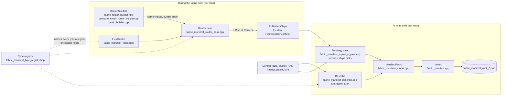

# Fabric manifest

## Purpose

When a fabric run hangs or misbehaves, the useful questions are about the routers: which ones exist and how they
connect, what each router kernel was configured with, and what each router is doing right now. Answering them takes
two things: a snapshot of each router's state, and a map that says where that state lives and what it holds. The
fabric manifest is the map.

The fabric build writes the manifest itself, from the same builder objects and compile-time arguments that configured
the routers, so it describes exactly what ran.

## Where it fits

The manifest is the first stage of the fabric visualizer's pipeline. Each later stage reads it:

| Stage      | Runs                            | What it takes from the manifest                                                                                     |
| ---------- | ------------------------------- | ------------------------------------------------------------------------------------------------------------------- |
| Manifest   | Once per rank, at fabric init   | Nothing: it writes the manifest from the builders                                                                   |
| Capture    | Once per rank, on the rank's host | Which cores to read (each router's chip and Ethernet channel), the L1 range on each, and the address of every register it reads |
| Decode     | Once per rank, on the run's build | Each L1 region's and stream register's type name, which it maps back to the C++ type, and the facts it reads values against: channels, credits, fields |
| Join       | Once per run                    | Each router's path and its link peer, which may be on another rank's chip                                           |
| Visualizer | Once per run                    | The meshes, chips and routers, and each router's channels, fields and L1 regions                                    |

Capture reads bytes and interprets nothing. Decode turns them into values using the manifest, and runs on the same
build as the run, so a name the manifest writes is a type decode has.

## What it is

One JSON file per MPI rank, written at fabric init. It describes every mesh and chip in the fabric. Chips this rank
opened (its local chips) also list their routers. The top level blocks are described below.

| Block        | What it holds                                                                                                             |
| ------------ | ------------------------------------------------------------------------------------------------------------------------- |
| `run`        | This process and build: host name, MPI rank, world size, when the file was written, and the commit                        |
| `fabric`     | The fabric settings the run asked for (`config`), and what fabric derived from them: topology, routing mode, packet header type, packet sizes |
| `arch`       | What the architecture fixes on every router core: its L1 range, L1 areas such as telemetry and the routing table, and core registers |
| `vocabulary` | Every value each label can hold, such as every channel status                                                             |
| `meshes`     | Each mesh's shape, its chips, and each local chip's routers: their links, channels, credits, fields and L1 regions        |

State on a router core is described by where its bytes are and the C++ type they hold, named by the type registry.

An **L1 region** is `num_elements` elements of `type`, `element_size` bytes apart from `address`. Each element holds a
`type` in its first `sizeof(T)`bytes. The rest of the element, if any, isn't typed, and is left as raw bytes. For
example, a sender channel's `conn_info` field is one struct:

```json
"conn_info": {
  "category": "control_info",
  "kind": "l1",
  "address": 98528,
  "num_elements": 1,
  "element_size": 64,
  "type": "EDMChannelWorkerLocationInfo"
}
```

and its ring buffer is fourteen slots, each starting with the run's packet header:

```json
"ring_buffer": { "address": 100256, "num_elements": 14, "element_size": 4448, "type": "HybridMeshPacketHeaderT<36>" }
```

A **stream register** is a word at `address`, whose low `value_bits` bits hold a `type`:

```json
"free_slots": {
  "category": "flow_control",
  "kind": "stream_reg",
  "stream_id": 15,
  "address": 4290048256,
  "value_bits": 17,
  "type": "unsigned int"
}
```

A type name is the C++ type's name without its namespaces, as the build spells it. The manifest doesn't describe a
type's members: decode gets the type back from its name and reads the bytes into it.

[docs/FORMAT.md](docs/FORMAT.md) describes every block and key, and has a glossary of the terms used here.
[`fabric_manifest_schema.json`](fabric_manifest_schema.json) is the file's JSON Schema. Readers depend on its shapes and
on `manifest_version`.

## Using it

Set `TT_METAL_FABRIC_GENERATE_MANIFEST=1`. Each MPI rank writes:

`<logs_dir>/generated/fabric/runs/<run_id>/fabric_manifest_rank_<rank + 1>_of_<world_size>.json`

Each fabric init is a run with its own folder. Rank 0 makes the run id, the UTC time and 8 random hex digits such as
`20261105T221500Z-1a2b3c4d`, and broadcasts it to the fabric's other ranks, so a run's manifests share one folder name
on every host. Run ids sort by time, so the newest run is the last folder by name. Old runs' folders stay until the
user removes them.

The rank and size are the whole job's (`MPI_COMM_WORLD`), even when tt-run splits the job into sub-contexts, so every
rank's file has its own name.

`logs_dir` is `TT_METAL_LOGS_PATH`, or the working directory when that isn't set.

- The file is written after the routers are compiled and launched, and before the host waits for router sync, so a
run that hangs during bring-up still leaves a manifest. A file on disk doesn't mean the routers reached sync.
- It's written to a temporary name and renamed into place, so a reader never sees a partial file.
- Mock clusters (`TT_METAL_MOCK_CLUSTER_DESC_PATH`) write manifests without hardware.
- When the manifest code can't describe what fabric built, fabric init fails with `Failed to write fabric manifest ...`
  and a message starting with `Fabric manifest:` that names what to update (see "Changing fabric" below).

## How it's built

Most of what the manifest records exists only while the fabric program is being built: the router builder objects are
destroyed once the program compiles. So the manifest is built in two phases. During the build, each router's facts are
collected and kept. At write time, those are combined with what the rest of the system knows and written out.



### The parts

**Type registry** ([docs/TYPE_REGISTRY.md](docs/TYPE_REGISTRY.md)).

The list of every type decode reads out of captured bytes, from L1 or a stream register, and the one name each goes by.
An L1 region or stream register can only be made for a registered type, so the manifest can't name a type decode doesn't
have. Configuration values the kernel is given, such as its direction, aren't captured bytes, so their enums aren't
registered: the manifest writes the value and its enumerator's name.

**Builder hooks** ([docs/BUILDER_HOOKS.md](docs/BUILDER_HOOKS.md)).

The few places fabric's builders hand facts to the manifest: each router records what it passed to `CreateKernel`, each
router builder answers `collect_manifest_router`, and each chip's `FabricBuilder` publishes its routers to
`PublishedChips`, which outlives the builders.

**Field tables** ([docs/FIELD_TABLES.md](docs/FIELD_TABLES.md), generated reference in
[docs/FIELDS.md](docs/FIELDS.md)).

Most of what a router records is a value the kernel was fed: an L1 address, a stream id, a flag. Each such field is one
table entry saying which argument feeds it and what it holds: an L1 region's type, a stream register and its type, or a
number, flag or enum. Every argument and define fed to the kernel must be read by a table or the router pass, or listed
with a reason.

**Router pass** ([docs/ROUTER_PASS.md](docs/ROUTER_PASS.md)).

Runs per router during the build. It reads the field tables, turning each entry into a region, a stream register's
address from the HAL, or a value, and computes the facts that need logic: the router's shape, each channel's status and
who services it, its ring buffers, credits, and the edges to its sibling routers.

**Topology pass** ([docs/TOPOLOGY_PASS.md](docs/TOPOLOGY_PASS.md)).

Runs at write time. It lays out every mesh and chip, decides which chips are local, and resolves each published router's
Ethernet channels into the routers they name: its key, its peer on the other end of the link, whether the link wraps or
crosses hosts, and its sibling producers.

**Describe** ([docs/DESCRIBE.md](docs/DESCRIBE.md)).

Runs at write time. It describes the blocks stated once per manifest: the run, the fabric settings and the run's packet
header type, the architecture's L1 areas and core registers, and each local mesh's credit transport.

**Writer** ([docs/WRITER.md](docs/WRITER.md)).

Turns `ManifestFacts` into the JSON. The writer is the one place that decides key names and shape. It writes each region
and register as it is, with its type's name; it computes nothing.

## How it stays correct

The manifest is only useful if it matches what ran. A few checks keep it that way, and each fails loudly rather than
writing a wrong manifest:

- **Every kernel input is accounted for.** Every named compile-time argument and define fed to a router kernel is read
by a field table or the router pass, or listed as left out with a reason. A new argument fails fabric init until it
is.
- **Every type the manifest names is one decode can read.** Regions and stream registers are made only for registered
types, so naming any other type fails the build. The registry also checks at compile time that every name is
distinct, that each type can be rebuilt from its bytes, that every packet header type fabric can pick is registered,
and that a stream register's type fits in its word.
- **A chip publishes every router its builder initialized**, so a manifest never silently misses a router.
- **The file is all or nothing.** It's written to a temporary name and renamed into place, and a failure fails fabric
init.

## Changing fabric

A fabric change the manifest doesn't account for fails with a message starting with `Fabric manifest:`, or the build
fails, naming what to update:

| Change | What fails | What to edit |
| --- | --- | --- |
| New named compile-time argument | The router pass: "... is fed to the router, but neither a field table nor the router pass reads it" | A field table entry in `fabric_manifest_fields.hpp`, or an entry with a reason in `k_unrecorded_args` |
| New define | The router pass: "the define ... is fed to the router, but the router pass does not read it" | Read it in the router pass and list it in `k_router_pass_defines`, or add it to `k_unrecorded_defines` with a reason |
| Removed argument | `RouterArgs`: "... reads ..., but ERISC<n> wasn't given it" | Delete its table entry. An unrecorded entry for it is not detected; delete it by hand |
| Router pass code reads a new argument | `RouterArgs`: "... reads ..., which no field table reads and k_router_pass_args does not list" | Add it to `k_router_pass_args` |
| A new type in L1 or a stream register | The build: "The manifest names only registered types" | Add it to `RegisteredTypes` in `fabric_manifest_type_registry.hpp` |
| A new packet header template | The build: "A packet header type fabric can pick isn't in PacketHeaderTypes" | `PacketHeaderTypes` in `fabric_manifest_type_registry.hpp` |
| A registered template whose argument equals its default | The build: "A registered type's name lost a template argument that equals its default" | A `manifest_type_name` specialization next to the existing two |
| Two registered types with one name in different namespaces | The build: "Two registered types have the same name without their namespaces" | A `manifest_type_name` specialization for one of them |
| New field category, field kind, Z port role or channel status | The schema check, on the name in `vocabulary` | Its list in `fabric_manifest_schema.json` |
| New label key (a key whose value is one of a fixed set of names) | Nothing | A list in `k_vocabulary_lists` (`fabric_manifest_model.hpp`), and the same name in the schema's `vocabulary` |
| New computed fact | Nothing | The model, the router pass or topology pass, the writer, the tests, the schema, and that pass's doc |
| A change to the JSON's shape | The schema check | `fabric_manifest_schema.json` and [docs/FORMAT.md](docs/FORMAT.md) |
| A field table or unrecorded list change | `ManifestDocs.UpToDate` | Regenerate [docs/FIELDS.md](docs/FIELDS.md) ([docs/FIELD_TABLES.md](docs/FIELD_TABLES.md) says how) |

## Testing

- `tests/scripts/run_fabric_manifest_tests.sh` runs everything that needs no fabric hardware: the device-free unit
tests, the manifest fixtures on several mock clusters (1D and 2D, Wormhole and Blackhole, one mesh split across two
ranks, torus galaxies, the tensix mux, VC2, channel trimming's capture and profile, and four Blackhole galaxies as
express meshes on four ranks), the schema check on every manifest they write, and the rank check on each run's
manifests.
- The manifest fixtures (`Manifest*Fixture` in `fabric_unit_tests`) are named outside hardware CI's fabric filters, so
CI runs them only on mock clusters. On hardware they run by name, for example
`fabric_unit_tests --gtest_filter='Manifest2DFixture.*'`.
- `tests/tt_metal/tt_fabric/fabric_manifest/check_manifest_schema.py` checks any manifest against the schema. It needs
  `jsonschema`:
  ```bash
  python3 tests/tt_metal/tt_fabric/fabric_manifest/check_manifest_schema.py generated/fabric
  ```
- `tests/tt_metal/tt_fabric/fabric_manifest/check_manifest_ranks.py` checks that one run's per-rank manifests fit
together: every chip is local in exactly one rank, and a router whose peer is on another rank's chip names a router
that rank wrote, which names it back:
  ```bash
  python3 tests/tt_metal/tt_fabric/fabric_manifest/check_manifest_ranks.py generated/fabric
  ```

## Limits and future work

**Only the manifest is built.**

Capture, decode, join and the visualizer are designed around the manifest but not built yet. "Where it fits" above
says what each takes from it.

**UDM isn't described.**

A UDM run (`fabric.config.udm_mode`) writes a manifest, but leaves out what UDM adds:

- The tensix mux and relay cores, and their L1.
- A receiver's path into its relay, and which routers have a relay.
- The `UDMControlFields` that follow each packet's header. `fabric.packet_header` names the header type before them.

The VC0 worker channel's `producer` can also be wrong: it reads `"worker"` even where a tensix mux feeds the channel.

Covering UDM needs a UDM mock fixture for test coverage, the relay path as one more of a receiver's outputs (with the
three UDM arguments [docs/FIELDS.md](docs/FIELDS.md) lists as not yet described becoming fields), a per-router relay
flag, and the tensix mux and relay cores.
