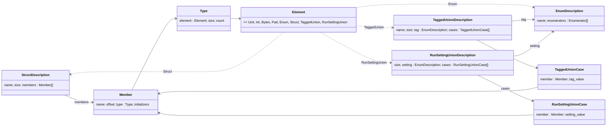

# Struct layouts

Fabric keeps some state and types in each router's L1, such as routing tables, telemetry, handshake info, channel bookkeeping, etc. To actually interpret that information, the decode-tool needs to read the raw bytes and know what they mean (which bytes correlate to which field, what type each field is, and which bytes mean nothing at all).

C++ can't tell us that on its own. It has no way to list a struct's fields. So every struct the manifest describes gets a hand-written **layout**: a list of its members, built with a few macros, that says where each member sits and how to read it. The struct-specific layouts live in [fabric_struct_layouts.hpp](../fabric_struct_layouts.hpp), and the macros and checks they're built from live in [struct_layout.hpp](../struct_layout.hpp).

A key point is that a hand-written description of a struct is only useful if it stays true. Device structs can change
often as development occurs, including fields being added, resized, or carved out of padding. To catch drift between
a struct and its layout, every layout is checked against its struct at compile time, and a layout that no longer matches
fails the build. Most of this doc is about how those checks work, and why the macros are shaped the way they are to make
the checks possible.

## Layouts and descriptions

There are two levels. A **layout** is what you write, one per type. From each layout the build makes a
**description**, one constant per type, which is what everything downstream reads. Together they make a small type
system, which follows four rules:

1. **You write a layout, and the library builds the description.** A description is never constructed by hand.
2. **A description is keyed on what identifies the thing it describes**: its type, or, for an anonymous union, which

   has no type, its list of cases. So there's exactly one description per thing we want to represent, at a stable address.
3. **An element points to a description and never copies it.** From any type, following elements reaches everything

   needed to read its bytes, down to primitives.
4. **Every layout is checked against its C++ type at compile time**, so a layout that drifts from its type fails the

   build. A struct is checked by `check_struct_layout`, a tagged union by `validate_tagged_union_cases`, and a
    run-setting union when its description is built.

The descriptions each layout produces:

| You write | The build makes | It holds |
| --- | --- | --- |
| `StructLayout<T>`, with an array named `members` | `struct_description<T>`, a `StructDescription` | The struct's name, its size, and its members |
| `TaggedUnionLayout<U>`, with its `Tag` enum and an array named `cases` | `tagged_union_description<U>`, a `TaggedUnionDescription` | The union's name, its size, its tag enum's description, and its cases |
| Nothing, for most enums (`EnumLayout<E>` only when enchantum can't list them; see special cases) | `enum_description<E>`, an `EnumDescription` | The enum's name, and every enumerator's name and value |
| An array of a run-setting union's cases, in the enclosing struct's `StructLayout` | `run_setting_union_description<Setting, cases>`, a `RunSettingUnionDescription` | The union's size, its setting enum's description, and its cases. No name: the union is anonymous |

A description doesn't copy its layout: a struct's description views the layout's `members` array, and a union's views
its `cases`. Its name is the type's name, or the name its layout sets for a type enchantum can't name, such as a class
template instance (`template_name` in `struct_layout_helpers.hpp`). That name is what the manifest's schemas use.

### The hierarchy

A struct's description holds its members. Each member has a type, each type has an element, and an element of an enum,
a struct or a union points to that type's description (recursive in a sense):



The same structure as a tree:

```
StructDescription                    struct_description<T>
├── name, size
└── members[]: Member
    ├── name, offset
    └── type: Type
        ├── size, count
        └── element: Element
            ├── Uint, Int, Bytes, Pad     read as they are; nothing to follow
            ├── Enum         ──► EnumDescription
            ├── Struct       ──► StructDescription
            ├── TaggedUnion  ──► TaggedUnionDescription, and the name of the member holding the tag
            └── RunSettingUnion ──► RunSettingUnionDescription

EnumDescription                      enum_description<E>
├── name
└── enumerators[]: Enumerator {name, value}

TaggedUnionDescription               tagged_union_description<U>
├── name, size
├── tag ──► EnumDescription
└── cases[]: TaggedUnionCase
    ├── member: Member               like a struct's members
    └── tag_value                    the enumerator that picks it

RunSettingUnionDescription           run_setting_union_description<Setting, cases>
├── size                             its widest case's
├── setting ──► EnumDescription
└── cases[]: RunSettingUnionCase
    ├── member: Member               a member of the enclosing struct, through the anonymous union
    └── setting_value                the enumerator that picks it
```

So from any type, following the arrows reaches everything needed to read its bytes, down to integers. With the example
types used throughout this doc (defined under the macros below), `Shape`'s description reaches `Kind`, `Geometry` and
`Point`:

```
struct_description<Shape>                  "Shape", 12 bytes
└── members
    ├── kind      offset 0, Enum ──►        enum_description<Kind>: "Kind", DOT = 0, LINE = 1
    └── geometry  offset 4, TaggedUnion ──► tagged_union_description<Geometry>: "Geometry", 8 bytes
                  (tag member "kind")       ├── tag ──► enum_description<Kind>
                                            └── cases
                                                ├── DOT:  dot, Struct ──► struct_description<Point>: "Point", 4 bytes
                                                │                         └── x (Uint, 2 bytes), y (Uint, 2 bytes)
                                                └── LINE: line, Uint, 8 bytes, 2 of them
```

### A member

Each entry in a layout's `members` is a `Member`:

| Part | Meaning |
| --- | --- |
| `name` | The field's name |
| `offset` | Where the field starts, in bytes from the start of the struct |
| `type` | How to read the bytes: an **element** kind, the total `size` in bytes, and a `count` (0 for a single value, N for an array of N) |
| `initializers` | Bookkeeping for the compile-time checks, explained below. Decode doesn't use it |

The element kinds are what decode needs to know to read a value:

| Element           | Read as                                                                                                                                                                                                                                                          |
| ----------------- | ---------------------------------------------------------------------------------------------------------------------------------------------------------------------------------------------------------------------------------------------------------------- |
| `Uint`, `Int`     | An unsigned or signed integer, as wide as one element                                                                                                                                                                                                            |
| `Enum`            | An enum. It points to the enum's description, so decode can show the enumerator's name                                                                                                                                                                           |
| `Struct`          | Another described struct. It points to that struct's description, and is read with its members                                                                                                                                                                   |
| `TaggedUnion`     | A union whose live member is picked by another field. It points to the union's description, and names the enclosing struct's member holding the tag (see tagged unions below)                                                                                    |
| `RunSettingUnion` | An anonymous union whose member is chosen by a setting fixed by the run (ie. for routing tables, the routing mode). It points to the union's description. The manifest writes the member the run picks, so decode never reads one (see run-setting unions below) |
| `Bytes`           | Raw bytes that decode keeps as they are, for code that knows how to read them                                                                                                                                                                                    |
| `Pad`             | Bytes that mean nothing. Decode skips them                                                                                                                                                                                                                       |

Nobody writes these entries by hand. The macros below build them from the struct itself, using `offsetof`, `sizeof` and
the field's declared type, so the offsets and sizes can't drift from the real struct, and each element's description
pointer is filled in from the field's type.

## The macros

The examples use the same types as the comments in the code:

```cpp
enum class Kind : uint32_t { DOT, LINE };

struct Point {          // 4 bytes
    uint16_t x;
    uint16_t y;
};

union Geometry {        // 8 bytes
    Point dot;          // holds the bytes when Shape::kind is DOT
    uint32_t line[2];   // holds the bytes when Shape::kind is LINE
};

struct Shape {          // 12 bytes
    Kind kind;          // offset 0: says which of geometry's members holds its bytes
    Geometry geometry;  // offset 4
};

enum class Dims : uint8_t { ONE_D, TWO_D };  // a setting fixed for the whole run

struct Marker {         // 8 bytes
    uint32_t id;        // offset 0
    union {             // offset 4, 4 bytes: anonymous, so its members are Marker's own
        uint16_t x;     // holds the bytes when the run's Dims is ONE_D
        Point point;    // holds the bytes when the run's Dims is TWO_D
    };
};
```

### `LAYOUT_MEMBER`: an ordinary field

Most fields are integers, enums, other described structs, or one-dimensional arrays of those. `LAYOUT_MEMBER(T, field)`
covers all of them. It works out the element kind from the field's type:

```cpp
template <>
struct StructLayout<Point> {
    static constexpr std::array members = {
        LAYOUT_MEMBER(Point, x),  // {name: "x", offset: 0, type: {element: Uint, size: 2, count: 0}}
        LAYOUT_MEMBER(Point, y),  // {name: "y", offset: 2, type: {element: Uint, size: 2, count: 0}}
    };
};
```

A field whose type is another struct needs that struct to be described first, since its element points to that struct's
description. If `Point` had no `StructLayout`, any layout listing a `Point` field would fail to compile, which is how a
missing layout gets noticed. A field whose type is an enum needs nothing more: its element points to the enum's
description, which the build makes on its own.

`LAYOUT_MEMBER` is also how you list padding the struct explicitly declares itself, ie.

```cpp
// Actual struct
struct StructWithExplicitPadding {
    uint32_t a;
    char b;
    uint8_t padding[3]; // Padding!
}

// Struct layout
template <>
struct StructLayout<StructWithExplicitPadding> {
    static constexpr std::array members = {
        LAYOUT_MEMBER(StructWithExplicitPadding, a),
        LAYOUT_MEMBER(StructWithExplicitPadding, b),
        LAYOUT_MEMBER(StructWithExplicitPadding, padding), // explicit padding is listed as a normal member
    };
};
```

### `LAYOUT_BYTES`: bytes decode reads by its own rules

Some fields can't be read from a layout alone. Their shape depends on values that are only known at run time, or their
entries are packed below byte boundaries. The routing table's direction tables are a good example: each holds hundreds
of 3-bit direction codes packed back to back.

`LAYOUT_BYTES(T, field)` still accounts for every byte of the field, but marks it as raw. Decode keeps those bytes as
they are and hands them to code written for that table, which knows the rule for reading it. Use it when a field means
something but can't be described with the other macros.

### `LAYOUT_PAD` and `LAYOUT_TAIL_PAD`: padding the compiler adds

The compiler inserts padding to keep fields aligned, and that padding has no field to name. We need to describe this padding though so that our size checks will still work out (no false-errors that think a layout missed a field due to compiler-inserted padding not being accounted for). The two macros describe it by computing the range from the fields around it:

```cpp
struct T { uint8_t a; uint32_t b; };      // 3 bytes of padding after a
LAYOUT_PAD(T, a, b)                        // {name: "padding_after_a", offset: 1, type: {element: Pad, size: 3}}

struct T { uint32_t word; uint8_t byte; }; // 3 bytes of padding after byte, at the end
LAYOUT_TAIL_PAD(T, byte)                   // {name: "tail_padding", offset: 5, type: {element: Pad, size: 3}}
```

Both are sized from `offsetof` and `sizeof`, so nothing is counted by hand.

### `LAYOUT_TAGGED_UNION`: a union picked by another field

A union's bytes can mean different things. In `Shape`, `geometry` holds a `Point` when `kind` is `DOT` and two words when
it's `LINE`. Nothing inside the union says which, so a layout can't describe it as an ordinary member. The answer lives
in another field of the enclosing struct, its **tag**.

Describing a tagged union takes two pieces:

**1. The union's own layout**, `TaggedUnionLayout<Geometry>`. It names the enum the tag holds, and has one **case** per
enumerator, saying which member that enumerator picks:

```cpp
template <>
struct TaggedUnionLayout<Geometry> {
    using Tag = Kind;
    static constexpr std::array cases = {
        LAYOUT_TAGGED_UNION_CASE(Geometry, dot, Kind::DOT),
        LAYOUT_TAGGED_UNION_CASE(Geometry, line, Kind::LINE),
    };
};
```

**2. The enclosing struct's entry**, which says where the union is and which field holds its tag:

```cpp
template <>
struct StructLayout<Shape> {
    static constexpr std::array members = {
        LAYOUT_MEMBER(Shape, kind),
        LAYOUT_TAGGED_UNION(Shape, geometry, kind),  // {element: TaggedUnion{Geometry, "kind"}, size: 8}
    };
};
```

They're split because they describe different things. The union's layout describes the union type: its members and
what picks them. From it the build makes `Geometry`'s description, which holds its cases and points to `Kind`'s
description as its tag. It can't know where its tag is, because a union can't contain its own tag. The struct's entry
fills that in: its element points to `Geometry`'s description and names `kind` as the member holding the tag.
`LAYOUT_TAGGED_UNION` also checks at compile time that the tag field really holds the union's `Tag` enum.

A real use of this is packet headers: the NOC command fields are a union picked by the header's send type, and every
packet in a buffer can have a different one.

A union that nothing tags can't be listed this way. Listing it with `LAYOUT_MEMBER` fails to compile, with a message
pointing at `LAYOUT_TAGGED_UNION`, or `LAYOUT_BYTES` when nothing tags it.

### `LAYOUT_RUN_SETTING_UNION`: a union picked by a run setting

Some unions aren't picked by a field at all. In `Marker`, the union holds `x` in a 1D run and `point` in a 2D run. The
run's `Dims` picks the member, and it's the same for every value the run writes. The routing table is the real case:
its route table holds the 1D path table or the 2D route table, depending on the run's routing mode.

Since the setting is fixed for the run, and the manifest knows it when it writes, the manifest writes the member the run
picks, under that member's name. Decode never sees the union as two members, just the chosen representation.

Such a union is usually anonymous, as `Marker`'s is, so it has no type to give a layout of its own. Instead the
enclosing struct's layout lists its **cases**, one per setting value, in the order the union declares its members, and
then the union itself:

```cpp
template <>
struct StructLayout<Marker> {
    static constexpr std::array position_cases = {
        LAYOUT_RUN_SETTING_UNION_CASE(Marker, x, Dims::ONE_D),
        LAYOUT_RUN_SETTING_UNION_CASE(Marker, point, Dims::TWO_D),
    };
    static constexpr std::array members = {
        LAYOUT_MEMBER(Marker, id),
        LAYOUT_RUN_SETTING_UNION(Dims, position_cases),  // {name: "", element: RunSettingUnion{...}, size: 4}
    };
};
```

An anonymous union's members belong to the enclosing struct, so each case names one directly (`Marker::point`), and
the macros read its offset and size from it as `LAYOUT_MEMBER` does. `LAYOUT_RUN_SETTING_UNION` builds the union's
description, `run_setting_union_description<Dims, position_cases>`, keyed on the case list, since there's no union type
to key it on. Building it checks the cases. The member it makes has no name, since C++ gives the union none, and is as
big as the widest case.

## Padding

There are three kinds of padding, and each is listed differently:

| Padding | Example | Listed with | Backed by a field? |
| --- | --- | --- | --- |
| Declared by the struct | `uint8_t padding0[12]` in `RouterStateManager` | `LAYOUT_MEMBER` | Yes |
| Inserted by the compiler between fields | `uint8_t a; uint32_t b;` (3 bytes after `a`) | `LAYOUT_PAD(T, a, b)` | No |
| Inserted by the compiler after the last field | `uint32_t word; uint8_t byte;` (3 bytes at the end) | `LAYOUT_TAIL_PAD(T, byte)` | No |

**Padding the struct declares is a real field**, so it's listed like one. That matters when the struct changes. If
someone turns part of `padding0[12]` into a real field, `padding0` moves or shrinks, the layout no longer lines up, and
the build fails until the new field is described. Had `padding0` been listed as anonymous padding, the new field would
have disappeared into it unnoticed. Decode shows declared padding like any other array, which also makes it visible if
firmware ever writes into it.

**Padding the compiler inserts has to be listed too**, because the checks account for every byte of the struct. Since
there's no field to name, `LAYOUT_PAD` and `LAYOUT_TAIL_PAD` compute the range from the neighbouring fields. Decode skips those bytes.

Compiler padding is where a new field could hide, so it gets extra care in the checks below.

## Keeping layouts in step with their structs

Ideally, we'd walk the struct's real fields and the layout's members side by side and check that they match one for
one. C++'s lack of reflexivity makes this a little challenging, but the idea boils down to two rules:

1. **Every member the layout lists is a real field, at its real offset and size, in order, and together they cover**

   **every byte of the struct exactly once.**
2. **Every real field of the struct is listed.**

C++ can't list a struct's fields, so neither rule can be checked by walking the fields directly. Instead, each layout
is followed by `static_assert(check_struct_layout<T>())`, which runs the following checks that together give the same result:
coverage for rule 1, and a field count for rule 2. Tagged and run-setting unions each get a check of their own.

### Coverage: rule 1

The macros read each member's offset and size from the struct by name, so a listed member always matches its real
field. On top of that, the **coverage check** walks the members in order and requires each one to start where the
previous one ended, the first at 0 and the last ending at `sizeof(T)`.

That catches most changes: a field added between listed fields leaves a gap, a field added at the end makes the struct
longer, and a resized or reordered field shifts the ones after it.

Its blind spot is padding. If a field is added inside bytes the layout lists as compiler padding, the padding entry
still covers the same range, and nothing looks wrong. That's what the next check is for.

### Field count: rule 2

If someone adds a field to the struct, the struct now has one more field than the layout lists. So the second check
counts the struct's fields and compares that with the layout. C++ has no direct way to count fields either, but two
language features can be used to count them, and which one applies depends on whether the struct is an **aggregate**:
a plain struct with no constructors, no private fields and no virtual functions.

| Struct | How its fields are counted |
| --- | --- |
| Aggregate | Initializer count |
| Not an aggregate, and its layout lists compiler padding | Structured bindings |
| Not an aggregate, and its layout lists no compiler padding | Not counted: coverage already proves every field is listed (see below) |

#### Aggregates: the initializer count

For a plain struct, C++ lets you brace-initialize the fields in order: `T{a, b, c}`. If you supply more values than the
struct has fields, it doesn't compile. So the largest number of values `T{...}` accepts is a count of its fields, and
the compiler can find it for us. `initializer_count<T>` does exactly that, by trying different numbers of values at
compile time and searching for the largest one that compiles.

One wrinkle: for a C array field, the elements can be filled one by one without braces of their own, so
`uint8_t padding0[12]` takes 12 values. Each layout entry records how many values its field takes in `initializers`:
the array's length for a C array, 1 for anything else, and 0 for compiler padding, since no field backs it.

The check then requires the layout's total to equal the struct's count. If someone adds a field anywhere, including
inside compiler padding, the struct's count goes up and the layout's doesn't:

```cpp
struct T { uint8_t a; uint8_t flags; uint32_t b; };  // flags was added inside a's padding

LAYOUT_MEMBER(T, a)    // 1
LAYOUT_PAD(T, a, b)    // 0, and still bytes 1 to 3, so coverage passes
LAYOUT_MEMBER(T, b)    // 1
// The layout accounts for 2 values, the struct takes 3: the build fails.
```

The fix is to list `flags`. The padding entry then shrinks to the bytes after `flags`, and both sides count 3.

Two things take one value however many members a layout lists for them: a base class, and an anonymous union. The
packet headers have both. They get `command_fields`, `payload_size_bytes`, `noc_send_type` and `src_ch_id` from
`PacketHeaderBase`, and the 2D header has two anonymous unions. They're still aggregates, since they declare no
constructor of their own, so they're counted. Their layouts mark each such group with `filled_by_one_initializer`
(`struct_layout_helpers.hpp`), which gives the group's first member the one value and the rest none:

```cpp
filled_by_one_initializer(std::array{
    LAYOUT_TAGGED_UNION(H, command_fields, noc_send_type),  // 1
    LAYOUT_MEMBER(H, payload_size_bytes),                   // 0
    LAYOUT_MEMBER(H, noc_send_type),                        // 0
    LAYOUT_MEMBER(H, src_ch_id),                            // 0
})
```

A field added to the header itself still raises its count. A field added to `PacketHeaderBase` doesn't, since the base
is still one value, but the base has no compiler padding, so the new field shifts the header's own fields and coverage
catches it.

#### Structs with constructors: structured bindings

For a struct with a constructor, `T{...}` calls the constructor, which says nothing about the fields, so the
initializer count doesn't work. Structured bindings do: `auto& [a, b, c] = t;` compiles only if `T` has exactly three
fields, whatever constructors it has.

So for these structs, the check binds the struct with as many names as the layout lists fields. Every listed member
counts as one name, a C array included, and compiler padding doesn't count. The binding is compiled but never run. Take
a NOC command header, which has a constructor and three bytes of padding after its last field:

```cpp
struct NocUnicastAtomicIncCommandHeader {
    NocUnicastAtomicIncCommandHeader(uint64_t noc_address, uint32_t val, bool flush = true);
    uint64_t noc_address;  // offset 0
    uint32_t val;          // offset 8
    bool flush;            // offset 12, then 3 bytes of compiler padding (not listed)
};

LAYOUT_MEMBER(T, noc_address)  // a field
LAYOUT_MEMBER(T, val)          // a field
LAYOUT_MEMBER(T, flush)        // a field
LAYOUT_TAIL_PAD(T, flush)      // not a field
// The layout lists 3 fields, so the check compiles: auto& [f0, f1, f2] = t;
```

If someone adds `uint8_t mode;` after `flush`, inside the padding, the struct has 4 fields, and the binding fails:
"type decomposes into 4 elements, but only 3 names were provided".

C++20 can't build a binding's list of names from a number, so the helper has one line per field count (`auto& [f0]`,
`auto& [f0, f1]`, and so on, up to a fixed maximum), and compiles only the line for the count it's given.

Structured bindings have their own requirements: every field has to be public and declared directly in the struct, so
none inherited from a base class, and there can be no anonymous union members. A struct that breaks them can't be bound
at all, and the build fails, so it can't pass by accident.

#### Why some structs aren't counted

A struct with a constructor whose layout lists no compiler padding needs no count. Every byte is covered by a real
field, so a new field has nowhere to hide: it has to shift later fields or grow the struct, and coverage catches
either. The NOC scatter command header is one: it has constructors and no compiler padding.

### Tagged unions

Each `TaggedUnionLayout` has its own check, `validate_tagged_union_cases`. It requires every case's member to start at
0, the widest member to fill the union, and every enumerator of the tag to pick exactly one case. A member can be picked
by several enumerators, but an enumerator can't pick two members, since decode then couldn't tell which one holds the
bytes. If someone adds an enumerator to the tag enum, the check fails until a case says what it picks.

### Run-setting unions

A run-setting union's check, `validate_run_setting_union_cases`, runs when its description is built, so a layout can't
leave it out. It requires every case to start where the union does, and every enumerator of the setting to pick
exactly one case. If someone adds an enumerator to the setting, the check fails until a case says what it picks.

The union's size is its widest case's. The enclosing struct's coverage check then confirms that size fills the gap
between the members around the union, so a case too small or too big shows up there.

### When a check fails

All the struct checks live in one function, `find_layout_error<T>`, which returns which check failed:

| Error | Meaning |
| --- | --- |
| `COVERAGE` | The layout leaves a gap, overlaps, or doesn't end at `sizeof(T)` |
| `UNLISTED_FIELD` | The struct is an aggregate with a field the layout doesn't list |

`check_struct_layout<T>` turns each error into a `static_assert` with its own message, and the compiler's note names the
struct. The tests call `find_layout_error` directly, which lets them check for a specific error.

The structured binding count for structs with constructors fails differently: the binding itself doesn't compile, and
the compiler's error says how many fields the struct has and how many the layout lists.

What catches each kind of change:

| Change to the struct | Caught by |
| --- | --- |
| Field added between listed fields | Coverage (and the count) |
| Field added at the end | Coverage (and the count) |
| Field added inside compiler padding | The field count (initializer count, or structured bindings for a struct with constructors) |
| Field carved out of declared padding | Coverage |
| Declared padding renamed to a real field | The layout no longer compiles |
| Field resized or fields reordered | Coverage |

## Special cases

**A struct with constructors that can't be bound can't list compiler padding.** Structs with constructors are counted
with structured bindings, which need public fields declared directly in the struct and no anonymous unions. A struct
that misses those and also has compiler padding can't be checked for a field hidden in the padding, and its layout
fails to build. The options are to declare the gap as a named field of the struct (listed with `LAYOUT_MEMBER`), or to
move the fields so there's no gap. Declaring padding can change the code the compiler generates for the struct, so
check the kernels that use it.

**An anonymous union counts as one value.** When the count reaches an anonymous union, one value fills the whole union.
A layout lists the union by the members that span it. If that's a single member that isn't a C array, it already counts
as one. Otherwise, wrap the members in `filled_by_one_initializer`, as the 2D packet header does for its chip and mesh
ids and for `mcast_params`. A named union field is always one value. A run-setting union counts as many values as its
first case, the member the union declares first, which is why its cases are listed in declaration order. If they
aren't, the field count catches it when the first case takes a different count.

**An enum enchantum can't reflect needs an** `EnumLayout`**.** An enum's description gets its enumerators from enchantum,
which finds them by scanning a range of values. An enum with values far outside that range, such as `EDMStatus`,
specializes `EnumLayout<E>` with an array named `enumerators`, and its description lists those instead. If enchantum
finds no enumerators at all and there's no `EnumLayout`, the build fails. The specialization goes beside the struct
layouts, so it's visible wherever the enum's description is used.

**Bitfields would confuse the initializer count.** Two bitfields sharing a byte count as two values, but a layout can
only describe the byte as a whole. None of the described aggregates has bitfields. If one ever does, its layout needs
to state its count explicitly.

## From layout to decoded value

Layouts are one piece of a longer path that ends with readable values:

```
layouts  ──►  descriptions  ──►  manifest  ──►  capture  ──►  decode
(written)     (compile time)     (types)        (raw bytes)     (values)
```

1. **The build** turns each layout into its description, as above.
2. **The manifest** starts from every type its schemas name. It follows each element to its description, and from there

   to the types that description names, and writes each description it reaches into its `types` section, keyed by name.
      Since a schema like `"struct:Point"` is a description's name, `types` has an entry for every schema the manifest
      writes. For a struct, the entry is its name and size, and for each member its name, offset, size, count and how to
      read it (an integer width, an enum, another struct, a tagged union with its tag, raw bytes, or padding). A
      run-setting union is written as the case the run picks, under that case's name. This is the hierarchy above,
      turned into data that tools outside the build can read.
3. **Capture** reads the router's L1 regions as raw bytes and saves them alongside the manifest. It doesn't need to

   understand any of the structs.
4. **Decode** reads the manifest's types back into its own lookup by name, and follows each schema to its entry the way

   the manifest followed elements to descriptions, turning the raw bytes into values:
   - integers and enums are read at their offsets, with enums shown by name;
   - nested structs are read with their own type entries;
   - tagged unions are read after the rest of the struct, by checking the tag and reading the member it picks;
   - padding is skipped;
   - raw bytes are kept as they are and handed to the code that knows their rules, such as the routing table walkers.

Because the layouts are checked against the real structs at compile time, every manifest the build writes matches the
code it was built from, and decode can trust it.

## Adding a struct

1. Write a `StructLayout<T>` that lists every field in declaration order, using the macro that fits each one.
2. List declared padding with `LAYOUT_MEMBER`, and compiler padding with `LAYOUT_PAD` or `LAYOUT_TAIL_PAD`.
3. Describe any struct a field uses first, any tagged union with its own `TaggedUnionLayout`, and any anonymous union a

   run setting picks with its cases and `LAYOUT_RUN_SETTING_UNION`. An enum a field uses needs nothing, unless
    enchantum can't list its enumerators; then give it an `EnumLayout`.
4. Follow it with `static_assert(check_struct_layout<T>())`, and the build tells you if anything is missing.
