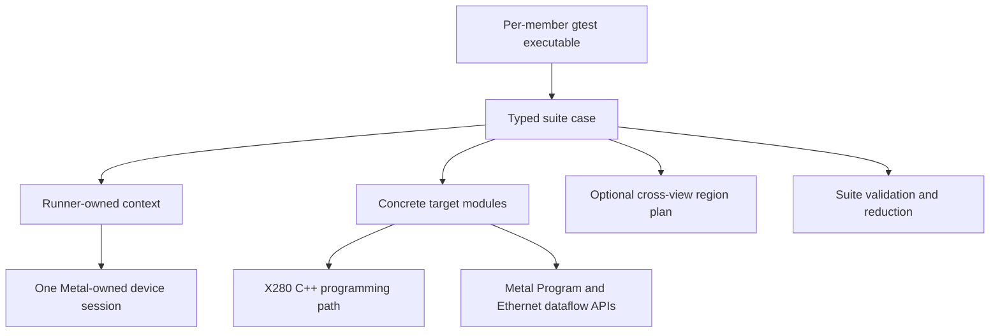

# Fabric 2 Characterization Harness

**Status:** Accepted v0 design; the lean X280 runtime is implemented. Metal
watcher support for ARC/L2CPU host access remains an upstream integration gate.

**Scope:** A host-side harness for correctness and performance characterization
across Blackhole programmable core classes. It is not a production Fabric 2
runtime.

## Document contract

This is a concise, team-facing description of the current accepted design.
It is canonical for host lifecycle and ownership, claims where the hardware
has a reversible reservation, regions and views, execution, deadlines, safety,
runtime gates and API blockers, clock mechanisms,
and the common result envelope. Performance-suite membership, participant
rows, protocol loops, measurement boundaries, axes, kernel frontend/backend
contracts, suite payloads, validation, and interpretation are owned by
[`docs/benchmarks/design.md`](benchmarks/design.md).
Raw X280 NOC encodings and helpers are defined in
[`include/noc.h`](../include/noc.h); the non-obvious hardware invariants the
harness relies on are summarized here.
The following rules are part of the document:

- Keep only current design. Replace superseded text instead of appending a
  correction or preserving a chronological discussion; Git keeps the history.
- Include only accepted design, necessary rationale, safety invariants, current
  open questions, and stable implementation references.
- Do not use this document as a project tracker, implementation diary, benchmark
  catalogue, or archive of rejected alternatives.
- Keep schedules, owners, checklists, and completion status in GitHub issues.
- Do not reference issue numbers or other tracker identifiers. Describe the work
  that resolves a question instead. Issues link into this document; this document
  does not link back.
- Reference implementation entry points only when they clarify a contract or a
  hardware constraint. Do not maintain exhaustive file inventories here.
- Document an API after it exists or when it is part of the immediately approved
  milestone. Do not invent speculative interfaces for future component types.
- An open question must identify the decision still needed and what it blocks.
  Remove the question when it is resolved.
- A change that alters a documented boundary or invariant must update this
  document in the same pull request.
- If a section grows enough to obscure the overall design, move the detail to a
  focused document and leave the contract and a link here.

## Purpose

The harness exists to make heterogeneous experiments comparable. It provides
one proven device-ownership and sequencing model, one placement vocabulary,
consistent component lifecycle and restoration, shared correctness
conventions, and disciplined measurement reporting.

Comparability is the lower bound, not the limit of reuse. The harness also
centralizes stable mechanisms that would otherwise be repeated by every
suite: discovery, resource ownership, region planning, artifact loading,
bounded execution, diagnostics, clock metadata, and result persistence.
Suite-specific experiment semantics remain in the suite that owns them.

Candidate per-component and cross-component microbenchmarks motivate the
required flexibility. Their catalogue and prioritization are intentionally
tracked in
[`docs/benchmarks/design.md`](benchmarks/design.md).

The harness may eventually contribute useful machinery to Fabric 2, but that is
not a design requirement. Characterization is intended to determine the
partition; the harness must not assume that partition in advance.

### Goals

- Program X280, Tensix, DRISC, and ERISC participants under one explicitly
  proven ownership and sequencing model. `X280Runtime` binds the
  caller-owned Metal `MeshDevice`; X280 topology, register, and LIM access uses
  Metal's `tt::Cluster` wrapper, while raw UMD is limited to ARC telemetry that
  the wrapper does not expose.
- Preserve each component class's real programming and lifecycle model rather
  than forcing a uniform kernel-loading API.
- Make placement a case parameter instead of embedding physical coordinates in
  kernels or case logic.
- Pair persistent hardware state changes with bounded restoration.
- Allocate case-scoped regions and resolve their addresses from every
  participant's view.
- Support correctness cases and later performance measurements without making
  either depend on a data-driven specification language.
- Keep the logic under measurement separate from component orchestration.

### Non-goals for v0

- A production Fabric 2 runtime or bring-up path.
- Making X280 a `HalProgrammableCoreType` or routing it through Metal JIT.
- One virtual component base class or one generic `load_kernel()` operation.
- YAML or another declarative case format.
- A composed-experiment graph executor.
- Public X280 writable outbound-NOC or per-hart APIs.
- Progress monitoring, golden-file regression, multi-host execution, randomized
  traffic generation, or automatic sweep expansion.
- A full performance result schema before the first real measurement requires
  one.

## Architecture and dependency direction

The boundary is determined by a simple test:

> Hardware mechanisms and restoration belong in the programming paths and
> concrete target modules. Shared orchestration policy belongs in the harness;
> experiment choices and measurement policy belong in behavior-named suites.



The X280 programming path and Metal APIs do not depend on harness code. The
concrete target modules adapt those mechanisms for case use without imposing a
common virtual root or a uniform loading API. Cases depend on target modules
and shared harness services; lower layers never depend on suite code.

The diagram shows the implemented Metal-owned path. The host-access
characterization proves wrapper topology, register, and LIM operations on
Galaxy. Exalens remains a separate-process behavioral reference, not a
production fallback or second cluster owner.

Use **programming component** for the underlying X280 C++ layer and **target
module** for its harness-facing integration. `X280Runtime` is the specific
Metal-bound X280 initialization and inventory object; it does not imply a
uniform component hierarchy or make the harness a Fabric 2 runtime.

### Programming paths and target modules: mechanism

The lower layers own:

- inventory and harvesting-aware discovery;
- identity and hardware state inspection;
- component-specific lifecycle operations;
- usable memory spans and windows and their hardware constraints;
- address translation and NOC-coordinate rules;
- component-specific firmware or kernel loading;
- machine safety guards and restoration diagnostics.

### Harness: policy

The harness owns:

- applying suite-supplied participant and placement requests to discovered
  inventory;
- checked allocation of test-scoped region requests;
- invocation identity and transport of suite-supplied configurations;
- address distribution to participating kernels;
- launch ordering and deadlines;
- common diagnostics, measurement metadata, and output persistence.

### Centralized host structure

The logical module structure is fixed even if physical directory and target
names follow the implementation that lands:

```text
runner/                 gtest wrapper and exact-case dispatch
harness/
  session/              one Metal-owned session and chip configuration
  inventory/            harvesting-aware identities and placement facts
  targets/              concrete X280, Tensix, DRISC, and ERISC integrations
  regions/              checked arenas, handles, views, and X280 window binding
  execution/            run labels, deadlines, waits, status, and diagnostics
  artifacts/            image/program selection and build identity
  measurement/          clock metadata and common result envelope
  output/               sample and summary persistence
```

This is centralization, not uniformization. Session ownership, restoration,
region handling, execution, and recording are reusable services. The timed
loop, participant roles, axes, suite directory structure, and derived
quantities remain owned by the
[`ubench design`](benchmarks/design.md#behavior-named-suites).

## Concrete target model

Each component type is modeled concretely because its setup, launch, and shared
resources differ:

- **X280/L2CPU:** an aggregate over its harts because host setup must arbitrate
  LIM and the shared System Port.
- **Tensix:** a thin wrapper over a `CoreRangeSet`; Metal already manages its L1
  and places kernels range-wise.
- **DRISC:** a flat programmable entity. Its DRAM bank and subchannel are
  placement attributes, not a host-side aggregate.
- **ERISC:** a programmable Ethernet core, with link bring-up represented above
  it because the handshake spans local and remote chips.

There is no common virtual root, `claim<Tag>` entry point, or generic
`load_kernel()` operation. The runner context exposes named concrete target
services. Stable lifecycle and resource behavior is centralized, but a method
is not added merely to make one target resemble another.

Target objects are host-side orchestration objects. Kernels do not see or
mirror these classes.

### Landed X280 programming-component contract

The landed X280 C++ programming component provides the current base
mechanisms:

- bind the runner's caller-owned Metal `MeshDevice` without opening a second
  device owner;
- discover unharvested L2CPU tiles and map chip, tile, NOC coordinate, and hart
  identities correctly;
- coordinate chip-scoped PLL and reset state above stable runtime-owned tile
  objects;
- inspect, adopt, or establish resident-idle state, including ECC and
  committed `WayEnable` handling;
- expose reserved and case-available LIM spans and perform checked block I/O;
- report the current clock through ARC telemetry;
- encode and read X280 NOC-window descriptors; and
- submit active images on the runtime and observe their acknowledged return
  through a runtime-owned session.

Per-hart launch selection and writable outbound-NOC windows are later
milestones. The private implementation contains parts of those mechanisms, but
the harness does not treat a private method as a usable contract.

The harness does not duplicate these mechanisms. It selects participants,
allocates experiment regions from the exposed spans, binds peer views, supplies
arguments and deadlines, and records the resulting measurement.

### Runtime ownership and participant selection

`X280Runtime` is session-owned and returns stable `X280Tile` references. The
runtime owner serializes use of tile-shared LIM, System Port, active-image
state, and the future writable NOC-window pool. X280 has no case-scoped RAII
claim and no public `X280Hart` or `HartSet` API.

A suite configuration may identify one or more harts as future launch
participants, but that selection is not a runtime acquisition. A memory-only
case selects a tile reference and uses its proven `available_lim()` span
without launching active firmware; it does not encode that behavior as an
empty hart set or implicitly boot the tile.

Tensix remains a range-wise target over a `CoreRangeSet` unless a concrete
restoration obligation appears. A DRISC claim that needs outbound NOC uses NOC0,
which DRISC firmware keeps in Stream mode; it switches no NIU.
Raw ERISC use is not a per-link claim: production fabric occupies Ethernet
cores through session/cluster `FabricConfig` and a compiled Metal `Program`.
A raw ERISC case therefore requires a separately configured session or an
explicit session-level fabric transition; no local claim pretends to restore a
single displaced production router.

### Identity and placement

The common identity key is:

```text
(component type, instance, core index)
```

Examples include an X280 tile, a DRISC bank and subchannel, an ERISC channel
and RISC, and a Tensix coordinate and RISC. A `CoreRangeSet` selection
may contain many Tensix identities; resolving a per-core view still requires a
core selector.

This vocabulary is shared by region ownership and, once performance
measurements begin, result records. It is not required to mirror an existing
runtime's naming.

Inventory exposes harvesting-aware valid placements. For an on-chip NOC leg,
`hops(from, to, noc_id)` takes an ordered endpoint pair and a mandatory explicit
NOC, then derives distance from discovered coordinates and routing rules.
Caller-supplied hop counts are never accepted as truth. Cross-chip Ethernet
legs have link topology rather than a NOC hop count. ERISC placement is
selected as a link or link pair, not inferred from two independently selected
cores.

### State must be observable

Components expose relevant state getters as well as mutating operations. A case
must be able to verify both that a mutation produced the requested state and
that the component remains in its designated safe state afterward.

## Ownership and lifecycle

Only two lifecycle structures are fixed in v0.

### Lifecycle follows the hardware

The runner owns the device session and its X280 runtime across case
invocations. A case obtains only the component resources it needs. Components
may expose case-scoped claims where the hardware has a reversible reservation,
but a claim is not imposed on resources whose lifecycle has no release
operation. Every wait involved in boot, execution, or restoration is bounded
by a deadline. Hardware that cannot be restored after a failed firmware run is
reported as unhealthy; the harness does not pretend restoration succeeded.

`X280Runtime` owns one stable `X280Tile` per physical tile. X280 reset release
cannot be reversed, so tiles have explicit boot and inspection
operations rather than an RAII acquire/release pair. The runtime owner
serializes case use and manages the chip-global PLL across its tile references.

### Deadlines are values, not a policy hierarchy

Every exact case invocation has an absolute host deadline covering launch,
device execution, collection, and publication. Restoration uses its own
bounded waits during unwind. A driver may impose a separate sweep wall-time
budget, but that budget is not packed into a kernel. There is no
`DeadlinePolicy` object.

Device-side bounds are suite protocol inputs, not a universal shell rule.
Setup, rendezvous, or warm-up waits may use a supplied relative or absolute
device budget. A suite may deliberately omit device-side checks from its
measured loop when checking would contaminate the subject. In that case the
host invocation deadline is the safety boundary. Timeout diagnostics include
the participant and target identity, last phase or state, optional
suite-published direction and progress or heartbeat, and trap state. An
unbounded Metal `Finish` is never a backstop.

### Region declaration precedes resolution

Cross-participant regions are declared first, then the region plan is
finalized, then peer views are resolved. Resolving before finalization or
declaring after finalization is an error. This barrier prevents
construction-order bugs when one participant needs another participant's
address. A local-only case may allocate from one checked arena and use its
self-view directly; it does not construct a vacuous cross-view plan.

Discovery, loading, launching, waiting, and collection remain
component-specific sequencing. X280 active work is submitted on its runtime; it
is not generalized into a cross-component session interface.

## Memory regions and address views

Memory is split across the target and harness boundary:

- A target defines the usable span, exclusions, alignment, memory
  semantics, and translation rules.
- A case decides which named regions it needs, their sizes, initial contents,
  and which participants receive their addresses.

A checked harness arena allocates case regions from the usable spans exposed by
the target. A thin shared resolver translates a finalized region for a
specified viewer.

Allocation returns a region handle, not an unqualified integer address. A
usable address is a function of the region and its viewer:

```text
resolve(region_handle, viewer)
```

Resolution is pure: it produces destination identity, coordinate, offset, and
descriptor inputs, but does not consume an X280 window index. `bind()` also
takes the suite-selected directional access plan. A cross-tile view used by an
X280 hart becomes one or more complete window descriptors and aperture
offsets. A same-tile coherent/LIM self-view is a local CPU address and consumes
no NOC window.

At the later writable-window milestone, binding validates the complete
invocation plan, leases entries from the session-owned tile, programs and
verifies them through the host programming component, and completes before
argument packing or launch. The landed public component can encode and read
descriptors but cannot yet perform that mutation. Firmware receives or derives
aperture locations and local offsets; it installs a descriptor during `INIT`
only for a window it exclusively owns, and never reprograms a window in a
timed loop. Once the public binding
contract exists, exhaustion or readback mismatch is reported before any
participant starts.

Each X280 initiating tile has 224 2 MiB entries. The current shared slot
convention reserves only indices 192–223 for host programming. That 32-entry
split is a software convention, not a hardware limit, and is insufficient for
the accepted characterization direction. A full physical Blackhole grid has
140 Tensix L1s and 14 Ethernet L1s: `140 + 14 = 154` target memories, each
fitting in one 2 MiB mapping under the current Metal programming map. Entries
0–8 remain excluded because ARC can overwrite them, so a fully repartitioned
one-window-per-target baseline leaves
`224 - 9 - 154 = 61` usable entries before extra NOC-selector, ordering,
posted/non-posted, or completion mappings. The writable-window milestone must
relax or repartition the existing host/firmware window split and preserve single-owner
programming. Capacity is still derived from the discovered, harvesting-aware
inventory and validated for each exact invocation rather than inferred from
this conservative physical-grid bound.

The host passes scalar Metal views or prepared X280 aperture locations and
mailbox offsets through runtime arguments or a case-owned argument block. Fixed
shared headers own hardware addresses and component-intrinsic wire layouts, not
test-specific addresses.

X280's resident-idle and active-firmware layout, per-hart lifecycle records, and
trap diagnostics are component-intrinsic reserved regions. They are not
allocated by cases. A correctness mailbox created by a case is separate and must
come from the case-scoped LIM or L1 span.

## X280 NOC invariants

`include/noc.h` is the implementation authority for port bases, descriptor
fields, aperture layout, and window programming. The harness and suites rely on
the following cross-source conclusions:

- An X280 hart reaches the NOC through ordinary loads and stores over
  configured windows. It has no software-visible NOC command buffer. The
  descriptor and CPU transaction together cannot encode a NOC atomic command,
  so X280 cannot issue NOC atomics through this path.
- A CPU atomic is not a substitute. A Memory Port atomic completes in the
  coherent X280 cache domain without becoming a NOC atomic; a System Port
  atomic faults. An AMO against an unproven address is permitted only under the
  firmware probe path because a fault can strand the hart until chip reset.
- Inbound NOC atomics can target Tensix and Ethernet L1, not X280 LIM.
  Therefore an X280 mailbox is single-writer. Fan-in uses one cell per writer
  and a consumer scan.
- Memory Port stores are cache fills, not peer-visible writes. A cached outbound
  path needs an explicit, proven eviction or visibility operation.
- Inbound NOC traffic to an L2CPU tile passes through its L3 controller. Into a
  data-cacheable destination a partial-line write may allocate a dirty L3 line
  rather than update the backing memory; LIM is not such a destination, being
  the uncached scratchpad (`docs/benchmarks/p2p_latency.md`
  § Why the backend is NOC-shaped). The host `Cluster::write_core` full-line
  pattern is known to reach LIM; whether a Tensix NOC write has the required
  visibility must be established for the exact destination, write shape, and
  X280 local poll path.
- Device NOC windows are distinct from host PCIe TLBs. The host resolves a
  destination, leases device-window indices, and programs and verifies complete
  descriptors before launch. Firmware uses the prepared apertures, or programs
  and verifies a window it exclusively owns in `INIT`, and never reprograms one
  in a timed loop.
- A window's ordering mode is the two-bit `ordering` field `noc.h` programs
  into its descriptor (from a `noc_ordering_t`, or from the raw entry points'
  `{posted, strict_order}` pair), and the two bits select one of four modes
  rather than a scale. Strict ordering makes the NOC transactions follow AXI
  ordering rules and withholds the write acknowledgement until the transaction
  is done. Posted returns the acknowledgement as soon as the data
  has entered the NOC, and relaxes NOC ordering. Two consequences the suites
  depend on: a non-posted store's cost is dominated by a clock-independent
  round trip, and a bracket closing on a posted store closes at issue rather
  than at arrival.

| Mode | `posted` | `strict_order` | Ordering | Acknowledgement |
|---|---|---|---|---|
| 0 | 0 | 0 | relaxed | on completion |
| 1 | 0 | 1 | in order | on completion |
| 2 | 1 | 0 | relaxed | at issue |
| 3 | 1 | 1 | in order | at issue, and a pending write blocks reads |

Blackhole adds mode 3; the earlier parts carry only the first three.
`Ordering.md` in the upstream ISA documentation defines the two bits for the
PCIe tile's windows, and `black_hole_noc_programming_guide.pdf`
§ AXI Ordering Control carries the four-mode encoding for this part.

On the L2CPU tile the selector is one 2-bit `ordering` field, which the window
descriptor table names without defining (`L2CPUTile/TLBWindows.md:47`);
the raw entry points' `strict_order` is its low bit and `posted` its high bit, so the four
combinations select the four modes rather than compose two separately
programmed controls. UMD supplies the semantics for the same encoding, naming
the modes `RELAXED`, `STRICT`, `POSTED` and `POSTED_STRICT` — the last
Blackhole-only and unicast-only (`umd/device/tt_kmd_lib/tt_kmd_lib.h`, with
`blackhole_implementation.hpp` placing the field at bits 70 and 59).

These invariants are supported by `include/noc.h`,
`src/atomic_bench.c` and `boot/entry.S`.

## Case model

Cases are code, not data. A case is a free function over a runner-owned context
and a typed suite configuration, and obtains only the concrete component
resources it needs. Sweep drivers construct configurations and call the case;
cases do not discover their own devices or expand a declarative graph.

The context may expose the device session, inventory, named target services,
region planning, run-label generation, artifact lookup, verification, and
result output. It
is not a collection of eager claims, a generic component manager, or a
suite-independent configuration engine.

Every v0 case has:

- explicit placement;
- explicit component-operation and restoration scopes;
- bounded waits;
- deterministic initialization of observed state;
- correctness verification before success;
- diagnostics containing the last observable component state on failure.

Stable lifecycle, resource, execution, and recording mechanisms are
centralized. Suite loops and reductions remain suite-owned, and concrete case
implementations validate that the shared boundaries are honest.

### `p2p_latency` is the first harness client

The harness is checked against the canonical participant matrix and
implementation order in the ubench design's
[`Participant rows`](benchmarks/design.md#participant-rows).
It supplies the reusable selection, region, execution, deadline, clock, and
recording mechanisms those rows consume. Suite configuration, protocol,
reduction, and extension rules remain in the ubench design. Current host and
runtime blockers are recorded here under [Design rules](#design-rules)
rather than duplicated beside the suite order.

## Kernel and image model

This section describes harness-level composition. Active X280 images are
submitted through the runtime described below; no per-hart method is implied.

Kernel loading is intentionally heterogeneous:

- Tensix, DRISC, and ERISC use their Metal `Program` configurations.
- X280 uses a prebuilt image produced by the separate rv64gcv toolchain and the
  X280 component's programming path.

Kernel structure is suite-owned: see
[`p2p_latency`](benchmarks/design.md#kernel-frontend-and-backend)
and
[`transport_bandwidth`](benchmarks/design.md#frontend-and-backend-contract)
in the ubench design. The harness only loads prepared artifacts and packs
arguments according to the selected suite contract; it does not impose a
frontend/backend split on other suites.

X280 images reuse the bare-metal runtime primitives under `include/rt/`
rather than copying them into each image. These headers own CPU timing and
pause primitives, resident-idle return, and device-side PLL measurement.

X280 images are built with the tt-metal build, by `x280_add_image` and the SFPI
compiler, and located at run time by a caller-supplied path. The component
hard-codes no build-tree location; the tests and the harness default the path to
the build's image directory, and an environment variable overrides it. Images are flat binaries loaded at a fixed address, not ELFs.

`ActiveRunRequest::image_path` is a trusted harness-artifact contract, not an
arbitrary binary interface. The caller supplies an image built for the expected
X280 firmware protocol; the component validates that the file is non-empty,
fits the reserved and currently backed LIM range, loads at the fixed active
address, and reads back byte-for-byte before `JUMP`. It does not parse a
semantic image manifest.

This matches tt-metal's effective boundary rather than its build mechanism:
callers provide kernel source plus typed configuration, tt-metal's controlled
build and compile-hash pipeline produces or selects the device binary, and
enqueue does not infer compatibility from an arbitrary flat image. X280 keeps
its separately built artifact, so protocol compatibility remains the caller's
responsibility.

Nothing ties an image to the source revision it was built from, so a stale
image the boot protocol still accepts runs and produces a result attributed to
the wrong revision. That is a measurement-traceability concern rather than a
correctness one; the result schema must record the loaded image's hash
alongside a measurement.

## X280 programming component

X280 is the first reusable programming component. Its base runtime and active
submission are landed and independently usable with no harness dependency; the
remaining gaps are the harness target integration and the later public per-hart
and writable-window contracts.

`X280Runtime::open(mesh, config)` is Metal's stateful X280 initialization entry
point. `RuntimeOpenConfig` contains the LIM ECC priming policy and target
`LimShape`. The defaults preserve current behavior: `AutoPrime`, fifteen
128 KiB LIM ways, `WayEnable=0`, and 1.875 MiB backed. `RequirePrepared` runs
the same readiness path without committing `WayEnable` on unprimed hardware.
One call:

1. validates and binds the caller-owned Metal mesh;
2. discovers and inspects every selected physical chip and enabled L2CPU tile;
3. creates one stable runtime-owned object for every selected tile under a weak
   binding to that live `MeshDevice`;
4. applies a safe probe clock when reset-held hardware is otherwise unreadable;
5. runs the temporary host PLL/LIM-ECC bootstrap when hardware state requires
   it and the selected policy is `AutoPrime`;
6. preflights every selected chip, then applies the configured WayEnable only
   while all affected L2CPUs remain held in reset; and
7. returns a usable runtime only when every selected chip is ready at the
   requested shape.

The public result types are:

- `RuntimeOpenOutcome::{Ready, PreparationRequired, ResetRequired, Failed}`;
- `ChipOpenResult`, containing only `chip_id`, `outcome`, and `diagnostic`; and
- `RuntimeOpenResult`, containing the aggregate `outcome`, optional `runtime`,
  `chips`, and aggregate `diagnostic`, plus `ready()`,
  `requires_preparation()`, and `requires_reset()`.

There are no public action vectors or tile snapshots in the open result.
Multi-chip opening is all-or-nothing: one non-ready chip prevents construction
of the runtime for all selected chips. Only `Ready` contains a runtime.

`X280Runtime::enqueue()` accepts an `ActiveRunRequest` only for a healthy
runtime-owned `X280Tile` from that runtime. A successful enqueue returns the
`SessionId` of a runtime-owned `X280ActiveSession`; no active-image mutator is
exposed on the tile. `TileState::harts` and active operation results'
`hartstates` each carry a `std::array<HartState, kHartsPerTile>`, including
protocol version, generation, command, phase, result, heartbeat, status, the
lifecycle harness's diagnostic stage, and committed trap diagnostics for each
hardware hart.
Aggregate waits retain all four records and `describe()` renders every one, so
the stage of whichever hart is in the wrong state says where in the lifecycle
it stopped. No predicate reads the stage.

Terminal success and the run-value echo are separate claims.
`hart_result_ready` means the hart committed success and is still parked in
`RUNNING_ACTIVE_FW`; it does not inspect the payload, because seven of the
eight active images publish what their work produced.
`active_result_matches` is the echo check.
Successful automatic ECC priming is progress, not readiness. It commits
`WayEnable`, returns `ResetRequired` without a runtime, and requires the caller
to close Metal, reset the device, recreate the mesh, and call `open` again.
`RequirePrepared` returns `PreparationRequired` for the same unprimed state
without changing hardware; reversible silicon tests use this policy through the
public entry point.

The pipeline group uses a prepared cache policy for an ASIC-reset lifetime.
Before each device case the pipeline_stage suite has the runtime prepare the
fixed 4288-byte Zero Device region, placing it into way 1 and pinning it; the
runtime does so once per reset and returns `AlreadyPrepared` afterwards.
Preparation requires the 14-LIM-way partition and operator-owned exclusive use
of the device until the next reset. See
[`runtime.md` / Prepared pipeline inputs](runtime.md#prepared-pipeline-inputs-x280-only).

Every case opens at 14 LIM ways ([Running benchmarks](#running-benchmarks)).
Each case still opens and closes its ordinary
MeshDevice/runtime and performs normal active-session and NoC-window cleanup.
Case boundaries do not change cache masks, invalidate the reserved region, or
release a cached-input lease. Process-local runtime ownership does not span
executables: external exclusive ownership must cover preparation through the
next reset. Failed preparation aborts the prepared sequence until a reset, with
no automatic cache-state recovery.

The current component reservation requires at least ten LIM ways.
WayEnable is increase-only, so a shape that expands LIM returns
`ResetRequired`. A same-mesh reopen with a different shape returns `Failed`
without touching hardware. `X280Runtime::lim_shape()` reports the effective
partition. Under the default `LimLayout::Legacy` profile, `X280Tile::reserved_lim()`
covers `[0x08000000, 0x08131B00)`, and `available_lim()` extends from that end to the
backed-LIM limit (with the default fifteen-way shape, `0x081e0000 - 0x08131B00 = 0xae500 = 713,984` bytes).
Under the opt-in `LimLayout::PacketInjection` profile (14 LIM ways), `X280Tile::reserved_lim()`
reports the low image/idle prefix `[0x08000000, 0x08020000)`, and `available_lim()` exposes
the lower arena `[0x08020000, 0x080FFF80)` (917,376 bytes), leaving upper active stacks,
traps, and protocol space preserved above `0x080FFF80`.

One process-global weak reference identifies the `RuntimeImpl` for the current
live `MeshDevice`. Reopening that same live mesh reuses the initialized runtime.
Opening a different live mesh or submesh while it exists returns
`RuntimeOpenOutcome::Failed` with a busy-owner diagnostic. Once the original
mesh closes or drops, a recreated mesh receives fresh contexts and hardware is
inspected again.

There is no public read-only `Runtime::inspect` and no public `X280Chip`.
`TileId` is an alias of `TileIdentity`. `X280Runtime::tile_ids()` returns
enabled, unharvested identities ordered by chip id and hardware tile index;
`X280Runtime::tile(id)` requires an exact member of the runtime's mesh view and
returns the same runtime-owned `X280Tile` reference on every lookup. The
reference is valid only while a runtime value keeps that `RuntimeImpl` alive.
`boot()` prepares resident idle and releases reset only with explicit opt-in.

PLL4 is chip-global, so `X280Runtime::set_pll()` establishes and confirms one
frequency for every enabled tile on the selected chip. A cold `boot()` moves the
clock to `kSafePllMhz` itself, inside the same locked section that proved every
L2CPU is held in reset, because that window closes the moment reset is released.
The runtime owner sequences operating-clock changes after boot; tiles do not
record per-handle clock intent. No public `X280Hart` exists: per-hart protocol
records are internal values of the stable tile until separately placed images
demonstrate a caller-facing hart contract.

The component is the `x280_device` target, built by `CMakeLists.txt` inside
the tt-metal build when `TT_METAL_BUILD_X280` is on, with public headers under `include/x280/device/`.

The public runtime binds to a `MeshDevice` the caller already opened.
`RuntimeImpl` holds the weak mesh-liveness reference and owns its `ChipImpl`
values and stable `X280Tile` objects. Each `ChipImpl` owns chip serialization,
topology, reset/ECC bootstrap coordination, and the shared Metal transport.
Neither `X280MetalTransport` nor UMD's typed `CoreCoord` reaches the public
header. Coordinate queries use Metal's `CoreCoord` and `CoreType`.

The static `X280Runtime::virtual_core_from_logical_core` resolves one common
virtual coordinate across a borrowed `MeshDevice` scope, or on one chip of it
named by `MeshCoordinate`, for the NoC its consumer uses, without an open
runtime.
Supported Metal types delegate to the public mesh resolver; L2CPU uses the
SoC descriptors and UMD mappings, with checked agreement
across chips. `virtual_core_from_tile` validates the runtime identity before
translating its NOC0 position directly to its chip's virtual coordinate. Both
return `TranslatedCoord`, refusing a value outside six bits or one NoC 1 does
not translate. These
host-only queries do not initialize hardware or create another execution owner.
P2P, transport-bandwidth, Tensix
correctness, core-sync, eth_credit and packet injection use these queries.

Rules that can be decided from values already read — LIM ECC classification,
resident-idle liveness, tile numbering, and deadlines — live in a
separate `x280_state` target with no Metal, UMD, or hardware dependency, so
they are testable without a device. `x280_device` depends on it.

Private implementation follows the same boundary:

- `RuntimeImpl` owns weak live-mesh validation, initialized chips, stable tiles,
  ordered identity inventory, exact lookup, active submission, the live-session
  registry keyed by `SessionId`, and the public PLL entry point;
- `ChipImpl` owns chip serialisation, topology, reset-register coordination, and
  temporary chip-wide bootstrap state;
- the tile implementation owns identity, read-only inspection, explicit
  resident-idle boot, the single-execution reservation slot, saved restoration
  failure, and health;
- `x280_state` owns pure classification and validation over values already read.

The private `open_impl()` path coordinates per-chip preflight, safe-clock
recovery, automatic ECC priming, and shape application. When system firmware
or Metal assumes PLL/ECC bootstrap, remove those temporary branches without
changing tile lookup or boot semantics.

Writable outbound-NOC programming remains later-milestone scope. Active images
are submitted only through the runtime, which owns their sessions and their
restoration.

### Host-access gate

The X280 component is a C++ adapter over the cluster already owned by Metal.
The caller creates and retains a `MeshDevice`; `X280Runtime::open` validates
that mesh and binds the private Metal access adapter. The component constructs
neither a `MetalContext` nor a `Cluster`. The caller's mesh remains the sole
owner of the `/dev/tenstorrent` file descriptor and ARC queue, and every
hardware operation refuses a closed or dropped mesh.

Metal's `tt::Cluster` wrapper is the intended route for topology, register, and
LIM access: `get_soc_desc`, `read_reg` / `write_reg`, and
`read_core` / `write_core`. This is the staging boundary for eventual X280
support inside the Metal runtime, not merely a shared owner from which the
component extracts a raw transport. Register writes remain 32-bit,
strict/uncached, ordered by readback, and LIM remains on the wrapper block path.

Raw UMD is restricted to ARC telemetry, which the wrapper does not expose.
`X280MetalTransport::telemetry()` borrows the driver behind the same
Metal-owned cluster. Adding wrapper telemetry removes that raw borrow without
changing public callers.

The current `MetalContext::get_cluster()` borrow is confined to the Metal
access adapter. A future Metal-owned replacement, including migration to
`MetalEnv`, changes that adapter rather than the runtime or tile API.

L2CPU identity is always the NOC0 hardware numbering defined by reset bit
`4+N` and telemetry `L2CPUCLK<N>`. The adapter converts explicitly where a
Metal wrapper API expects translated coordinates. Relying on NOC0 and
translated coordinates to coincide happens to work for Blackhole L2CPU tiles
but is not a contract.

Coordinate conversion does not select the physical NOC fabric. Every wrapper
register or block delegate is scoped with UMD's thread-local NOC selector set
to NOC0; Metal does not set or restore that thread state.

Core-sync and packet injection share one host release selector,
`select_release` (`harness/regions/release_selector.hpp`). It resolves every
participant through `X280Runtime::virtual_core_from_logical_core` in input
order and returns at most one multicast group plus endpoints, under
`ReleaseMode::Auto`, `UnicastOnly` or `RequireMulticast`. Non-Tensix
participants are always endpoints. The Tensix participants form the group when
their logical coordinates exactly fill one logical rectangle and the sender can
multicast on NoC 0; the group's corners are the virtual images of that
rectangle's corners and `num_dests` is the logical count. Firmware's
translation is order-preserving and its virtual gaps (translated columns 8-9,
harvested columns) are opted out of broadcasts, so delivery equals the
selection even where the NOC0 span has gaps. CTest `X280ReleaseSelector` checks
it against a mock harvested descriptor only; it opens no silicon.

With translation enabled, a NIU translates all four multicast corners before
choosing the spans (tt-isa-documentation `BlackholeA0/NoC/MemoryMap.md`,
`NOC_TARG_ADDR`). The L2CPU TLB window documentation does not say whether that
holds for its windows; the renumbered-column case below observed it on a
harvested part.

Every other core-sync case sits at logical x < 6, where virtual and NOC0
coincide on the parts in use, except
`X280CoreSyncDirector.RequiredMulticastReleasesExactlyItsSelection` (below), so
only it and `X280CoreSyncDirector.ArrivalAndReleaseReachARenumberedColumn`
distinguish the two. The latter chooses, from the device's own mapping, the
first 4 x 4 block whose virtual columns are consecutive and whose columns x and x+2 differ from NOC0, and
runs the mixed-tier arrival, the two-group release probe and its required
multicast release there. On a
device where every column coincides it skips with an availability reason.

`X280CoreSyncDirector.RequiredMulticastReleasesExactlyItsSelection` is the
recipient-level check of the mapping contract. From the device's own mapping
it picks a 2 x 2 logical block of each shape the contract must hold for -- a
contiguous control, one whose virtual span crosses translated columns 8-9, and
one whose NOC0 span contains a harvested column -- and releases each by a
`RequireMulticast` group while every other live Tensix core holds a sentinel at
the release address. Any sentinel overwritten is a release the selection did
not ask for; a shape the part lacks is reported rather than failed.

Metal's host-NOC watcher recognises only worker, Ethernet, PCIe, and DRAM
cores. `X280MetalTransport::bind()` therefore warns before runtime discovery
when watcher is enabled; subsequent ARC/L2CPU wrapper access remains subject to
the Metal sanitizer and fails pending upstream support. Production code does
not bypass the wrapper for topology, register, or LIM access.

Host access has been demonstrated on Blackhole Galaxy for:

- L2CPU discovery through `SocDescriptor::get_cores(CoreType::L2CPU, …)`, with
  the harvesting mask applied by UMD.
- ARC telemetry (`ENABLED_L2CPU`, `L2CPUCLK0..3`) independently of any LIM access.
- L3 CSR and ARC-tile register reads, all-ones rejected rather than masked.
- A restoring LIM write and readback.
- A probe-PLL slew, with ARC telemetry confirming each endpoint. The return
  target is the chip's own starting clock, read before the slew, not a fixed
  800 MHz: a chip parked elsewhere must come back to where it was rather than be
  reprogrammed to one caller's idea of normal.
- A real 1×2 Metal mesh that returns both physical chips in stable order.
- Reversible LIM-region perturbations protected by range checks and
  exception-safe restoration guards.

The routine equivalents create the caller-owned `MeshDevice` first and call
`X280Runtime::open(...RequirePrepared)` across the full visible mesh. Discovery,
state, telemetry, and backed-LIM checks use `tile_ids()` and `inspect()`.
Restoring scratch writes use `read_available_lim()` and
`write_available_lim()`, which re-inspect under the chip lock, bound the request
to `available_lim()`, and require whole cache-line writes.

The runtime entry point cannot establish missing preparation for a reversible
test, so open reports the chips that require operator action:

- **Primed LIM ECC.** Priming commits `WayEnable = 0xF`, which is increase-only,
  so a tile primed in-process loses the LIM it was about to write and still needs
  the ASIC reset that completes the prime.
- **All L2CPUs in reset.** Reset release is one-way, so the isolated
  PLL characterization skips a running chip rather than attempting to quiet it.

Two transport tests remain explicit exceptions. `x280_arc_test` exercises raw
UMD `get_clocks()` and `arc_msg()` because Metal exposes neither operation.
`x280_pll_test` retains the raw, per-register divider staircase as a transport
proof rather than public runtime behavior, isolated behind
`X280_ALLOW_PLL_SLEW=1`. The unclocked-tile all-ones probe is deliberately
absent: its host NOC read can wedge the path back to ARC, making divider
restoration unreachable and requiring a chassis reset.

Galaxy chips are MMIO-local, so `LocalChip` semantics apply: the per-tile static
TLB that Metal configures at LIM base is available, and the register path keeps
its strict-ordering, uncached mapping. A remote chip would lose both — its
TLB manager throws and its register calls degrade to plain reads — so the adapter
must assert MMIO-local rather than assume it.

Exalens remains a behavioral reference, not a fallback, and is used only in a
separate process; its readings agree byte-for-byte with the borrowed-cluster path
on the same registers. Pyluwen must not coexist with Metal. Invoking Exalens
in-process with Metal is unsupported unless it is explicitly proven to borrow the
existing owner rather than initialize another UMD cluster.

### Chip-coordinated resident-idle lifecycle

"Within a chip-reset lifetime" is a hardware bound, not a scoping convenience:
releasing a tile's harts from reset is a one-way step, so the whole
resident-idle scheme exists to make one release serve every case that follows.

`X280Runtime::open` performs readiness inspection and, under `AutoPrime`, the
one-time PLL/ECC bootstrap before exposing tile references:

1. Discover enabled tiles. An unclocked L2CPU is unreadable, so a tile that
   reads back unusable is clocked with a known-safe probe PLL and read again.
   The probe is permitted only while the chip is quiescent.
2. Classify LIM ECC and `WayEnable` state before performing partial LIM writes.
   Treat a raw all-ones CSR read as an invalid clock or transport observation;
   never mask it into an apparently valid state. A nonzero WayEnable is valid
   when it matches the requested partial-LIM shape and the low-LIM marker is
   present.
3. If LIM is unprimed, `AutoPrime` primes the enabled tiles and returns a
   reset-required result; `RequirePrepared` returns `PreparationRequired`
   without changing hardware. If WayEnable leaves less LIM than requested,
   return reset-required without changing it. The component never performs the
   required ASIC reset and returns no runtime.
4. The caller closes Metal, resets the ASIC, recreates the mesh, and invokes
   `open` again.
5. On the post-reset invocation, inspect hardware again rather than trusting
   process history, preflight every chip, and apply the requested shape while
   every L2CPU remains in reset. `open` does not load resident idle or release
   reset. An out-of-reset tile counts as ready only when all four harts publish
   the expected protocol version, their distinct idle heartbeat markers, and a
   committed `IDLE` phase.
6. Construct the runtime only after every selected chip and tile is ready. Any
   invalid observation, unsafe post-reset state, or failed bootstrap produces
   per-chip diagnostics and no runtime.

Live repartitioning is deliberately absent. The runtime does not own caller LIM
allocations, and resident idle has no handshake that quiesces all harts and
cache masters while WayMasks change. Adding it requires both mechanisms and
must preserve the low-LIM image, stacks, mailboxes, and allocation high-water
mark.

After opening, the owner asks a reset-held tile to `boot()`. Boot establishes
`kSafePllMhz` while the chip is still quiescent, validates and loads resident
idle, writes and verifies reset vectors, and releases reset only with explicit
opt-in. The owner then calls `X280Runtime::set_pll()` for the operating
frequency. A tile already in resident idle takes the no-write boot path.

The per-tile `boot()` cannot cold-boot more than one reset-held tile on a
chip in the same reset lifetime. After the first `boot()` releases a tile,
another reset-held tile's cold boot is rejected because the chip is no longer
quiescent. Cross-tile X280 cases boot their tiles through
`X280Runtime::boot_tiles`, which carries the prepare-all,
establish-safe-clock-once, release-all-in-one-write, wait-all sequence across
a selected set of tiles (`ChipImpl::release_tile_resets` is the one write);
preparation failure releases none.

### Active-firmware submission

One runtime-owned stable tile runs repeated active images without touching
`L2CPU_RESET`.
`X280Runtime::enqueue` holds the existing chip lock while it:

1. verifies runtime identity and tile health;
2. requires released reset and four versioned, committed resident-IDLE records;
3. reserves the tile's single-execution slot, before any write, so a racing
   submission loses the slot rather than the records;
4. validates the image against the active region, the component reservation,
   and currently backed LIM, then loads and reads it back;
5. clears the four control, state, and trap records with full cache-line writes;
6. publishes and reads back one shared run value and active entry in all four
   controls;
7. registers the runtime-owned session; and
8. publishes four `JUMP` commit words and returns its `SessionId` without
   polling.

Step 5 is the point of no return for resident idle: it publishes its four IDLE
records once, on entry, so a submission that fails after those records are
cleared leaves nothing that will republish them and latches the tile unhealthy.
A failure before step 5 releases the slot and leaves the tile reusable.

The resident, success sentinel, and fault image use twelve cache lines at
migration-control `+0x1800..+0x1AFF`: four controls, four states, and four
traps. Each stage uses an existing protocol field as its commit word. Host
commands are written last; firmware commits startup and return with `phase`,
terminal results with `status`, and traps with `trap_valid`. Dependencies stay
stable after their commit.

The runtime-owned `X280ActiveSession` behind that `SessionId` observes startup
and run-correlated results with bounded all-hart waits, and carries the run
value every aggregate predicate correlates against.
`X280Runtime::cleanup(id, timeout)` publishes four `STOP` commands, waits for
four committed `RETURNED_TO_IDLE` phases, publishes four `RETURN_ACK` commands,
and requires four generation-matched, versioned `IDLE` records. Polling takes
the chip lock for one composite snapshot and releases it before sleeping. A
running or result timeout retains the snapshot without changing tile health.

Reaching a terminal state reaps the session, so `cleanup` is single-shot and a
stale id reports `UnknownSession`. Runtime destruction runs the same bounded
cleanup for every session still live, warning for each one it cannot restore and
for each it cannot reach at all because the mesh is already closed. Those tiles
run active firmware until an ASIC reset. Failed restoration saves the final active
observation and marks the runtime-owned tile unhealthy, which
`X280Tile::healthy()` and `X280Tile::last_failure()` report after the session is
gone. Later enqueue attempts return `Unhealthy` without hardware access.
Writable outbound-NOC programming and any public hart object remain outside
this surface.

Every image in this tree speaks the per-hart protocol.

### Clock configuration is chip-scoped

The L2CPU clock is one chip-level resource shared by all four tiles, not a
per-tile setting. Reset-held probing, ECC bootstrap, and cold boot establish
`kSafePllMhz` only while every L2CPU is in reset. After boot,
`X280Runtime::set_pll()` can move PLL4 while tiles are live, and every live tile
sees the change.

The harness permits one owner-coordinated operating-clock establishment per
session. Before that call, every live X280 tile must be in verified resident
idle; no active case firmware may be running. The caller must also satisfy the
runtime's external PLL4 ownership precondition: no other process, including a
fleet telemetry agent, may hold the device open while the clock moves. The
operating frequency is then adopted by every case in that session and always
reported as measured rather than merely as requested.

Frequency remains a run condition rather than an in-session sweep axis. A new
frequency point uses a separately identified session and repeats liveness and
clock confirmation, but does not inherently require an ASIC reset.

## Measurement discipline

Correctness is required alongside every future performance number.

When performance reporting is introduced:

- record the clock domain and measured/configured clock state with each result;
- never subtract timestamps sampled on different component classes;
- measure a round trip in one clock domain when comparing cross-component
  signaling;
- distinguish real logic from a cost stub;
- use the common placement identity in every record.

### Result composition

There is no union schema containing every axis of every suite. A recorded row
is composed from:

1. a common envelope: run label, behavior-named suite and case, named sweep and
   baseline, pass and ordinal, exact-run configuration identity, participant
   placement, counter identity and frequency, backend and artifact
   identity, reference type, and execution mode; and
2. a suite payload: protocol axes, raw observations, and validity fields
   defined by that suite.

The envelope contains no editorial family identifier. Device code writes raw
counter deltas, exact integer counts, terminal state, heartbeat, diagnostics,
and backend identity. Host code stamps experiment metadata and validates
observations; the tabulator, `tools/tabulate_suites.py`, derives physical units
and statistics. The output module appends per-sample and summary rows as JSONL under
`$TT_METAL_HOME/characterization`; it does not decide suite validity or impose
a global result schema.

The common `reference_type` vocabulary is:

- **same subject, other class** for an apples-to-apples comparison;
- **production path** for real-system context using different code; and
- **theoretical or measured bound** such as line rate or a destination ceiling.

The suite selects and interprets the reference. A production-path result is
never presented as the same source compiled for another class.

On X280, `x280_rdcycle()` is the bare interval-counter read and intentionally
contains no fence. A reusable measurement bracket wraps it with the required
fences at both boundaries so neither counter read can retire across the CPU
transactions that define the suite's endpoint. Suites use that bracket rather
than calling `x280_rdcycle()` directly for a measured interval. The suite still
defines whether the endpoint is issue, local departure, or remote completion;
an X280 read-back through a window is not replaced by the timing fence, and under
the posted ordering mode neither forces completion.

Maintained performance suites use direct fenced mtime wall brackets and raw
architectural CPU cycles. They do not convert CPU cycles to time or calibrate
CPU frequency for reporting. Lifecycle/recovery deadlines remain separate.
See [the measurement contract](measurement.md) for counter identity,
clock evidence, native availability and retained reference observations.

### Suite integration boundary

Canonical performance-suite requirements stay in the
[`ubench design`](benchmarks/design.md). A suite consumes the
concrete inventory, target, region, execution, artifact, clock, and result
services defined here. Each suite validates its own path as part of its
ordinary invocation; no separate admission workload runs before it. Adding a suite changes this LLD only when it introduces a
reusable host mechanism or a new hardware ownership or restoration obligation.

## Device selection

Tools and cases in this suite name their target device through the
`TT_VISIBLE_DEVICES` environment variable. `tt-smi` honours the same filter: under
an inherited filter, `tt-smi -r <N>` for a device outside it prints
`Resetting UMD logical IDs: [N]`, exits 0 and resets nothing.

- **Never let `tt-smi` inherit the filter.** Invoke it as
  `env -u TT_VISIBLE_DEVICES tt-smi ...`, always.
- **Never treat a reset's exit status as proof it happened.** Read the target
  state back: after `tt-smi -r <N>`, the tile's reset bit must read *held*.
- **Resolve identity by BDF**, via `env -u TT_VISIBLE_DEVICES tt-smi -ls`, when
  a result is going to be attributed to a specific part. UMD logical id (BDF sort
  order), the `/dev/tenstorrent/<n>` node index and the PCI BDF are distinct
  numberings.
- **Verify state by measurement, not by inference.** Prefer a probe that proves
  a precondition over a procedure believed to establish it.

## Safety invariants

- Never initialize unsupported concurrent device or cluster owners for the same
  chip. There is exactly one caller-owned Metal `MeshDevice`, retained by the
  runner; `X280Runtime` binds to it without opening another owner. Pyluwen must
  not coexist with Metal, and Exalens must not be invoked in-process with it.
- Never automatically perform a chip reset as part of a case.
- UMD `WarmReset` and ARC reset messages are not recovery tools for a case.
  Reset-gated configuration is an explicit operator-controlled flow.
- Move the operating L2CPU PLL only through the runtime owner, while every live
  X280 tile is in verified resident idle and no active case firmware or
  external device owner exists. Reset-held probe, bootstrap, and cold-boot
  clock changes remain gated on every L2CPU being in reset.
- Never classify X280 L3 or LIM state from an unclocked tile or from a raw
  all-ones read.
- Require the component's strongest available liveness evidence: X280 resident
  idle uses four versioned per-hart heartbeat markers plus four committed IDLE
  phases plus a tile that is out of reset, while a component with an advancing
  heartbeat must demonstrate progress. A stale status word alone is
  insufficient, and in LIM those words persist across a return to reset.
- Bound every firmware wait and include last-seen phase, heartbeat, command,
  and trap state where available.
- Attach an active session before publishing `JUMP`, and preserve the session
  whenever that write may have landed.
- Restore persistent target state on failure when the hardware permits it, and
  report the target unhealthy when it does not.
- Never issue an X280 atomic memory operation against an address whose
  support is not established, except under the firmware's probe mode. An
  unguarded faulting AMO reaches the trap handler and permanently halts the
  hart, stranding the L2CPU until a chip reset.
- Never give a mailbox on an X280 more than one writer. The NOC performs
  atomics only against Tensix and Ethernet L1, so a multi-writer mailbox on
  X280 has no correct implementation; use one cell per writer and scan.
- Do not expose X280 boot-protocol mailboxes as test scratch.
- Do not hard-code physical NOC coordinates in case kernels.
- Do not compare raw cycle counts without their clock-domain and clock-state
  metadata.

## Design rules

- Programming components and concrete target modules own hardware
  mechanism and restoration; the harness owns shared orchestration policy and
  suites own experiment policy.
- The X280 programming component and Metal APIs have no dependency
  on harness or suite code. Concrete target modules have no dependency on suite
  implementations.
- Metal's `tt::Cluster` wrapper is the X280 topology, register, and
  LIM path. Raw UMD is restricted to ARC telemetry absent from the wrapper.
  Exalens is a separate-process behavioral reference only, and no
  unsupported concurrent owners are permitted.
- Component types remain concrete and heterogeneous; no common
  virtual base or uniform load API is introduced in v0.
- `X280Runtime` owns one stable `X280Tile` per discovered physical
  tile. Exact repeated lookup returns the same object, whose reference is
  bounded by the runtime lifetime. X280 has no synthetic RAII claim because
  reset release has no in-process inverse; the runtime owner serializes use.
- Region declaration and finalization precede cross-component view
  resolution. Local self-views do not require a vacuous cross-view plan.
- Addresses are resolved for a viewer on the host and passed to
  kernels; test-specific addresses are not baked into shared headers.
- Cases are code; a declarative specification and graph executor are
  deferred.
- `X280Runtime::open` is Metal's stateful X280 initialization
  boundary. It discovers and initializes all selected chips and returns a
  runtime only for all-chip readiness; X280 is not a first-class Metal
  programmable-core type.
- The first cross-component case is a symmetric readiness
  acknowledgement, separate from X280's internal firmware handoff.
- Every exact invocation has a host deadline. Device-side bounds are
  suite-owned and may be omitted from a measured loop.
- Stable lifecycle, resource, execution, and recording mechanisms
  are centralized. Suite loops and reductions remain suite-owned; concrete
  implementations validate the shared boundaries.
- X280 images reuse the shared bare-metal runtime headers; those
  firmware primitives do not replace the host-side X280 programming path or define
  the harness result schema.
- Runtime opening may clock a reset-held tile at the safe probe
  frequency when its initial observation is unusable. It rejects both raw
  all-ones observations and the equivalent per-operation timeout before field
  decoding. Measured on Blackhole, an unclocked tile returns all ones after
  about 55 ms, so UMD may surface either form. Neither may be masked into a
  plausible field value.
- L2CPU hardware numbering is the `L2CPU_RESET` bit order — bit `4+N`
  selects hart group `4N..4N+3` and indexes `L2CPUCLK<N>` telemetry. UMD's L2CPU
  core array is sorted by NoC Y and is a *different* index. UMD shuffles
  `ENABLED_L2CPU` into that ordering as its harvesting mask and omits disabled
  cores before returning the inventory. Components map each returned NOC0
  coordinate back to the hardware index; conflating UMD order with hardware
  order selects the wrong reset bit and telemetry tag while appearing to work.
- PLL, L3 CSR, and reset-register access uses Metal's
  `tt::Cluster::read_reg` / `write_reg` wrapper path (uncached mapping, strict
  ordering, 32-bit chunked) targeting the ARC or L2CPU core, with a readback
  after every write. The
  readback is the mechanism that makes a multi-write divider slew safe, not an
  optimization: it forces each write to complete before the next issues, so host
  write-combining cannot collapse the sequence. A failed readback must stop the
  slew — a fatal assertion inside the write helper does not, since it returns from
  the helper and leaves the stepping loop running. LIM is memory rather than
  registers and uses the block path, `read_core` / `write_core`. The `arc_apb`
  helpers are avoided on Galaxy, where they resolve to BAR access.
- LIM ECC priming is a prerequisite for any LIM write, including
  firmware loads. A fresh machine has uninitialised ECC, reads are safe but
  partial writes corrupt silently, and priming commits `WayEnable` and then
  requires an ASIC reset to complete. Components verify the prime marker before
  writing LIM rather than assuming it.
- Resident-idle liveness requires the tile to be out of reset *in
  addition to* four expected protocol versions, distinct idle heartbeat
  markers, and committed `IDLE` phases. The records live in LIM outside every
  image region, so they survive both a handoff and the tile returning to reset.
  Matching records on a reset-held tile describe the last boot, not current
  liveness.

- `X280Runtime::open` binds weakly to a caller-owned live
  `MeshDevice`. Reopening the same mesh reuses its runtime; another live mesh
  receives `Failed` with a busy-owner diagnostic; a recreated mesh gets fresh
  contexts after the first closes. Every operation refuses a closed mesh, and
  destructors perform no device I/O after closure.
- Chip-scoped coordination is private runtime state, not a public
  `X280Chip`. The runtime owns discovery, all-chip readiness, stable tile
  objects, and chip-global PLL programming; chip contexts own hardware
  serialization and reset/ECC coordination; tiles own inspection and explicit
  resident-idle boot.
- Active images are submitted on the runtime, which owns every
  in-flight session, addresses it by `SessionId`, and reaps it on completion.
  Submission accepts only healthy tiles from that same runtime; tiles expose no
  `launch()` method. Writable outbound-NOC remains deferred.
- Releasing a tile's harts from reset is one-way. A hardware bug means
  the harts within an L2CPU tile can be brought out of reset only once; putting
  them back requires resetting the whole ASIC (`tt-smi -r`). Asserting the reset
  bit on a running tile therefore does not yield a restartable tile, it yields one
  that needs a chip reset — so nothing in-process may reset-cycle a tile to reach a
  state it wants. A component or case that needs all harts quiet must find them
  that way and skip the tile otherwise, and a sweep reports the skip rather than
  forcing it. The documented way to reclaim a running hart without reset is to
  seize it via RNMI and park it in machine mode, which is what the resident-idle
  firmware stands in for. Source: tt-isa-documentation
  `BlackholeA0/L2CPUTile/README.md`, the L2CPU_RESET section — which is also where
  the `L2CPU_RESET` bit-to-coordinate table the hardware numbering above depends
  on is defined, and it
  further requires that harts come out of reset with L2SYS at a low clock, raised
  only once running.
  Two details that section understates. `L2CPU_RESET` carries two 4-bit fields:
  bits 0–3 are `l2cpu_reset_n`, the per-tile reset, and bits 4–7 are
  `l2cpu_risc_reset_n`, the per-cluster reset the table describes — the table
  calls bits 0–3 reserved, and the read-modify-write preserves them either way
  (`reset_unit.L2CPU_RESET`). And the one-way property is specifically that the cluster bits
  can release the cores from reset but cannot put them *back* into reset: the
  hardware-bug caution under `BlackholeA0/L2CPUTile/README.md` "Reset" says a
  running hart returns to reset only through a whole-ASIC reset. Nothing in this
  tree ever clears a bit, so the NOC hang that clearing one causes is out of reach.
- There is no public `X280Hart`. Per-hart protocol records remain
  internal tile state. A public hart becomes justified only by separately
  placed images and remains a stable child of `X280Tile`; it does not own reset,
  PLL, shared LIM, or submission.
- The harness establishes the operating PLL once per session through
  the runtime owner while every live X280 tile is in verified resident idle.
  No active firmware or external device owner may coexist with the move.
  Reset-held probe, bootstrap, and cold-boot changes retain their stronger
  all-tiles-in-reset gate.
- Characterization uses host-programmed, readback-verified X280
  device windows prepared before launch. The current host-only range 192–223 is
  a software partition that must be relaxed or repartitioned for the all-L1
  target plan; firmware never races the host or reprograms a timed-loop window.
- The per-tile `boot()` cannot cold-boot a second reset-held tile
  after the first tile leaves reset. Cross-tile X280 execution boots its tiles
  through `X280Runtime::boot_tiles`, a chip-level operation on the runtime that
  prepares a selected set of tiles, establishes the safe clock, and releases
  all of them in one write to `L2CPU_RESET`, inside the all-in-reset window the
  per-tile gate proves. Several L2CPUs leaving reset in one write is confirmed
  on silicon: the `x280_peer_tile` placement sweep ran across three
  complexes cold-booted as one batch. It is also the sanctioned bringup flow
  rather than a tolerated one. `tt-bh-linux`, `boot.py:76-85` implements the same algorithm — PLL to 200,
  read `L2CPU_RESET`, `|= 1 << (index + 4)` for every requested index, one
  `axi_write32`, read back, PLL to 1750 — over an arbitrary subset of
  `[0,1,2,3]`; the Zephyr CMFW reset driver writes the whole field as
  `TT_BH_L2CPU_TILE_MASK`; and the boot sequence is a `tt-smi` reset, then one
  to four tiles released in one write, all of them booting at the same time. ARC and CMFW take no action
  on an `L2CPU_RESET` write beyond latching the bit — no source describes
  either observing it, and CMFW is itself a writer through that driver. The
  shared-resource hazard is the clock, not this register: all four share one
  clock, which must be lowered for the reset and raised after it, which the
  runtime's safe clock handles.
- Production fabric occupies Ethernet cores through session/cluster
  `FabricConfig` and a compiled Metal `Program`. Raw ERISC characterization is
  therefore a session-level configuration transition, not a per-link RAII
  claim that can locally restore one production router. The `p2p_latency`
  `erisc_peer_tile` smoke member does not perform that transition: it selects
  only a core reported inactive, launches it in `Eth::IDLE`, and uses same-chip
  NOC traffic without touching the Ethernet link. Active-ERISC and
  production-fabric support remain unimplemented.
- `X280Runtime` lifecycle state is four homogeneous per-hart records
  with one shared image, entry, and generation.
- The hart index is an array index and nothing else. No firmware,
  host, or linker path gives hart 0 a different ABI: every hart sizes its stack
  from the same linker-provided stride, records trap diagnostics in its own
  block, arms its own fault probe, and publishes its own lifecycle record. An
  aggregate wait retains all four records, so every hart must publish — but
  that is the lifecycle harness's job, not the image's, so an image with work
  for one hart simply returns from `main` on the other three. Two consequences
  are load-bearing. A single probe word would let a hart probing an unknown
  register suppress another hart's real fault report, and a single 32 B trap
  block would let two trapping harts overwrite each other, both silently.
- The C++ `X280Runtime` is the only supported boot and submission path.
  Application mailboxes are those protocols' own: the socket, migration and
  atomic-bench control blocks.
- Every active image runs one lifecycle harness
  (`src/x280_active_start.c`), which publishes RUNNING, calls the image's
  `main`, commits terminal success, waits for the host's STOP, and takes the
  acknowledged return. It carries no hart-to-hart dependency — no director
  hart, no launch barrier, no termination broadcast — because a launch barrier
  would fire before hart 0's image code runs and could establish nothing about
  image state, and routing termination through hart 0 would make every
  worker's liveness depend on hart 0 surviving, which the fault image must not
  require. What the harness cannot enforce is five stated obligations
  ([device_images.md](device_images.md#the-active-image-contract)), enforced by
  `X280ActiveContract`.
- An active image receives host-computed values through one
  caller-owned argument block whose address and extent are told rather than derived:
  `ActiveRunRequest::args_addr` and `args_bytes`, published into
  `x280_hart_control_t::args` and `args_bytes` and read back beside run value
  and entry. Images can read the byte extent through `x280_hart_args_bytes()`
  to check it before parsing their layout. Enqueue
  checks placement only — cache-line aligned, whole lines, inside the tile's
  `available_lim()` — because that is the granularity through which a case could
  have written the block. It does not know the block's layout, so an image still
  satisfies itself that the contents are this run's before acting on them: LIM
  keeps its contents across a resident-idle handoff, so a correct address says
  nothing about the age of the bytes behind it. What that check is belongs to
  the case. Deriving the address on both sides is the alternative, and it
  couples every image to `reserved_lim()`'s internals through two
  `#ifndef`-overridable sizes.
- A case-owned mailbox layout lives in one header beside the case,
  compiled by all three participants: host C++, the rv64 image, and the rv32
  Tensix kernel, which reaches it through
  `DataMovementConfig::compiler_include_paths`. Beside the case rather than in
  `include/`, because the layout is the case's contract and not the
  framework's — the framework defines no wire format at all, and a shared
  directory is where one would accumulate by default. Layout only; addresses are
  resolved by the host at run time and told to each participant. A copy per
  participant is the alternative, and it drifts with only comments asking that
  it not.
- A stop path may not write a value some wait is waiting for.
  `wait_or_stop` tests its word before it tests STOP, so GO wins over a STOP
  already latched: a cancel that writes the gate releases an armed participant
  into the work it was cancelling instead of ending it. `test-active-stop-poll`
  does not reach this. It proves every fence-bearing wait can observe STOP,
  which a gate spin does, so an image carrying the defect passes the gate —
  obligation 1 constrains the waiter, and this constrains what the stop path
  writes. The satisfying shape is one write site per release value: the gate
  value written only at the legitimate start, and shutdown through a word the
  gate spin does not read.
  `atomic_bench.c`'s `cancel_run` writes `AB_GATE_GO` and does not satisfy it;
  a helper released that way runs `run_increment_loop` against whatever counter
  address it latched, and on a stale one the access fault CEASEs the hart and
  the tile needs `tt-smi -r`.
- `p2p_latency` `drisc_peer_tile` is a mechanical same-chip smoke
  member for bank 0's free non-endpoint DRISC. It uses NOC0 only and forces
  slow dispatch with the tensor prefetcher inactive. The kernel requires NOC0
  in the stream mode DRISC firmware sets, and switches no NIU. X280 uses the DRISC-local mailbox offset; host access uses the
  corresponding tagged L1 address. DRISC deltas remain raw wall-clock ticks and
  carry host-bracketed AICLK evidence for external conversion. The executable,
  libraries, runtime assets, JIT headers, and kernel sources come from one
  tt-metal revision; combining them from different revisions is unsupported.

- Metal P2P peers compile one `metal_peer_entry.cpp` with exact-one
  target definitions supplied by their launch config. `metal_peer_target.hpp`
  owns counter, backend identity, and transport lifecycle policy; the shared
  layout cookie belongs to `metal_peer_args.h`. All three hosts use
  `firmware-p2p-latency-metal-peer-tile.bin` and
  `X280_P2P_LATENCY_METAL_PEER_TILE_FW_IMAGE`. The X280 participant identifies
  the shared implementation as `P2P_LATENCY_BACKEND_ID_X280_METAL_PEER_TILE`;
  only the Metal participant's backend ID distinguishes the core target.
  Host descriptors share pure placement, packing, validation and reporting
  helpers in `tests/device/suites/p2p_latency/metal_peer.hpp`; core selection,
  resources, launch APIs and failure recovery stay in each descriptor.

- Every Metal workload targeting `IDLE_ETH` requires
  `TT_METAL_SLOW_DISPATCH_MODE=1` before `MeshDevice` construction. tt-metal's
  fast-dispatch paths do not support idle Ethernet cores: they omit
  complete runtime-argument and kernel-text writes and do not publish a usable
  `RUN_MSG_GO`, leaving the selected ERISC reset-held even though JIT
  compilation succeeds. The executable owns this requirement by linking the
  `x280_slow_dispatch` object library, which sets the variable during static
  initialisation. An all-zero ERISC result under fast dispatch is an invalid launch,
  not a protocol measurement.

## Running benchmarks

The benchmark executables share the harness under `harness/`. Its session
fixture (`harness/session/session.hpp`) opens the mesh and the runtime with
`LimEccPrimingPolicy::RequirePrepared` and boots resident idle itself: on every
chip whose enabled L2CPUs are all held in reset it runs one `boot_tiles` batch
over all of them, the one batch that chip-reset lifetime admits, then sets PLL4
to `X280_PLL_MHZ` (default 1750). A chip with only some L2CPUs out of reset
cannot boot the rest, so its cases skip until `tt-smi -r`. Images default to
`build/x280/` as the tests' do; each `X280_*_FW_IMAGE` variable, and
`X280_IDLE_FW_IMAGE` for resident idle, names another file.

Every benchmark opens at 14 LIM ways (`WAYENABLE=1`), the shape the
pipeline_stage pinned input and the PacketInjection layout require. A chip whose
L2CPUs are all held in reset reaches it automatically when the first case opens;
a chip whose tiles already run at another shape returns `ResetRequired`, and its
cases skip until `tt-smi -r <device>`.

Every executable that launches a Metal kernel on a core-local RISC (an
`IDLE_ETH` or `ACTIVE_ETH` Ethernet core, or a DRISC) requires
`TT_METAL_SLOW_DISPATCH_MODE=1` in the environment before `MeshDevice` is
constructed. Fast dispatch does not support `IDLE_ETH`: the kernel may JIT
compile while the selected Ethernet core remains reset-held with no complete
runtime arguments, kernel text, or `RUN_MSG_GO`. Each such executable links the
`x280_slow_dispatch` object library (`CMakeLists.txt`), which sets the variable
to `1` before `main`, overriding and logging any other value, so a direct
invocation needs no setting. Each fixture that launches on a core-local RISC
references the library, so an executable that omits it fails to link, and
fails before opening the device, naming the missing link, when the variable is
not `1`.

`select_drisc_endpoint` (`harness/targets/drisc_endpoint.hpp`), which places the
core_sync DRISC worker, has an offline check against the Blackhole SoC
descriptor under Metal's runtime root (`TT_METAL_RUNTIME_ROOT`, or the
repository root as the working directory). It needs no device and runs in the
`x280_bench_device_offline` CTest.

In short, for a caller writing its own Metal program against the X280: a Metal program on
idle Ethernet or DRAM RISC-V cores that the X280 exchanges data with needs
`TT_METAL_SLOW_DISPATCH_MODE=1`. Without it an `IDLE_ETH` kernel compiles but its result stays
zero, because fast dispatch neither loads nor releases idle-ERISC kernels.

### Paired Tensix/X280 cases

A paired case runs its two halves on different core types: p2p_latency's
`tensix_peer_tile` member runs `src/p2p_latency_metal_peer_tile.cpp` on an X280
hart and `kernels/p2p_latency/metal_peer_entry.cpp` on a Tensix core. Its block
layouts are headers both halves compile; the framework defines no wire format.

What the framework supplies is three things: the opaque argument span
(`ActiveRunRequest::args_addr` and `args_bytes`, read by the image through
`x280_hart_args` and `x280_hart_args_bytes`,
validated for placement only), `noc_open_window_2m`, which refuses an
out-of-range coordinate rather than truncating it into a different real tile
and reads back the window it programmed, and `X280_TLB_PAIRED_BASE`, the slot
range a paired case draws its outbound window from.

Both sides bound their own wait, and neither bound depends on the other side.
The X280 side polls for STOP while it waits (`rt/x280_idle.h`), so the host's
STOP always ends it; the Tensix side carries its own cycle deadline, because Metal's `Finish`
has none and an unbounded kernel wait hangs the host with no way back.

## Implementation references

- `include/x280/device/x280_runtime.hpp` and
  `include/x280/device/x280_tile.hpp` — landed public runtime ownership,
  inventory, PLL, resident-idle, and LIM surface.
- `include/x280/device/x280_state.hpp` and
  `include/x280/device/x280_noc_window.hpp` — pure state classification,
  LIM validation, and host-side NOC-window encoding.
- `src/device/x280_runtime.cpp`, `src/device/x280_tile.cpp`, and
  `src/device/x280_metal_transport.cpp` — current initialization, boot,
  private later-milestone window mechanisms, and Metal access adapter.
- `src/device/x280_active.cpp` — runtime submission, active observation,
  acknowledged return, and unhealthy restoration handling.
- `CMakeLists.txt` — the component build.
- `include/noc.h` — X280 ports, descriptors, apertures, and window
  installation.
- `src/atomic_bench.c` and `boot/entry.S` — CPU-atomic behavior and
  probe safety.
- `include/x280_address_map.h` — canonical LIM, DDR, CLINT, firmware
  region, sentinel, ECC marker, and trap addresses shared by host, firmware,
  and preprocessed assembly.
- `include/x280_hart_protocol.h` — canonical per-hart commands, phases,
  heartbeats, record offsets, wire structs, and layout assertions.
- `include/socket_layout.h` — migration and socket mailbox placement and
  values. `include/x280.h` remains the characterization-firmware umbrella.
- `include/rt/x280_hw.h` and `include/rt/x280_pll.h` — active-cycle
  versus wall-clock primitives and device-side PLL measurement.
- `include/rt/x280_idle.h` — per-hart record accessors, the participant
  sequence every hart runs, and the acknowledged return to resident idle.
- `src/lim_idle.c` — resident-idle protocol and multi-hart handoff.
- `ld/x280-lim-idle.ld` and `ld/x280.ld` — resident and active image
  placement.
- `tt_metal/llrt/tlb_config.cpp` — Blackhole L2CPU static TLB
  configuration over the LIM window.
- `tt_metal/llrt/tt_cluster.hpp` and UMD `device/cluster.hpp` —
  Metal wrapper read/write/topology surface plus the temporary raw ARC
  telemetry capability.
- `tests/tt_metal/tt_fabric/test_infra/tt_fabric_test_memory_map.hpp`
  — precedent for a bounded named test-memory map.
- `tests/tt_metal/tt_fabric/test_infra/tt_fabric_test_context.*` and
  `tt_fabric_test_device_setup.cpp` — useful orchestration precedents without
  adopting their YAML specification layer.
