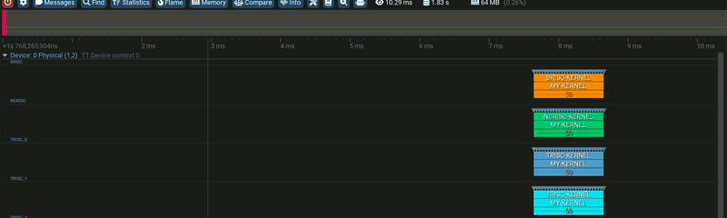
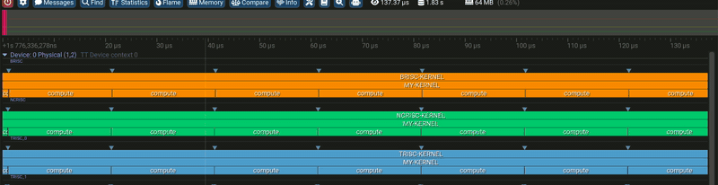
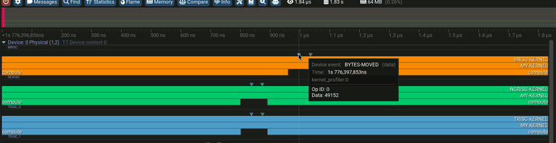

# Streaming profiler in the Tracy GUI

Data is streamed off the device as it is produced, so capture runs continuously instead of stopping at
a kernel or program boundary. Host callbacks receive every record and decide what to do with it (see
[STREAMING_PROFILER_DETAILED.md](STREAMING_PROFILER_DETAILED.md)). A Tracy callback ships built in: set
`TT_METAL_STREAMING_PROFILER_TRACY=1` and it pushes every zone, event and timestamped data record to the GUI.

The three device-side primitives are below — device code, the host callback that receives it, and how
it renders. All three GIFs come from one 50-iteration demo kernel; one GPU context per worker core,
one row per RISC.

## 1. Zone scope — `DeviceZoneScopedN`

Device:

```cpp
void kernel_main() {
    DeviceZoneScopedN("MY-KERNEL");    // one zone spanning the whole kernel
    for (uint32_t it = 0; it < N_ITERS; it++) {
        DeviceZoneScopedN("compute");  // nested zone: opens here...
        do_compute();                  // ~20 us of work
    }                                  // ...closes at the end of the scope
}
```

Host callback — a zone arrives as one record, whole, when it closes. The public API is
`<tt-metalium/experimental/streaming_profiler.hpp>` (namespace `tt::tt_metal::experimental::streaming_profiler`);
register a callable taking the `Batch` of the record types you want:

```cpp
Callback zones = RegisterCallback([](const Batch<Zone>& batch) {
    for (const Zone& zone : batch.records<Zone>()) {
        fmt::print("{}: {} ns on chip {} core ({},{}) {} (op {})\n",
            zone.metadata().name,  // "compute"
            zone.payload().duration().count(), zone.core().chip_id, zone.core().logical.x, zone.core().logical.y,
            enchantum::to_string(zone.core().processor), zone.runtime_id());
    }
}, "zone-sink");
// destroying `zones`, or zones.reset(), unregisters the callback
```



A named RAII scope, alive until the end of its `{}`. Zones nest: every RISC row shows
`*-KERNEL` (the firmware wrapper) with `MY-KERNEL` under it and the per-iteration `compute`
zones one level deeper. Hovering shows the name and GPU execution time (~20 us here).

## 2. Timestamped data — `DeviceTimestampedData`

Device:

```cpp
uint64_t bytes_moved = 0;
for (uint32_t it = 0; it < N_ITERS; it++) {
    do_compute();
    bytes_moved += 2048;                                // any runtime value
    DeviceTimestampedData("BYTES-MOVED", bytes_moved);  // stamped with the device time
}
```

Host callback — a `TimestampedData` record arrives assembled, its values as a span of uint64 words:

```cpp
Callback data = RegisterCallback([](const Batch<TimestampedData>& batch) {
    for (const TimestampedData& record : batch.records<TimestampedData>()) {
        fmt::print("{} @ {}: value={}\n",
            record.metadata().name,  // "BYTES-MOVED"
            record.published_at().time().time_since_epoch().count(), record.payload()[0]);
    }
}, "data-sink");
```



A point event carrying a 64-bit runtime value. Renders as a triangle above the row; the tooltip
shows name, timestamp, and the value — here `Data: 49152` = `bytes_moved` after 24 iterations.

## 3. Event — `DeviceRecordEvent`

Device:

```cpp
for (uint32_t it = 0; it < N_ITERS; it++) {
    DeviceRecordEvent("LOOP-START");   // a named instant, no payload
    do_compute();
}
```

Host callback — an `Event` is a name and a time, nothing else:

```cpp
Callback events = RegisterCallback([](const Batch<Event>& batch) {
    for (const Event& event : batch.records<Event>()) {
        fmt::print("{} @ {} on core ({},{})\n",
            event.metadata().name, event.published_at().time().time_since_epoch().count(),  // "LOOP-START" @ host time
            event.core().logical.x, event.core().logical.y);
    }
}, "event-sink");
```



The payload-free point event: a name and a device timestamp, nothing else. Use it to put a
moment (phase boundary, retry, error path) on the timeline. Here one `LOOP-START` per
iteration, next to that iteration's `BYTES-MOVED` on the same row. Same macro as the DRAM
profiler's; there its argument is a runtime `uint16_t` id, here it is a compile-time name like
the other two primitives, because the streaming wire resolves every marker's name from the ELF.

## 4. Your own records — `DevicePublish`

A kernel can publish a struct of its own, and a callback receives it as the same C++ type. Define the payload, and a
metadata struct that names the call site, in a header that both the kernel and the host include:

```cpp
// tile_stats.hpp
#pragma once
#include <cstdint>
#include <hostdevcommon/streaming_profiler_types.hpp>

struct TileStats {  // the payload, sent with each record
    uint32_t tiles, bytes;
};
struct Name {  // the metadata, fixed when the kernel compiles
    tt::tt_metal::experimental::streaming_profiler::String name;  // "..."_s in a kernel, a std::string_view on the host
};
```

Device:

```cpp
#include "api/debug/device_publish.h"
#include "tile_stats.hpp"

void kernel_main() {
    for (uint32_t it = 0; it < N_ITERS; it++) {
        do_compute();
        DevicePublish<Name{"tile stats"_s}>(TileStats{it, it * 2048});
    }
}
```

Host callback — a `Record<Payload, Metadata>` holds the payload, which `r.payload()` reaches, and its call site's
metadata:

```cpp
Callback stats = RegisterCallback([](const Batch<Record<TileStats, Name>>& batch) {
    for (const auto& r : batch.records<Record<TileStats, Name>>()) {
        fmt::print("{} @ {}: {} tiles, {} bytes\n",
            r.metadata().name,  // "tile stats"
            r.published_at().time().time_since_epoch().count(), r.payload().tiles, r.payload().bytes);
    }
}, "stats-sink");
```

A kernel can pass arguments one by one instead of a struct. `DevicePublish<Name{"tiles"_s}>(count, ratio)`, with a
`uint32_t` count and a `float` ratio, reaches a callback as `Record<std::tuple<uint32_t, float>, Name>`, and a single
argument as its own type, such as `Record<uint32_t, Name>`. Call sites that pass different numbers of arguments reach
`Record<Variadic<T>, Name>`, whose payload is a span of them.

Payload fields and arguments use fixed-width types such as `uint32_t` and `float`, and `Timestamp` for a time a kernel
takes with `Timestamp::now()`. Text is `String`, and goes only in metadata: to send text chosen at runtime, branch over
`DevicePublish` calls, one per text, and pass `kNoInline` so each branch costs only a call. The full rules are in
`api/debug/device_publish.h`.

## Where to go next

- [`STREAMING_PROFILER_DETAILED.md`](STREAMING_PROFILER_DETAILED.md) — the full reference: the three profiler
  modes and every environment variable, the relay/receiver architecture, the wire format, the offline tools.
- [`STREAMING_PROFILER_FINDINGS.md`](STREAMING_PROFILER_FINDINGS.md) — the dated record of findings and
  benchmarks behind the design.
