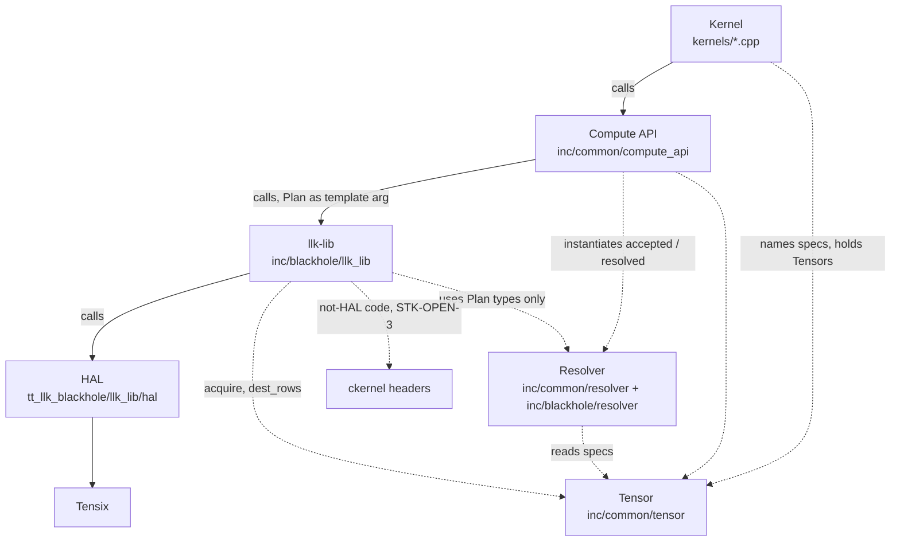
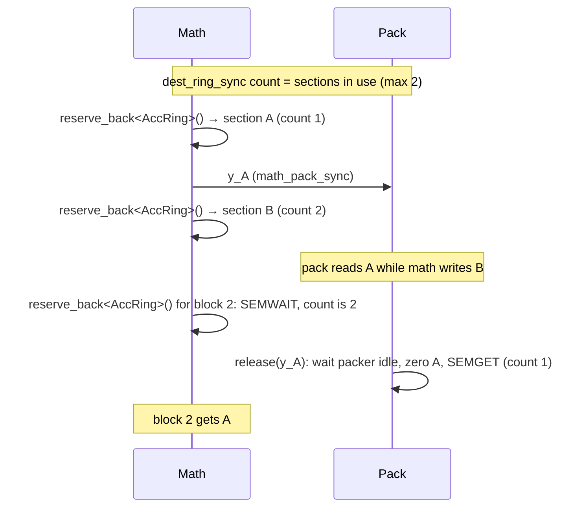

# LLK 2.0 stack layers

Status: **draft for review**. Conventions: [README.md](README.md).

LLK 2.0 is a layered compute stack on the typed Blackhole HAL.
A kernel is one `.cpp` that every TRISC compiles; each Compute API call is planned at compile time, and each thread's build keeps only its own part. [kernel.cpp:5-7] [thread.h:5-10]
The operand type is specified in [tensor.md](tensor.md), and compile-time planning in [resolver.md](resolver.md).



Solid edges are calls; dashed edges are compile-time data or type use.

## Contract

### Layers

- **STK-LAY-1** · Calls go down one layer only: Kernel → Compute API → llk-lib → HAL. [README.md:6-7]
- **STK-LAY-2** · Tensor and Resolver are used by more than one layer and are not in the call chain. [README.md:6-7]
- **STK-LAY-3** · Everything is compile time except addresses. [README.md:7]
- **STK-LAY-4** · No layer has an init, uninit, reconfig or hw_configure call. [kernel.cpp:6-7] [lib/unpack.h:51-52] [README.md:65]

| Layer | Where | Responsibility | Arch |
|-------|-------|----------------|------|
| Kernel | `kernels/` | Names specs, loops over blocks, calls ops, releases storage | any |
| Compute API | `inc/common/compute_api/` | One function per op on Tensors, modifier struct as template argument; checks `accepted`, reads `resolved`, calls `acquire` per operand, calls llk-lib per thread, returns the result re-owned | independent |
| Tensor | `inc/common/tensor/` | Shape, format, storage and owner in the type; address at run time | independent |
| Resolver | `inc/common/resolver/`, `inc/blackhole/resolver/` | Per call, at compile time: accepts, options, work, plan | driver independent; OpApis per arch |
| llk-lib | `inc/blackhole/llk_lib/` | Thread split and hardware programming in HAL calls | per arch |
| HAL | `tt_llk_blackhole/llk_lib/hal/` | Typed instructions, config fields, semaphores, MOP and replay | per arch |

[README.md:9-34] [api/matmul.h:36-56]

### Arch split

- **STK-ARCH-1** · The build puts `inc/common` and exactly one `inc/<arch>` on the include path. [README.md:21]
- **STK-ARCH-2** · Arch-independent code includes arch files by bare path (`"resolver/matmul.h"`, `"llk_lib/matmul.h"`), which resolve to `inc/<arch>/…`. [derived: STK-ARCH-1 and the includes in `api/*.h`]
- **STK-ARCH-3** · A new arch adds `inc/<arch>/resolver` and `inc/<arch>/llk_lib`; the kernel and Compute API stay the same. [derived from STK-ARCH-1, STK-ARCH-2]

### Thread split

- **STK-THR-1** · `current_thread` is `Unpack`, `Math` or `Pack` from `LLK_TRISC_*` (tt-llk harness) or `TRISC_*` (tt-metal), else `None` (host: plan only). [thread.h:19-29]
- **STK-THR-2** · Every per-thread llk-lib call takes the thread it runs on, `On`, and has both checks: `static_assert(On == <thread>)` checks the call, and `if constexpr (runs_on<On>)` keeps the body only in that thread's build. [thread.h:31-39]
- **STK-THR-3** · Planning (`<op>_params_from`) runs on every build; configure and execute run only where `current_thread == On`. [thread.h:5-8]
- **STK-THR-4** · Every TRISC runs the same kernel loop with the same calls; that is how threads agree on Dest ring sections and buffer pointers without shared state. [lib/dest.h:20-24] [lib/sync.h:16-17]

### llk-lib pattern

- **STK-LIB-1** · Each llk-lib op header has the same five parts: [lib/matmul.h:8-14] [lib/eltwise_binary.h:9-14] [lib/copy.h:9-14] [lib/vec.h:12-19] [lib/pack.h:10-18] [lib/unpack.h:22-28]

```cpp
struct <op>_params { … };                              // one struct; configure and execute take the same one
constexpr <op>_params <op>_params_from(const Plan&);  // the Resolver's Plan → this thread's view
template <<op>_params P> void <op>_configure();       // programs the units completely
template <<op>_params P> void <op>_execute(…);        // the loop over tiles / K steps
template <Thread On, Plan Pl> void <op>(…);           // the entry the Compute API calls
```

- **STK-LIB-2** · `configure` programs everything its units need on every call and assumes nothing about what ran before; removing redundant writes is left to the compiler. [lib/unpack.h:51-52] [lib/pack.h:33]
- **STK-LIB-3** · llk-lib uses the Resolver's data types (`plan.h`, `vec_function.h`) but none of its logic. [derived: the only `resolver/` includes in `lib/`]

| Header | Thread | Takes |
|--------|--------|-------|
| `unpack.h` | Unpack | L1 byte addresses |
| `matmul.h`, `eltwise_binary.h`, `copy.h` | Math | Dest row |
| `vec.h` | Math or Pack | Dest row, FP32 scalars |
| `pack.h` | Pack | Dest row, L1 byte address, `l1_acc` |
| `sync.h`, `dest.h`, `semaphores.h` | all | specs, ring params |

[derived from STK-LIB-1 entries and TEN-TEN-4]

### Synchronization

- **STK-SYNC-1** · The kernel writes no sync; read-after-write between ops comes from owners (TEN-SYNC-1..7). [kernel.cpp:9-16]
- **STK-SYNC-2** · Write-after-read is explicit: a Dest ring, or `complete<T>(t)` for a Dest tensor at a fixed row. [lib/sync.h:17-19] [lib/dest.h:12-13] [api/sync.h:23-24]
- **STK-SYNC-3** · `migrate<Sfpu, From, To>()` moves the SFPU between math and pack; no other unit can move. [lib/sync.h:27-29] [lib/sync.h:147-151]
- **STK-SYNC-4** · Unpack → math within an op (Src valid, Src bank release) stays inside the op. [lib/matmul.h:136] [derived]
- **STK-SYNC-5** · L1 across kernels goes only through dataflow buffers. [README.md:62-64]

| Semaphore | llk2 name | Counts | Source |
|-----------|-----------|--------|--------|
| S0 · FPU_SFPU | `pack_math_sync` | tensors pack handed to math, not yet taken | [lib/semaphores.h:37-38] |
| S1 · MATH_PACK | `math_pack_sync` | tensors math handed to pack, not yet taken | [lib/semaphores.h:34-35] |
| S2 · UNPACK_TO_DEST | `unpack_to_dest_sync` | tiles unpacked to Dest, not yet taken by math | [lib/semaphores.h:31-32] |
| S4 · PACK_DONE | `dest_ring_sync` | ring sections math reserved and pack has not released | [lib/semaphores.h:40-41] |
| S5 · UNPACK_SYNC | `unpack_sync` | config contexts handed to the unpackers, not finished | [lib/semaphores.h:28-29] |
| S7 · MATH_DONE | `math_done_sync` | math and SFPU idle, before an unpack to Dest | [lib/semaphores.h:43-44] |

- **STK-SEM-1** · Semaphore numbers are ckernel's, so old-LLK and llk-lib code agree; S0 and S4 reuse numbers no LLK uses on this path. [lib/semaphores.h:5-7] [lib/semaphores.h:16-17]
- **STK-SEM-2** · A semaphore is set up lazily by its first poster (`semaphore_setup_once`, a per-thread `.bss` flag), which first waits for the count to reach 0 so a count left by an earlier kernel is not read as this kernel's. [lib/semaphores.h:46-66]

### Dest ring

- **STK-RING-1** · Dest is split into 1 or 2 sections of `DEST_REGISTER_FULL_SIZE / Sections` rows. [lib/dest.h:8-10] [lib/dest.h:110]
- **STK-RING-2** · `ring_reserve` runs on math: it waits while all sections are taken, then takes one (SEMWAIT, SEMPOST `dest_ring_sync`). [lib/dest.h:14-15] [lib/dest.h:109]
- **STK-RING-3** · `ring_release` runs on pack: it waits for the packer, zeroes the section, and gives it back (SEMGET). [lib/dest.h:16] [lib/dest.h:122-138]
- **STK-RING-4** · Every thread keeps its own section index; the n-th reserve is section `n % Sections` on every thread. [lib/dest.h:20-24]
- **STK-RING-5** · `dest_ring_sync` is set up in math's first `ring_reserve`. [lib/dest.h:26-27]
- **STK-RING-6** · Every reserve returns a zeroed section; the first ones rely on Dest being zero at kernel start. [lib/dest.h:29-32]

### Dataflow buffers

- **STK-DFB-1** · Dataflow buffers stay tt-metal's; `compute_api/dataflow.h` calls only `wait_front`, `pop_front`, `reserve_back`, `push_back` and the pointer getters. [api/dataflow.h:16] [README.md:62-64]
- **STK-DFB-2** · `Buffer` is a template parameter, so any type with those methods works; the tests use `tests/helpers/test_dataflow_buffer.h`. [api/dataflow.h:16-17] [README.md:47]

### Requirements on tt-metal

The kernel assumes these, which tt-metal does not provide today: [kernel.cpp:42-51]

- **STK-MET-1** · Each CB's format is a named compile-time argument `<cb>_format`, the same on all three TRISCs. [kernel.cpp:43-45]
- **STK-MET-2** · Every CB page is one tile. [kernel.cpp:46]
- **STK-MET-3** · `cb_intermed0` holds exactly one output block, so L1 accumulation reserves the same pages again. [kernel.cpp:47-48]
- **STK-MET-4** · `llk2/inc` is on the include path. [kernel.cpp:49]

## Rationale

- Discarding the other threads' branches with `if constexpr` means a thread-specific call cannot leak into the wrong ELF, and the same kernel file builds in both the harness and tt-metal. [thread.h:5-8] [thread.h:19-20]
- With no init call, an op does not depend on which op ran before it. [lib/unpack.h:51-52] [lib/pack.h:33]
- Moving an SFPU call to the pack thread changes only its modifier. [README.md:50-52]

## Examples

### One call, three builds

`y = matmul(x, w, acc)` and the two calls after it, with `x`, `w` from `wait_front` and `acc` from a Dest ring.
The math → pack hand-off happens inside the consumer, not inside matmul. [derived from TEN-SYNC rules]

| Compute API statement | TRISC0 (unpack) | TRISC1 (math) | TRISC2 (pack) |
|-----------------------|-----------------|---------------|---------------|
| `static_assert(accepted<…>)`, `resolved<…>` | compile time | compile time | compile time |
| `acquire<Unpack, Unpacker, x / w>` | nothing (same owner) | nothing | nothing |
| `acquire<Math, Fpu, acc>` | nothing | nothing (same owner) | nothing |
| `llk_lib::unpack<Unpack, r.plan>` | configure + execute | discarded | discarded |
| `llk_lib::matmul<Math, r.plan>` | discarded | configure + execute | discarded |
| `vec_silu<{.thread = Pack}>(y)` → `acquire<Pack, Sfpu, y>` | nothing | wait FPU idle, SEMPOST `math_pack_sync` | SEMWAIT, SEMGET; vec configure + execute |
| `pack(z, slot)` → `acquire<Pack, Packer, z>` | nothing | nothing | STALLWAIT until SFPU idle; pack configure + execute |

[derived] from STK-THR-2, TEN-SYNC-3..5 and [api/matmul.h:51-56].

### Dest ring over two output blocks



[derived] from STK-RING-1..6.

## Open items

- **STK-OPEN-1** · Output subblocks: the fused kernel handles one per block; more need Tensor views and stride-based steps (TEN-OPEN-1, RES-OPEN-4). [kernel.cpp:56]
- **STK-OPEN-2** · Not yet ported from the 1.0 kernel: in0/in1 transpose, untilize_out, batch from the reader, `BIAS_FULL_BLOCK` / element-wise bias, `MATMUL_DRAM_SHARDED` padding, `SKIP_COMPUTE`, and activations other than silu, relu6 and hardtanh. [kernel.cpp:56-58]
  The PR describes these as not ported by decision. [PR]
- **STK-OPEN-3** · Code that still bypasses the HAL, as each file marks it: format helpers, the Src zero-flag rule, thread mailboxes, SFPCONFIG and SFPI's own SETRWC, GPR indices, `unp_cfg_context`, L1 address checks, `DEST_REGISTER_FULL_SIZE`. [lib/unpack.h:54-58] [lib/pack.h:37-39] [lib/math_common.h:20-21] [lib/copy.h:36] [lib/vec.h:37-39] [lib/formats.h:8] [lib/dest.h:34]
  Who moves each item into the HAL is not decided in the code or the PR. [open]
- **STK-OPEN-4** · One Dest ring per kernel: the semaphore and the section index are global. [lib/dest.h:20-27] [derived]
- **STK-OPEN-5** · One Dest mode per kernel (RES-OPEN-5); 32 × 32 tiles only (RES-OPEN-2).
- **STK-OPEN-6** · Integration into tt-metal depends on STK-MET-1. [kernel.cpp:42-45]
- **STK-OPEN-7** · Which 1.0 APIs each layer replaces (for example `tile_regs_*`, `*_init`, `_llk_unpack_*` families) is not recorded in the code. [open] Should this doc carry a mapping?

## Evidence

| Test | Covers | Source |
|------|--------|--------|
| `test_llk2_matmul.py` | matmul against `test_matmul.py`'s golden | [tests/test_llk2_matmul.py:3-7] |
| `test_llk2_pack.py` | ReLU and L1 accumulation (Off, On, Runtime), behind a matmul | [tests/test_llk2_pack.py:3-7] |
| `test_llk2_bmm_fused.py` | the kernel file itself, on one core | [tests/test_llk2_bmm_fused.py:3-11] |
| `test_llk2_add.py` | add and sub, plain and row broadcast | [tests/test_llk2_add.py:3-9] |
| `test_llk2_vec.py` | the SFPU activations, on math and pack | [tests/test_llk2_vec.py:3-7] [tests/test_llk2_vec.py:103] |
| `test_llk2_dfb.py` | Tensors from `wait_front` / `reserve_back` feeding matmul | [tests/test_llk2_dfb.py:3-10] |
| `test_llk2_copy.py` | copy, with and without transpose | [tests/test_llk2_copy.py:3-9] [tests/test_llk2_copy.py:65] |
| `test_llk2_sync.py` | `complete` and `migrate`, Dest tensors at fixed rows | [tests/test_llk2_sync.py:3-7] |

The PR reports 2,110 passing cases on Blackhole ttsim v1.12.1, and no silicon run. [PR]
The HAL below llk-lib comes from the stacked HAL PRs #58990 … #59009. [PR]
llk-lib includes 11 HAL headers; `hal/sync.h` (9 headers), `hal/cfg.h` and `hal/tensix_counters.h` (7 each) are the most used. [derived: `#include "hal/…"` in `lib/`]

<!-- Links below are generated by gen_links.py; do not edit by hand. -->

[PR]: https://github.com/tenstorrent/tt-metal/pull/62961
[README.md:21]: https://github.com/tenstorrent/tt-metal/blob/972eb4de3392481e56c7509f58870c754019ed01/tt_metal/tt-llk/llk2/README.md#L21
[README.md:47]: https://github.com/tenstorrent/tt-metal/blob/972eb4de3392481e56c7509f58870c754019ed01/tt_metal/tt-llk/llk2/README.md#L47
[README.md:50-52]: https://github.com/tenstorrent/tt-metal/blob/972eb4de3392481e56c7509f58870c754019ed01/tt_metal/tt-llk/llk2/README.md#L50-L52
[README.md:6-7]: https://github.com/tenstorrent/tt-metal/blob/972eb4de3392481e56c7509f58870c754019ed01/tt_metal/tt-llk/llk2/README.md#L6-L7
[README.md:62-64]: https://github.com/tenstorrent/tt-metal/blob/972eb4de3392481e56c7509f58870c754019ed01/tt_metal/tt-llk/llk2/README.md#L62-L64
[README.md:65]: https://github.com/tenstorrent/tt-metal/blob/972eb4de3392481e56c7509f58870c754019ed01/tt_metal/tt-llk/llk2/README.md#L65
[README.md:7]: https://github.com/tenstorrent/tt-metal/blob/972eb4de3392481e56c7509f58870c754019ed01/tt_metal/tt-llk/llk2/README.md#L7
[README.md:9-34]: https://github.com/tenstorrent/tt-metal/blob/972eb4de3392481e56c7509f58870c754019ed01/tt_metal/tt-llk/llk2/README.md#L9-L34
[api/dataflow.h:16]: https://github.com/tenstorrent/tt-metal/blob/972eb4de3392481e56c7509f58870c754019ed01/tt_metal/tt-llk/llk2/inc/common/compute_api/dataflow.h#L16
[api/dataflow.h:16-17]: https://github.com/tenstorrent/tt-metal/blob/972eb4de3392481e56c7509f58870c754019ed01/tt_metal/tt-llk/llk2/inc/common/compute_api/dataflow.h#L16-L17
[api/matmul.h:36-56]: https://github.com/tenstorrent/tt-metal/blob/972eb4de3392481e56c7509f58870c754019ed01/tt_metal/tt-llk/llk2/inc/common/compute_api/matmul.h#L36-L56
[api/matmul.h:51-56]: https://github.com/tenstorrent/tt-metal/blob/972eb4de3392481e56c7509f58870c754019ed01/tt_metal/tt-llk/llk2/inc/common/compute_api/matmul.h#L51-L56
[api/sync.h:23-24]: https://github.com/tenstorrent/tt-metal/blob/972eb4de3392481e56c7509f58870c754019ed01/tt_metal/tt-llk/llk2/inc/common/compute_api/sync.h#L23-L24
[kernel.cpp:42-45]: https://github.com/tenstorrent/tt-metal/blob/972eb4de3392481e56c7509f58870c754019ed01/tt_metal/tt-llk/llk2/kernels/bmm_large_block_zm_fused_bias_activation.cpp#L42-L45
[kernel.cpp:42-51]: https://github.com/tenstorrent/tt-metal/blob/972eb4de3392481e56c7509f58870c754019ed01/tt_metal/tt-llk/llk2/kernels/bmm_large_block_zm_fused_bias_activation.cpp#L42-L51
[kernel.cpp:43-45]: https://github.com/tenstorrent/tt-metal/blob/972eb4de3392481e56c7509f58870c754019ed01/tt_metal/tt-llk/llk2/kernels/bmm_large_block_zm_fused_bias_activation.cpp#L43-L45
[kernel.cpp:46]: https://github.com/tenstorrent/tt-metal/blob/972eb4de3392481e56c7509f58870c754019ed01/tt_metal/tt-llk/llk2/kernels/bmm_large_block_zm_fused_bias_activation.cpp#L46
[kernel.cpp:47-48]: https://github.com/tenstorrent/tt-metal/blob/972eb4de3392481e56c7509f58870c754019ed01/tt_metal/tt-llk/llk2/kernels/bmm_large_block_zm_fused_bias_activation.cpp#L47-L48
[kernel.cpp:49]: https://github.com/tenstorrent/tt-metal/blob/972eb4de3392481e56c7509f58870c754019ed01/tt_metal/tt-llk/llk2/kernels/bmm_large_block_zm_fused_bias_activation.cpp#L49
[kernel.cpp:5-7]: https://github.com/tenstorrent/tt-metal/blob/972eb4de3392481e56c7509f58870c754019ed01/tt_metal/tt-llk/llk2/kernels/bmm_large_block_zm_fused_bias_activation.cpp#L5-L7
[kernel.cpp:56]: https://github.com/tenstorrent/tt-metal/blob/972eb4de3392481e56c7509f58870c754019ed01/tt_metal/tt-llk/llk2/kernels/bmm_large_block_zm_fused_bias_activation.cpp#L56
[kernel.cpp:56-58]: https://github.com/tenstorrent/tt-metal/blob/972eb4de3392481e56c7509f58870c754019ed01/tt_metal/tt-llk/llk2/kernels/bmm_large_block_zm_fused_bias_activation.cpp#L56-L58
[kernel.cpp:6-7]: https://github.com/tenstorrent/tt-metal/blob/972eb4de3392481e56c7509f58870c754019ed01/tt_metal/tt-llk/llk2/kernels/bmm_large_block_zm_fused_bias_activation.cpp#L6-L7
[kernel.cpp:9-16]: https://github.com/tenstorrent/tt-metal/blob/972eb4de3392481e56c7509f58870c754019ed01/tt_metal/tt-llk/llk2/kernels/bmm_large_block_zm_fused_bias_activation.cpp#L9-L16
[lib/copy.h:36]: https://github.com/tenstorrent/tt-metal/blob/972eb4de3392481e56c7509f58870c754019ed01/tt_metal/tt-llk/llk2/inc/blackhole/llk_lib/copy.h#L36
[lib/copy.h:9-14]: https://github.com/tenstorrent/tt-metal/blob/972eb4de3392481e56c7509f58870c754019ed01/tt_metal/tt-llk/llk2/inc/blackhole/llk_lib/copy.h#L9-L14
[lib/dest.h:109]: https://github.com/tenstorrent/tt-metal/blob/972eb4de3392481e56c7509f58870c754019ed01/tt_metal/tt-llk/llk2/inc/blackhole/llk_lib/dest.h#L109
[lib/dest.h:110]: https://github.com/tenstorrent/tt-metal/blob/972eb4de3392481e56c7509f58870c754019ed01/tt_metal/tt-llk/llk2/inc/blackhole/llk_lib/dest.h#L110
[lib/dest.h:12-13]: https://github.com/tenstorrent/tt-metal/blob/972eb4de3392481e56c7509f58870c754019ed01/tt_metal/tt-llk/llk2/inc/blackhole/llk_lib/dest.h#L12-L13
[lib/dest.h:122-138]: https://github.com/tenstorrent/tt-metal/blob/972eb4de3392481e56c7509f58870c754019ed01/tt_metal/tt-llk/llk2/inc/blackhole/llk_lib/dest.h#L122-L138
[lib/dest.h:14-15]: https://github.com/tenstorrent/tt-metal/blob/972eb4de3392481e56c7509f58870c754019ed01/tt_metal/tt-llk/llk2/inc/blackhole/llk_lib/dest.h#L14-L15
[lib/dest.h:16]: https://github.com/tenstorrent/tt-metal/blob/972eb4de3392481e56c7509f58870c754019ed01/tt_metal/tt-llk/llk2/inc/blackhole/llk_lib/dest.h#L16
[lib/dest.h:20-24]: https://github.com/tenstorrent/tt-metal/blob/972eb4de3392481e56c7509f58870c754019ed01/tt_metal/tt-llk/llk2/inc/blackhole/llk_lib/dest.h#L20-L24
[lib/dest.h:20-27]: https://github.com/tenstorrent/tt-metal/blob/972eb4de3392481e56c7509f58870c754019ed01/tt_metal/tt-llk/llk2/inc/blackhole/llk_lib/dest.h#L20-L27
[lib/dest.h:26-27]: https://github.com/tenstorrent/tt-metal/blob/972eb4de3392481e56c7509f58870c754019ed01/tt_metal/tt-llk/llk2/inc/blackhole/llk_lib/dest.h#L26-L27
[lib/dest.h:29-32]: https://github.com/tenstorrent/tt-metal/blob/972eb4de3392481e56c7509f58870c754019ed01/tt_metal/tt-llk/llk2/inc/blackhole/llk_lib/dest.h#L29-L32
[lib/dest.h:34]: https://github.com/tenstorrent/tt-metal/blob/972eb4de3392481e56c7509f58870c754019ed01/tt_metal/tt-llk/llk2/inc/blackhole/llk_lib/dest.h#L34
[lib/dest.h:8-10]: https://github.com/tenstorrent/tt-metal/blob/972eb4de3392481e56c7509f58870c754019ed01/tt_metal/tt-llk/llk2/inc/blackhole/llk_lib/dest.h#L8-L10
[lib/eltwise_binary.h:9-14]: https://github.com/tenstorrent/tt-metal/blob/972eb4de3392481e56c7509f58870c754019ed01/tt_metal/tt-llk/llk2/inc/blackhole/llk_lib/eltwise_binary.h#L9-L14
[lib/formats.h:8]: https://github.com/tenstorrent/tt-metal/blob/972eb4de3392481e56c7509f58870c754019ed01/tt_metal/tt-llk/llk2/inc/blackhole/llk_lib/formats.h#L8
[lib/math_common.h:20-21]: https://github.com/tenstorrent/tt-metal/blob/972eb4de3392481e56c7509f58870c754019ed01/tt_metal/tt-llk/llk2/inc/blackhole/llk_lib/math_common.h#L20-L21
[lib/matmul.h:136]: https://github.com/tenstorrent/tt-metal/blob/972eb4de3392481e56c7509f58870c754019ed01/tt_metal/tt-llk/llk2/inc/blackhole/llk_lib/matmul.h#L136
[lib/matmul.h:8-14]: https://github.com/tenstorrent/tt-metal/blob/972eb4de3392481e56c7509f58870c754019ed01/tt_metal/tt-llk/llk2/inc/blackhole/llk_lib/matmul.h#L8-L14
[lib/pack.h:10-18]: https://github.com/tenstorrent/tt-metal/blob/972eb4de3392481e56c7509f58870c754019ed01/tt_metal/tt-llk/llk2/inc/blackhole/llk_lib/pack.h#L10-L18
[lib/pack.h:33]: https://github.com/tenstorrent/tt-metal/blob/972eb4de3392481e56c7509f58870c754019ed01/tt_metal/tt-llk/llk2/inc/blackhole/llk_lib/pack.h#L33
[lib/pack.h:37-39]: https://github.com/tenstorrent/tt-metal/blob/972eb4de3392481e56c7509f58870c754019ed01/tt_metal/tt-llk/llk2/inc/blackhole/llk_lib/pack.h#L37-L39
[lib/semaphores.h:16-17]: https://github.com/tenstorrent/tt-metal/blob/972eb4de3392481e56c7509f58870c754019ed01/tt_metal/tt-llk/llk2/inc/blackhole/llk_lib/semaphores.h#L16-L17
[lib/semaphores.h:28-29]: https://github.com/tenstorrent/tt-metal/blob/972eb4de3392481e56c7509f58870c754019ed01/tt_metal/tt-llk/llk2/inc/blackhole/llk_lib/semaphores.h#L28-L29
[lib/semaphores.h:31-32]: https://github.com/tenstorrent/tt-metal/blob/972eb4de3392481e56c7509f58870c754019ed01/tt_metal/tt-llk/llk2/inc/blackhole/llk_lib/semaphores.h#L31-L32
[lib/semaphores.h:34-35]: https://github.com/tenstorrent/tt-metal/blob/972eb4de3392481e56c7509f58870c754019ed01/tt_metal/tt-llk/llk2/inc/blackhole/llk_lib/semaphores.h#L34-L35
[lib/semaphores.h:37-38]: https://github.com/tenstorrent/tt-metal/blob/972eb4de3392481e56c7509f58870c754019ed01/tt_metal/tt-llk/llk2/inc/blackhole/llk_lib/semaphores.h#L37-L38
[lib/semaphores.h:40-41]: https://github.com/tenstorrent/tt-metal/blob/972eb4de3392481e56c7509f58870c754019ed01/tt_metal/tt-llk/llk2/inc/blackhole/llk_lib/semaphores.h#L40-L41
[lib/semaphores.h:43-44]: https://github.com/tenstorrent/tt-metal/blob/972eb4de3392481e56c7509f58870c754019ed01/tt_metal/tt-llk/llk2/inc/blackhole/llk_lib/semaphores.h#L43-L44
[lib/semaphores.h:46-66]: https://github.com/tenstorrent/tt-metal/blob/972eb4de3392481e56c7509f58870c754019ed01/tt_metal/tt-llk/llk2/inc/blackhole/llk_lib/semaphores.h#L46-L66
[lib/semaphores.h:5-7]: https://github.com/tenstorrent/tt-metal/blob/972eb4de3392481e56c7509f58870c754019ed01/tt_metal/tt-llk/llk2/inc/blackhole/llk_lib/semaphores.h#L5-L7
[lib/sync.h:147-151]: https://github.com/tenstorrent/tt-metal/blob/972eb4de3392481e56c7509f58870c754019ed01/tt_metal/tt-llk/llk2/inc/blackhole/llk_lib/sync.h#L147-L151
[lib/sync.h:16-17]: https://github.com/tenstorrent/tt-metal/blob/972eb4de3392481e56c7509f58870c754019ed01/tt_metal/tt-llk/llk2/inc/blackhole/llk_lib/sync.h#L16-L17
[lib/sync.h:17-19]: https://github.com/tenstorrent/tt-metal/blob/972eb4de3392481e56c7509f58870c754019ed01/tt_metal/tt-llk/llk2/inc/blackhole/llk_lib/sync.h#L17-L19
[lib/sync.h:27-29]: https://github.com/tenstorrent/tt-metal/blob/972eb4de3392481e56c7509f58870c754019ed01/tt_metal/tt-llk/llk2/inc/blackhole/llk_lib/sync.h#L27-L29
[lib/unpack.h:22-28]: https://github.com/tenstorrent/tt-metal/blob/972eb4de3392481e56c7509f58870c754019ed01/tt_metal/tt-llk/llk2/inc/blackhole/llk_lib/unpack.h#L22-L28
[lib/unpack.h:51-52]: https://github.com/tenstorrent/tt-metal/blob/972eb4de3392481e56c7509f58870c754019ed01/tt_metal/tt-llk/llk2/inc/blackhole/llk_lib/unpack.h#L51-L52
[lib/unpack.h:54-58]: https://github.com/tenstorrent/tt-metal/blob/972eb4de3392481e56c7509f58870c754019ed01/tt_metal/tt-llk/llk2/inc/blackhole/llk_lib/unpack.h#L54-L58
[lib/vec.h:12-19]: https://github.com/tenstorrent/tt-metal/blob/972eb4de3392481e56c7509f58870c754019ed01/tt_metal/tt-llk/llk2/inc/blackhole/llk_lib/vec.h#L12-L19
[lib/vec.h:37-39]: https://github.com/tenstorrent/tt-metal/blob/972eb4de3392481e56c7509f58870c754019ed01/tt_metal/tt-llk/llk2/inc/blackhole/llk_lib/vec.h#L37-L39
[tests/test_llk2_add.py:3-9]: https://github.com/tenstorrent/tt-metal/blob/972eb4de3392481e56c7509f58870c754019ed01/tt_metal/tt-llk/llk2/tests/python_tests/test_llk2_add.py#L3-L9
[tests/test_llk2_bmm_fused.py:3-11]: https://github.com/tenstorrent/tt-metal/blob/972eb4de3392481e56c7509f58870c754019ed01/tt_metal/tt-llk/llk2/tests/python_tests/test_llk2_bmm_fused.py#L3-L11
[tests/test_llk2_copy.py:3-9]: https://github.com/tenstorrent/tt-metal/blob/972eb4de3392481e56c7509f58870c754019ed01/tt_metal/tt-llk/llk2/tests/python_tests/test_llk2_copy.py#L3-L9
[tests/test_llk2_copy.py:65]: https://github.com/tenstorrent/tt-metal/blob/972eb4de3392481e56c7509f58870c754019ed01/tt_metal/tt-llk/llk2/tests/python_tests/test_llk2_copy.py#L65
[tests/test_llk2_dfb.py:3-10]: https://github.com/tenstorrent/tt-metal/blob/972eb4de3392481e56c7509f58870c754019ed01/tt_metal/tt-llk/llk2/tests/python_tests/test_llk2_dfb.py#L3-L10
[tests/test_llk2_matmul.py:3-7]: https://github.com/tenstorrent/tt-metal/blob/972eb4de3392481e56c7509f58870c754019ed01/tt_metal/tt-llk/llk2/tests/python_tests/test_llk2_matmul.py#L3-L7
[tests/test_llk2_pack.py:3-7]: https://github.com/tenstorrent/tt-metal/blob/972eb4de3392481e56c7509f58870c754019ed01/tt_metal/tt-llk/llk2/tests/python_tests/test_llk2_pack.py#L3-L7
[tests/test_llk2_sync.py:3-7]: https://github.com/tenstorrent/tt-metal/blob/972eb4de3392481e56c7509f58870c754019ed01/tt_metal/tt-llk/llk2/tests/python_tests/test_llk2_sync.py#L3-L7
[tests/test_llk2_vec.py:103]: https://github.com/tenstorrent/tt-metal/blob/972eb4de3392481e56c7509f58870c754019ed01/tt_metal/tt-llk/llk2/tests/python_tests/test_llk2_vec.py#L103
[tests/test_llk2_vec.py:3-7]: https://github.com/tenstorrent/tt-metal/blob/972eb4de3392481e56c7509f58870c754019ed01/tt_metal/tt-llk/llk2/tests/python_tests/test_llk2_vec.py#L3-L7
[thread.h:19-20]: https://github.com/tenstorrent/tt-metal/blob/972eb4de3392481e56c7509f58870c754019ed01/tt_metal/tt-llk/llk2/inc/common/llk_lib/thread.h#L19-L20
[thread.h:19-29]: https://github.com/tenstorrent/tt-metal/blob/972eb4de3392481e56c7509f58870c754019ed01/tt_metal/tt-llk/llk2/inc/common/llk_lib/thread.h#L19-L29
[thread.h:31-39]: https://github.com/tenstorrent/tt-metal/blob/972eb4de3392481e56c7509f58870c754019ed01/tt_metal/tt-llk/llk2/inc/common/llk_lib/thread.h#L31-L39
[thread.h:5-10]: https://github.com/tenstorrent/tt-metal/blob/972eb4de3392481e56c7509f58870c754019ed01/tt_metal/tt-llk/llk2/inc/common/llk_lib/thread.h#L5-L10
[thread.h:5-8]: https://github.com/tenstorrent/tt-metal/blob/972eb4de3392481e56c7509f58870c754019ed01/tt_metal/tt-llk/llk2/inc/common/llk_lib/thread.h#L5-L8
