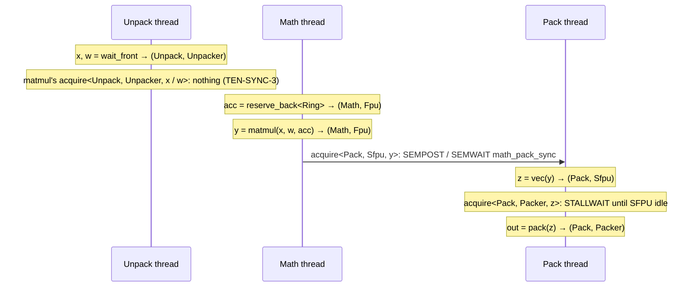

# LLK 2.0 Tensor

Status: **draft for review**. Conventions: [README.md](README.md).

The Tensor is the operand type every LLK 2.0 layer takes.
Its shape, format, storage and owner are compile-time values carried in its C++ type; only its address exists at run time. [tensor.h:5-22]
The Resolver plans from the compile-time part ([resolver.md](resolver.md)); llk-lib emits thread hand-offs from the owner (TEN-SYNC).

```
          compile time (in the type)                      |  run time
                                                          |
  TensorShape ──► TensorSpec ──► Tensor<const auto& S, R> : R
  sizes[6]        shape                                   |   uint32 address
  strides[6]      format (DataFormat)                     |   (+ Buffer* if R pops/pushes)
  offset          storage (L1 | Dest)                     |
                  thread, exu   ◄── the owner             |
```

## Contract

### Shape

- **TEN-SHAPE-1** · A `TensorShape` has rank 6, outermost first: `TileY, TileX, FaceY, FaceX, DatumY, DatumX`. [tensor.h:44-52] [tensor.h:81]
- **TEN-SHAPE-2** · Sizes and strides are counted in datums, and `offset` is the distance in datums from the address to datum 0. [tensor.h:102-109]
- **TEN-SHAPE-3** · Every face is 16 datums wide, and a full face is 16 rows. [tensor.h:87-88]
- **TEN-SHAPE-4** · L1 strides are dense: row-major in dim order (`dense_strides`). [tensor.h:180-190]
- **TEN-SHAPE-5** · Dest strides count rows of 16 datums, and every face takes a slot of at least 8 rows (`dest_strides`). [tensor.h:192-203] [tensor.h:90-91]
- **TEN-SHAPE-6** · `laid_out(sizes, format, storage)` picks the strides from the storage and sets offset 0 and owner `(None, None)`. [tensor.h:357-362]

### Spec

- **TEN-SPEC-1** · A `TensorSpec` is the shape, a `DataFormat`, a `Storage` and an owner `(Thread, Exu)`, and is a compile-time value. [tensor.h:111-120]
- **TEN-SPEC-2** · `Storage` is `L1` (address is a byte address) or `Dest` (address is a Dest row). [tensor.h:54-59]
- **TEN-SPEC-3** · `Thread` is `Unpack, Math, Pack, None`; `Exu` is `Unpacker, Fpu, Sfpu, Packer, None`. [tensor.h:61-78]
- **TEN-SPEC-4** · An `H × W` tile is valid when `W` is a positive multiple of 16 and `H` is 1, 2, 4 or 8 (tiny) or a positive multiple of 16. [tensor.h:342-348]
- **TEN-SPEC-5** · The tile must divide the tensor; otherwise compilation fails with "pad it first". [tensor.h:368-369]
- **TEN-SPEC-6** · When the caller names no tile, it is `min(Rows, 32) × min(Cols, 32)`. [tensor.h:374-380]
- **TEN-SPEC-7** · A kernel names a spec with `l1_spec<Rows, Cols, F, H, W>` or `dst_spec<…>` (or `make_spec`), which are named `constexpr` objects a `Tensor` can take by reference. [tensor.h:29-30] [tensor.h:373-389]
- **TEN-SPEC-8** · Tile grid sizes are `{Rows/H, Cols/W, H/min(H,16), W/16, min(H,16), 16}`. [tensor.h:350-355]

### Tensor and address

- **TEN-TEN-1** · `Tensor<const auto& S, class R = NoRelease>` derives from its release action `R`, names its spec by reference, and holds one `uint32_t address`. [tensor.h:131-143]
- **TEN-TEN-2** · For L1 the address is the byte address of datum 0; for Dest it is the absolute first row. [tensor.h:137]
- **TEN-TEN-3** · An L1 address is valid only on the thread that uses it: unpack for inputs, pack for outputs; on math a kernel's buffer pointer is 0. [tensor.h:24-27] [api/dataflow.h:20-23]
- **TEN-TEN-4** · Every llk-lib call that takes an L1 address runs on unpack or pack; no math-side call (matmul, eltwise_binary, copy, vec, Dest sync) takes one. [tensor.h:25-27]
- **TEN-TEN-5** · Buffer read and write pointers are in 16-byte words; `wait_front`, `peek_front` and `reserve_back` multiply them by `l1_word_bytes`. [tensor.h:94] [api/dataflow.h:75] [api/dataflow.h:84] [api/dataflow.h:102]

### Owner

- **TEN-OWN-1** · A spec's `(thread, exu)` is the unit that last wrote the tensor, or `(None, None)` if nothing in the kernel produced it. [tensor.h:15-16]
- **TEN-OWN-2** · Every op returns what it wrote re-owned under its own `(thread, unit)`; for example, matmul returns its accumulator as `(Math, Fpu)`. [tensor.h:16-18] [api/matmul.h:56]
- **TEN-OWN-3** · `owned_by<S, T, E>` is one object per spec value, so a tensor under a given owner is always the same C++ type, however many hand-offs it went through. [tensor.h:318-325]
- **TEN-OWN-4** · `as_owned<T, E>(t)` keeps `t`'s address and release action and changes only the owner. [tensor.h:327-332]
- **TEN-OWN-5** · A tensor from `wait_front` or `peek_front` is born `(Unpack, Unpacker)`; one from a buffer's `reserve_back` is born `(Pack, Packer)`. [api/dataflow.h:20-21]
- **TEN-OWN-6** · A tensor from a Dest ring's `reserve_back` is born `(Math, Fpu)`. [api/dest.h:76]

### Sync from the owner

These rules are what makes the owner useful; [stack.md](stack.md) describes the semaphores they use.

- **TEN-SYNC-1** · An op on `(T, E)` calls `llk_lib::acquire<T, E, S>()` on each operand, on every thread, before it runs. [lib/sync.h:9-10] [api/matmul.h:51-53]
- **TEN-SYNC-2** · Owner thread `None`: nothing is emitted. [lib/sync.h:120-123]
- **TEN-SYNC-3** · Same thread, same unit: nothing is emitted, since a unit runs in order. [lib/sync.h:124-130]
- **TEN-SYNC-4** · Same thread, another unit: on `T`, a STALLWAIT holds `E`'s instruction class until the owner's unit is idle. [lib/sync.h:124-130] [lib/sync.h:12-13]
- **TEN-SYNC-5** · Another thread: the owner's thread waits for its unit to be idle and posts the pair's semaphore; `T` waits on it with every instruction class held and takes it. [lib/sync.h:131-143] [lib/sync.h:99-114]
- **TEN-SYNC-6** · Only math → pack and pack → math hand-offs exist; any other pair fails at compile time with "this hand-off has no semaphore yet". [lib/sync.h:20-23] [lib/sync.h:133]
- **TEN-SYNC-7** · Read-after-write is implicit; write-after-read is explicit: `complete<T>(t)` is `acquire<T, Exu::None>`, so `T` waits until `t` is written. [lib/sync.h:17-19] [api/sync.h:41-43]
- **TEN-SYNC-8** · The kernel never writes `tile_regs_commit`, `tile_regs_wait` or any other math-to-pack sync; the hand-off comes from TEN-SYNC-1..7. [kernel.cpp:7]

### Release

- **TEN-REL-1** · `release(t)` calls `t`'s base `R`; call it once per storage, on any tensor that shares it. [tensor.h:145-151]
- **TEN-REL-2** · An op's result keeps the release of the tensor it wrote, so releasing the result releases that storage. [tensor.h:21-22] [tensor.h:327-332]

| `R` | Made by | Owner at birth | `release()` does | Source |
|-----|---------|----------------|------------------|--------|
| `NoRelease` | `l1_tensor`, `dst_tensor`, `peek_front` | `None` / `(Unpack, Unpacker)` | nothing; peeked pages need `pop_front<S>` later | [tensor.h:122-129] [api/dataflow.h:78-92] |
| `BufferPop<Buf, N>` | `wait_front<S>(buf)` | `(Unpack, Unpacker)` | `buf->pop_front(N)`, `N = tile_count(S)` | [api/dataflow.h:39-50] [api/dataflow.h:69-75] |
| `BufferPush<Buf, N>` | `reserve_back<S>(buf)` | `(Pack, Packer)` | `buf->push_back(N)` | [api/dataflow.h:54-64] [api/dataflow.h:96-102] |
| `DestRingRelease<Ring>` | `reserve_back<Ring>()` | `(Math, Fpu)` | pack: wait for packer idle, zero the section, SEMGET `dest_ring_sync`; every thread: `ring_next` | [api/dest.h:54-64] [lib/dest.h:122-138] |

### Dest fit

- **TEN-DEST-1** · A Dest tensor spans `dest_rows = (offset + sizes[TileY] · strides[TileY]) / 16` rows. [lib/dest.h:70-74]
- **TEN-DEST-2** · A ring's tensor must fit one section at compile time; with 32-bit Dest a section holds half as many rows. [lib/dest.h:76-80] [lib/dest.h:111]
- **TEN-DEST-3** · A Dest ring's tensor format must match the kernel's Dest mode: 32-bit with `LLK2_DEST_FP32`, else 16 bits or fewer. [api/dest.h:71-74]

### Layer boundaries

- **TEN-LAYER-1** · The Resolver reads specs; llk-lib reads the Plan. [tensor.h:29-30]
- **TEN-LAYER-2** · llk-lib reads a spec directly in two places only: `acquire` (the owner) and `ring_params_from` (`dest_rows`). [lib/sync.h:117-118] [lib/dest.h:82-86] [derived: no other `TensorSpec` parameter in `lib/`]
- **TEN-LAYER-3** · The HAL takes no Tensor or spec: only rows, addresses and config fields. [derived: no `TensorSpec` in `hal/`]

## Rationale

- Putting the owner in the type lets the hand-off between threads be chosen at compile time from the two owners alone, with the producer never knowing its consumer: every TRISC runs the same body, so the owner's thread meets the same `acquire` call. [lib/sync.h:16-17]
- Keying `owned_by` by value (TEN-OWN-3) keeps the number of `Tensor` types bounded, so a tensor passed around a K loop does not change type each iteration. [tensor.h:318-325]
- Making release part of the type (TEN-REL-1) means the page count cannot be wrong: it is `tile_count(S)` from the same spec that sized the read. [api/dataflow.h:39] [api/dataflow.h:72]
- Dest strides give each face at least 8 rows because that is the face slot every arch uses (on Quasar, `tiny_face_stride`). [tensor.h:91]
  For full 32 × 32 tiles the L1 and Dest strides are identical. [derived: see Examples]

## Examples

### Strides

| Spec | Storage | TileY | TileX | FaceY | FaceX | DatumY | DatumX |
|------|---------|------:|------:|------:|------:|-------:|-------:|
| 64 × 96, 32 × 32 tiles, sizes `{2,3,2,2,16,16}` | L1 or Dest | 3072 | 1024 | 512 | 256 | 16 | 1 |
| 4 × 32, one tiny tile, sizes `{1,1,1,2,4,16}` | L1 | 128 | 128 | 128 | 64 | 16 | 1 |
| 4 × 32, one tiny tile, sizes `{1,1,1,2,4,16}` | Dest | 256 | 256 | 256 | 128 | 16 | 1 |

[derived] from TEN-SHAPE-4, TEN-SHAPE-5 and TEN-SPEC-8.

### Dest rows

A 64 × 96 accumulator spans `2 · 3072 / 16 = 384` rows (TEN-DEST-1). [derived]
Whether it fits depends on the section size, `DEST_REGISTER_FULL_SIZE / sections`, halved in 32-bit mode (TEN-DEST-2). [lib/dest.h:82-86]
On Blackhole `DEST_REGISTER_FULL_SIZE` is `64 · 16 = 1024` rows ([tensix_types.h:189-191](https://github.com/tenstorrent/tt-metal/blob/972eb4de3392481e56c7509f58870c754019ed01/tt_metal/hw/inc/internal/tt-1xx/blackhole/tensix_types.h#L189-L191)).
With two sections that is 512 rows each with 16-bit Dest, so the accumulator fits, and 256 with 32-bit Dest, so it does not. [derived]

### Tile bytes

`tile_bytes` adds one exponent byte per 16 datums for block formats, and pads each part to 16-byte words. [tensor.h:277-283]

| Format | Datum bits | 32 × 32 tile bytes | Working |
|--------|-----------:|-------------------:|---------|
| `Float32` | 32 | 4096 | 1024 × 4 |
| `Float16_b` | 16 | 2048 | 1024 × 2 |
| `Bfp8_b` | 8 | 1088 | 1024 + 64 |
| `Bfp4_b` | 4 | 576 | 512 + 64 |
| `Bfp2_b` | 2 | 320 | 256 + 64 |

[derived] from [tensor.h:212-239] and [tensor.h:277-283].

### Specs of the fused matmul kernel

```cpp
x_spec        = l1_spec<RT·32, KB·32, cb_in0 format>        // [RT, KB] tiles
w_spec        = l1_spec<KB·32, CT·32, cb_in1 format>        // [KB, CT]
bias_spec     = l1_spec<32,    CT·32, cb_bias format>       // one tile row
partials_spec = l1_spec<RT·32, CT·32, cb_intermed0 format>
out_spec      = l1_spec<RT·32, CT·32, cb_out format>
acc_spec      = dst_spec<RT·32, CT·32, kernel_dest_format>  // in Dest
```

[kernel.cpp:147-152]

### One K block, activation on pack



The only cross-thread hand-off is `y → z`. [derived from TEN-SYNC-3..5]
It takes the place of the 1.0 kernel's `tile_regs_commit` / `tile_regs_wait`. [derived: 1.0 kernel on `main`]
Moving the activation to math changes `vec`'s thread; the semaphore hand-off then moves to `pack`. [derived from TEN-SYNC-4, TEN-SYNC-5]

## Open items

- **TEN-OPEN-1** · No views yet. Output subblocks need a view that keeps the parent's strides, and matmul's Resolver must take address steps from strides. [PR]
  The PR states llk-lib needs no change for this. [PR]
- **TEN-OPEN-2** · The shape describes tiny and 16k-wide tiles, but every ported op accepts only 32 × 32 tiles. [bh-res/copy.h:29] [bh-res/eltwise_binary.h:26] [bh-res/pack.h:30]
- **TEN-OPEN-3** · Rank is fixed at 6; batch is a kernel loop, not a dim. [tensor.h:81] [kernel.cpp:102]
- **TEN-OPEN-4** · `datum_bits` is 0 for formats outside its list, and no Tensor can be made in them; pack rejects them. [tensor.h:236-237] [bh-res/pack.h:148]
- **TEN-OPEN-5** · Specs must be compile-time, so every CB's format must reach all three TRISCs as a named compile-time argument `<cb>_format`. [kernel.cpp:83]
  Whether tt-metal provides this today is not shown by the code. [open]
- **TEN-OPEN-6** · Only math ↔ pack hand-offs exist (TEN-SYNC-6). Unpack ↔ math and unpack ↔ pack will need semaphores once an op reads a tensor that way. [lib/sync.h:24]
- **TEN-OPEN-7** · `main` already has an unrelated `ckernel::TensorShape` (4 bytes of face geometry, `common/tensor_shape.h`). [open] Keep both names, or rename one?

<!-- Links below are generated by gen_links.py; do not edit by hand. -->

[PR]: https://github.com/tenstorrent/tt-metal/pull/62961
[api/dataflow.h:102]: https://github.com/tenstorrent/tt-metal/blob/972eb4de3392481e56c7509f58870c754019ed01/tt_metal/tt-llk/llk2/inc/common/compute_api/dataflow.h#L102
[api/dataflow.h:20-21]: https://github.com/tenstorrent/tt-metal/blob/972eb4de3392481e56c7509f58870c754019ed01/tt_metal/tt-llk/llk2/inc/common/compute_api/dataflow.h#L20-L21
[api/dataflow.h:20-23]: https://github.com/tenstorrent/tt-metal/blob/972eb4de3392481e56c7509f58870c754019ed01/tt_metal/tt-llk/llk2/inc/common/compute_api/dataflow.h#L20-L23
[api/dataflow.h:39]: https://github.com/tenstorrent/tt-metal/blob/972eb4de3392481e56c7509f58870c754019ed01/tt_metal/tt-llk/llk2/inc/common/compute_api/dataflow.h#L39
[api/dataflow.h:39-50]: https://github.com/tenstorrent/tt-metal/blob/972eb4de3392481e56c7509f58870c754019ed01/tt_metal/tt-llk/llk2/inc/common/compute_api/dataflow.h#L39-L50
[api/dataflow.h:54-64]: https://github.com/tenstorrent/tt-metal/blob/972eb4de3392481e56c7509f58870c754019ed01/tt_metal/tt-llk/llk2/inc/common/compute_api/dataflow.h#L54-L64
[api/dataflow.h:69-75]: https://github.com/tenstorrent/tt-metal/blob/972eb4de3392481e56c7509f58870c754019ed01/tt_metal/tt-llk/llk2/inc/common/compute_api/dataflow.h#L69-L75
[api/dataflow.h:72]: https://github.com/tenstorrent/tt-metal/blob/972eb4de3392481e56c7509f58870c754019ed01/tt_metal/tt-llk/llk2/inc/common/compute_api/dataflow.h#L72
[api/dataflow.h:75]: https://github.com/tenstorrent/tt-metal/blob/972eb4de3392481e56c7509f58870c754019ed01/tt_metal/tt-llk/llk2/inc/common/compute_api/dataflow.h#L75
[api/dataflow.h:78-92]: https://github.com/tenstorrent/tt-metal/blob/972eb4de3392481e56c7509f58870c754019ed01/tt_metal/tt-llk/llk2/inc/common/compute_api/dataflow.h#L78-L92
[api/dataflow.h:84]: https://github.com/tenstorrent/tt-metal/blob/972eb4de3392481e56c7509f58870c754019ed01/tt_metal/tt-llk/llk2/inc/common/compute_api/dataflow.h#L84
[api/dataflow.h:96-102]: https://github.com/tenstorrent/tt-metal/blob/972eb4de3392481e56c7509f58870c754019ed01/tt_metal/tt-llk/llk2/inc/common/compute_api/dataflow.h#L96-L102
[api/dest.h:54-64]: https://github.com/tenstorrent/tt-metal/blob/972eb4de3392481e56c7509f58870c754019ed01/tt_metal/tt-llk/llk2/inc/common/compute_api/dest.h#L54-L64
[api/dest.h:71-74]: https://github.com/tenstorrent/tt-metal/blob/972eb4de3392481e56c7509f58870c754019ed01/tt_metal/tt-llk/llk2/inc/common/compute_api/dest.h#L71-L74
[api/dest.h:76]: https://github.com/tenstorrent/tt-metal/blob/972eb4de3392481e56c7509f58870c754019ed01/tt_metal/tt-llk/llk2/inc/common/compute_api/dest.h#L76
[api/matmul.h:51-53]: https://github.com/tenstorrent/tt-metal/blob/972eb4de3392481e56c7509f58870c754019ed01/tt_metal/tt-llk/llk2/inc/common/compute_api/matmul.h#L51-L53
[api/matmul.h:56]: https://github.com/tenstorrent/tt-metal/blob/972eb4de3392481e56c7509f58870c754019ed01/tt_metal/tt-llk/llk2/inc/common/compute_api/matmul.h#L56
[api/sync.h:41-43]: https://github.com/tenstorrent/tt-metal/blob/972eb4de3392481e56c7509f58870c754019ed01/tt_metal/tt-llk/llk2/inc/common/compute_api/sync.h#L41-L43
[bh-res/copy.h:29]: https://github.com/tenstorrent/tt-metal/blob/972eb4de3392481e56c7509f58870c754019ed01/tt_metal/tt-llk/llk2/inc/blackhole/resolver/copy.h#L29
[bh-res/eltwise_binary.h:26]: https://github.com/tenstorrent/tt-metal/blob/972eb4de3392481e56c7509f58870c754019ed01/tt_metal/tt-llk/llk2/inc/blackhole/resolver/eltwise_binary.h#L26
[bh-res/pack.h:148]: https://github.com/tenstorrent/tt-metal/blob/972eb4de3392481e56c7509f58870c754019ed01/tt_metal/tt-llk/llk2/inc/blackhole/resolver/pack.h#L148
[bh-res/pack.h:30]: https://github.com/tenstorrent/tt-metal/blob/972eb4de3392481e56c7509f58870c754019ed01/tt_metal/tt-llk/llk2/inc/blackhole/resolver/pack.h#L30
[kernel.cpp:102]: https://github.com/tenstorrent/tt-metal/blob/972eb4de3392481e56c7509f58870c754019ed01/tt_metal/tt-llk/llk2/kernels/bmm_large_block_zm_fused_bias_activation.cpp#L102
[kernel.cpp:147-152]: https://github.com/tenstorrent/tt-metal/blob/972eb4de3392481e56c7509f58870c754019ed01/tt_metal/tt-llk/llk2/kernels/bmm_large_block_zm_fused_bias_activation.cpp#L147-L152
[kernel.cpp:7]: https://github.com/tenstorrent/tt-metal/blob/972eb4de3392481e56c7509f58870c754019ed01/tt_metal/tt-llk/llk2/kernels/bmm_large_block_zm_fused_bias_activation.cpp#L7
[kernel.cpp:83]: https://github.com/tenstorrent/tt-metal/blob/972eb4de3392481e56c7509f58870c754019ed01/tt_metal/tt-llk/llk2/kernels/bmm_large_block_zm_fused_bias_activation.cpp#L83
[lib/dest.h:111]: https://github.com/tenstorrent/tt-metal/blob/972eb4de3392481e56c7509f58870c754019ed01/tt_metal/tt-llk/llk2/inc/blackhole/llk_lib/dest.h#L111
[lib/dest.h:122-138]: https://github.com/tenstorrent/tt-metal/blob/972eb4de3392481e56c7509f58870c754019ed01/tt_metal/tt-llk/llk2/inc/blackhole/llk_lib/dest.h#L122-L138
[lib/dest.h:70-74]: https://github.com/tenstorrent/tt-metal/blob/972eb4de3392481e56c7509f58870c754019ed01/tt_metal/tt-llk/llk2/inc/blackhole/llk_lib/dest.h#L70-L74
[lib/dest.h:76-80]: https://github.com/tenstorrent/tt-metal/blob/972eb4de3392481e56c7509f58870c754019ed01/tt_metal/tt-llk/llk2/inc/blackhole/llk_lib/dest.h#L76-L80
[lib/dest.h:82-86]: https://github.com/tenstorrent/tt-metal/blob/972eb4de3392481e56c7509f58870c754019ed01/tt_metal/tt-llk/llk2/inc/blackhole/llk_lib/dest.h#L82-L86
[lib/sync.h:117-118]: https://github.com/tenstorrent/tt-metal/blob/972eb4de3392481e56c7509f58870c754019ed01/tt_metal/tt-llk/llk2/inc/blackhole/llk_lib/sync.h#L117-L118
[lib/sync.h:12-13]: https://github.com/tenstorrent/tt-metal/blob/972eb4de3392481e56c7509f58870c754019ed01/tt_metal/tt-llk/llk2/inc/blackhole/llk_lib/sync.h#L12-L13
[lib/sync.h:120-123]: https://github.com/tenstorrent/tt-metal/blob/972eb4de3392481e56c7509f58870c754019ed01/tt_metal/tt-llk/llk2/inc/blackhole/llk_lib/sync.h#L120-L123
[lib/sync.h:124-130]: https://github.com/tenstorrent/tt-metal/blob/972eb4de3392481e56c7509f58870c754019ed01/tt_metal/tt-llk/llk2/inc/blackhole/llk_lib/sync.h#L124-L130
[lib/sync.h:131-143]: https://github.com/tenstorrent/tt-metal/blob/972eb4de3392481e56c7509f58870c754019ed01/tt_metal/tt-llk/llk2/inc/blackhole/llk_lib/sync.h#L131-L143
[lib/sync.h:133]: https://github.com/tenstorrent/tt-metal/blob/972eb4de3392481e56c7509f58870c754019ed01/tt_metal/tt-llk/llk2/inc/blackhole/llk_lib/sync.h#L133
[lib/sync.h:16-17]: https://github.com/tenstorrent/tt-metal/blob/972eb4de3392481e56c7509f58870c754019ed01/tt_metal/tt-llk/llk2/inc/blackhole/llk_lib/sync.h#L16-L17
[lib/sync.h:17-19]: https://github.com/tenstorrent/tt-metal/blob/972eb4de3392481e56c7509f58870c754019ed01/tt_metal/tt-llk/llk2/inc/blackhole/llk_lib/sync.h#L17-L19
[lib/sync.h:20-23]: https://github.com/tenstorrent/tt-metal/blob/972eb4de3392481e56c7509f58870c754019ed01/tt_metal/tt-llk/llk2/inc/blackhole/llk_lib/sync.h#L20-L23
[lib/sync.h:24]: https://github.com/tenstorrent/tt-metal/blob/972eb4de3392481e56c7509f58870c754019ed01/tt_metal/tt-llk/llk2/inc/blackhole/llk_lib/sync.h#L24
[lib/sync.h:9-10]: https://github.com/tenstorrent/tt-metal/blob/972eb4de3392481e56c7509f58870c754019ed01/tt_metal/tt-llk/llk2/inc/blackhole/llk_lib/sync.h#L9-L10
[lib/sync.h:99-114]: https://github.com/tenstorrent/tt-metal/blob/972eb4de3392481e56c7509f58870c754019ed01/tt_metal/tt-llk/llk2/inc/blackhole/llk_lib/sync.h#L99-L114
[tensor.h:102-109]: https://github.com/tenstorrent/tt-metal/blob/972eb4de3392481e56c7509f58870c754019ed01/tt_metal/tt-llk/llk2/inc/common/tensor/tensor.h#L102-L109
[tensor.h:111-120]: https://github.com/tenstorrent/tt-metal/blob/972eb4de3392481e56c7509f58870c754019ed01/tt_metal/tt-llk/llk2/inc/common/tensor/tensor.h#L111-L120
[tensor.h:122-129]: https://github.com/tenstorrent/tt-metal/blob/972eb4de3392481e56c7509f58870c754019ed01/tt_metal/tt-llk/llk2/inc/common/tensor/tensor.h#L122-L129
[tensor.h:131-143]: https://github.com/tenstorrent/tt-metal/blob/972eb4de3392481e56c7509f58870c754019ed01/tt_metal/tt-llk/llk2/inc/common/tensor/tensor.h#L131-L143
[tensor.h:137]: https://github.com/tenstorrent/tt-metal/blob/972eb4de3392481e56c7509f58870c754019ed01/tt_metal/tt-llk/llk2/inc/common/tensor/tensor.h#L137
[tensor.h:145-151]: https://github.com/tenstorrent/tt-metal/blob/972eb4de3392481e56c7509f58870c754019ed01/tt_metal/tt-llk/llk2/inc/common/tensor/tensor.h#L145-L151
[tensor.h:15-16]: https://github.com/tenstorrent/tt-metal/blob/972eb4de3392481e56c7509f58870c754019ed01/tt_metal/tt-llk/llk2/inc/common/tensor/tensor.h#L15-L16
[tensor.h:16-18]: https://github.com/tenstorrent/tt-metal/blob/972eb4de3392481e56c7509f58870c754019ed01/tt_metal/tt-llk/llk2/inc/common/tensor/tensor.h#L16-L18
[tensor.h:180-190]: https://github.com/tenstorrent/tt-metal/blob/972eb4de3392481e56c7509f58870c754019ed01/tt_metal/tt-llk/llk2/inc/common/tensor/tensor.h#L180-L190
[tensor.h:192-203]: https://github.com/tenstorrent/tt-metal/blob/972eb4de3392481e56c7509f58870c754019ed01/tt_metal/tt-llk/llk2/inc/common/tensor/tensor.h#L192-L203
[tensor.h:21-22]: https://github.com/tenstorrent/tt-metal/blob/972eb4de3392481e56c7509f58870c754019ed01/tt_metal/tt-llk/llk2/inc/common/tensor/tensor.h#L21-L22
[tensor.h:212-239]: https://github.com/tenstorrent/tt-metal/blob/972eb4de3392481e56c7509f58870c754019ed01/tt_metal/tt-llk/llk2/inc/common/tensor/tensor.h#L212-L239
[tensor.h:236-237]: https://github.com/tenstorrent/tt-metal/blob/972eb4de3392481e56c7509f58870c754019ed01/tt_metal/tt-llk/llk2/inc/common/tensor/tensor.h#L236-L237
[tensor.h:24-27]: https://github.com/tenstorrent/tt-metal/blob/972eb4de3392481e56c7509f58870c754019ed01/tt_metal/tt-llk/llk2/inc/common/tensor/tensor.h#L24-L27
[tensor.h:25-27]: https://github.com/tenstorrent/tt-metal/blob/972eb4de3392481e56c7509f58870c754019ed01/tt_metal/tt-llk/llk2/inc/common/tensor/tensor.h#L25-L27
[tensor.h:277-283]: https://github.com/tenstorrent/tt-metal/blob/972eb4de3392481e56c7509f58870c754019ed01/tt_metal/tt-llk/llk2/inc/common/tensor/tensor.h#L277-L283
[tensor.h:29-30]: https://github.com/tenstorrent/tt-metal/blob/972eb4de3392481e56c7509f58870c754019ed01/tt_metal/tt-llk/llk2/inc/common/tensor/tensor.h#L29-L30
[tensor.h:318-325]: https://github.com/tenstorrent/tt-metal/blob/972eb4de3392481e56c7509f58870c754019ed01/tt_metal/tt-llk/llk2/inc/common/tensor/tensor.h#L318-L325
[tensor.h:327-332]: https://github.com/tenstorrent/tt-metal/blob/972eb4de3392481e56c7509f58870c754019ed01/tt_metal/tt-llk/llk2/inc/common/tensor/tensor.h#L327-L332
[tensor.h:342-348]: https://github.com/tenstorrent/tt-metal/blob/972eb4de3392481e56c7509f58870c754019ed01/tt_metal/tt-llk/llk2/inc/common/tensor/tensor.h#L342-L348
[tensor.h:350-355]: https://github.com/tenstorrent/tt-metal/blob/972eb4de3392481e56c7509f58870c754019ed01/tt_metal/tt-llk/llk2/inc/common/tensor/tensor.h#L350-L355
[tensor.h:357-362]: https://github.com/tenstorrent/tt-metal/blob/972eb4de3392481e56c7509f58870c754019ed01/tt_metal/tt-llk/llk2/inc/common/tensor/tensor.h#L357-L362
[tensor.h:368-369]: https://github.com/tenstorrent/tt-metal/blob/972eb4de3392481e56c7509f58870c754019ed01/tt_metal/tt-llk/llk2/inc/common/tensor/tensor.h#L368-L369
[tensor.h:373-389]: https://github.com/tenstorrent/tt-metal/blob/972eb4de3392481e56c7509f58870c754019ed01/tt_metal/tt-llk/llk2/inc/common/tensor/tensor.h#L373-L389
[tensor.h:374-380]: https://github.com/tenstorrent/tt-metal/blob/972eb4de3392481e56c7509f58870c754019ed01/tt_metal/tt-llk/llk2/inc/common/tensor/tensor.h#L374-L380
[tensor.h:44-52]: https://github.com/tenstorrent/tt-metal/blob/972eb4de3392481e56c7509f58870c754019ed01/tt_metal/tt-llk/llk2/inc/common/tensor/tensor.h#L44-L52
[tensor.h:5-22]: https://github.com/tenstorrent/tt-metal/blob/972eb4de3392481e56c7509f58870c754019ed01/tt_metal/tt-llk/llk2/inc/common/tensor/tensor.h#L5-L22
[tensor.h:54-59]: https://github.com/tenstorrent/tt-metal/blob/972eb4de3392481e56c7509f58870c754019ed01/tt_metal/tt-llk/llk2/inc/common/tensor/tensor.h#L54-L59
[tensor.h:61-78]: https://github.com/tenstorrent/tt-metal/blob/972eb4de3392481e56c7509f58870c754019ed01/tt_metal/tt-llk/llk2/inc/common/tensor/tensor.h#L61-L78
[tensor.h:81]: https://github.com/tenstorrent/tt-metal/blob/972eb4de3392481e56c7509f58870c754019ed01/tt_metal/tt-llk/llk2/inc/common/tensor/tensor.h#L81
[tensor.h:87-88]: https://github.com/tenstorrent/tt-metal/blob/972eb4de3392481e56c7509f58870c754019ed01/tt_metal/tt-llk/llk2/inc/common/tensor/tensor.h#L87-L88
[tensor.h:90-91]: https://github.com/tenstorrent/tt-metal/blob/972eb4de3392481e56c7509f58870c754019ed01/tt_metal/tt-llk/llk2/inc/common/tensor/tensor.h#L90-L91
[tensor.h:91]: https://github.com/tenstorrent/tt-metal/blob/972eb4de3392481e56c7509f58870c754019ed01/tt_metal/tt-llk/llk2/inc/common/tensor/tensor.h#L91
[tensor.h:94]: https://github.com/tenstorrent/tt-metal/blob/972eb4de3392481e56c7509f58870c754019ed01/tt_metal/tt-llk/llk2/inc/common/tensor/tensor.h#L94
