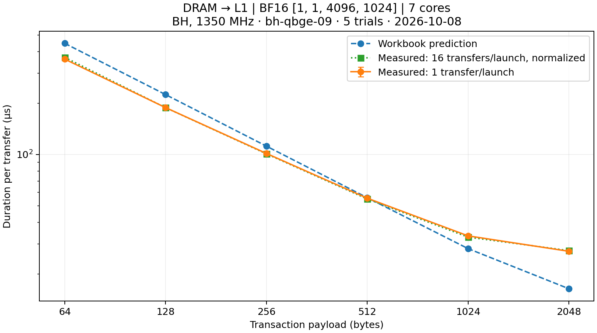
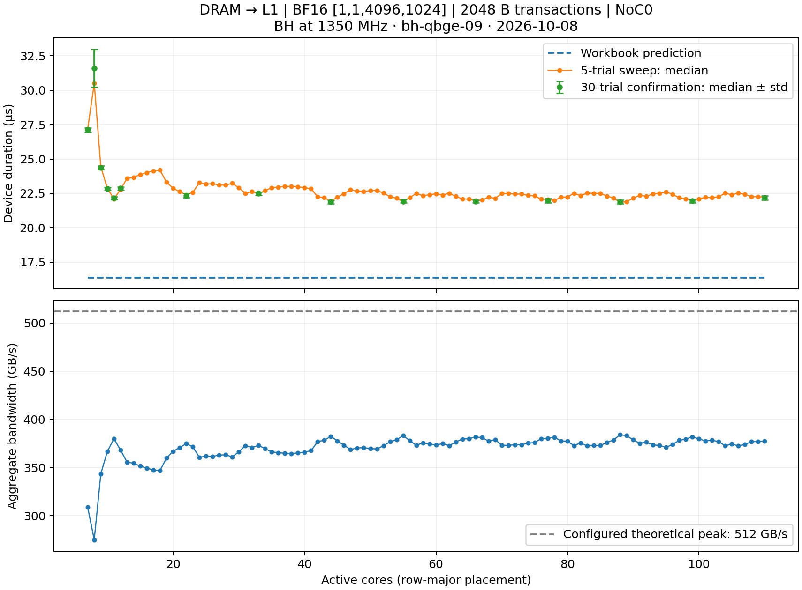

# DRAM → resident L1: transaction-size sweep

**Difficulty:** ⭐ T1 · **Concept:** NoC read transaction payload size.

**First profiled on:** `bh-qbge-09-special-dstoiljkovic-for-reservation-117054` · Blackhole · 1350 MHz · 2026-10-08 · git `20d0afc3fdfaf84f98548d61dc81d708ddd35316` (local example additions).

Reading order: [catalog](../master.md) → this README → [inline kernel](program_descriptor_with_inline_kernels.py).

## The problem

A tensor needs to move from interleaved DRAM into resident L1 shards. The full destination already fits in L1. How much does splitting rows into small read transactions cost, and does a bandwidth-based prediction describe the real kernel?

## What this isolates

Only transaction payload size changes. Shape, input values, row-to-bank mapping, core count, core placement, reader processor, NoC assignment, L1 footprint, and barrier policy stay fixed. There is no compute, pack/unpack, DRAM write, intermediate buffer, or partial-result consumer.

Each core reads its complete shard into final L1 offsets, then performs **one final read barrier**. For repeated transfers, that barrier also prevents reusing the destination before the preceding transfer completes. Issuing all requests before a barrier does not imply that all requests are simultaneously outstanding: the read API applies command-buffer backpressure.

The workload is BF16 `[1, 1, 4096, 1024]` (8 MiB), flattened to 4096 × 1024 row-major elements. One 2048-byte row is one interleaved DRAM page. Seven logical cores `(0,0)` through `(6,0)` execute on NCRISC, with the runtime-preferred DRAM-read NoC on every core, selected through `ReaderConfigDescriptor()` (NoC0 in this build).

Core 0 reads 586 rows; the other six read 585 rows each. The tensor allocator uses uniform 586-row shard capacity: **1,200,128 bytes/core**. Each short shard has one unused row. All actual data is verified exactly, and the unused rows are checked against their initial sentinel. No padding row is read from DRAM.

## Methods

`VARIANTS` contains `txn_64` (baseline), `txn_128`, `txn_256`, `txn_512`, `txn_1024`, `txn_2048`, `txn_4096`, `txn_8192`, and `txn_16384`. Each compiles a distinct payload size into the same reader loop. By default, only payloads dividing the stored row size are selected. The kernel statically enforces the architecture's maximum NoC burst size.

For the default 2048-byte row, the first six variants are valid. A larger read would cross a row/bank-page boundary. Larger-payload checks therefore use a separate wider-row shape and are not compared against the default shape's predictions.

## Measured result

Fixed seven-core placement above; **DEVICE KERNEL DURATION [ns]**, converted to microseconds. Five trials, median; first measured launch discarded; exact correctness passed for every variant. The 16-iteration column is normalized per transfer. All numbers have the box/architecture stamp above.

| Transaction B | Requests on largest core | Model µs | Device µs, 1 iteration | Std µs | Device µs, 16 iterations / 16 | Useful GB/s, 1 iteration |
|---:|---:|---:|---:|---:|---:|---:|
| 64 | 18,752 | 447.809 | 361.958 | 0.023 | 370.776 | 23.18 |
| 128 | 9,376 | 224.449 | 188.311 | 0.015 | 188.226 | 44.55 |
| 256 | 4,688 | 112.015 | 101.512 | 0.027 | 100.967 | 82.64 |
| 512 | 2,344 | 55.898 | 55.529 | 0.045 | 54.950 | 151.07 |
| 1024 | 1,172 | 28.144 | 33.416 | 0.017 | 32.846 | 251.04 |
| 2048 | 586 | 16.384 | 27.144 | 0.120 | 27.401 | 309.04 |



Using the runtime-preferred read NoC on all cores reduces the 2048-byte result from the earlier alternating-NoC **43.321 us** to **27.144 us**, or **309.04 GB/s**. All six variants pass exact correctness again. The earlier results remain in `report.md`, `alternating_report.json`, and `alternating_steady_state.json`.

The current 2048-byte variant is **334,814 ns faster (13.33×)** than the 64-byte variant on this placement. The model still predicts 16.384 us, making its best-case duration about **1.66× too optimistic**. The 16-iteration control measures **27.401 us/transfer**. Neither the old ~194 GB/s result nor the new ~309 GB/s result is a universal hardware ceiling.

The default read-NoC preference is enforced structurally through one reader descriptor spanning every active core; there is no alternating-NoC branch or CLI override. The test asserts that all kernel descriptors use that reader configuration. The runtime chooses the architecture-specific preference. This is separate from optimizing worker placement for DRAM banks, which this example does not do.

Timing includes kernel entry/exit, address generation, request issue, backpressure, contention, and final completion. Host allocation, H2D initialization, D2H correctness checks, and Python dispatch time are outside the measured interval. Profiler instrumentation is enabled. Reported standard deviation describes these five trials, not reproducibility across boots or placements.

The authoritative samples and model snapshot are in [report.json](report.json), [steady_state.json](steady_state.json), and the appendable [report.md](report.md). Performance is never a pass/fail threshold.

## Core-count sweep with preferred read NoC0

Same BH box, 1350 MHz, 2026-10-08; same 8 MiB BF16 tensor and 2048-byte payload. We swept **every count from 7 through 110** with five trials. Counts below seven exceed the model's L1 budget; the current runtime exposes an **11×10 worker grid**, so counts 111–120 cannot be tested in this session. Each count uses the first N logical cores in row-major order. Preferred read NoC0 and one final barrier per core remain fixed.

Every count passed exact data and untouched-padding checks. The first sweep's lowest median was 21.847 µs at 88 cores. We then repeated 15 selected counts with 30 trials each:

| Cores | Model µs | Measured µs, 30-trial median | Std µs | GB/s |
|---:|---:|---:|---:|---:|
| 7 | 16.384 | 27.121 | 0.153 | 309.30 |
| 8 | 16.384 | 31.603 | 1.385 | 265.44 |
| 9 | 16.384 | 24.373 | 0.138 | 344.18 |
| 10 | 16.384 | 22.839 | 0.113 | 367.29 |
| 11 | 16.384 | **22.150** | 0.106 | **378.73** |
| 12 | 16.384 | 22.862 | 0.124 | 366.92 |
| 22 | 16.384 | 22.332 | 0.153 | 375.63 |
| 44 | 16.384 | **21.875** | 0.129 | **383.48** |
| 55 | 16.384 | 21.931 | 0.125 | 382.51 |
| 88 | 16.384 | 21.899 | 0.137 | 383.07 |
| 110 | 16.384 | 22.181 | 0.147 | 378.20 |



The best confirmed sampled median is at 44 cores, but the 44- and 88-core medians differ by only 0.024 µs, less than trial variation. This is a throughput plateau, not evidence of a unique optimum. Eleven cores are only **1.25% slower than the lowest confirmed median**, making them a useful low-core-count candidate. At 44 cores, measured time remains **33.5% above** the unchanged 16.384 µs prediction, at about **74.9%** of the configured 512 GB/s theoretical peak.

Changing count also changes the occupied row-major core set, shard sizes, and start-bank phases. This sweep does not separate those effects or optimize placement. The non-monotonic eight-core result had over 3% relative standard deviation in confirmation; raw samples are retained without a performance assertion.

Full results: [five-trial sweep](core_sweep.md), [30-trial confirmation](core_sweep_confirmation.md), and their adjacent JSON files (all samples, coordinates, allocation footprints, model predictions). Kernel source and runtime NoC policy are identical across counts.

```bash
# case.json must include core_predictions: [{cores, transaction_bytes: 2048, expected_us, ...}, ...].
python_env/bin/python -m ttnn.operations.examples.dram_l1_transaction_size \
  --sweep-cores all --model-json case.json --trials 5 --report core_sweep.md

python_env/bin/python -m ttnn.operations.examples.dram_l1_transaction_size \
  --sweep-cores 7 8 9 10 11 12 22 33 44 55 66 77 88 99 110 \
  --model-json case.json --trials 30 --report core_sweep_confirmation.md
```

`--sweep-cores` fixes transaction size to 2048 bytes and requires a matching model snapshot. It can take `all` or explicit counts. The device grid bounds the scan; unavailable counts are recorded separately. The ordinary transaction-size benchmark is unchanged.

## CLI

```bash
# Default shape, valid transaction sizes, one measured trial.
python_env/bin/python -m ttnn.operations.examples.dram_l1_transaction_size

# Fixed-shape comparison with an exported model snapshot; five measured trials.
python_env/bin/python -m ttnn.operations.examples.dram_l1_transaction_size \
  --model-json case.json --trials 5 --report measured.md

# Repeat transfers inside the kernel to assess sustained throughput.
python_env/bin/python -m ttnn.operations.examples.dram_l1_transaction_size \
  --model-json case.json --trials 5 --kernel-iters 16 --report steady.md

# Wider rows permit 16 KiB transactions; also exercises unequal shard sizes.
python_env/bin/python -m ttnn.operations.examples.dram_l1_transaction_size \
  --shape 1 1 17 32768 --cores 7 \
  --variant txn_64 txn_2048 txn_8192 txn_16384 --kernel-iters 2
```

| Flag | Default | Meaning |
|---|---|---|
| `--variant` | `all` | Valid row-dividing payloads, or explicitly named variants |
| `--shape N C H W` | `1 1 4096 1024` | BF16 shape; flatten N×C×H into rows |
| `--cores` | `7` | Row-major core placement; at least one row per core |
| `--trials` | `1` | Measured launches per variant after discarded warmup |
| `--kernel-iters` | `1` | Full transfers per launch; normalize duration by this count |
| `--model-json` | none | Snapshot supplying shape, cores, and expected times |
| `--report` | local `report.md` | Append report and save latest samples as adjacent `.json` |

Rows must be 64-byte aligned in this example, the destination must fit available L1, and the requested payload must be supported by the device. A snapshot must match the requested shape/core count; the runner rejects mismatches. See `report.json`'s `model` field for the snapshot format. A single-trial run cannot estimate timing variability.

The CLI runs the safe pytest wrapper. To invoke the test directly:

```bash
TT_METAL_DEVICE_PROFILER=1 TT_METAL_PROFILER_MID_RUN_DUMP=1 \
TT_METAL_PROFILER_CPP_POST_PROCESS=1 TT_METAL_LOGGER_LEVEL=error \
scripts/run_safe_pytest.sh --no-precompile \
  tests/ttnn/unit_tests/operations/examples/test_dram_l1_transaction_size.py -s -q
```

## Issue-loop and final-barrier profiling

Named device zones are available through `--zones`; add `--profile` for an actual Tracy capture.
On the same BH host at 1350 MHz, the selected seven-core trial's longest core spent
**23.046 µs issuing reads** (including possible command-buffer waits) and **4.261 µs waiting
at the final barrier**, for **27.415 µs** local kernel time. Earlier reads overlap issuance.
The 44-core comparison reaches **21.933 µs** whole-program time. Exact correctness passes;
fresh controls show no material change from the instrumentation at this measurement precision.

See the [per-core timeline and Tracy analysis](zone_report.md), including scope limitations,
raw-capture locations and commands. These are measured regions, not independently additive
DRAM, routing and instruction costs.

## TT-NPE congestion replay

[Captured traffic, modeled congestion, link-demand map and limitations](npe_report.md).
For the 44-core captured issue schedule, the eight-bank Blackhole model estimates
23.516 µs with contention versus 18.224 µs without it. These are trace-replay results,
not independent predictions of the uninstrumented kernel. The seven-core event capture
has substantial overhead; the report explains why its zero completion-time delta does
not demonstrate zero hardware congestion. Upstream model bandwidths remain separate
from spreadsheet hardware specifications.
