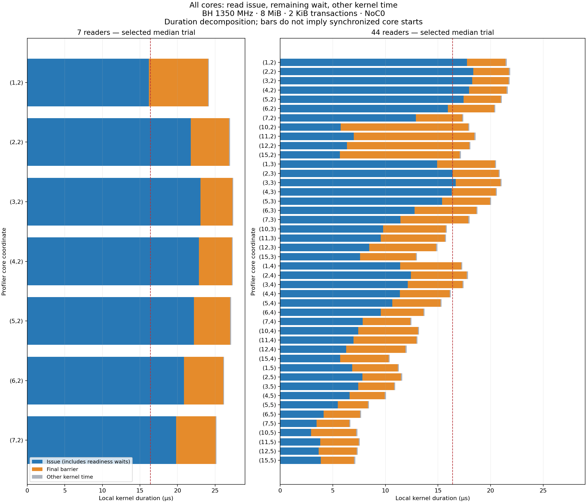

# All captured read durations

Existing Tracy captures, 2026-10-08, BH at 1350 MHz; 8 MiB BF16, 2048-byte reads on preferred NoC0. No new device run. All 153 core executions in the three measured trials per configuration were checked. Correctness and warmup launches are excluded.

Bars show summed local durations, not a globally synchronized timeline. Each timestamp difference is within one core. Coordinates are those recorded by the profiler.

## Whole-program measurements

| Readers | Trial | Selected | Kernel µs | Firmware µs | First-to-last kernel start µs | Host call µs |
|---:|---:|:---:|---:|---:|---:|---:|
| 7 | 1 |  | 27.469 | 27.884 | 0.117 | 3.467 |
| 7 | 2 | yes | 27.415 | 27.844 | 0.092 | 3.266 |
| 7 | 3 |  | 27.122 | 27.550 | 0.112 | 2.515 |
| 44 | 1 | yes | 21.933 | 22.379 | 0.167 | 4.959 |
| 44 | 2 |  | 22.120 | 22.584 | 0.174 | 4.218 |
| 44 | 3 |  | 21.883 | 22.324 | 0.184 | 3.447 |

Firmware and kernel spans overlap; do not add them. Host API-call duration is a separate host-side measurement, not transfer time or end-to-end latency. The start spread is the profiler-reported metric, not a subtraction of raw cross-core clocks.

## 7 readers: every core in the selected median trial

| Core | Issue µs | Barrier µs | Other kernel µs | Kernel µs | NCRISC firmware µs | BRISC firmware µs |
|---|---:|---:|---:|---:|---:|---:|
| (1,2) | 16.190 | 7.881 | 0.111 | 24.181 | 24.416 | 24.624 |
| (2,2) | 21.761 | 5.114 | 0.109 | 26.984 | 27.218 | 27.407 |
| (3,2) | 23.046 | 4.261 | 0.107 | 27.415 | 27.643 | 27.841 |
| (4,2) | 22.858 | 4.379 | 0.111 | 27.348 | 27.581 | 27.787 |
| (5,2) | 22.193 | 4.818 | 0.113 | 27.123 | 27.356 | 27.553 |
| (6,2) | 20.864 | 5.221 | 0.107 | 26.192 | 26.433 | 26.636 |
| (7,2) | 19.827 | 5.262 | 0.109 | 25.198 | 25.441 | 25.644 |

### 7 readers: smallest boundary durations (all measured cores/trials)

| Region | Min µs | Median µs | Max µs |
|---|---:|---:|---:|
| fw_before_kernel | 0.202222 | 0.206667 | 0.217778 |
| kernel_before_total | 0.036296 | 0.036296 | 0.037778 |
| total_before_issue | 0.015556 | 0.016296 | 0.017778 |
| between_issue_barrier | 0.019259 | 0.019259 | 0.021481 |
| total_after_barrier | 0.020000 | 0.020000 | 0.022222 |
| kernel_after_total | 0.016296 | 0.016296 | 0.017037 |
| fw_after_kernel | 0.025926 | 0.025926 | 0.028148 |
| other_kernel | 0.107407 | 0.108889 | 0.112593 |

## 44 readers: every core in the selected median trial

| Core | Issue µs | Barrier µs | Other kernel µs | Kernel µs | NCRISC firmware µs | BRISC firmware µs |
|---|---:|---:|---:|---:|---:|---:|
| (1,2) | 17.766 | 3.662 | 0.112 | 21.540 | 21.793 | 22.001 |
| (2,2) | 18.348 | 3.407 | 0.109 | 21.864 | 22.108 | 22.301 |
| (3,2) | 18.266 | 3.449 | 0.109 | 21.824 | 22.067 | 22.262 |
| (4,2) | 17.947 | 3.579 | 0.110 | 21.636 | 21.869 | 22.056 |
| (5,2) | 17.433 | 3.540 | 0.108 | 21.081 | 21.314 | 21.506 |
| (6,2) | 15.941 | 4.396 | 0.109 | 20.447 | 20.679 | 20.867 |
| (7,2) | 12.890 | 4.410 | 0.109 | 17.409 | 17.645 | 17.834 |
| (10,2) | 5.761 | 12.119 | 0.108 | 17.988 | 18.229 | 18.428 |
| (11,2) | 6.985 | 11.479 | 0.108 | 18.573 | 18.817 | 19.012 |
| (12,2) | 6.354 | 11.621 | 0.108 | 18.083 | 18.314 | 18.500 |
| (15,2) | 5.673 | 11.396 | 0.107 | 17.176 | 17.409 | 17.601 |
| (1,3) | 14.912 | 5.504 | 0.109 | 20.525 | 20.793 | 20.983 |
| (2,3) | 16.379 | 4.397 | 0.107 | 20.883 | 21.166 | 21.360 |
| (3,3) | 16.676 | 4.267 | 0.109 | 21.051 | 21.330 | 21.519 |
| (4,3) | 16.309 | 4.189 | 0.110 | 20.607 | 20.862 | 21.050 |
| (5,3) | 15.393 | 4.559 | 0.107 | 20.059 | 20.301 | 20.488 |
| (6,3) | 12.781 | 5.863 | 0.111 | 18.755 | 18.987 | 19.176 |
| (7,3) | 11.430 | 6.465 | 0.107 | 18.002 | 18.244 | 18.438 |
| (10,3) | 9.788 | 5.944 | 0.108 | 15.840 | 16.075 | 16.264 |
| (11,3) | 9.561 | 6.094 | 0.109 | 15.764 | 16.004 | 16.196 |
| (12,3) | 8.479 | 6.353 | 0.109 | 14.940 | 15.170 | 15.358 |
| (15,3) | 7.600 | 5.297 | 0.110 | 13.007 | 13.241 | 13.429 |
| (1,4) | 11.396 | 5.801 | 0.110 | 17.307 | 17.679 | 17.868 |
| (2,4) | 12.421 | 5.316 | 0.109 | 17.847 | 18.201 | 18.393 |
| (3,4) | 12.126 | 5.199 | 0.109 | 17.434 | 17.759 | 17.948 |
| (4,4) | 11.370 | 4.742 | 0.110 | 16.223 | 16.554 | 16.740 |
| (5,4) | 10.648 | 4.592 | 0.109 | 15.349 | 15.657 | 15.844 |
| (6,4) | 9.553 | 4.067 | 0.110 | 13.729 | 14.020 | 14.208 |
| (7,4) | 7.848 | 4.529 | 0.109 | 12.486 | 12.762 | 12.954 |
| (10,4) | 7.420 | 5.677 | 0.108 | 13.205 | 13.440 | 13.627 |
| (11,4) | 6.970 | 5.970 | 0.107 | 13.047 | 13.288 | 13.481 |
| (12,4) | 6.284 | 5.629 | 0.109 | 12.021 | 12.255 | 12.444 |
| (15,4) | 5.694 | 4.610 | 0.107 | 10.412 | 10.656 | 10.849 |
| (1,5) | 6.851 | 4.321 | 0.108 | 11.281 | 11.624 | 11.813 |
| (2,5) | 7.831 | 3.652 | 0.110 | 11.593 | 11.913 | 12.100 |
| (3,5) | 7.424 | 3.413 | 0.108 | 10.945 | 11.265 | 11.454 |
| (4,5) | 6.607 | 3.336 | 0.110 | 10.053 | 10.348 | 10.535 |
| (5,5) | 5.470 | 2.862 | 0.109 | 8.441 | 8.724 | 8.920 |
| (6,5) | 4.130 | 3.462 | 0.108 | 7.700 | 7.983 | 8.170 |
| (7,5) | 3.456 | 3.119 | 0.107 | 6.682 | 6.961 | 7.156 |
| (10,5) | 2.939 | 4.290 | 0.107 | 7.336 | 7.573 | 7.761 |
| (11,5) | 3.818 | 3.646 | 0.108 | 7.572 | 7.804 | 7.993 |
| (12,5) | 3.671 | 3.592 | 0.107 | 7.370 | 7.604 | 7.796 |
| (15,5) | 3.867 | 3.159 | 0.110 | 7.136 | 7.370 | 7.561 |

### 44 readers: smallest boundary durations (all measured cores/trials)

| Region | Min µs | Median µs | Max µs |
|---|---:|---:|---:|
| fw_before_kernel | 0.202222 | 0.215185 | 0.342963 |
| kernel_before_total | 0.035556 | 0.037037 | 0.040741 |
| total_before_issue | 0.015556 | 0.016296 | 0.017037 |
| between_issue_barrier | 0.019259 | 0.019259 | 0.022963 |
| total_after_barrier | 0.020000 | 0.020000 | 0.022963 |
| kernel_after_total | 0.016296 | 0.016296 | 0.017037 |
| fw_after_kernel | 0.025185 | 0.025926 | 0.034074 |
| other_kernel | 0.107407 | 0.108889 | 0.112593 |

## Interpretation

The issue and barrier split varies substantially by core. The core with the longest barrier is not necessarily the slowest core: time spent waiting for completions can shift between command-buffer backpressure during issuance and the final barrier. A barrier-only ranking would misidentify the critical path.

BRISC firmware is a surrounding control span, not an additional payload stage to add to NCRISC. There is no compute, unpack, pack or DRAM-write stage in this kernel. Tiny inter-zone gaps include marker overhead and control instructions; they cannot be interpreted as isolated hardware latency.

These captures do not separate address generation, command-register programming, command-buffer stalls, DRAM service, or per-link congestion inside the issue region. No duration for those components can be extracted independently from the current scopes. Other transaction sizes and core counts are not in these two Tracy captures.

[All cores and all trials CSV](all_core_durations.csv) · [Whole-program CSV](program_durations.csv). Reproduce the extraction with `python_env/bin/python tools/data_movement_perf/analyze_all_read_durations.py`.
