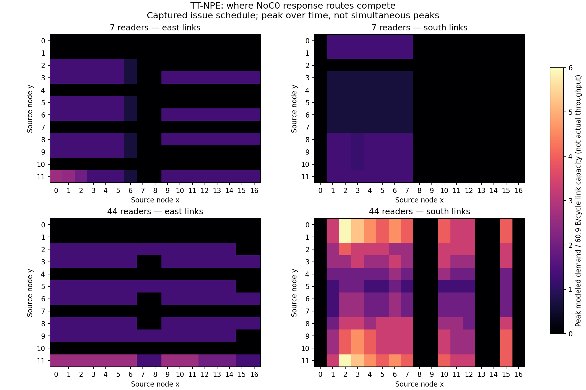

# TT-NPE replay: DRAM-to-L1 congestion

BH, 1350 MHz; 2026-10-08; host bh-qbge-09-special-dstoiljkovic-for-reservation-117054.
Workload: 8 MiB BF16, 4096 reads of 2048 B, preferred NoC0, one final barrier/core.
TT-NPE commit `6967ce36b99c179742114107ca7da8aca722dad2`, built locally under `/localdev/dstoiljkovic/tt-npe`.
No spreadsheet parameters were changed.

## Replay results

| Readers | Baseline µs (three-trial median) | NoC event capture µs (one trial) | NPE congestion on µs | NPE congestion off µs | Replay delta µs |
|---:|---:|---:|---:|---:|---:|
| 7 | 27.415 | 34.338 | 34.199 | 34.199 | 0.000 |
| 44 | 21.933 | 22.263 | 23.516 | 18.224 | 5.292 |

Both NoC-capture runs passed exact data and padding checks. Each retained measured trace has
4096 READ records, all on NoC0, totaling exactly 8,388,608 B. Each of the eight DRAM endpoints
supplies 512 reads (1 MiB). Captures include the actual reader coordinates and timestamps.

**44 readers:** enabling TT-NPE's contention model adds 5.292 µs to completion for the same
recorded issue schedule (22.5% of the modeled congested duration). This is simulated additional
contention, not a measured division of all hardware stall cycles. Modeled contention includes
source/sink NIU demand as well as shared NoC links, so the delta is not exclusively router-link cost.
The modeled 23.516 µs is 5.6% above the 22.263 µs instrumented capture.

**7 readers:** both modes finish at 34.199 µs. This does **not** prove that the actual seven-core
kernel has no congestion. The captured issuance schedule already includes hardware stalls and
instrumentation delay. The seven-core trace also contains 28 PROFILER-NOC-QUICK-PUSH zones
(four per core), while the 44-core trace has none. NoC event recording increases the seven-core
runtime from 27.415 to 34.338 µs. The replay's final completion is schedule-limited even though
it reports overloaded resources during portions of execution.

The simulator adds modeled read latency to the captured issue timestamps, reverses READ source
and destination to represent response payloads, and routes those payloads. Turning congestion
off does not remove delay already baked into the input timestamps. Neither result is an independent
prediction of the uninstrumented kernel. The no-congestion replay can exceed modeled resource
capacity and should not be treated as an achievable hardware runtime.

## Where traffic competes



Cells identify the source node of an eastward or southward NoC0 link. Ratios above one mean
summed modeled demand exceeds the configured link capacity. These are peak demand ratios,
not delivered bandwidth, measured hardware utilization, or peaks occurring at the same instant.
Coordinates in the diagram are (x,y); TT-NPE's raw arrays use (device,y,x,direction).

For 44 readers, southward links (2,11)→(2,0), (2,0)→(2,1), and (2,1)→(2,2) reach
360 B/cycle of modeled demand against a 60.9 B/cycle modeled capacity (5.91×). These are shared
response paths around the torus boundary. For seven readers, the eastward link (0,11)→(1,11)
peaks at 160 B/cycle (2.63×). Whole-chip average utilization would hide these local peaks.
Equal aggregate bytes per bank therefore does not imply contention-free routes or equal completion.

## Model inputs and limits

The generic `blackhole`/`P100` preset assumes seven DRAM controllers. The capture uses eight, so
these results use TT-NPE's **P150 eight-bank Blackhole preset** as a single-chip geometry model;
this is not a claim that the physical board is P150. Physical board topology files were retained
but this workload has no multichip traffic.

Upstream model values, unchanged:

- 17×12 NoC grid and directional torus routes: NoC0 east then south.
- 1.35 GHz model clock, matching the capture.
- Link bandwidth 60.9 B/cycle, rather than the ideal hardware flit rate of 64 B/cycle.
- DRAM source rate 54 GB/s per controller (40 B/cycle), totaling **432 GB/s** for eight controllers,
  rather than the spreadsheet's 512 GB/s theoretical peak.
- Worker source/sink rate 60.9 B/cycle.
- Transaction-bandwidth curve includes 57.7 B/cycle at 2048 B.
- Read latency uses fixed 65/177/217/329-cycle values according to coordinate relationship.

Those are upstream model parameters, not newly measured hardware constants. The 54 GB/s
value and bandwidth curve have not been independently justified for this board. They are not
silently copied into Excel. TT-NPE's DRAM utilization is normalized against its own capacity;
it must not be compared directly with percentage of the 512 GB/s spec.

Reducing simulation timestep from 32 to 16 cycles leaves the seven-core result unchanged and
changes the 44-core result from 23.516 to 23.664 µs (0.63%). That numerical sensitivity is small
compared with the modeled contention delta, but model assumptions and capture overhead remain.

## Reproduce and artifacts

Safe device capture (change 7 to 44 for the other configuration):

```bash
mkdir -p generated/dram_l1_npe/c7
TT_METAL_DEVICE_PROFILER_NOC_EVENTS=1 \
TT_METAL_DEVICE_PROFILER_NOC_EVENTS_RPT_PATH="$PWD/generated/dram_l1_npe/c7" \
python_env/bin/python -m ttnn.operations.examples.dram_l1_transaction_size \
  --variant txn_2048 --cores 7 --trials 1 --zones \
  --report generated/dram_l1_npe/c7_capture.md

PYTHONPATH=/localdev/dstoiljkovic/tt-npe/install/lib:$PYTHONPATH \
python_env/bin/python tools/data_movement_perf/run_tt_npe_read_analysis.py --cores 7 --mode fast
# Repeat with --mode none, and --cores 44. --step 16 checks timestep sensitivity.
python_env/bin/python tools/data_movement_perf/summarize_tt_npe_reads.py
```

`generated/dram_l1_npe/c7/` and `c44/` retain all raw traces and device topology. Run host ID3072
is the measured launch, following correctness and warmup launches. `c*_fast_32_timeline.json`
contains TT-NPE's visualizer timeline and per-step demand; `c*_{fast,none}_32.json` contains results.
Initial runs with the incorrect seven-bank preset are archived under `initial_seven_bank_preset/`
and excluded from the reported comparison. Local JSON and CSV summary files accompany this report.

Sources: [TT-NPE](https://github.com/tenstorrent/tt-npe),
[pinned BH model](https://github.com/tenstorrent/tt-npe/blob/6967ce36b99c179742114107ca7da8aca722dad2/tt_npe/cpp/include/device_models/blackhole.hpp),
[preset selection](https://github.com/tenstorrent/tt-npe/blob/6967ce36b99c179742114107ca7da8aca722dad2/tt_npe/cpp/include/npeDeviceModelFactory.hpp),
[trace ingestion](https://github.com/tenstorrent/tt-npe/blob/6967ce36b99c179742114107ca7da8aca722dad2/tt_npe/cpp/src/npeWorkloadIngest.cpp).
