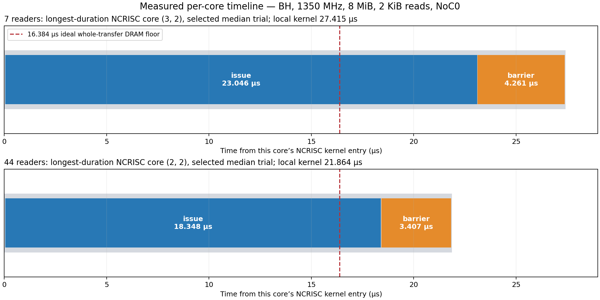

# DRAM to L1: Tracy issue/barrier analysis

BH host `bh-qbge-09-special-dstoiljkovic-for-reservation-117054`, 1350 MHz, 2026-10-08.
Git `20d0afc3fdfaf84f98548d61dc81d708ddd35316` plus local instrumentation.
BF16 [1,1,4096,1024], 8 MiB, 2048-byte transactions, NCRISC, preferred read NoC0,
row-major core placement, one final barrier/core, one transfer per launch.

## Observed timeline



The diagram uses elapsed time from **that core's NCRISC kernel entry**. It never subtracts
raw timestamps from different cores. Coordinates are the coordinates recorded by the device
profiler. The red line is the ideal **whole-transfer** 8 MiB / 512 GB/s floor, not a prediction
for an isolated shard. Gray slivers include entry/exit, inter-zone gaps and instrumentation.

| Reader count | Selected run host ID | Longest local core | Issue µs | Final barrier µs | Other µs | Local kernel µs | Whole program µs |
|---:|---:|---|---:|---:|---:|---:|---:|
| 7 | 4096 | (3, 2) | 23.046 | 4.261 | 0.107 | 27.415 | 27.415 |
| 44 | 3072 | (2, 2) | 18.348 | 3.407 | 0.109 | 21.864 | 21.933 |

The 7-core selected trial is the median of three measured launches. Its longest core was
still issuing reads at 16.384 µs; issuance ended at local time 23.098 µs, the final barrier
ended at 27.379 µs, and the kernel ended at 27.415 µs. Its issue duration plus final wait
plus 0.107 µs of other time accounts for the local kernel duration.

Reads are asynchronous. Earlier reads can traverse the NoC and write L1 **during** the issue
loop; the barrier measures only the unfinished tail after the last request is issued. These
scopes do not expose the first byte arrival or every packet's route. There is no measured
handshake/DRAM-service/link-wait breakdown in this capture. Do not add `D/512 GB/s` to the
issue duration and barrier duration: that would count overlapping work twice.

## Interpretation and model implications

1. `DM_READ_ISSUE` includes address generation, register programming and command-buffer
   readiness waits. It is elapsed occupancy, not a measurement of pure RISC instruction cost.
2. `DM_READ_BARRIER` measures waiting for all issued reads to complete. It does not measure
   all transfer time, since transfers are already progressing during issuance.
3. Seven cores have almost equal work (585/586 rows). In the selected trial their kernel
   durations range from 24.181 to 27.415 µs; max/median is 1.016. At 44 cores, work is also
   almost equal (93/94 rows), but durations range from 6.682 to 21.864 µs; max/median is
   1.364. Equal bytes do not imply equal service time for this placement and concurrent load.
4. The 16.384 µs calculation assumes that all eight banks sustain their theoretical aggregate
   bandwidth throughout the transfer. It omits constrained issuance, load-dependent service,
   uneven completion and final drain. The trace shows where time is spent, but does not
   isolate which DRAM controller, NoC link or queue produces the waits.
5. Do not turn the observed issue duration into a universal cycles/request constant. It
   includes backpressure and changes with core placement and concurrency. Separating active
   issue work from command-buffer stall time, then measuring per-bank/per-link traffic, is
   the next diagnostic step. No new unexplained efficiency factor was inserted into Excel.

## Instrumentation check

Three trials per configuration; first correctness launch and next warmup launch are excluded.
Each real transfer and all padding are checked exactly. Plain safe-pytest runs passed separately
from Tracy because the Tracy wrapper can mask pytest's exit status. Controls use the same
kernel and workload with the three additional named zones disabled; standard device profiling
remains enabled.

| Cores | Control median µs | Named zones + Tracy median µs | Difference |
|---:|---:|---:|---:|
| 7 | 27.464 | 27.415 | -0.18% |
| 44 | 21.928 | 21.933 | +0.02% |

These differences are within run variation; they do not establish zero instrumentation cost.
The seven-core zoned run without Tracy was 27.263 µs. The added zones cannot account for
an approximately 11 µs gap from the ideal floor.

The analyzer verified all 105 seven-core and 660 forty-four-core `DM_READ_*` events exported
from the actual `.tracy` captures against paired raw device markers, within 3 ns of rounding.
All expected zones are present and nested correctly. Only three optional zones execute per
core, far below the marker budget. Full per-core values are in [zone_analysis.json](zone_analysis.json).

## Reproduce

```bash
# Correctness plus control timing (no extra zones):
python_env/bin/python -m ttnn.operations.examples.dram_l1_transaction_size \
  --variant txn_2048 --cores 7 --trials 3 --report generated/dram_l1_zones/control.md

# Named device scopes, actual Tracy capture, safe device wrapper:
python_env/bin/python -m ttnn.operations.examples.dram_l1_transaction_size \
  --variant txn_2048 --cores 7 --trials 3 --zones --profile \
  --report generated/dram_l1_zones/profile.md
```

`--zones` adds `DM_READ_TOTAL`, `DM_READ_ISSUE` and `DM_READ_BARRIER`; omit it for the control.
`--profile` enables Tracy through the safe pytest wrapper. At most 32 kernel iterations are
allowed with zones enabled to stay within the marker budget. Capture artifacts must be copied
out of `generated/profiler/.logs` before another run overwrites them.

This session's retained raw captures and CSVs are in `generated/dram_l1_zones/`:
`c7.tracy`, `c44.tracy`, `c7_ops.csv`, `c44_ops.csv`, the matching `*_device.csv`,
`*_tracy_zones.csv`, and run JSON files. The analyzer is
`tools/data_movement_perf/analyze_read_zones.py`; its default input is that directory.

## Expanded timing breakdown

[Every core, all measured trials, firmware spans and inter-zone gaps](all_durations_report.md).
